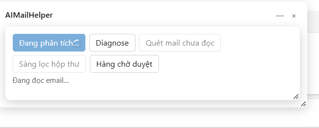
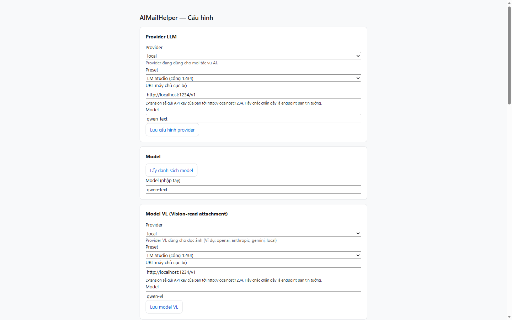
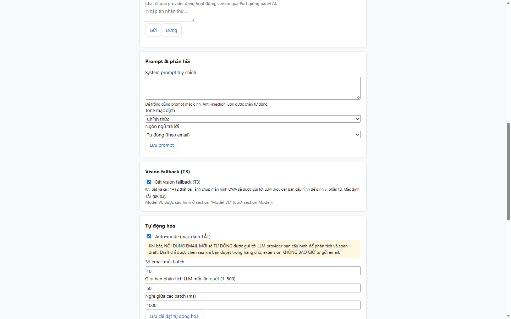
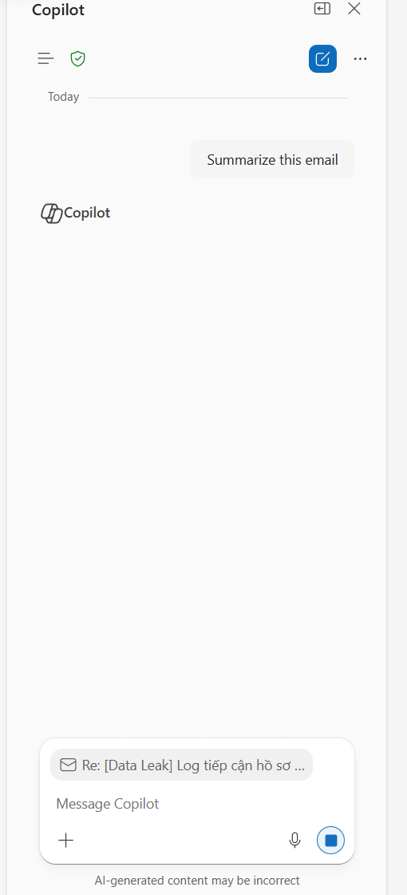

# AIMailHelper — Trợ lý AI cho Outlook Web

[](https://github.com/dnguyenminh/AIMailHelper/actions/workflows/ci.yml)
[](https://github.com/dnguyenminh/AIMailHelper/releases)


Browser extension **MV3** (Chrome / Edge) chạy trong **Outlook Web**, thêm trợ lý AI ngay cạnh email của bạn — **không server trung gian, không tự gửi email**, dữ liệu email chỉ đi tới dịch vụ AI **bạn tự cấu hình** (hỗ trợ cả AI chạy local với Ollama / LM Studio).



## Tính năng

| # | Tính năng | Làm gì cho bạn |
|---|-----------|----------------|
| 1 | **Phân tích email** | Tóm tắt email đang mở (giữ nguyên format heading/bullet của Copilot nếu dùng Copilot), chấm điểm mức độ quan trọng (nhãn màu), ý định, việc cần làm, hạn chót, cảm xúc |
| 2 | **Soạn trả lời AI** | Bản nháp trả lời theo tone/ngôn ngữ bạn chọn → chèn vào khung Reply của Outlook — **bạn đọc, sửa và tự bấm Send** |
| 3 | **Triage hộp thư** | Quét danh sách inbox đang hiển thị, chấm điểm ưu tiên, gom bảng **Digest** kèm lý do từng email (có cache — quét lại không tốn token) |
| 4 | **Auto-mode (tùy chọn, mặc định TẮT)** | Tự phân tích email mới đến → nháp đưa vào **hàng chờ duyệt** — bạn duyệt thì mới chèn vào Reply |
| 5 | **Tích hợp Copilot Outlook** (mới 1.1.10) | Có Copilot side panel của Outlook? Extension dùng luôn Copilot (không cần API key) — hiển thị lời Copilot **nguyên văn, giữ format**; không có Copilot → fallback sang LLM bạn cấu hình |

> 🔒 **Nguyên tắc số 1: extension KHÔNG BAO GIỜ tự gửi email.** Không tồn tại code bấm nút Send (kiểm chứng bằng audit tự động mỗi lần build). Chi tiết: [UG.md § 1.3](documents/AIMH-LOCAL/UG.md).

## Cài đặt

### Cách 1 — Tải bản đóng gói từ Release (khuyên dùng)

1. Mở tab [**Releases**](https://github.com/dnguyenminh/AIMailHelper/releases) → tải `AIMailHelper-v1.1.10.zip` → **giải nén**.
2. Mở `edge://extensions` (hoặc `chrome://extensions`) → bật **Developer mode**.
3. Bấm **Load unpacked / Tải tiện ích đã giải nén** → chọn thư mục **`dist/`** (thư mục chứa `manifest.json`).
4. Ghim icon extension ra thanh công cụ → mở [Outlook Web](https://outlook.office.com) → panel **AIMailHelper** hiện cạnh email.

### Cách 2 — Build từ mã nguồn

```bash
npm ci
npm run build      # output: dist/
```

Rồi làm bước 2-3 như trên với thư mục `dist/`.

## Cấu hình nhanh (2 phút)

Bấm icon extension → **Mở Options**:



1. **Provider LLM** — chọn 1 trong 6: `openai` · `azure` · `anthropic` · `gemini` · `openai-compatible` (OpenRouter/vLLM…) · `local` (Ollama port 11434 / LM Studio port 1234 — miễn phí, dữ liệu không rời máy).
2. Điền **API key** (+ model) → **Lưu cấu hình provider**. Với `openai-compatible`/`local`, trình duyệt hỏi quyền truy cập địa chỉ → chọn **Allow**.
3. **Kiểm tra kết nối** → dòng xanh `✓ OK (…ms)` là sẵn sàng.



4. *(Tùy chọn)* **Chat thử (streaming)** — gõ vài chữ, bấm **Gửi**, phản hồi hiện dần từng chữ.

## Sử dụng hàng ngày

1. Mở email trong Outlook Web → panel **AIMailHelper** → **Đang phân tích…**
2. Kết quả: **Tóm tắt** · **Mức độ quan trọng** (nhãn màu + điểm /100) · **Ý định** · **Hành động cần làm** · **Hạn chót** · **Cảm xúc**.
3. **Soạn trả lời AI**: chọn tone (Chính thức / Thân mật / Ngắn gọn) + ngôn ngữ + hướng dẫn thêm → **Soạn trả lời** → **Chèn vào Reply** → đọc lại → **tự bấm Send**.

Hướng dẫn đầy đủ từng bước (kèm xử lý 16 mã lỗi, cấu hình Ollama/LM Studio, auto-mode, bảo mật): **[documents/AIMH-LOCAL/UG.md](documents/AIMH-LOCAL/UG.md)**.

## Tích hợp Copilot Outlook (1.1.10)

Nếu tài khoản OWA của bạn có **Copilot side panel**, extension tự dùng Copilot: bấm **AI phân tích** → trigger "Summarize this email" (hoặc chip trong panel) → đọc lời Copilot **nguyên văn, giữ format heading/bullet/link** → hiển thị trong panel AIMailHelper. Không có Copilot → tự fallback sang LLM bạn cấu hình.



## Bảo mật & riêng tư

- 🔑 **API key** lưu trong `chrome.storage` của chính trình duyệt — không có server trung gian; chọn **"Chỉ lưu máy này"** để key không rời máy.
- 📧 **Nội dung email** chỉ gửi tới endpoint LLM bạn cấu hình. Không telemetry, không analytics, không remote code.
- 🚫 **Không tự gửi email** — audit tự động quét toàn bộ mã nguồn mỗi lần build.
- Chi tiết đầy đủ: UG.md mục 8 · SECURITY-REVIEW.md.

## Phát triển

```bash
npm ci              # cài dependencies
npm run dev         # dev server (Vite + CRXJS, hot-reload)
npm test            # Vitest — 466 test
npm run typecheck   # tsc --noEmit
npm run lint        # ESLint
npm run build       # build production → dist/
```

### Phát hành phiên bản mới

Version đặt ở **2 chỗ** (phải khớp nhau — Release workflow tự kiểm tra): `package.json` + `manifest.config.ts`.

```bash
# 1. bump version (vd 1.1.11) trong package.json + manifest.config.ts
# 2. commit + tag — Release workflow tự build, test, đóng gói zip, tạo GitHub Release
git tag v1.1.11
git push origin v1.1.11
```

### CI

Mỗi push/PR chạy **Typecheck → Lint → 466 tests → Build** ([.github/workflows/ci.yml](.github/workflows/ci.yml)). Release chạy thêm bước kiểm tra version khớp tag rồi đóng gói zip ([.github/workflows/release.yml](.github/workflows/release.yml)).

## Tài liệu

| Tài liệu | Nội dung |
|----------|----------|
| [UG.md](documents/AIMH-LOCAL/UG.md) | User Guide — cài đặt, cấu hình, sử dụng, 16 mã lỗi, FAQ, bảo mật |
| [BRD.md](documents/AIMH-LOCAL/BRD.md) | Yêu cầu nghiệp vụ |
| [FSD.md](documents/AIMH-LOCAL/FSD.md) | Đặc tả chức năng |
| [TDD.md](documents/AIMH-LOCAL/TDD.md) | Thiết kế kỹ thuật |
| [DPG.md](documents/AIMH-LOCAL/DPG.md) | Hướng dẫn triển khai/phát hành |
| [SECURITY-REVIEW.md](documents/AIMH-LOCAL/SECURITY-REVIEW.md) | Đánh giá bảo mật thiết kế |

## Yêu cầu hệ thống

- Chrome ≥ 114 hoặc Microsoft Edge (Chromium hiện tại)
- Tài khoản Outlook Web: `outlook.office.com` / `outlook.office365.com` / `outlook.live.com` / `outlook.cloud.microsoft`
- Dịch vụ AI: API key của 1 provider cloud, **hoặc** Ollama / LM Studio chạy local (không cần key)
