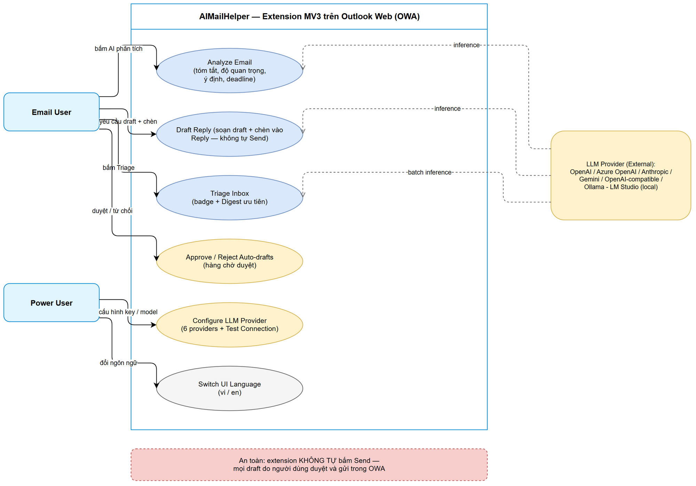
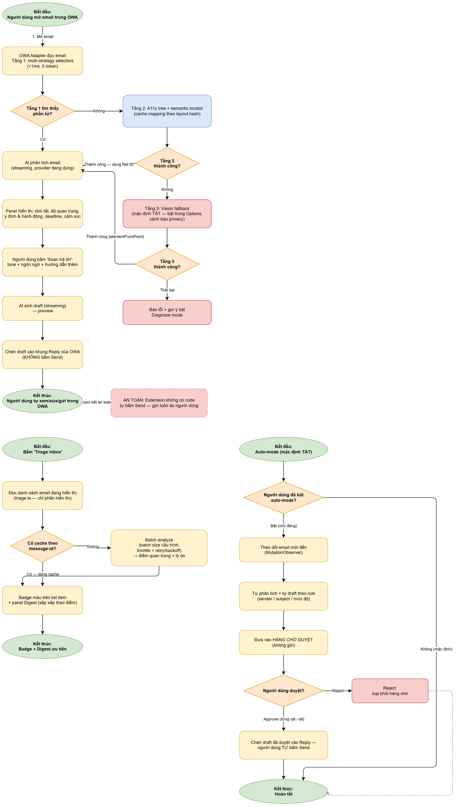

# Business Requirements Document (BRD)

## AIMailHelper — AIMH-LOCAL: Trợ lý AI cho Outlook Web (Browser Extension MV3)

> **Ghi chú nguồn (đọc trước):** BRD này là **placeholder offline**. Ticket AIMH-LOCAL không tồn tại trên Jira — Jira MCP không khả dụng trong phiên làm việc, nên không có ticket thật, không có linked tickets, không có attachments/comments. **Nguồn sự thật duy nhất của BRD này là PLAN.md** (root workspace, đã chốt scoping với user ngày 2026-10-13). Toàn bộ yêu cầu dưới đây bám 100% vào PLAN.md; không bịa thêm yêu cầu ngoài scope. Khi ticket Jira thật được tạo, BRD cần rà soát đối chiếu lại với ticket.

---

## Document Information

| Field | Value |
|-------|-------|
| Jira Ticket | AIMH-LOCAL (placeholder offline — chưa có ticket Jira thật) |
| Title | AIMailHelper — Browser Extension AI cho Outlook Web (MV3) |
| Author | BA Agent |
| Version | 1.0 |
| Date | 2026-10-14 |
| Status | Draft |
| Source of truth | PLAN.md (workspace root) — KHÔNG dùng Jira trong phiên này |

---

## Author Tracking

| Role | Name - Position | Responsibility |
|------|-----------------|----------------|
| Author | BA Agent – Business Analyst | Create document |
| Peer Reviewer | Product Owner (user đã chốt scoping trong PLAN.md) | Review & sign-off |

---

## Revision History

| Version | Date | Author | Changes |
|---------|------|--------|---------|
| 1.0 | 2026-10-14 | BA Agent | Khởi tạo BRD v1 từ PLAN.md — offline placeholder, không gọi Jira |

---

## Sign-Off

| Name | Signature and date |
|------|--------------------|
| Product Owner | ☐ I agree and confirm all criteria on this BRD as expected requirements |
| Tech Lead | ☐ I agree and confirm all criteria on this BRD as expected requirements |

---

## Executive Summary (Tóm tắt điều hành)

AIMailHelper là browser extension **Manifest V3 (Chrome + Edge)** chạy trên Outlook Web (OWA), mang 4 nhóm năng lực AI:

1. **Phân tích email** đang mở: tóm tắt, mức độ quan trọng/khẩn cấp, ý định & hành động cần làm, deadline, cảm xúc.
2. **Soạn draft trả lời**: AI sinh nội dung theo tone/ngôn ngữ người dùng chọn, điền vào khung Reply của Outlook — người dùng tự xem/sửa/gửi.
3. **Triage hộp thư**: quét danh sách inbox đang hiển thị, chấm điểm quan trọng, badge màu + bảng Digest ưu tiên.
4. **Auto-mode (tùy chọn, mặc định TẮT)**: tự draft trả lời hàng loạt đưa vào hàng chờ duyệt.

Người dùng tự cấu hình 1 trong **6 LLM provider** (OpenAI, Azure OpenAI, Anthropic, Gemini, OpenAI-compatible tùy chỉnh, Local Ollama/LM Studio). Extension đọc trực tiếp **DOM trang OWA** (KHÔNG dùng Microsoft Graph API) qua kiến trúc **self-healing 3 tầng**: selectors nhanh → semantic locator (a11y tree + cache theo layout hash) → vision fallback (mặc định TẮT). Triển khai **full 6 giai đoạn** (GĐ1 scaffold → GĐ6 auto-mode). Nguyên tắc an toàn xuyên suốt: **extension không bao giờ tự bấm Send**.

---

## 1. Introduction

### 1.1 Scope

Phạm vi đã chốt với user (PLAN.md mục 1–2):

- **Nền tảng:** Browser extension Manifest V3 trên **Chrome + Edge**; build bằng **Vite + @crxjs/vite-plugin**, TypeScript strict mode.
- **Cách truy cập email:** Đọc **DOM trang OWA** bằng content script — KHÔNG dùng Graph API, không backend riêng.
- **Domain hỗ trợ:** Cả tài khoản Work/School (outlook.office.com, outlook.office365.com) và cá nhân (outlook.live.com).
- **LLM providers (6):** OpenAI, Azure OpenAI, Anthropic, Gemini, OpenAI-compatible tùy chỉnh, Local LLM (Ollama/LM Studio preset) — gọi thuần fetch, streaming qua Port messaging.
- **Tính năng:** Phân tích email; soạn draft trả lời (chèn vào Reply, không tự gửi); triage inbox + Digest; auto-mode tùy chọn mặc định TẮT với hàng chờ duyệt; trang cấu hình LLM multi-provider có Test Connection; chọn nơi lưu API key (sync/local).
- **Self-healing 3 tầng** trong owa-adapter/ để thích ứng khi MS đổi UI OWA.
- **UI:** React 18 — options page, popup, panel AI inject vào OWA qua Shadow DOM.
- **Ngôn ngữ:** Song ngữ Việt/Anh (i18n có chuyển đổi trong Options).
- **Phạm vi lần đầu:** Full 6 giai đoạn (chi tiết tại mục 7).

### 1.2 Out of Scope

Các hạng mục bị loại rõ ràng khỏi CR này:

1. **Microsoft Graph API** hoặc bất kỳ truy cập email server-side nào — chỉ đọc DOM trang OWA.
2. **Tự động bấm Send** — extension không có code gửi thư; mọi email do người dùng tự gửi trong OWA.
3. **Pro mode chrome.debugger + CDP** (xuyên closed shadow DOM) — chủ ý hoãn sau MVP; chỉ thiết kế interface để cắm sau (PLAN.md mục 6).
4. **Nhúng framework browser-agent ngoài** (Stagehand, browser-use, Skyvern SDK) — Python/Node dependency + license không phù hợp; chỉ tái tạo pattern (xem REFERENCE-ANALYSIS.md).
5. **Trình duyệt khác** (Firefox, Safari) và **Outlook desktop**.
6. **Backend/server trung gian** — toàn bộ xử lý chạy client-side trong extension.
7. **Auto-mode tự gửi** — auto-mode chỉ sinh draft vào hàng chờ duyệt, không bao giờ gửi.
8. Vision fallback **bật mặc định** — tính năng có (GĐ4) nhưng mặc định TẮT, người dùng chủ động bật.
9. Deployment/quản trị tập trung cho doanh nghiệp (admin console, policy) — không có trong PLAN.md, to be confirmed with stakeholders.

### 1.3 Preliminary Requirement

Điều kiện tiên quyết trước khi triển khai/sử dụng:

1. Trình duyệt Chrome hoặc Edge (hỗ trợ Manifest V3); giai đoạn dev dùng "Load unpacked".
2. Người dùng có sẵn API key cho provider cloud đã chọn, hoặc LLM local (Ollama port 11434 / LM Studio port 1234).
3. Với Local LLM Ollama: cần env OLLAMA_ORIGINS=chrome-extension://* — hướng dẫn hiển thị ngay trong Options.
4. Quyền host_permissions cho 3 domain OWA (khai báo trong manifest.config.ts) và domain LLM provider (cân nhắc optional_host_permissions cho provider tùy chỉnh).
5. Không cần cài đặt server; mọi cấu hình thực hiện trong trang Options của extension.

---

## 2. Business Requirements

### 2.1 High Level Process Map

Quy trình nghiệp vụ tổng quan gồm 3 luồng chính:

1. **Luồng phân tích → draft → gửi:** Người dùng mở email trong OWA → OWA Adapter đọc email (self-healing 3 tầng nếu selectors gãy) → AI phân tích streaming hiển thị trong panel → người dùng yêu cầu draft (tone/ngôn ngữ) → AI sinh draft → chèn vào khung Reply → **người dùng tự xem/sửa/gửi trong OWA**.
2. **Luồng triage:** Người dùng bấm Triage → đọc danh sách inbox đang hiển thị → batch analyze (cache theo message-id) → badge màu trên list + bảng Digest ưu tiên.
3. **Luồng auto-mode (mặc định TẮT):** Người dùng chủ động bật → extension theo dõi email mới → tự draft theo rule → **hàng chờ duyệt** → duyệt từng cái/all → chèn vào Reply → người dùng tự gửi.

Điểm an toàn xuyên suốt: mọi luồng đều kết thúc ở khung compose của OWA; việc bấm Send luôn thuộc về người dùng.

*[Edit in draw.io](diagrams/use-case.drawio)*

*[Edit in draw.io](diagrams/business-flow.drawio)*

#### Diagram Index

| # | Diagram | Image | Source (editable) |
|---|---------|-------|-------------------|
| 1 | Use Case Diagram | [use-case.png](diagrams/use-case.png) | [use-case.drawio](diagrams/use-case.drawio) |
| 2 | Business Flow — 3 nhánh | [business-flow.png](diagrams/business-flow.png) | [business-flow.drawio](diagrams/business-flow.drawio) |

### 2.2 List of User Stories / Use Cases

| # | Story / Use Case / Epic | Priority | Source Ticket |
|---|-------------------------|----------|---------------|
| 1 | US-01 — As a người dùng OWA, I want cài extension và thấy popup + Options hoạt động so that tôi có nền tảng sẵn sàng cho các tính năng AI (GĐ1) | MUST HAVE | AIMH-LOCAL |
| 2 | US-02 — As a Power User, I want cấu hình và chuyển đổi giữa 6 LLM provider so that tôi chọn được AI phù hợp ngân sách/bảo mật/offline (GĐ2) | MUST HAVE | AIMH-LOCAL |
| 3 | US-03 — As a Power User, I want nút Test Connection hiển thị kết quả + latency so that tôi biết cấu hình LLM đúng trước khi dùng (GĐ2) | MUST HAVE | AIMH-LOCAL |
| 4 | US-04 — As a người dùng quan tâm bảo mật, I want chọn lưu API key sync hoặc local so that tôi kiểm soát dữ liệu nhạy cảm (GĐ2) | SHOULD HAVE | AIMH-LOCAL |
| 5 | US-05 — As a người dùng vi/en, I want chuyển ngôn ngữ UI trong Options so that tôi dùng extension bằng ngôn ngữ của mình (GĐ1–2) | SHOULD HAVE | AIMH-LOCAL |
| 6 | US-06 — As a người dùng OWA, I want AI phân tích email đang mở (tóm tắt, độ quan trọng, hành động, deadline) so that tôi xử lý email nhanh hơn (GĐ3) | MUST HAVE | AIMH-LOCAL |
| 7 | US-07 — As a người dùng OWA, I want AI soạn draft trả lời theo tone/ngôn ngữ và chèn vào Reply so that tôi chỉ cần xem/sửa và tự bấm Send (GĐ4) | MUST HAVE | AIMH-LOCAL |
| 8 | US-08 — As a người dùng inbox đông, I want triage inbox với badge + Digest ưu tiên so that tôi biết đọc/trả lời gì trước (GĐ5) | SHOULD HAVE | AIMH-LOCAL |
| 9 | US-09 — As a người dùng bận, I want auto-mode (mặc định TẮT) tự draft theo rule vào hàng chờ duyệt so that tôi tiết kiệm thời gian mà không lo gửi sai (GĐ6) | COULD HAVE | AIMH-LOCAL |
| 10 | US-10 — As a người dùng lo ngại dữ liệu email, I want kiểm soát dữ liệu gửi đi và chắc chắn extension không tự gửi thư so that tôi tin tưởng dùng hàng ngày (cross-cutting) | MUST HAVE | AIMH-LOCAL |

---

### 2.3 Details of User Stories

---

#### Business Flow

**Luồng chính (phân tích → draft → gửi):**

**Step 1:** Người dùng mở một email trong OWA (reading pane hoặc bật riêng, work/school hoặc cá nhân).

**Step 2:** Người dùng bấm nút "AI phân tích" do extension inject vào toolbar email. OWA Adapter đọc nội dung email: Tầng 1 (multi-strategy selectors, <1ms) → nếu gãy thì Tầng 2 (a11y tree + semantic locator, có cache theo layout hash) → Tầng 3 (vision fallback) chỉ khi người dùng đã bật.

**Step 3:** AI phân tích streaming (qua provider người dùng cấu hình) → panel hiển thị kết quả có cấu trúc: tóm tắt, độ quan trọng (score + nhãn badge màu), ý định & hành động, deadline, cảm xúc.

**Step 4:** Người dùng bấm "Soạn trả lời", chọn tone (chính thức/thân mật/ngắn gọn), ngôn ngữ (theo email gốc / bắt buộc VI / EN), và có thể gõ hướng dẫn thêm.

**Step 5:** AI sinh draft streaming → preview hiển thị trong panel.

**Step 6:** Người dùng bấm "Chèn vào Reply" → extension điền draft vào khung compose Reply của OWA (KHÔNG bấm Send).

**Step 7:** Người dùng xem/sửa rồi TỰ bấm Send trong OWA. Extension không có chức năng gửi thư.

> **Note:** Luồng triage (US-08) và auto-mode (US-09) là hai nhánh độc lập với luồng chính — xem chi tiết trong từng story và sơ đồ business-flow. Luồng auto-mode mặc định TẮT; kể cả khi bật, mọi draft vẫn nằm trong hàng chờ duyệt và việc gửi vẫn do người dùng.

---

#### STORY 1: Cài đặt extension & khung ứng dụng (GĐ1 — Scaffold)

> As a người dùng OWA, I want cài đặt extension AIMailHelper vào Chrome/Edge và thấy popup + trang Options hoạt động so that tôi có nền tảng sẵn sàng cho các tính năng AI.

**Requirement Details:**

1. Build bằng Vite + @crxjs/vite-plugin; manifest.config.ts khai báo permissions và host_permissions cho 3 domain OWA (outlook.office.com, outlook.office365.com, outlook.live.com).
2. Popup hiển thị trạng thái nhanh: provider đang dùng, bật/tắt extension, link mở Options.
3. Khung hạ tầng: Options shell (React), storage.ts (typed wrapper chrome.storage — sync cho config, local cho cache), messaging.ts (typed request/response + Port streaming), message router trong service worker, i18n framework (vi.json/en.json).
4. Content script entry point inject trên 3 domain OWA.

**Data Fields:**

| Field | Type | Required | Description | Example |
|-------|------|----------|-------------|---------|
| providerActive | ProviderId | Yes | Provider đang dùng (hiển thị trên popup) | "openai" |
| extensionEnabled | boolean | Yes | Bật/tắt extension | true |
| uiLanguage | "vi" \| "en" | Yes | Ngôn ngữ UI | "vi" |

**Acceptance Criteria:**

1. Extension load được qua "Load unpacked" trên cả Chrome và Edge, không lỗi console.
2. Popup hiển thị trạng thái provider, bật/tắt và link mở Options.
3. Trang Options mở được và render shell React.
4. Content script inject thành công trên cả 3 domain OWA.
5. Cấu hình từ popup/Options lưu xuống chrome.storage và đọc lại đúng sau khi đóng/mở lại trình duyệt.

**UI Specifications:**

| No. | Name | Type | Required | Description | Note |
|-----|------|------|----------|-------------|------|
| 1 | Provider status | Label | Yes | Provider đang dùng | Trên popup |
| 2 | Bật/tắt extension | Toggle | Yes | Bật/tắt nhanh | Trên popup |
| 3 | Nút mở Options | Button | Yes | Mở trang cấu hình | Trên popup |

**Validation Rules:**

- Mọi key config đi qua typed wrapper storage.ts; uiLanguage chỉ nhận "vi" \| "en"; providerActive chỉ nhận ProviderId hợp lệ.

**Error Handling:**

- Load unpacked lỗi manifest: kiểm tra lại bước build (Vite/CRXJS) — không phải lỗi runtime của extension.
- Ở GĐ1 chưa có tính năng đọc email nên thay đổi DOM OWA chưa ảnh hưởng.

---

#### STORY 2: Cấu hình LLM multi-provider (GĐ2 — LLM Config)

> As a Power User, I want cấu hình và chuyển đổi giữa 6 LLM provider (OpenAI, Azure OpenAI, Anthropic, Gemini, OpenAI-compatible tùy chỉnh, Local Ollama/LM Studio) so that tôi chọn được AI phù hợp với ngân sách, chính sách bảo mật và nhu cầu offline.

**Requirement Details:**

1. 6 adapters + registry (map ProviderId → adapter instance), implement interface thống nhất: chat, chatStream (AsyncIterable), listModels, testConnection.
2. Options UI: chọn provider active; form cấu hình per-provider (ProviderForm): API key, Base URL, model, deployment, api-version...
3. ModelPicker: dropdown fetch danh sách model từ API khi provider hỗ trợ + ô nhập tay (Azure không có listModels → nhập tay).
4. Streaming từ service worker sang content script qua chrome.runtime.connect Port (MV3).
5. LLM calls thuần fetch — không dùng SDK nặng (giữ bundle nhỏ, dễ tùy biến per-provider).
6. Local LLM: preset 1-click Ollama localhost:11434 / LM Studio localhost:1234 (openai-compatible); Options hiển thị hướng dẫn đặt env OLLAMA_ORIGINS=chrome-extension://* cho Ollama; list models qua /api/tags.

**Bảng cấu hình từng provider (nguồn: PLAN.md mục 5):**

| Provider | Endpoint | Cấu hình cần | Ghi chú kỹ thuật |
|---|---|---|---|
| OpenAI | api.openai.com/v1/chat/completions | API key, model | CORS OK từ browser |
| Azure OpenAI | https://(resource).openai.azure.com/openai/deployments/(deployment)/chat/completions?api-version=... | Endpoint, deployment name, api-version, key | Không có listModels → nhập tay |
| Anthropic | api.anthropic.com/v1/messages | API key, model | Header anthropic-dangerous-direct-browser-access: true |
| Gemini | generativelanguage.googleapis.com/v1beta/models/(model):generateContent | API key, model | Streaming qua :streamGenerateContent?alt=sse |
| OpenAI-compatible | Base URL tùy chỉnh | Base URL, key (tùy chọn), model | OpenRouter /api/v1/models, vLLM, proxy công ty |
| Local LLM | Ollama localhost:11434, LM Studio localhost:1234 | Preset 1-click + chỉnh URL | Ollama cần env OLLAMA_ORIGINS=chrome-extension://* |

**Data Fields:**

| Field | Type | Required | Description | Example |
|-------|------|----------|-------------|---------|
| providerActive | ProviderId | Yes | Provider đang dùng | "openai" |
| apiKey | string | Yes* | *Bắt buộc với 4 provider cloud; tùy chọn với OpenAI-compatible; không cần với Local | sk-... |
| baseUrl | string | Yes** | **Bắt buộc với OpenAI-compatible | https://openrouter.ai/api/v1 |
| model | string | Yes | Model ID | gpt-4o-mini |
| azureEndpoint | string | Azure only | Endpoint tài nguyên Azure | https://myres.openai.azure.com |
| azureDeployment | string | Azure only | Tên deployment | gpt-4o |
| azureApiVersion | string | Azure only | api-version | 2024-10-21 |
| localUrl | string | Local only | URL LLM local | http://localhost:11434 |

**Acceptance Criteria:**

1. Chọn được provider active trong đủ 6 loại; registry map đúng adapter tương ứng.
2. Chat test từ Options trả về kết quả streaming thành công cho đủ cả 6 loại provider.
3. ModelPicker fetch danh sách model khi API hỗ trợ; ô nhập tay luôn khả dụng.
4. Azure hoạt động với endpoint + deployment + api-version nhập tay.
5. Local LLM: preset 1-click điền đúng URL; hiển thị hướng dẫn OLLAMA_ORIGINS; list models qua /api/tags.

**UI Specifications:**

| No. | Name | Type | Required | Description | Note |
|-----|------|------|----------|-------------|------|
| 1 | Provider selector | Dropdown | Yes | Chọn provider active trong 6 loại | Lưu ngay khi chọn |
| 2 | ProviderForm | Form | Yes | API key, Base URL, model, deployment, api-version per-provider | Trường hiển thị theo provider |
| 3 | ModelPicker | Dropdown + Input | Yes | Fetch models từ API + nhập tay | Ẩn fetch với Azure |
| 4 | Ollama setup guide | Info box | Local only | Hướng dẫn đặt OLLAMA_ORIGINS | Hiển thị khi chọn Local |

**Validation Rules:**

- API key bắt buộc với OpenAI / Azure / Anthropic / Gemini; tùy chọn với OpenAI-compatible; không cần với Local.
- Base URL phải là URL hợp lệ (cho phép http://localhost cho local).
- Model không được rỗng.
- azureApiVersion phải đúng định dạng phiên bản (ví dụ 2024-10-21).

**Error Handling:**

- CORS chặn: adapter Anthropic tự thêm header anthropic-dangerous-direct-browser-access: true; lỗi còn lại hiển thị thông báo CORS kèm hướng dẫn.
- Ollama không kết nối được: hiển thị hướng dẫn đặt OLLAMA_ORIGINS=chrome-extension://* và kiểm tra port 11434.
- Sai key (401/403): thông báo lỗi rõ ràng, KHÔNG log giá trị key.

---

#### STORY 3: Test Connection cho provider (GĐ2)

> As a Power User, I want bấm "Kiểm tra kết nối" và thấy kết quả + độ trễ so that tôi biết cấu hình LLM đúng trước khi dùng các tính năng AI.

**Requirement Details:**

1. Nút Test Connection gọi testConnection(config) của adapter đang active.
2. Kết quả trả về dạng { ok, message, latencyMs } và hiển thị trực tiếp trong Options.

**Data Fields:**

| Field | Type | Required | Description | Example |
|-------|------|----------|-------------|---------|
| ok | boolean | Yes | Kết nối thành công hay không | true |
| message | string | Yes | Thông báo kết quả/lỗi | "OK (200)" |
| latencyMs | number | Yes | Độ trễ đo được (ms) | 830 |

**Acceptance Criteria:**

1. Nút Test Connection hiển thị latency đo được sau khi gọi.
2. Khi ok=false hiển thị message lỗi rõ ràng, dễ hiểu cho người dùng.
3. Hoạt động cho đủ cả 6 loại provider.

**UI Specifications:**

| No. | Name | Type | Required | Description | Note |
|-----|------|------|----------|-------------|------|
| 1 | Test Connection | Button | Yes | Gọi testConnection của adapter active | Disable khi đang gọi |
| 2 | Result area | Label | Yes | Hiển thị ok/message/latencyMs | Xanh khi ok, đỏ khi lỗi |

**Validation Rules:**

- Không cho phép test khi còn thiếu trường bắt buộc của provider (key/model/...).
- Chặn bấm lặp trong lúc request đang chạy.

**Error Handling:**

- Timeout: hiển thị "không phản hồi sau N giây".
- Lỗi mạng/CORS/DNS: hiển thị nguyên nhân theo loại lỗi, kèm gợi ý (ví dụ hướng dẫn OLLAMA_ORIGINS với local).

---

#### STORY 4: Chọn nơi lưu API key — sync hoặc local (GĐ2)

> As a người dùng quan tâm bảo mật, I want chọn lưu API key trong chrome.storage.sync (mặc định, tiện dùng đa máy) hoặc chrome.storage.local (chỉ máy này) so that tôi kiểm soát được dữ liệu nhạy cảm của mình.

**Requirement Details:**

1. GeneralSettings cung cấp lựa chọn nơi lưu key: sync (mặc định) hoặc "chỉ lưu máy này" (local).
2. storage.ts là typed wrapper duy nhất truy cập chrome.storage; config nằm ở sync, cache nằm ở local.

**Data Fields:**

| Field | Type | Required | Description | Example |
|-------|------|----------|-------------|---------|
| keyStorage | "sync" \| "local" | Yes | Nơi lưu API key | "sync" |

**Acceptance Criteria:**

1. Mặc định key lưu ở chrome.storage.sync.
2. Chọn "chỉ lưu máy này" → key chuyển sang chrome.storage.local và bị xóa khỏi sync.
3. Options hiển thị privacy note giải thích nơi lưu và phạm vi gửi dữ liệu.

**UI Specifications:**

| No. | Name | Type | Required | Description | Note |
|-----|------|------|----------|-------------|------|
| 1 | Key storage selector | Dropdown/Radio | Yes | sync / chỉ máy này (local) | Mặc định sync |
| 2 | Privacy note | Info text | Yes | Giải thích dữ liệu gửi tới đâu, lưu ở đâu | Trong GeneralSettings |

**Validation Rules:**

- keyStorage chỉ nhận "sync" \| "local"; giá trị khác bị từ chối ở tầng typed wrapper.

**Error Handling:**

- chrome.storage lỗi (quota/full): thông báo cho người dùng và giữ nguyên dữ liệu cũ (không mất key).

---

#### STORY 5: Chuyển ngôn ngữ UI Việt/Anh (GĐ1–2)

> As a người dùng Việt Nam hoặc quốc tế, I want chuyển ngôn ngữ giao diện giữa Tiếng Việt và English trong Options so that tôi dùng extension bằng ngôn ngữ mình muốn.

**Requirement Details:**

1. i18n tự viết nhẹ: JSON dictionary vi.json, en.json; setting chọn ngôn ngữ trong Options (GeneralSettings).
2. Toàn bộ label của popup, panel AI và Options đi qua i18n; system prompts cho analyze/reply/triage có bản vi + en (prompts.ts).
3. Ngôn ngữ TRẢ LỜI của AI cấu hình riêng (US-07): theo email gốc / bắt buộc VI / EN.

**Data Fields:**

| Field | Type | Required | Description | Example |
|-------|------|----------|-------------|---------|
| uiLanguage | "vi" \| "en" | Yes | Ngôn ngữ UI | "vi" |
| replyLanguage | "auto" \| "vi" \| "en" | No | Ngôn ngữ draft trả lời | "auto" |

**Acceptance Criteria:**

1. Đổi ngôn ngữ trong Options → toàn bộ UI (popup, panel, Options) cập nhật theo.
2. Có đủ 2 gói vi/en; không còn chuỗi hard-code ngoài dictionary.
3. Ngôn ngữ trả lời AI là setting riêng, không phụ thuộc uiLanguage.

**UI Specifications:**

| No. | Name | Type | Required | Description | Note |
|-----|------|------|----------|-------------|------|
| 1 | UI language selector | Dropdown | Yes | vi / en | Trong GeneralSettings |

**Validation Rules:**

- uiLanguage chỉ nhận "vi" \| "en".

**Error Handling:**

- Thiếu key i18n trong dictionary: fallback về English và ghi log cảnh báo (không làm vỡ UI).

---

#### STORY 6: Phân tích email đang mở (GĐ3)

> As a người dùng OWA, I want bấm "AI phân tích" trên email đang mở để nhận tóm tắt, mức độ quan trọng, ý định & hành động cần làm, deadline và cảm xúc so that tôi xử lý email nhanh hơn.

**Requirement Details:**

1. owa-adapter: detector.ts nhận diện chế độ OWA (reading pane bên phải vs bật riêng vs conversation view); reader.ts đọc subject, sender, to/cc, body, thread context.
2. Self-healing theo lộ trình GĐ3: Tầng 1 (selectors) hoàn thiện từ GĐ1; Tầng 2 (a11y-tree.ts + semantic-locator.ts + locator-cache.ts) hoàn thiện trong GĐ3; Tầng 3 (vision-fallback) hoãn sang GĐ4.
3. Inject nút "AI phân tích" vào toolbar email + panel AI React chạy trong Shadow DOM (closed nếu được) bên cạnh email.
4. Phân tích streaming; render kết quả có cấu trúc với badge màu theo mức độ quan trọng.

**Data Fields (AnalysisResult — nguồn PLAN.md mục 4, shared/types.ts):**

| Field | Type | Required | Description | Example |
|-------|------|----------|-------------|---------|
| summary | string | Yes | Tóm tắt email | "Khách yêu cầu báo giá Q4..." |
| importanceScore | number | Yes | Điểm quan trọng | 82 |
| importanceLabel | enum | Yes | Nhãn mức độ | Cao / Trung bình / Thấp |
| intent | string | Yes | Ý định của email | "Yêu cầu hành động" |
| actions[] | string[] | Yes | Hành động cần làm | "Gửi báo giá trước 30/10" |
| deadline | string \| null | Yes | Deadline phát hiện được | 2026-10-30 |
| sentiment | string | Yes | Cảm xúc | Trung tính / Tiêu cực |

**Acceptance Criteria:**

1. Mở 1 email trong OWA → bấm phân tích → thấy kết quả streaming trong vài giây.
2. Kết quả đủ 5 khía cạnh: tóm tắt, độ quan trọng (score + nhãn), ý định & hành động, deadline, cảm xúc.
3. Hoạt động trên cả outlook.office.com / outlook.office365.com và outlook.live.com; hỗ trợ cả reading pane lẫn chế độ bật riêng.
4. Khi Tầng 1 selectors gãy (MS đổi UI), Tầng 2 tự định vị qua a11y tree; kết quả cache theo layout hash — lần sau không tốn token nếu layout chưa đổi.
5. Panel không phá vỡ layout/trạng thái trang OWA (Shadow DOM).

**UI Specifications:**

| No. | Name | Type | Required | Description | Note |
|-----|------|------|----------|-------------|------|
| 1 | Nút "AI phân tích" | Button (inject) | Yes | Nút trong toolbar email OWA | Inject qua owa-adapter |
| 2 | Analysis panel | Panel (Shadow DOM) | Yes | Hiển thị 5 khía cạnh streaming | Badge màu theo mức độ |
| 3 | Nút "Soạn trả lời" | Button | Yes | Mở luồng US-07 từ panel | Có sau khi có kết quả |

**Validation Rules:**

- Email rỗng / không đọc được nội dung → thông báo thay vì gọi LLM với payload rỗng.
- Tầng 2 chỉ chạy khi Tầng 1 thất bại; luôn giới hạn max_chars cho a11y snapshot và filter phần tử interactive.

**Error Handling:**

- LLM lỗi/timeout: hiển thị lỗi + cho thử lại; giữ trạng thái panel.
- Không tìm thấy vùng đọc email: gợi ý mở email ở chế độ đọc và bật Diagnose mode để báo lỗi.

---

#### STORY 7: Soạn draft trả lời AI (GĐ4)

> As a người dùng OWA, I want AI soạn draft trả lời theo tone và ngôn ngữ tôi chọn và chèn vào khung Reply so that tôi chỉ cần xem/sửa và tự bấm Send.

**Requirement Details:**

1. Từ panel phân tích → nút "Soạn trả lời": chọn tone (chính thức/thân mật/ngắn gọn), ngôn ngữ (theo email gốc / bắt buộc VI / EN), hướng dẫn thêm (người dùng gõ yêu cầu riêng).
2. Streaming sinh draft → preview trong panel → nút "Chèn vào Reply" điền draft vào compose box của OWA qua actions.ts.
3. **Không tự bấm Send** — actions.ts chỉ mở reply box và điền nội dung; không tồn tại code kích hoạt nút Send.
4. GĐ4 hoàn thiện Tầng 3 vision-fallback (mặc định TẮT, toggle + cảnh báo privacy trong Options) + diagnose mode.

**Data Fields:**

| Field | Type | Required | Description | Example |
|-------|------|----------|-------------|---------|
| tone | enum | Yes | Giọng điệu draft | "chính thức" |
| language | enum | Yes | Ngôn ngữ draft | "auto" / "vi" / "en" |
| extraInstructions | string | No | Yêu cầu riêng của người dùng | "Nhắc lại lịch họp thứ 3" |
| draftContent | string | Yes | Nội dung draft sinh ra | "Kính gửi anh Minh,..." |
| targetComposeBox | element ref | Yes | Vị trí điền draft trong OWA | Ref ID từ locator |

**Acceptance Criteria:**

1. Sinh và chèn draft trả lời thành công vào compose box của OWA.
2. Người dùng edit và gửi bình thường bằng nút Send của OWA sau khi chèn.
3. Preview hiển thị streaming; việc chèn CHỈ xảy ra sau khi người dùng bấm "Chèn vào Reply".
4. Không tồn tại đường code nào tự kích hoạt nút Send trong extension.
5. Tầng 3 vision fallback có thể bật trong Options nhưng MẶC ĐỊNH TẮT, kèm cảnh báo privacy rõ ràng (ảnh chụp màn hình email sẽ gửi tới vision LLM).

**UI Specifications:**

| No. | Name | Type | Required | Description | Note |
|-----|------|------|----------|-------------|------|
| 1 | Tone selector | Dropdown | Yes | chính thức / thân mật / ngắn gọn | |
| 2 | Language selector | Dropdown | Yes | theo email gốc / VI / EN | |
| 3 | Extra instructions | Textarea | No | Yêu cầu riêng | |
| 4 | Draft preview | Panel | Yes | Streaming preview | |
| 5 | "Chèn vào Reply" | Button | Yes | Điền draft vào compose box | KHÔNG có nút Send của extension |

**Validation Rules:**

- Compose box chưa mở → actions.ts mở reply box trước khi điền.
- Draft rỗng → vô hiệu nút "Chèn vào Reply".

**Error Handling:**

- Không tìm thấy compose box bằng Tầng 1 → thử Tầng 2 (semantic locator) rồi Tầng 3 (nếu người dùng đã bật).
- Chèn thất bại: giữ nội dung trong preview để người dùng copy tay; hiển thị lỗi + gợi ý Diagnose mode.

---

#### STORY 8: Triage hộp thư & Digest (GĐ5)

> As a người dùng inbox đông, I want extension quét danh sách inbox đang hiển thị, gắn badge mức độ quan trọng và hiển thị bảng Digest ưu tiên so that tôi biết cần đọc/trả lời cái gì trước.

**Requirement Details:**

1. triage.ts đọc danh sách email đang hiển thị trong inbox list (chỉ phần hiển thị, không tải thêm mail).
2. Batch analyze: batch size điều chỉnh được, có throttle + retry/backoff → điểm quan trọng + lý do.
3. Badge màu trên list item + panel "Digest" liệt kê email ưu tiên với lý do.
4. Cache kết quả theo message-id trong chrome.storage.local — quét lại không tốn token cho email đã phân tích.

**Data Fields:**

| Field | Type | Required | Description | Example |
|-------|------|----------|-------------|---------|
| messageId | string | Yes | Khóa cache theo email | "AAMkAGRl..." |
| score | number | Yes | Điểm quan trọng | 76 |
| reason | string | Yes | Lý do hiển thị trong Digest | "Deadline trong 2 ngày" |
| batchSize | number | No | Số email mỗi batch (cấu hình) | 5 |

**Acceptance Criteria:**

1. Quét inbox hiện tại (phần đang hiển thị) → badge màu + Digest hoạt động.
2. Email đã có cache theo message-id → không gọi LLM lại khi quét lại.
3. Batch size + throttle điều chỉnh được; có retry/backoff khi LLM lỗi/rate limit.
4. Digest hiển thị lý do ưu tiên cho từng email.

**UI Specifications:**

| No. | Name | Type | Required | Description | Note |
|-----|------|------|----------|-------------|------|
| 1 | Nút "Triage inbox" | Button | Yes | Bắt đầu quét | Trong panel AI |
| 2 | Badge | Badge (inject) | Yes | Màu theo điểm trên list item | Inject qua owa-adapter |
| 3 | Digest panel | Panel | Yes | Danh sách ưu tiên + lý do | Sắp xếp theo score |

**Validation Rules:**

- Chỉ quét các item đang hiển thị; item thiếu message-id → bỏ qua và ghi log.
- Không gọi LLM cho messageId đã có trong cache (trừ khi người dùng yêu cầu quét lại).

**Error Handling:**

- Rate limit từ nhà cung cấp: backoff + hiển thị tiến độ quét.
- Người dùng chuyển folder giữa chừng: dừng quét an toàn, giữ kết quả đã có.

---

#### STORY 9: Auto-mode với hàng chờ duyệt (GĐ6 — mặc định TẮT)

> As a người dùng bận, I want bật auto-mode để extension tự phân tích email mới và tự soạn draft trả lời cho nhóm email theo rule, đưa vào hàng chờ để tôi duyệt so that tôi tiết kiệm thời gian mà không bao giờ lo email bị gửi sai.

**Requirement Details:**

1. Setting bật/tắt rõ ràng + cảnh báo trong AutomationSettings; **MẶC ĐỊNH TẮT**.
2. Khi bật: tự phân tích email mới đến (detect qua MutationObserver); tự draft trả lời cho nhóm email định sẵn theo rule: sender, subject, mức độ.
3. Draft được đưa vào **hàng chờ duyệt** — người dùng duyệt từng cái hoặc Approve all.
4. Sau khi duyệt → chèn vào Reply; người dùng TỰ bấm Send. Không có tự gửi trong mọi nhánh.

**Data Fields:**

| Field | Type | Required | Description | Example |
|-------|------|----------|-------------|---------|
| enabled | boolean | Yes | Auto-mode bật/tắt — mặc định false | false |
| rules[] | Rule[] | No | sender / subject pattern / mức độ tối thiểu | sender: boss@x.com |
| queueItem.status | enum | Yes | pending / approved / rejected | "pending" |
| queueItem.draft | string | Yes | Nội dung draft chờ duyệt | "Kính gửi..." |

**Acceptance Criteria:**

1. Mặc định TẮT; khi TẮT, extension không thực hiện bất kỳ hành động tự động nào.
2. Khi bật: luồng auto-draft → hàng chờ → duyệt → chèn hoạt động hoàn chỉnh.
3. Duyệt từng cái và Approve all đều hoạt động.
4. Reject → loại khỏi hàng chờ, không chèn.
5. Không có code tự bấm Send trong mọi nhánh của auto-mode.

**UI Specifications:**

| No. | Name | Type | Required | Description | Note |
|-----|------|------|----------|-------------|------|
| 1 | Auto-mode toggle | Toggle | Yes | Bật/tắt — mặc định OFF | Kèm cảnh báo khi bật |
| 2 | Rules editor | Form | No | Rule sender/subject/mức độ | |
| 3 | Hàng chờ duyệt | Panel | Yes | Danh sách draft chờ | Approve/Reject từng cái + Approve all |

**Validation Rules:**

- Bật auto-mode yêu cầu xác nhận rõ ràng (hiện cảnh báo trước khi bật).
- Rule rỗng → không tự draft email nào (chỉ phân tích).

**Error Handling:**

- LLM lỗi giữa batch: item giữ trạng thái pending và thử lại theo backoff.
- Tắt auto-mode khi còn hàng chờ: dữ liệu hàng chờ giữ nguyên, không tự hành động gì.

---

#### STORY 10: Privacy & an toàn (cross-cutting — mọi giai đoạn)

> As a người dùng lo ngại dữ liệu email, I want kiểm soát rõ dữ liệu nào được gửi đi và chắc chắn extension không bao giờ tự gửi email so that tôi tin tưởng dùng hàng ngày.

**Requirement Details:**

1. Email data CHỈ gửi tới endpoint LLM người dùng TỰ cấu hình; không có backend trung gian — toàn bộ xử lý client-side trong extension.
2. **KHÔNG tự bấm Send**: mọi luồng (thủ công, triage, auto-mode) kết thúc ở compose box / hàng chờ duyệt; việc gửi là hành động của người dùng trong OWA.
3. Auto-mode MẶC ĐỊNH TẮT; Tầng 3 vision fallback MẶC ĐỊNH TẮT và có cảnh báo privacy rõ ràng (ảnh chụp màn hình email sẽ được gửi tới vision LLM).
4. API key lưu trong chrome.storage (sync mặc định / local tùy chọn); không log key.
5. MV3 CSP: không remote code — toàn bộ bundle cục bộ; host permissions giới hạn: 3 domain OWA + domain LLM provider (cân nhắc optional_host_permissions cho provider tùy chỉnh).
6. Privacy note hiển thị trong Options (GeneralSettings).

**Acceptance Criteria:**

1. Không tồn tại request gửi email data tới bất kỳ endpoint nào ngoài provider người dùng cấu hình.
2. Không tồn tại code tự kích hoạt nút Send của OWA.
3. Auto-mode và vision fallback mặc định TẮT trong mọi lần cài đặt mới.
4. API key không xuất hiện trong log/console ở bất kỳ tầng nào.
5. Options hiển thị privacy note rõ ràng cho người dùng.

**Validation Rules:**

- Vision fallback TẮT → không bao giờ gọi chrome.tabs.captureVisibleTab.
- Chỉ cho phép fetch tới host trong phạm vi đã cấp quyền; host ngoài phạm vi → chặn và hướng dẫn cấp quyền.

**Error Handling:**

- Provider tùy chỉnh cần host permission chưa cấp: hiển thị hướng dẫn cấp quyền thay vì fail im lặng.

---

## 3. Dependencies

| Dependency | Type | Related Ticket | Description |
|------------|------|----------------|-------------|
| DOM trang OWA (3 domain) | External | AIMH-LOCAL | Nguồn dữ liệu duy nhất: outlook.office.com, outlook.office365.com, outlook.live.com — Microsoft sở hữu và có thể đổi bất cứ lúc nào |
| LLM endpoints (6 provider) | External | AIMH-LOCAL | api.openai.com; (resource).openai.azure.com; api.anthropic.com; generativelanguage.googleapis.com; Base URL tùy chỉnh; localhost:11434 / :1234 — API key do người dùng cung cấp |
| OLLAMA_ORIGINS env | External (config) | AIMH-LOCAL | Ollama cần OLLAMA_ORIGINS=chrome-extension://* để browser call được; hiển thị hướng dẫn trong Options |
| Anthropic CORS header | External (API contract) | AIMH-LOCAL | Header anthropic-dangerous-direct-browser-access: true bắt buộc cho gọi trực tiếp từ browser |
| chrome.storage (sync/local) | Platform | AIMH-LOCAL | Lưu config (sync) + cache (local); typed wrapper storage.ts |
| chrome.runtime Port messaging | Platform | AIMH-LOCAL | MV3 service worker → content script streaming |
| Shadow DOM | Platform | AIMH-LOCAL | Panel AI inject vào OWA không xung đột CSS (closed nếu được) |
| Vite + @crxjs/vite-plugin + React 18 + TS strict | Build tooling | AIMH-LOCAL | manifest.config.ts, bundle cục bộ (MV3 CSP không remote code) |

---

## 4. Stakeholders

| Role | Name / Team | Responsibility | Source |
|------|-------------|----------------|--------|
| Email User — Persona A (Doanh nghiệp) | Nhân viên dùng OWA Work/School trên outlook.office.com / outlook.office365.com | Người dùng cuối: phân tích email, soạn trả lời, triage inbox trong giờ làm việc | PLAN.md mục 2 |
| Email User — Persona B (Cá nhân) | Người dùng cá nhân trên outlook.live.com | Người dùng cuối: trợ lý soạn thảo song ngữ, quản lý hộp thư cá nhân | PLAN.md mục 2 |
| Power User | Người tự cấu hình LLM (key, model, provider tùy chỉnh, local LLM), auto-mode rules, nơi lưu key | Cấu hình và vận hành extension | PLAN.md mục 2, 5 |
| Product Owner | User đã chốt scoping (PLAN.md, 2026-10-13) | Phê duyệt phạm vi, sign-off BRD | PLAN.md |
| LLM Providers (external) | OpenAI, Azure OpenAI, Anthropic, Google Gemini, dịch vụ OpenAI-compatible (OpenRouter/vLLM/proxy), local Ollama/LM Studio | Cung cấp inference; endpoint + API contract phải ổn định | PLAN.md mục 5 |
| Microsoft (OWA platform) | Đội ngũ Outlook Web (implicit) | Kiểm soát DOM/UI của OWA — rủi ro thay đổi layout | PLAN.md mục 6, 9 |
| Dev pipeline | BA / TA / SA / DEV / QA / DevOps agents | Xây dựng, kiểm thử, bàn giao theo BRD/FSD/TDD | SDLC pipeline |

---

## 5. Risks and Assumptions

### 5.1 Risks

(Nguồn: PLAN.md mục 9 — bổ sung đánh giá Impact/Likelihood cho mục đích BRD.)

| Risk | Impact | Likelihood | Mitigation |
|------|--------|------------|------------|
| MS thay đổi DOM OWA | High | High | Self-healing 3 tầng (PLAN.md mục 6): selectors → AI semantic locator (có cache theo layout hash) → vision fallback; cô lập trong owa-adapter; diagnose mode |
| Anthropic/LLM chặn CORS | High | Medium | Header riêng anthropic-dangerous-direct-browser-access cho Anthropic; hướng dẫn OLLAMA_ORIGINS cho local |
| Token tốn khi triage | Medium | High | Cache theo message-id, chỉ quét phần hiển thị, batch size cấu hình được |
| Key lộ | High | Low | Lưu storage Chrome (user-scoped), tùy chọn local-only, không log key |
| Auto-mode gửi nhầm | High | Low | Mặc định TẮT, luôn qua bước duyệt của người dùng, không có code tự bấm Send |
| Vision fallback tốn token / privacy | Medium | Low | Mặc định TẮT, nén ảnh mạnh, chỉ chạy khi tầng 1+2 thất bại, toggle + cảnh báo trong Options |
| Cache locator sai sau khi layout đổi | Medium | Medium | Cache gắn hash cấu trúc layout — đổi layout → tự vô hiệu, tầng 2 chạy lại |

### 5.2 Assumptions

- Người dùng tự chịu trách nhiệm về API key và chi phí LLM của mình.
- OWA chạy trên đúng 3 domain đã chốt; extension không cần hỗ trợ Outlook desktop hay trình duyệt khác trong phiên bản đầu.
- Microsoft có thể thay đổi UI OWA bất cứ lúc nào — kiến trúc phải chấp nhận điều này (self-healing là yêu cầu nền tảng, không phải tính năng phụ).
- Người dùng hiểu và chấp nhận nội dung email được gửi tới LLM provider mà họ tự cấu hình.
- AIMH-LOCAL là placeholder; khi ticket Jira thật tồn tại, BRD cần rà soát đối chiếu lại với ticket.

---

## 6. Non-Functional Requirements

| Category | Requirement | Details |
|----------|-------------|---------|
| Privacy | Email data chỉ gửi tới LLM endpoint user tự cấu hình | Không backend trung gian; privacy note trong Options; ảnh vision chỉ gửi khi Tầng 3 được bật tay |
| Safety | KHÔNG tự bấm Send; auto-mode mặc định TẮT; vision fallback mặc định TẮT | Mọi luồng kết thúc ở compose box / hàng chờ duyệt; không tồn tại code kích hoạt Send |
| Performance | Selectors Tầng 1 <1ms, không tốn token; cache locator theo layout hash; triage batch throttle | Chỉ tốn token khi layout đổi (Tầng 2 chạy lại 1 lần) hoặc email chưa có cache message-id |
| Security | API key trong chrome.storage (sync mặc định, local tùy chọn); MV3 CSP không remote code; không log key | Host permissions giới hạn 3 domain OWA + domain LLM; optional_host_permissions cho provider tùy chỉnh |
| Adaptability | Tự thích ứng khi MS đổi UI OWA (self-healing 3 tầng) | selectors → semantic locator (a11y tree + ref ID + cache) → vision fallback; diagnose mode hỗ trợ debug |
| Compatibility | Chrome + Edge; cả Work/School và cá nhân | 3 domain OWA; reading pane / bật riêng / conversation view |
| Efficiency | LLM calls thuần fetch, không SDK nặng | Giữ bundle nhỏ, dễ tùy biến per-provider |
| Usability | Song ngữ vi/en chuyển đổi được trong Options | i18n JSON dictionary; system prompts cũng có bản vi + en |

---

## 7. Phạm vi theo giai đoạn (Release Plan)

Nguồn: PLAN.md mục 7 + 8. Thứ tự triển khai: GĐ1 → GĐ2 → GĐ3 → GĐ4 → GĐ5 → GĐ6. Sau GĐ4 có một mốc kiểm thử thực tế trên cả outlook.office.com và outlook.live.com trước khi làm GĐ5–6.

| GĐ | Tên | Nội dung chính | Deliverable |
|----|-----|----------------|-------------|
| GĐ1 | Scaffold | Vite + CRXJS + React + TS; manifest.config.ts (permissions, host_permissions 3 domain OWA); popup + Options shell; storage.ts; messaging.ts; i18n framework; message router trong service worker | Extension load được qua "Load unpacked", popup/options hoạt động |
| GĐ2 | LLM Config | 6 adapters + registry + streaming qua Port; Options UI: chọn provider active, form per-provider, model picker (fetch list khi có + nhập tay), nút Test Connection (hiển thị latency), chọn nơi lưu key | Chat test từ Options trả về streaming thành công cho đủ cả 6 loại provider |
| GĐ3 | Đọc & Phân tích email | owa-adapter: detector + reader; self-healing: Tầng 1 hoàn thiện, Tầng 2 (a11y-tree + semantic-locator + locator-cache) hoàn thiện trong GĐ này; inject nút "AI phân tích" + panel Shadow DOM; phân tích streaming 5 khía cạnh; render badge màu. Tầng 3 hoãn sang GĐ4 | Mở 1 email trong OWA → bấm phân tích → thấy kết quả trong vài giây |
| GĐ4 | Soạn trả lời AI | Tone (chính thức/thân mật/ngắn gọn) + ngôn ngữ (theo email gốc/VI/EN) + hướng dẫn thêm; streaming draft → preview → "Chèn vào Reply" qua actions.ts; KHÔNG tự bấm Send; hoàn thiện Tầng 3 vision-fallback (mặc định TẮT) + diagnose mode | Sinh và chèn draft trả lời thành công; người dùng edit + gửi bình thường. Mốc kiểm thử thực tế trên cả outlook.office.com và outlook.live.com |
| GĐ5 | Triage hộp thư | triage.ts đọc danh sách inbox đang hiển thị; batch analyze (batch size, throttle + retry/backoff); badge màu trên list item + panel Digest với lý do; cache theo message-id trong chrome.storage.local | Quét inbox hiện tại, badge + Digest hoạt động |
| GĐ6 | Auto-mode (mặc định TẮT) | Setting bật/tắt rõ ràng + cảnh báo; detect email mới qua MutationObserver; tự draft theo rule (sender, subject, mức độ); hàng chờ duyệt — Approve all / từng cái | Luồng auto-draft → duyệt → chèn hoàn chỉnh |

---

## 8. Related Tickets

| Ticket Key | Summary | Status | Type | Relationship |
|------------|---------|--------|------|--------------|
| AIMH-LOCAL | AIMailHelper — Browser Extension AI cho Outlook Web (MV3) | Draft (offline placeholder) | Epic | Main ticket |

> **Lưu ý:** Jira MCP không khả dụng trong phiên làm việc này, nên không có ticket Jira thật, không có linked tickets, subtasks, comments hay attachments nào được lấy ra. Mọi yêu cầu trong BRD truy vết về PLAN.md thay vì ticket Jira.

---

## 9. Appendix

### 9.1 Glossary (tóm tắt)

Danh sách đầy đủ 10 thuật ngữ domain kèm "từ cần tránh" xem tại **GLOSSARY.md** (cùng thư mục). Tóm tắt nhanh:

| Term | Definition (ngắn) |
|------|-------------------|
| OWA Adapter | Tầng middleware trong content script đọc/thao tác trang OWA, cô lập toàn bộ thao tác DOM |
| Self-healing Locator | Cơ chế định vị phần tử 3 tầng: selectors → semantic locator (a11y + cache) → vision fallback |
| A11y Tree | Snapshot dạng text mô tả phần tử tương tác (role + label + ref) — nguồn sự thật cấu trúc |
| Ref ID | Định danh bền vững (ref_12...) gắn phần tử a11y tree qua WeakRef; hành động qua ref, không qua tọa độ |
| LLM Provider / Adapter | Dịch vụ LLM người dùng chọn / lớp TS implement interface LLMAdapter cho từng provider |
| Draft | Bản nháp AI chỉ được CHÈN vào khung Reply; Send luôn do người dùng thực hiện |
| Triage / Digest | Quét inbox hiển thị chấm điểm / bảng ưu tiên tổng hợp từ kết quả triage |
| Auto-mode | Chế độ tự draft theo rule vào hàng chờ duyệt — MẶC ĐỊNH TẮT |
| Analysis Result | Kết quả phân tích email: summary, importanceScore/Label, intent, actions[], deadline, sentiment |
| Layout Hash | Hash cấu trúc layout OWA làm khóa vô hiệu cache locator khi MS đổi UI |

### 9.2 Reference Documents

| Document | Link / Location |
|----------|-----------------|
| PLAN.md (nguồn sự thật — scoping đã chốt) | C:\projects\nodejs\AIMailHelper\PLAN.md |
| REFERENCE-ANALYSIS.md (phân tích mẫu self-healing) | documents/AIMH-LOCAL/REFERENCE-ANALYSIS.md |
| GLOSSARY.md (thuật ngữ domain) | documents/AIMH-LOCAL/GLOSSARY.md |
| BRD Template | documents/templates/BRD-TEMPLATE.md |
| Diagrams (draw.io + PNG) | documents/AIMH-LOCAL/diagrams/ |

### 9.3 Diagrams — trạng thái export (ghi THẬT)

| # | Diagram | File nguồn | PNG | Trạng thái export |
|---|---------|-----------|-----|-------------------|
| 1 | Business Flow — 3 nhánh | [business-flow.drawio](diagrams/business-flow.drawio) | [business-flow.png](diagrams/business-flow.png) | ✅ Thành công — export bằng draw.io CLI (draw.io.exe -x -f png, --width 2000); cần 1 vòng fix XML (escape `<`/`&` trong label) + 1 vòng dời label khỏi node sau vision self-check |
| 2 | Use Case — 3 actors, 6 use cases | [use-case.drawio](diagrams/use-case.drawio) | [use-case.png](diagrams/use-case.png) | ✅ Thành công — export bằng draw.io CLI; cần 1 vòng re-layout edge (bỏ route xuyên node) sau vision self-check |
