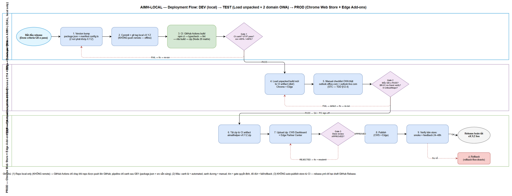
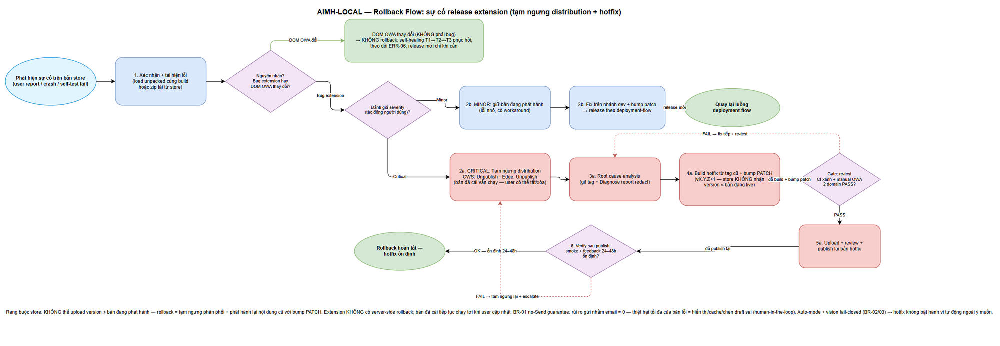

# Deployment Guide (DPG)

## AIMailHelper — AIMH-LOCAL: Trợ lý AI cho Outlook Web (Browser Extension MV3)

> **Ghi chú nguồn:** DPG v1 được **DevOps agent tạo offline (Phase 4.5 — DevOps Setup)** cho placeholder **AIMH-LOCAL** — KHÔNG Jira, KHÔNG DOCX, KHÔNG push git, KHÔNG tạo remote. Nguồn: TDD.md v1.1 (kiến trúc, storage migration, checklist 6 GĐ), FSD.md v1.2 (NFR mục 8), PLAN.md (mục 3 tech stack, mục 7 giai đoạn), STP.md/STC.md (testing gates), SECURITY-REVIEW.md (BR-01/02/03). Dự án greenfield: `src/` rỗng — pipeline CI/CD viết chuẩn cho **trạng thái đích sau GĐ1**, không viết theo trạng thái rỗng hiện tại (giải thích ở §1.4).

---

## Document Information

| Field | Value |
|-------|-------|
| Jira Ticket | AIMH-LOCAL (placeholder offline — chưa có ticket Jira thật) |
| Title | AIMailHelper — Trợ lý AI cho Outlook Web (Browser Extension MV3) |
| Author | DevOps Agent |
| Version | 1.0 |
| Date | 2026-10-14 |
| Status | Draft |
| Related TDD | documents/AIMH-LOCAL/TDD.md (v1.1) |
| Related STP/STC | documents/AIMH-LOCAL/STP.md · STC.md |
| CI/CD | .github/workflows/ci.yml · .github/workflows/release.yml |
| RLN | **Chưa tạo** — Release Notes sẽ tạo ở Phase 7 sau khi code hoàn tất (xem §10.4) |

---

## Revision History

| Version | Date | Author | Changes |
|---------|------|--------|---------|
| 1.0 | 2026-10-14 | DevOps Agent | Khởi tạo — Phase 4.5 DevOps Setup: CI/CD pipeline (ci.yml + release.yml), DPG, 2 drawio diagrams (deployment-flow + rollback-flow, export PNG thật + vision check) |

---

## Sign-Off

| Name | Role | Signature and date |
|------|------|--------------------|
| | Dev Lead | ☐ Approved for deployment |
| | QA Lead | ☐ Testing completed |
| | PO | ☐ Approve release |

---

## 1. Overview

### 1.1 Feature Summary

AIMailHelper là browser extension **Manifest V3 (Chrome ≥114 + Edge)** chạy trên Outlook Web (3 domain: outlook.office.com, outlook.office365.com, outlook.live.com) với 4 nhóm năng lực: (1) **Phân tích email** AI streaming (tóm tắt, importance score, intent/actions, deadline, sentiment); (2) **Soạn draft trả lời** theo tone/ngôn ngữ — điền vào compose box, **KHÔNG tự bấm Send (BR-01)**; (3) **Triage hộp thư** — quét inbox, badge + Digest ưu tiên, cache theo message-id; (4) **Auto-mode tùy chọn mặc định TẮT (BR-02)** với hàng chờ duyệt. Hỗ trợ 6 LLM providers (OpenAI, Azure OpenAI, Anthropic, Gemini, OpenAI-compatible, Local — Ollama/LM Studio), i18n vi/en.

### 1.2 Deployment Scope

| Item | Type | Description |
|------|------|-------------|
| Extension package (dist/ + zip) | New | Build bằng Vite + @crxjs/vite-plugin; phát hành qua Chrome Web Store + Edge Add-ons (upload manual sau store review) |
| CI/CD workflows | New | .github/workflows/ci.yml (build matrix Node 20 + test) + release.yml (tag v* → draft GitHub Release) — xem §1.4 |
| Dữ liệu người dùng | New | chrome.storage schema v1 — migration pure + idempotent qua storage.ts (xem §4). KHÔNG có server DB |
| Configuration | New | manifest.config.ts (version, host_permissions) + package.json (version) — xem §6.2 |
| Server / backend | N/A | Kiến trúc client-only — KHÔNG backend trung gian (BR-05); không Docker, không container |
| Database | N/A | Không RDBMS — thay bằng chrome.storage.sync (config) + chrome.storage.local (cache) |
### 1.3 Target Environments

Extension KHÔNG có môi trường SIT/UAT server riêng — store review là gate thay thế; UAT = manual checklist trên OWA thật (xem §9.2).

| Environment | Hình thức | Phương thức deploy | Approval Required |
|-------------|-----------|--------------------|-------------------|
| DEV | Local dev — `npm run dev` (Vite watch) + Load unpacked | Developer tự nạp dist/ vào chrome://extensions | No |
| TEST | Build + Load unpacked trên **Chrome ≥114 + Edge**, thử trên **2 domain OWA thật** | CI artifact (dist/) hoặc build local | QA sign-off mốc GĐ |
| SIT/UAT | N/A — không có môi trường trung gian | Store review + manual checklist thay thế | — |
| PROD | Chrome Web Store + Edge Add-ons | Upload zip manual qua store dashboards → store review → publish | PO + QA Lead |

### 1.4 CI/CD Pipeline (đã tạo — Phase 4.5)

**Files:** `.github/workflows/ci.yml` + `.github/workflows/release.yml` (GitHub Actions, Ubuntu runner).

**ci.yml — trigger: push + pull_request — 2 jobs chạy song song:**

| Job | Steps |
|-----|-------|
| **build** (matrix `node-version: [20]`, có thể mở rộng) | checkout → setup-node 20 (cache npm) → `npm ci` → `npm run typecheck` (tsc --noEmit) → `npm run lint` (eslint) → `npm run build` (vite + CRXJS) → upload artifact `dist/` → zip `aimailhelper-{sha}.zip` → upload zip artifact |
| **test** (node 20) | checkout → setup-node 20 → `npm ci` → `npm test` (vitest run) → upload `test-results/` (junit) |

**release.yml — trigger: push tag `v*`:** build → zip `aimailhelper-v{VERSION}.zip` → tạo **draft GitHub Release** kèm zip. **KHÔNG tự publish store** — bước upload/publish luôn là manual (§5.4).

**Script contract (GĐ1 bắt buộc khai báo trong package.json):**

| Script | Lệnh | Ghi chú |
|--------|------|---------|
| `typecheck` | `tsc --noEmit` | TS strict toàn dự án |
| `lint` | `eslint .` | Done criteria GĐ1 (file ≤200 dòng) |
| `build` | `vite build` | CRXJS xuất dist/ từ manifest.config.ts |
| `test` | `vitest run` | Cần junit reporter → `test-results/junit.xml` để CI upload kết quả |

**⚠️ Pipeline chỉ xanh sau GĐ1:** tại thời điểm tạo pipeline (2026-10-14) repo **chưa có package.json + `src/` rỗng** → `npm ci` sẽ fail → CI đỏ. Đây là **trạng thái kỳ vọng, không phải lỗi pipeline**. Pipeline được viết CHUẨN cho trạng thái đích: dev-agent hoàn tất GĐ1 scaffold (package.json đủ 4 scripts + vitest junit reporter) là pipeline khớp ngay, không phải sửa workflow.

**⚠️ Repo hiện local-only:** branch AIMH-LOCAL chưa có remote → GitHub Actions chưa chạy thực tế. CI chỉ kích hoạt khi repo được push lên GitHub (KHÔNG thuộc phạm vi Phase 4.5 — ràng buộc offline: KHÔNG tạo remote, KHÔNG push).

**Secrets cần cấu hình trong CI: KHÔNG có.** Không API key LLM trong CI — key chỉ tồn tại trong chrome.storage của người dùng cuối (BR-04/BR-08); CI không gọi LLM thật (tests dùng chrome mock + mock fetch). GitHub Actions dùng `github.token` mặc định cho release draft (permissions: contents: write).
---

## 2. Prerequisites

### 2.1 Infrastructure

| Requirement | Status | Notes |
|-------------|--------|-------|
| Chrome ≥ 114 | Ready | MV3 + chrome.storage.local quota 10MB từ Chrome 114 |
| Edge (Chromium) bản hiện tại | Ready | Kiểm thử kép Chrome + Edge ở mọi mốc |
| Tài khoản Chrome Web Store developer | Pending | Đăng ký 1 lần (phí $5) — cần cho PROD |
| Tài khoản Microsoft Partner Center (Edge Add-ons) | Pending | Cần cho PROD |
| GitHub repo + Actions enabled | Pending | Repo hiện local-only (KHÔNG remote) |
| Truy cập internet tới 3 domain OWA + 4 domain LLM | Ready | Theo host_permissions (§6.2) |

### 2.2 Software Dependencies

| Dependency | Version | Status |
|-----------|---------|--------|
| Node.js | 20 LTS | Installed (khớp CI matrix) |
| npm | ≥ 10 | Installed |
| Vite + @crxjs/vite-plugin | Vite 5.x / CRXJS 2.x | Pending — dev-agent cài ở GĐ1 |
| React / TypeScript | 18.x / 5.x strict | Pending — GĐ1 |
| Vitest + jsdom | 2.x | Pending — GĐ1 |
| draw.io CLI | bản desktop hiện tại | Installed — chỉ dùng cho tài liệu |

### 2.3 Access Requirements

| Access | Type | Who Needs It |
|--------|------|--------------|
| chrome://extensions (Developer mode) | Local | Developer + QA |
| Chrome Web Store Developer Dashboard | Tài khoản store | Release manager |
| Edge Partner Center | Tài khoản store | Release manager |
| GitHub repo (khi có remote) | Write | DevOps / Developer |

### 2.4 Backup Requirements

- [x] KHÔNG cần database backup (không có DB).
- [ ] **Giữ lại zip của MỌI version đã phát hành** — bắt buộc cho rollback (store không cho re-publish trực tiếp bản cũ, xem §8.3).
- [ ] Git tag local `vX.Y.Z` cho mỗi release (commit immutable để build lại).
- [ ] Store listing copy (mô tả, ảnh chụp, chính sách privacy) lưu trong documents/.

---

## 3. Pre-Deployment Checklist

> Testing gates TRƯỚC mỗi lần deploy (áp dụng cho cả TEST và PROD): chi tiết định lượng trong STP.md/STC.md.

| # | Item | Responsible | Status |
|---|------|-------------|--------|
| 1 | Code GĐ-x đạt Done criteria (TDD §11) | Developer | ☐ |
| 2 | CI xanh: typecheck + lint + build + test (matrix Node 20) | CI | ☐ |
| 3 | Unit + integration pass với coverage: adapters/locator ≥ 85%, storage/messaging ≥ 80% (STP) | Developer + QA | ☐ |
| 4 | **BR-01 audit pass** — không tồn tại code bấm Send (unit test quét source + security review) | QA + Security | ☐ |
| 5 | **Manual checklist OWA thật pass CẢ outlook.office.com VÀ outlook.live.com** trên Chrome + Edge (STC; TDD §12.4) — bắt buộc sau GĐ4 | QA | ☐ |
| 6 | Version bump khớp 2 nơi: package.json + manifest.config.ts | Developer | ☐ |
| 7 | NFR bundle ≤ 1MB gzipped (FSD mục 8) — build report đính kèm | DevOps | ☐ |
| 8 | 0 API key trong code/log/artifact (BR-08) | Security | ☐ |
| 9 | Zip bản release được lưu vào kho artifact + git tag tạo | DevOps | ☐ |
| 10 | Rollback plan reviewed (mục 8) | Team | ☐ |
| 11 | (Từ release công khai đầu tiên) RLN tạo ở Phase 7 | DevOps | ☐ |
---

## 4. Data Migration (chrome.storage — thay thế Database Migration)

Extension KHÔNG có RDBMS. "Migration" = phiên bản hóa chrome.storage qua storage.ts (TDD §6.3). Migration chạy tại service worker: `onInstalled` (cài mới) và `onStartup`/mở Options.

### 4.1 Migration Scripts (không SQL)

| Order | Trigger | Hành động | Estimated Time |
|-------|---------|-----------|----------------|
| 1 | onInstalled (cài mới) | Ghi `storage.schemaVersion = 1` + defaults (config.general/prompts/automation/vision/activeProvider) — KHÔNG tạo key rỗng cho provider | < 1s |
| 2 | onStartup / mở Options | Đọc schemaVersion: =1 → không làm; >1 (downgrade) → KHÔNG đụng dữ liệu, read-only + cảnh báo | < 100ms |

### 4.2 Verification

```text
# Sau khi load unpacked / publish:
1. Mở Options → các section hiển thị giá trị mặc định (automation.enabled=false, vision.enabled=false)
2. DevTools service worker console: log migration "schemaVersion=1"
3. Console KHÔNG có ERR
```

### 4.3 Rollback Migration

- MIGRATIONS pure + idempotent → chạy lại an toàn (không cần script đảo).
- Migration fail → DỪNG chuỗi, giữ nguyên dữ liệu (**KHÔNG BAO GIỜ xóa apiKey — BR-04**), banner cảnh báo ở Options lần mở sau.
- Migrator được phép drop `cache.triage`/`cache.locator` khi đổi cấu trúc (người dùng quét lại; locator tự học lại 1 lần — BR-06).

---

## 5. Application Deployment

### 5.1 Deployment Flow


*[Edit in draw.io](diagrams/deployment-flow.drawio)*

### 5.2 DEV — Developer local (Load unpacked)

| Step | Action | Command | Verification |
|------|--------|---------|--------------|
| 1 | Cài dependencies | `npm install` | node_modules/ được tạo |
| 2 | Build watch | `npm run dev` | dist/ cập nhật liên tục theo src/ |
| 3 | Load unpacked | chrome://extensions → bật Developer mode → Load unpacked → chọn `dist/` | Extension card hiện, 0 error |
| 4 | Smoke nhanh | Mở OWA → panel inject | Console sạch (TC-01) |

> Lưu ý: sửa code MV3 cần **reload extension + refresh tab OWA** (HMR không áp dụng cho service worker/content script). Lặp lại bước 3 trên Edge khi cần (`edge://extensions`).

### 5.3 TEST — QA (build + Load unpacked, Chrome + Edge × 2 domain OWA)

| Step | Action | Command/Thao tác | Verification |
|------|--------|------------------|--------------|
| 1 | Lấy artifact | Tải `extension-dist-node20` từ CI (hoặc `npm run build` local) | dist/ đúng manifest version |
| 2 | Load unpacked Chrome | chrome://extensions | TC-01 pass |
| 3 | Load unpacked Edge | edge://extensions | TC-01 pass |
| 4 | Chạy manual checklist trên 2 domain OWA | STC (kịch bản TDD §12.4) | 100% pass mốc |
| 5 | NFR spot-check | Build report | bundle ≤ 1MB gzipped |

### 5.4 PROD — Store Release (Chrome Web Store + Edge Add-ons)

| Step | Action | Command/Thao tác | Verification |
|------|--------|------------------|--------------|
| 1 | Version bump | Cập nhật `version` trong **package.json + manifest.config.ts** cùng X.Y.Z | 2 nơi khớp |
| 2 | Commit + git tag local | `git tag -a vX.Y.Z -m "AIMH-LOCAL: release X.Y.Z"` | `git tag` có tag mới |
| 3 | Build + zip | Tự động: push tag → release.yml tạo draft GitHub Release kèm zip. Thủ công: `npm run build; cd dist; zip -r ../aimailhelper-vX.Y.Z.zip .` | Zip mở được, manifest version đúng |
| 4 | Upload CWS | Chrome Web Store Developer Dashboard → Upload new package → điền listing | Tab "Pending review" |
| 5 | Upload Edge | Partner Center → Create new submission → Packages | Submission "In review" |
| 6 | Store review | Chờ CWS + Edge duyệt (thường vài giờ–vài ngày; lần đầu/đổi quyền có thể lâu hơn) | — |
| 7 | Publish | Approved → Publish (CWS) / Submit → live (Edge) | Listing live version mới |
| 8 | Verify post-publish | Mục 7 | Smoke pass, feedback ổn định |

> **Quy tắc:** (1) KHÔNG auto-publish store từ CI — release.yml chỉ tạo draft GitHub Release, upload/publish là manual (con người kiểm duyệt trước khi ra mắt vì extension thao tác trên hộp thư thật); (2) manifest `version` chỉ nhận ≤ 4 số nguyên (0..65535 mỗi phần) và store **CHỈ chấp nhận version CAO HƠN bản đang live** → mọi hotfix phải bump PATCH (xem §8.3); (3) KHÔNG dùng tag floating `latest` — mọi artifact gắn version cụ thể.

### 5.5 Docker Deployment — N/A

Extension client-only, không có server/container (BR-05: không backend trung gian) → không cần Dockerfile/docker-compose.
---

## 6. Configuration Changes

### 6.1 "Environment Variables" của extension = chrome.storage keys

Không có env runtime — mọi cấu hình qua chrome.storage, validate biên tại storage.ts (BR-15). API key do **người dùng tự nhập lúc runtime** — KHÔNG BAO GIỜ hardcode vào repo/config/CI (BR-04/BR-08).

| Key | Area | Mặc định | Ghi chú |
|-----|------|----------|---------|
| config.general | sync | { uiLanguage:"vi", keyStorage:"sync", extensionEnabled:true } | BR-15 validate enum |
| config.providers.{id} | sync|local theo keyStorage | {} | 6 provider giữ song song; key đi kèm |
| config.automation | sync | { enabled:false, rules:[], batchSize:5, throttleMs:1000, triageCap:50 } | BR-02/BR-13 fail-closed |
| config.vision | sync | { enabled:false } | BR-03 fail-closed |
| cache.triage.{messageId} | local | — | LRU 500 (#10) |
| cache.locator.{functionKey} | local | — | Chỉ giữ entry của layoutHash hiện tại (BR-06) |

### 6.2 Application Config Files

| File | Change | Ghi chú |
|------|--------|---------|
| package.json | `version: X.Y.Z` + 4 scripts contract (§1.4) | GĐ1 khởi tạo |
| manifest.config.ts | `version: X.Y.Z`; host_permissions: 3 domain OWA + 4 domain LLM; optional_host_permissions: https://*/*, http://localhost/*, http://127.0.0.1/* | CRXJS sinh manifest.json trong dist/ |
| vite.config.ts | Build config (CRXJS plugin) | GĐ1 |

### 6.3 Feature Flags (không có flags server-side — flags = config mặc định fail-closed)

| Flag | Giá trị mặc định ở MỌI môi trường | BR |
|------|-----------------------------------|----|
| automation.enabled | false — bật cần confirm dialog | BR-02 |
| vision.enabled | false | BR-03 |
| extensionEnabled | true | — |

### 6.4 CI Secrets

| Secret | Cần cấu hình? | Lý do |
|--------|---------------|-------|
| (không có) | — | CI không gọi LLM thật; không có secret nhạy cảm nào trong pipeline; `github.token` mặc định đủ cho draft release |

---

## 7. Post-Deployment Verification

### 7.1 Health Checks (thay thế HTTP health endpoint)

| Check | Cách kiểm | Expected Result | Timeout |
|-------|-----------|-----------------|---------|
| Load extension | chrome://extensions → card extension | Không banner lỗi; "Errors" = 0 | — |
| Service worker | DevTools → service worker | SW đăng ký; wake khi nhận message | 30s |
| Options page | Bấm Options | 6 section render đủ | 10s |
| Content script inject | Mở 1 email trên OWA | Nút "AI phân tích" trên toolbar; 0 console error | 30s |

### 7.2 Smoke Tests (rút gọn từ TDD §12.4 / STC)

| # | Scenario | Steps | Expected Result |
|---|----------|-------|-----------------|
| 1 | Analyze email đang mở | Mở email → bấm "AI phân tích" | Streaming 5 khía cạnh + badge màu đúng |
| 2 | Reply draft + chèn | Chọn tone → sinh draft → "Chèn vào Reply" | Draft nằm trong compose box; **KHÔNG tự Send (BR-01)** |
| 3 | Triage inbox | Quét 20 email hiển thị | Badge + Digest; quét lại 0 LLM call (cache hit) |
| 4 | Đổi ngôn ngữ vi/en | Options → uiLanguage | Toàn bộ UI đổi ngay |
| 5 | Test Connection | Options → provider cấu hình | {ok, message, latencyMs} |

### 7.3 Log Verification

| Log Entry | Level | Expected | Location |
|-----------|-------|----------|----------|
| Locator tier fallback | info | tier=T1/cache/T2, thời gian | SW console |
| LLM error | warn | ERR code + httpStatus — **KHÔNG chứa key (BR-08)** | SW console |
| Storage migration | info/warn | schemaVersion, kết quả từng bước | SW console |

### 7.4 Monitoring

- [ ] KHÔNG có telemetry (BR-05: 0 request tới host ngoài cấu hình) → không có dashboard server.
- [ ] Monitoring thay thế: CWS/Edge dashboard (rating, feedback, crash report nếu có) + issue tracker local.
- [ ] Theo dõi 24–48h sau publish; ERR-06 tăng đột biến → kiểm tra DOM OWA thay đổi (xem §8.2 — không phải bug rollback).
---

## 8. Rollback Plan

### 8.1 Rollback Flow


*[Edit in draw.io](diagrams/rollback-flow.drawio)*

### 8.2 Rollback Decision Criteria

| Condition | Action |
|-----------|--------|
| Crash service worker / mất dữ liệu config / chèn draft hỏng nội dung | **Critical → tạm ngưng distribution NGAY** (unlist) |
| Lỗi UX nhỏ, có workaround | Minor → giữ bản live, hotfix patch theo luồng thường |
| ERR-06 tăng đột biến do **DOM OWA thay đổi** (không phải bug extension) | **KHÔNG rollback** — self-healing T1→T2→T3 phục hồi; release mới chỉ khi cần |
| Store reject package (chưa live) | Fix + resubmit — không ảnh hưởng người dùng |

### 8.3 Rollback Steps (extension KHÔNG có server-side rollback)

**Ràng buộc:** CWS/Edge KHÔNG chấp nhận upload version ≤ bản đang phát hành → không thể "re-publish nguyên bản cũ". Rollback thực chất = **tạm ngưng phân phối + phát hành lại nội dung cũ với bump PATCH**.

| Step | Action | Thao tác | Verification |
|------|--------|----------|--------------|
| 1 | Tạm ngưng distribution | CWS: Unpublish (hoặc chặn visibility) / Edge Partner Center: Unpublish | Listing không còn phân phối bản lỗi; **bản đã cài vẫn chạy** |
| 2 | Root cause | git tag + Diagnose report (redact — SR-02) | Xác định commit/cause |
| 3 | Build hotfix từ tag cũ | `git checkout vX.Y.(Z-1)` → bump PATCH thành vX.Y.Z+1 → build + zip | Zip có version cao hơn bản live |
| 4 | Re-test | CI xanh + manual OWA 2 domain (mục 3) | Gate pass |
| 5 | Upload + publish lại | Store dashboards | Hotfix live |
| 6 | Verify | Mục 7 | Smoke pass, feedback ổn định |

> Người dùng đã cài bản lỗi vẫn chạy bản lỗi tới khi cập nhật → Critical bug phải unlist NGAY + khuyến cáo qua release notes. Người dùng có thể tự tắt extension (popup) hoặc gỡ cài đặt; dữ liệu chrome.storage giữ nguyên (không mất key — BR-04).

### 8.4 Rollback Time Estimate

| Action | Estimated Time |
|--------|---------------|
| Tạm ngưng distribution (unlist) | < 15 phút thao tác (propagation tới người dùng có thể vài giờ qua CDN store) |
| Root cause + hotfix build | 1–2 giờ (tùy defect) |
| Store review lại hotfix | Vài giờ–vài ngày (KHÔNG kiểm soát được) |
| **Tổng** | **Tối thiểu ~2 giờ + thời gian store review** |

### 8.5 Contingency & Bảo vệ rủi ro (BR-01)

- **No-Send guarantee (BR-01):** KHÔNG tồn tại code bấm Send (kiểm chứng 4 lớp: design/code/test/review — TDD §8.5) → rủi ro nghiêm trọng nhất của extension email — "gửi nhầm email" — **bằng 0**. Thiệt hại tối đa của bản lỗi: hiển thị sai / cache sai / chèn draft sai vị trí (người dùng xem và tự Send — human-in-the-loop).
- **Fail-closed:** auto-mode (BR-02) + vision (BR-03) mặc định TẮT ở mọi bản cài mới → hotfix không thể vô tình bật hành vi tự động.
- Giới hạn: extension không có cơ chế ép cập nhật người dùng — truyền thông qua release notes/issue khi có Critical.

---

## 9. Environment-Specific Notes

### 9.1 DEV
- `npm run dev` + Load unpacked; không cần tag/store; quay lưng nhanh bằng nút reload extension + refresh tab OWA.
- Kiểm trên cả Chrome và Edge ngay từ DEV (kiến trúc giống nhau nhưng console/behavior khác nhau nhẹ).

### 9.2 TEST (SIT/UAT-equivalent)
- Không có SIT/UAT server riêng: **manual checklist trên OWA thật (2 domain × 2 browser) chính là UAT gate** — mốc GĐ4 bắt buộc pass trên cả outlook.office.com VÀ outlook.live.com trước khi vào GĐ5 (PLAN mục 8).
- Approval: QA Lead (checklist 100%) + PO (mốc demo).

### 9.3 PROD
- **Deployment Window:** đầu tuần, giờ hành động (VD Thứ 2–3, 9:00–11:00) — để kịp theo dõi feedback 24–48h trong ngày làm việc.
- **Approval Required From:** PO (sign-off release) + QA Lead (checklist).
- **Communication Plan:** cập nhật issue tracker + RLN (tạo ở Phase 7) sau publish.
- **On-Call:** developer chính (dự án 1 dev — không có team ops riêng).

---

## 10. Appendix

### 10.1 Contacts (offline — điền khi có team thật)

| Role | Name | Contact |
|------|------|---------|
| DevOps Lead | (offline) | — |
| Release Manager | (offline) | — |
| On-Call Dev | (offline) | — |

### 10.2 Related Documents

| Document | Location |
|----------|----------|
| TDD v1.1 | documents/AIMH-LOCAL/TDD.md |
| FSD v1.2 | documents/AIMH-LOCAL/FSD.md |
| BRD v1 | documents/AIMH-LOCAL/BRD.md |
| STP / STC | documents/AIMH-LOCAL/STP.md · STC.md |
| SECURITY-REVIEW | documents/AIMH-LOCAL/SECURITY-REVIEW.md |
| PLAN (tech stack + giai đoạn) | PLAN.md |

### 10.3 Diagram Index

| # | Diagram | Image | Source (editable) |
|---|---------|-------|-------------------|
| 1 | Deployment Flow (DEV → TEST → PROD) | [deployment-flow.png](diagrams/deployment-flow.png) | [deployment-flow.drawio](diagrams/deployment-flow.drawio) |
| 2 | Rollback Flow | [rollback-flow.png](diagrams/rollback-flow.png) | [rollback-flow.drawio](diagrams/rollback-flow.drawio) |

### 10.4 Ghi chú Release Notes (RLN)

RLN sẽ được tạo ở **Phase 7 (Deployment)** sau khi code hoàn tất và có nội dung release thật — KHÔNG tạo skeleton RLN ở Phase 4.5 (quyết định task). RLN cần chứa: what's new theo GĐ, hướng dẫn cài từ store, known issues, migration notes (chrome.storage schema v1).

### 10.5 Trạng thái export diagrams (ghi THẬT — 2026-10-14)

| Diagram | Export PNG | Kích thước | Vision self-check |
|---------|-----------|------------|-------------------|
| deployment-flow.drawio → deployment-flow.png | ✅ OK (draw.io CLI, --width 2200) | 300KB | PASS sau **1 vòng fix** (vòng 1: nhãn edge "Sự cố" đè ellipse "Release hoàn tất" → đổi lộ trình edge p4→rollback đi dưới → vòng 2 PASS) |
| rollback-flow.drawio → rollback-flow.png | ✅ OK (draw.io CLI, --width 2000) | 298KB | PASS ngay vòng đầu (không cần fix) |

> Công cụ export: `C:\Program Files\draw.io\draw.io.exe -x -f png -b 10` — PNG render thật (không 0-byte), kiểm tra bằng vision: đủ node/edge, không overlap lớn, nhãn đọc được.
