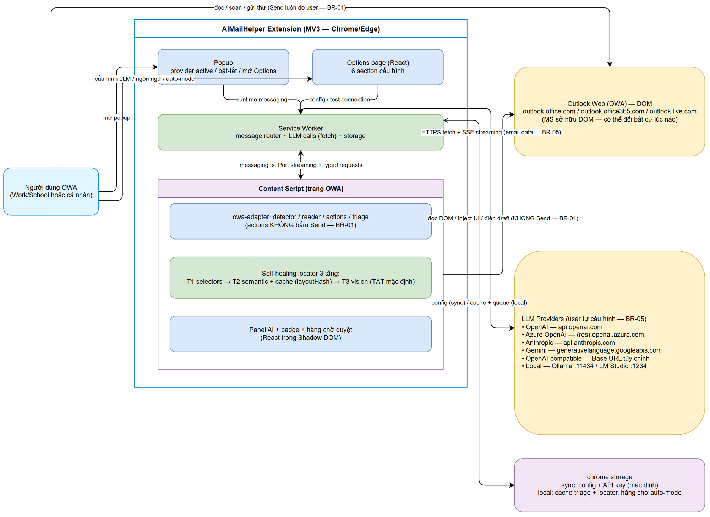
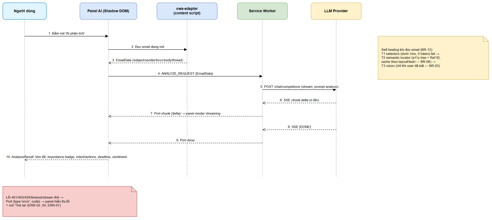
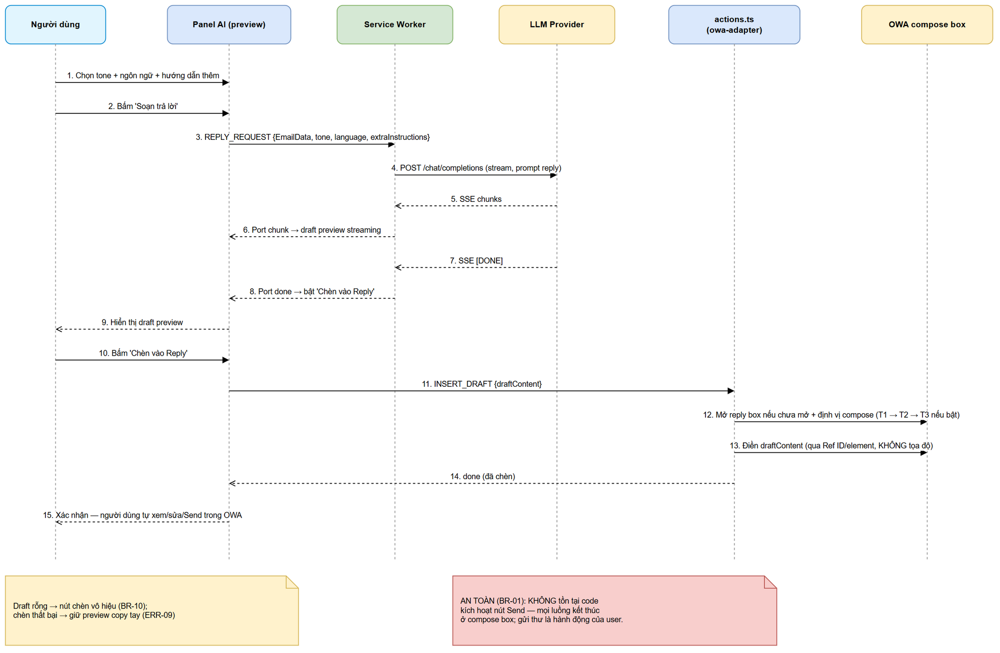
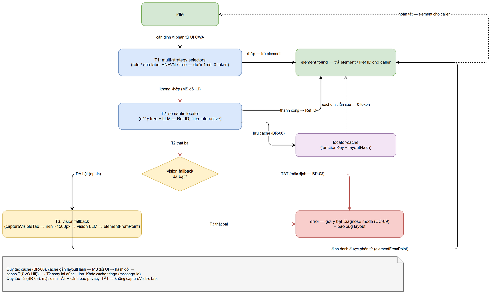

# Functional Specification Document (FSD)

## AIMailHelper — AIMH-LOCAL: Trợ lý AI cho Outlook Web (Browser Extension MV3)

> **Ghi chú nguồn (đọc trước):** FSD v1 này là **bản draft business sections do BA agent tạo offline**. Ticket AIMH-LOCAL **không tồn tại trên Jira** — Jira MCP không khả dụng trong phiên làm việc, nên KHÔNG gọi công cụ Jira, KHÔNG có ticket thật, KHÔNG bịa ticket key/URL. Nguồn sự thật của FSD này: (1) **documents/AIMH-LOCAL/BRD.md** v1 — business requirements đã duyệt; (2) **PLAN.md** — chi tiết kỹ thuật đã chốt (cấu trúc thư mục mục 4, LLM provider layer mục 5, OWA adapter 3 tầng mục 6, 6 giai đoạn mục 7); (3) **documents/AIMH-LOCAL/GLOSSARY.md** — thuật ngữ bắt buộc dùng đúng. Các phần **API / Integration Specifications được viết ở mức khung (functional view)** — TA agent sẽ enrich chi tiết (request/response schema, retry policy, timeout) trong bước TA enrichment *(TA v1.1: đã hoàn thành — xem Revision History và mục 5.2.0–5.2.6, 5.3.1–5.3.3, 5.4.1, 6.6)*. Dự án là **greenfield** (chưa có codebase), nên mọi kiểu dữ liệu ở mục 4 là **bản logic** — TA đã enrich v1.1, **BA đã feedback review v1.2 (BA-REVIEWED — đối soát từng entity với BRD/PLAN.md, xem ghi chú "BA Review v1.2" trong mục 4)**; SA chuẩn hóa kiểu cuối trong TDD.

---

## Document Information

| Field | Value |
|-------|-------|
| Jira Ticket | AIMH-LOCAL (placeholder offline — chưa có ticket Jira thật) |
| Title | AIMailHelper — Trợ lý AI cho Outlook Web (Browser Extension MV3) |
| Author | BA Agent |
| Version | 1.2 (v1.0 BA draft + TA v1.1 enrichment + BA feedback review) |
| Date | 2026-10-14 |
| Status | Draft — BA reviewed v1.2 (chờ SA/TDD + SM finalize) |
| Related BRD | documents/AIMH-LOCAL/BRD.md |

---

## Revision History

| Version | Date | Author | Changes |
|---------|------|--------|---------|
| 1.0 | 2026-10-14 | BA Agent | Khởi tạo FSD draft v1 từ BRD + PLAN.md + GLOSSARY — offline placeholder, không gọi Jira, không export DOCX (SM export sau) |
| 1.1 | 2026-10-14 | TA Agent | TA enrichment: API contract đầy đủ 6 LLM provider (endpoint/headers/body/SSE streaming/listModels/error mapping + retry — mục 5.2.0–5.2.6), Port streaming protocol + message router typed (5.3.1–5.3.3), chrome.storage quota + versioning/migration (5.4.1), pseudocode 6 thuật toán (6.6a–f), TA notes data model (mục 4), AF/EF bổ sung 9 UC, NFR định lượng bổ sung, ERR-15/16, cập nhật Open Issues #1/#2/#4 + thêm #8–#11 |
| 1.2 | 2026-10-14 | BA Agent | BA feedback review: entities verified, Open Issues resolved, FR mapping confirmed |

---

## 1. Introduction

### 1.1 Purpose

Tài liệu này đặc tả **chức năng (functional)** của AIMailHelper — browser extension Manifest V3 (Chrome + Edge) chạy trên Outlook Web (OWA), gồm 4 nhóm năng lực AI: phân tích email, soạn draft trả lời (KHÔNG tự gửi), triage hộp thư + Digest, và auto-mode tùy chọn (mặc định TẮT) với hàng chờ duyệt. FSD chuyển các business requirements của BRD thành: Use Cases có ID (UC-xx), Business Rules có ID (BR-xx), Functional Requirements theo 6 giai đoạn (FR-GD1..GD6), đặc tả dữ liệu, đặc tả tích hợp LLM provider, đặc tả UI, ma trận xử lý lỗi và i18n — đủ để TA/SA/DEV triển khai và QA kiểm thử có thể truy vết ngược về BRD.

### 1.2 Scope

Phạm vi **khớp 100% với BRD mục 1.1–1.2** (nguồn PLAN.md mục 1–2). Tóm tắt:

**In scope:**

1. Browser extension **Manifest V3 trên Chrome + Edge**, build bằng **Vite + @crxjs/vite-plugin**, TypeScript strict mode.
2. Đọc **DOM trang OWA** bằng content script — KHÔNG dùng Graph API, không backend; hỗ trợ cả Work/School (outlook.office.com, outlook.office365.com) và cá nhân (outlook.live.com).
3. **6 LLM provider** (OpenAI, Azure OpenAI, Anthropic, Gemini, OpenAI-compatible tùy chỉnh, Local Ollama/LM Studio) — gọi thuần fetch, streaming qua Port messaging.
4. Tính năng: phân tích email; soạn draft trả lời (chèn vào Reply, không tự gửi); triage inbox + Digest; auto-mode tùy chọn mặc định TẮT với hàng chờ duyệt; trang cấu hình LLM multi-provider có Test Connection; chọn nơi lưu API key (sync/local); song ngữ vi/en.
5. **Self-healing 3 tầng** trong owa-adapter/ (selectors → semantic locator + cache theo layout hash → vision fallback mặc định TẮT).
6. UI React 18: options page, popup, panel AI inject vào OWA qua Shadow DOM.

**Out of scope (kế thừa BRD):**

1. Microsoft Graph API / truy cập email server-side.
2. **Tự động bấm Send** — extension không có code gửi thư.
3. Pro mode chrome.debugger + CDP (hoãn sau MVP; chỉ thiết kế interface để cắm sau).
4. Nhúng framework browser-agent ngoài (Stagehand, browser-use, Skyvern SDK).
5. Trình duyệt khác (Firefox, Safari) và Outlook desktop.
6. Backend/server trung gian — toàn bộ xử lý client-side trong extension.
7. Auto-mode tự gửi — chỉ sinh draft vào hàng chờ duyệt.
8. Vision fallback bật mặc định (có tính năng ở GĐ4 nhưng mặc định TẮT).
9. Deployment/quản trị tập trung cho doanh nghiệp.

### 1.3 Definitions & Acronyms

Thuật ngữ domain dùng đúng theo **GLOSSARY.md** (bắt buộc; cột "Avoid" liệt kê từ cần tránh). Tóm tắt các thuật ngữ xuất hiện nhiều trong FSD:

| Term | Definition |
|------|------------|
| OWA Adapter | Tầng middleware trong content script (src/content/owa-adapter/) đọc/thao tác trang Outlook Web: detector, reader, actions, triage. Cô lập TOÀN BỘ thao tác DOM. |
| Self-healing Locator | Cơ chế định vị phần tử UI OWA 3 tầng: (1) multi-strategy selectors; (2) semantic locator (a11y tree + cache); (3) vision fallback (mặc định TẮT). |
| A11y Tree | Snapshot dạng text mô tả phần tử tương tác (role + label + ref), sinh bằng cách đi bộ DOM — "structure beats pixels". |
| Ref ID | Định danh bền vững (ref_12) gắn phần tử a11y tree qua WeakRef element map; hành động qua ref, không qua tọa độ pixel. |
| Layout Hash | Hash cấu trúc layout OWA làm khóa vô hiệu cache locator khi MS đổi UI (khác cache triage khóa theo message-id). |
| LLM Provider / Adapter | Provider: dịch vụ LLM trong 6 loại. Adapter: lớp TS implement LLMAdapter (chat, chatStream, listModels, testConnection) đăng ký trong registry. |
| Draft | Nội dung trả lời AI CHỈ được CHÈN vào khung Reply (compose box) qua actions.ts; Send luôn do người dùng thực hiện. |
| Triage / Digest | Quét danh sách inbox ĐANG HIỂN THỊ chấm điểm có throttle + retry/backoff / bảng ưu tiên tổng hợp, cache theo message-id. |
| Auto-mode | Chế độ tùy chọn (MẶC ĐỊNH TẮT) tự phân tích email mới + tự draft theo rule vào HÀNG CHỜ DUYỆT; không bao giờ tự gửi. |
| Analysis Result | Kết quả phân tích 1 email: summary, importanceScore/Label, intent, actions[], deadline, sentiment. |
| MV3 | Manifest V3 — nền tảng extension của Chrome/Edge; service worker thay background page; CSP không remote code. |
| SSE | Server-Sent Events — định dạng streaming HTTP dùng bởi các provider (data: ... / [DONE]). |
| Shadow DOM | Cơ chế cô lập DOM/CSS; panel AI inject vào OWA trong Shadow DOM (closed nếu được) tránh xung đột style của Outlook. |
| Port messaging | Kênh chrome.runtime.connect dài hạn dùng streaming chunk từ service worker → content script (MV3). |
| Compose box | Khung soạn thảo Reply của OWA — điểm kết thúc của mọi luồng draft. |

### 1.4 References

| Document | Location |
|----------|----------|
| BRD (input chính) | documents/AIMH-LOCAL/BRD.md |
| PLAN.md (nguồn kỹ thuật đã chốt — mục 4, 5, 6, 7) | C:\projects\nodejs\AIMailHelper\PLAN.md |
| GLOSSARY.md (thuật ngữ) | documents/AIMH-LOCAL/GLOSSARY.md |
| REFERENCE-ANALYSIS.md (pattern self-healing) | documents/AIMH-LOCAL/REFERENCE-ANALYSIS.md |
| DESIGN-SYSTEM.md (chuẩn UI cho DEV) | documents/templates/DESIGN-SYSTEM.md |
| FSD Template | documents/templates/FSD-TEMPLATE.md |

---

## 2. System Overview

### 2.1 System Context

AIMailHelper là extension chạy **hoàn toàn client-side**, tương tác với 3 thế giới ngoài:

1. **Trang OWA (DOM)** — nguồn dữ liệu email duy nhất: đọc nội dung qua content script, inject UI (nút, badge, panel), điền draft vào compose box. Microsoft sở hữu DOM và có thể đổi bất cứ lúc nào → kiến trúc self-healing 3 tầng là yêu cầu nền tảng.
2. **LLM Providers (6)** — điểm đến duy nhất của dữ liệu email: người dùng TỰ cấu hình endpoint + API key; extension gọi thuần HTTPS fetch, streaming SSE.
3. **chrome.storage (sync/local)** — nơi lưu duy nhất: config + API key (sync mặc định, local tùy chọn), cache triage/locator + hàng chờ auto-mode (local).


*[Edit in draw.io](diagrams/system-context.drawio)*

**Điểm an toàn xuyên suốt:** mọi luồng (thủ công, triage, auto-mode) đều kết thúc ở compose box hoặc hàng chờ duyệt của người dùng; extension không tồn tại đường code nào kích hoạt nút Send của OWA (BR-01).

### 2.2 System Architecture

Kiến trúc module bám theo **PLAN.md mục 4** (cấu trúc thư mục đã chốt):

| Khối | Vị trí (PLAN.md mục 4) | Trách nhiệm |
|------|------------------------|-------------|
| Service Worker | src/background/service-worker.ts | Message router + gọi LLM (chat/chatStream) + điều phối storage |
| Content Script entry | src/content/index.tsx | Entry point inject trên 3 domain OWA |
| OWA Adapter (self-healing 3 tầng) | src/content/owa-adapter/ | detector.ts, reader.ts, actions.ts (KHÔNG bấm Send), triage.ts, selectors.ts (T1), a11y-tree.ts + semantic-locator.ts + locator-cache.ts (T2), vision-fallback.ts (T3, mặc định TẮT), diagnose.ts |
| UI components (React + Shadow DOM) | src/content/components/ | Panel AI, nút hành động, badge |
| Feature modules | src/content/modules/ | analyze.ts (GĐ3), reply.ts (GĐ4), digest.ts (GĐ5) |
| Options page | src/options/ | App + 6 components: ProviderForm, ModelPicker, TestConnection, PromptSettings, AutomationSettings, GeneralSettings |
| Popup | src/popup/ | Trạng thái nhanh: provider đang dùng, bật/tắt, link mở Options |
| LLM layer | src/shared/llm/ | types.ts (LLMConfig, ChatMessage, LLMResponse, ProviderId); adapters/ (6 adapter); registry.ts; prompts.ts (system prompts vi + en) |
| Hạ tầng chung | src/shared/ | storage.ts (typed wrapper chrome.storage), messaging.ts (typed request/response + Port streaming), i18n/ (vi.json, en.json), types.ts (EmailData, AnalysisResult, ReplyDraft, TriageScore) |

**Dòng chảy dữ liệu tổng quát:** UI (popup/options/panel) ↔ messaging.ts ↔ service worker (router) ↔ LLM adapter (fetch + SSE) và ↔ chrome.storage; content script ↔ owa-adapter ↔ DOM OWA. Streaming chunk đi theo chiều service worker → content script → panel qua Port.

Chi tiết luồng: phân tích email (mục 6.1 + sequence-analyze-email), self-healing locator (mục 6.2 + state-locator), draft reply (mục 6.3 + sequence-reply-draft), triage (mục 6.4), auto-mode (mục 6.5).

---

## 3. Functional Requirements

### 3.0 Traceability — Use Case ↔ User Story (BRD) ↔ FR ↔ Giai đoạn

| UC | Tên Use Case | Nguồn User Story (BRD) | FR liên quan | GĐ |
|----|--------------|------------------------|--------------|-----|
| UC-01 | Analyze Email | US-06 | FR-GD3-01..07 | GĐ3 |
| UC-02 | Draft Reply | US-07, US-10 | FR-GD4-01..08 | GĐ4 |
| UC-03 | Triage Inbox | US-08 | FR-GD5-01..06 | GĐ5 |
| UC-04 | View Digest | US-08 | FR-GD5-04, FR-GD5-05 | GĐ5 |
| UC-05 | Configure LLM Provider | US-02 | FR-GD2-01..05, FR-GD2-07, FR-GD2-10 | GĐ2 |
| UC-06 | Test Connection | US-03 | FR-GD2-06 | GĐ2 |
| UC-07 | Approve/Reject Auto-draft | US-09, US-10 | FR-GD6-01..06 | GĐ6 |
| UC-08 | Switch Language | US-05 | FR-GD1-06, FR-GD2-09 | GĐ1–2 |
| UC-09 | Diagnose OWA Layout | US-07 (tầng 3 + diagnose), US-06 | FR-GD4-05, FR-GD4-06 | GĐ4 |

US-01 (scaffold) và US-04 (nơi lưu key) không có UC riêng vì là nền tảng xuyên suốt — được đặc tả qua FR-GD1-*, FR-GD2-08 và BR-04/BR-15.

### 3.1 Functional Requirements theo 6 giai đoạn

> Nguồn đánh số GĐ: PLAN.md mục 7. Mỗi FR ghi rõ user story nguồn trong BRD.

#### 3.1.1 GĐ1 — Scaffold

| FR ID | Requirement | Nguồn |
|-------|-------------|-------|
| FR-GD1-01 | Khởi tạo dự án Vite + @crxjs/vite-plugin + React 18 + TS strict; manifest.config.ts khai báo permissions và host_permissions cho 3 domain OWA (outlook.office.com, outlook.office365.com, outlook.live.com) | US-01 |
| FR-GD1-02 | Popup hiển thị trạng thái nhanh: provider đang dùng, toggle bật/tắt extension, nút mở Options | US-01 |
| FR-GD1-03 | Trang Options shell (React) mở và render được | US-01 |
| FR-GD1-04 | storage.ts — typed wrapper duy nhất truy cập chrome.storage: sync cho config, local cho cache | US-01 |
| FR-GD1-05 | messaging.ts — typed request/response + Port streaming; message router trong service worker | US-01 |
| FR-GD1-06 | i18n framework (vi.json/en.json); mọi label popup/panel/Options đi qua i18n | US-05 |
| FR-GD1-07 | Content script entry point inject thành công trên cả 3 domain OWA | US-01 |
| FR-GD1-08 | selectors.ts — Tầng 1 multi-strategy (role, aria-label cả EN/VN, cấu trúc tree, data-*) hoàn thiện từ GĐ1, là fast-path cho mọi thao tác sau này | US-01, US-06 |

#### 3.1.2 GĐ2 — LLM Config

| FR ID | Requirement | Nguồn |
|-------|-------------|-------|
| FR-GD2-01 | 6 adapters + registry (map ProviderId → adapter instance), implement interface thống nhất: chat, chatStream (AsyncIterable), listModels, testConnection | US-02 |
| FR-GD2-02 | Options UI: chọn provider active; ProviderForm per-provider (API key, Base URL, model, deployment, api-version) hiển thị trường theo provider | US-02 |
| FR-GD2-03 | ModelPicker: dropdown fetch danh sách model từ API khi provider hỗ trợ + ô nhập tay luôn khả dụng; Azure ẩn fetch (không có listModels) | US-02 |
| FR-GD2-04 | Streaming từ service worker sang content script qua chrome.runtime.connect Port (MV3) | US-02 |
| FR-GD2-05 | Chat test từ Options trả về kết quả streaming thành công cho đủ cả 6 loại provider | US-02 |
| FR-GD2-06 | Nút Test Connection gọi testConnection(config) của adapter active; hiển thị { ok, message, latencyMs } | US-03 |
| FR-GD2-07 | Local LLM: preset 1-click Ollama localhost:11434 / LM Studio localhost:1234; hướng dẫn đặt env OLLAMA_ORIGINS=chrome-extension://* hiển thị trong Options; list models qua /api/tags | US-02 |
| FR-GD2-08 | GeneralSettings cho chọn nơi lưu API key: chrome.storage.sync (mặc định) hoặc chrome.storage.local ("chỉ lưu máy này"); chuyển sang local thì xóa key khỏi sync; kèm privacy note giải thích nơi lưu + phạm vi gửi dữ liệu (BR-05) | US-04, US-10 |
| FR-GD2-09 | UI language selector vi/en trong GeneralSettings; đổi ngôn ngữ → toàn bộ UI (popup, panel, Options) cập nhật; thiếu key i18n → fallback English + log cảnh báo | US-05 |
| FR-GD2-10 | LLM calls thuần fetch — không dùng SDK nặng (bundle nhỏ, dễ tùy biến per-provider) | US-02 |

#### 3.1.3 GĐ3 — Đọc & Phân tích email đang mở

| FR ID | Requirement | Nguồn |
|-------|-------------|-------|
| FR-GD3-01 | detector.ts nhận diện chế độ OWA: reading pane bên phải / bật riêng / conversation view | US-06 |
| FR-GD3-02 | reader.ts đọc subject, sender, to/cc, body, thread context | US-06 |
| FR-GD3-03 | Hoàn thiện Tầng 2 self-healing: a11y-tree.ts (snapshot + Ref ID map WeakRef) + semantic-locator.ts (gửi a11y tree cho LLM định vị, trả Ref ID) + locator-cache.ts (cache theo layout hash) | US-06 |
| FR-GD3-04 | Inject nút "AI phân tích" vào toolbar email qua owa-adapter | US-06 |
| FR-GD3-05 | Panel AI React chạy trong Shadow DOM (closed nếu được) bên cạnh email; không phá vỡ layout/trạng thái trang OWA | US-06 |
| FR-GD3-06 | Phân tích streaming 5 khía cạnh (tóm tắt, độ quan trọng score + nhãn, ý định & hành động, deadline, cảm xúc); render badge màu theo importanceLabel | US-06 |
| FR-GD3-07 | Email rỗng / không đọc được nội dung → hiển thị thông báo thay vì gọi LLM với payload rỗng (BR-14) | US-06 |

#### 3.1.4 GĐ4 — Soạn trả lời AI

| FR ID | Requirement | Nguồn |
|-------|-------------|-------|
| FR-GD4-01 | Nút "Soạn trả lời" từ panel: chọn tone (chính thức/thân mật/ngắn gọn), ngôn ngữ (theo email gốc / bắt buộc VI / EN), hướng dẫn thêm (extraInstructions) | US-07 |
| FR-GD4-02 | Streaming sinh draft → preview hiển thị trong panel | US-07 |
| FR-GD4-03 | "Chèn vào Reply" qua actions.ts: mở compose box nếu chưa mở, điền draft vào compose box của OWA; việc chèn CHỈ xảy ra sau khi người dùng bấm nút | US-07 |
| FR-GD4-04 | KHÔNG tồn tại đường code nào tự kích hoạt nút Send trong extension (mọi nhánh) | US-07, US-10 |
| FR-GD4-05 | Hoàn thiện Tầng 3 vision-fallback.ts: captureVisibleTab → nén mạnh (target ~1568px) → vision LLM → elementFromPoint + dispatch event; MẶC ĐỊNH TẮT, toggle + cảnh báo privacy trong Options | US-07, US-10 |
| FR-GD4-06 | diagnose.ts log cấu trúc DOM/a11y tìm thấy được; xuất báo cáo người dùng có thể gửi kèm bug report | US-07 |
| FR-GD4-07 | Draft rỗng → vô hiệu nút "Chèn vào Reply"; chèn thất bại → giữ nội dung trong preview để người dùng copy tay | US-07 |
| FR-GD4-08 | Mốc kiểm thử thực tế trên cả outlook.office.com và outlook.live.com trước khi vào GĐ5–6 | US-07 |

#### 3.1.5 GĐ5 — Triage hộp thư

| FR ID | Requirement | Nguồn |
|-------|-------------|-------|
| FR-GD5-01 | triage.ts đọc danh sách email ĐANG HIỂN THỊ trong inbox list (không tải thêm mail) | US-08 |
| FR-GD5-02 | Batch analyze: batch size điều chỉnh được, có throttle + retry/backoff → điểm quan trọng + lý do | US-08 |
| FR-GD5-03 | Badge màu trên list item theo điểm quan trọng (inject qua owa-adapter) | US-08 |
| FR-GD5-04 | Panel "Digest" liệt kê email ưu tiên kèm lý do, sắp xếp theo score | US-08 |
| FR-GD5-05 | Cache kết quả theo message-id trong chrome.storage.local; quét lại không gọi LLM cho email đã cache (trừ khi người dùng yêu cầu quét lại) | US-08 |
| FR-GD5-06 | Item thiếu message-id → bỏ qua và ghi log; người dùng chuyển folder giữa chừng → dừng quét an toàn, giữ kết quả đã có | US-08 |

#### 3.1.6 GĐ6 — Auto-mode (mặc định TẮT)

| FR ID | Requirement | Nguồn |
|-------|-------------|-------|
| FR-GD6-01 | AutomationSettings: toggle bật/tắt rõ ràng + cảnh báo; MẶC ĐỊNH TẮT; bật yêu cầu xác nhận rõ ràng | US-09 |
| FR-GD6-02 | Khi bật: detect email mới đến qua MutationObserver → tự phân tích | US-09 |
| FR-GD6-03 | Rule engine: sender, subject pattern, mức độ tối thiểu; rule rỗng → không tự draft email nào (chỉ phân tích) | US-09 |
| FR-GD6-04 | Draft tự sinh được đưa vào HÀNG CHỜ DUYỆT; duyệt từng cái hoặc Approve all; Reject → loại khỏi hàng chờ, không chèn | US-09 |
| FR-GD6-05 | Sau khi duyệt → chèn vào Reply qua actions.ts; người dùng TỰ bấm Send; không có tự gửi trong mọi nhánh | US-09, US-10 |
| FR-GD6-06 | Tắt auto-mode khi còn hàng chờ: dữ liệu hàng chờ giữ nguyên, không tự hành động gì | US-09 |

**Kết quả rà FR mapping (BA review v1.2):**

| GĐ | Số FR | FR ID | Nguồn US (BRD) | Rà soát AC |
|----|-------|-------|----------------|------------|
| GĐ1 | 8 | FR-GD1-01..08 | US-01, US-05, US-06 | ✅ khớp 5/5 AC US-01 |
| GĐ2 | 10 | FR-GD2-01..10 | US-02, US-03, US-04, US-05 | ✅ khớp 5/5 AC US-02, 3/3 US-03, 3/3 US-04, 3/3 US-05; sửa 1: FR-GD2-08 bổ sung privacy note (AC3 US-04 + AC5 US-10) |
| GĐ3 | 7 | FR-GD3-01..07 | US-06 | ✅ khớp 5/5 AC US-06 |
| GĐ4 | 8 | FR-GD4-01..08 | US-07, US-10 | ✅ khớp 5/5 AC US-07 |
| GĐ5 | 6 | FR-GD5-01..06 | US-08 | ✅ khớp 4/4 AC US-08 |
| GĐ6 | 6 | FR-GD6-01..06 | US-09, US-10 | ✅ khớp 5/5 AC US-09 |
| **Tổng** | **45** | FR-GD1-01..FR-GD6-06 | US-01..US-10 | 45/45 FR có nguồn US; 0 FR lệch GĐ (auto-mode nằm trọn GĐ6 — FR-GD6-01..06; vision T3 đúng GĐ4 theo PLAN mục 7); 1 amendment (FR-GD2-08); US-10 (cross-cutting) phủ qua FR-GD4-04/05, FR-GD6-05 + BR-01/03/04/05/08 |

### 3.2 Business Rules

Bảng quy tắc nghiệp vụ trung tâm, được tham chiếu bởi mọi Use Case. Nguồn: BRD (mục 2.3) + PLAN.md (mục 5, 6, 9) + GLOSSARY.

| Rule ID | Rule | Nguồn |
|---------|------|-------|
| BR-01 | Extension KHÔNG BAO GIỜ tự bấm Send: mọi luồng (thủ công, triage, auto-mode) kết thúc ở compose box hoặc hàng chờ duyệt; việc gửi luôn là hành động của người dùng trong OWA; không tồn tại code kích hoạt nút Send | BRD US-07, US-10; PLAN.md mục 6 |
| BR-02 | Auto-mode MẶC ĐỊNH TẮT trong mọi lần cài đặt mới; khi TẮT, extension không thực hiện bất kỳ hành động tự động nào; bật yêu cầu xác nhận rõ ràng (hiện cảnh báo) | BRD US-09, US-10 |
| BR-03 | Vision fallback (Tầng 3) MẶC ĐỊNH TẮT; chỉ chạy khi Tầng 1 + Tầng 2 thất bại VÀ người dùng đã chủ động bật trong Options; khi bật phải hiển thị cảnh báo privacy (ảnh chụp màn hình email sẽ gửi tới vision LLM); TẮT → không bao giờ gọi chrome.tabs.captureVisibleTab | BRD US-07, US-10; PLAN.md mục 6 |
| BR-04 | API key mặc định lưu chrome.storage.sync; tùy chọn "chỉ lưu máy này" → chrome.storage.local và bị xóa khỏi sync; không log giá trị key ở bất kỳ tầng nào | BRD US-04, US-10 |
| BR-05 | Email data CHỈ gửi tới endpoint LLM người dùng TỰ cấu hình; không có backend trung gian; chỉ cho phép fetch tới host trong phạm vi đã cấp quyền (host_permissions), host ngoài phạm vi → chặn và hướng dẫn cấp quyền | BRD US-10 |
| BR-06 | Locator cache VÔ HIỆU TỰ ĐỘNG khi layout hash thay đổi (MS đổi UI OWA) → Tầng 2 chạy lại đúng 1 lần; cache gắn hash cấu trúc layout, khác hoàn toàn với cache triage (khóa message-id) | BRD US-06; GLOSSARY "Layout Hash"; PLAN.md mục 6 |
| BR-07 | Triage CHỈ quét danh sách email đang hiển thị trong inbox list; không tải thêm mail | BRD US-08; GLOSSARY "Triage" |
| BR-08 | API key không xuất hiện trong log/console ở bất kỳ tầng nào (kể cả error message, bug report, diagnose report) | BRD US-10 |
| BR-09 | Triage không gọi LLM cho messageId đã có trong cache, trừ khi người dùng yêu cầu quét lại | BRD US-08 |
| BR-10 | Draft rỗng → vô hiệu nút "Chèn vào Reply"; việc chèn CHỈ xảy ra sau khi người dùng bấm nút | BRD US-07 |
| BR-11 | Ngôn ngữ trả lời AI (replyLanguage: auto/vi/en) là setting riêng, ĐỘC LẬP với ngôn ngữ UI (uiLanguage) | BRD US-05, US-07 |
| BR-12 | Tầng 2 chỉ chạy khi Tầng 1 thất bại; Tầng 3 chỉ chạy khi Tầng 1 + 2 thất bại và người dùng đã opt-in (BR-03) | BRD US-06; PLAN.md mục 6 |
| BR-13 | Rule auto-mode rỗng → không tự draft email nào (chỉ phân tích) | BRD US-09 |
| BR-14 | Email rỗng / không đọc được nội dung → hiển thị thông báo, KHÔNG gọi LLM với payload rỗng | BRD US-06 |
| BR-15 | Giá trị config chỉ nhận enum hợp lệ: uiLanguage chỉ nhận "vi"/"en"; keyStorage chỉ nhận "sync"/"local"; providerActive chỉ nhận ProviderId hợp lệ; giá trị khác bị từ chối ở tầng typed wrapper storage.ts | BRD US-01, US-04, US-05 |
| BR-16 | MV3 CSP: không remote code — toàn bộ bundle cục bộ; host permissions giới hạn: 3 domain OWA + domain LLM provider; cân nhắc optional_host_permissions cho provider tùy chỉnh | BRD US-10; PLAN.md mục 5 |
| BR-17 | ModelPicker: ô nhập tay model LUÔN khả dụng cho mọi provider; nút fetch danh sách model chỉ hiển thị khi listModels được xác nhận khả dụng từ browser — Azure luôn ẩn nút fetch (không có listModels); Anthropic: nếu spike CORS GĐ2 kết luận listModels bị chặn → UI ẩn nút fetch, chỉ cho nhập tay; lỗi fetch models KHÔNG chặn lưu cấu hình | BA decision v1.2 (Open Issue #2); FR-GD2-03 |

### 3.3 Use Cases

> **TA enrich (v1.1) — các flows bổ sung khi review Use Cases:** UC-01: EF-5..EF-7 · UC-02: AF-5, EF-5 · UC-03: AF-5, EF-5 · UC-04: AF-3, EF-3 · UC-05: EF-6 · UC-06: EF-4 · UC-07: AF-5, EF-4 · UC-08: AF-2 · UC-09: EF-3. Nội dung gốc của BA giữ nguyên; luồng kỹ thuật chi tiết nằm ở mục 5–6.

#### UC-01 — Analyze Email (Phân tích email đang mở)

**Nguồn:** US-06; FR-GD3-01..07; GĐ3.
**Actor:** Người dùng OWA (Persona A Work/School hoặc Persona B cá nhân).
**Preconditions:** Extension đã bật; provider LLM đã cấu hình + key hợp lệ (UC-05); đang mở 1 email trong OWA (reading pane hoặc bật riêng, có thể conversation view).
**Postconditions:** Panel AI hiển thị AnalysisResult đủ 5 khía cạnh; trạng thái trang OWA không bị thay đổi; không có email nào được gửi.

**Main Flow:**

| Step | Actor | System | Description |
|------|-------|--------|-------------|
| 1 | Người dùng | | Bấm nút "AI phân tích" được extension inject vào toolbar email |
| 2 | | owa-adapter | detector.ts nhận diện chế độ OWA; reader.ts đọc EmailData (subject, sender, to/cc, body, thread) qua self-healing locator (T1 selectors, fallback T2 — xem mục 6.2) |
| 3 | | Panel AI | Gửi ANALYZE_REQUEST {EmailData} tới service worker qua messaging.ts |
| 4 | | Service Worker | Registry chọn adapter theo providerActive; gọi chatStream với system prompt "analyze" (bản theo replyLanguage/prompts) |
| 5 | | LLM Provider | Trả SSE chunks; service worker forward từng chunk qua Port về panel |
| 6 | | Panel AI | Render streaming có cấu trúc; khi done → hiển thị AnalysisResult (badge màu theo importanceLabel) |
| 7 | Người dùng | | Đọc kết quả; có thể tiếp tục UC-02 (Soạn trả lời) |

**Alternative Flows:**

| ID | Condition | Steps |
|----|-----------|-------|
| AF-1 | Conversation view | detector nhận diện conversation → reader đọc thread context (các email trước) và đưa vào prompt để phân tích chính xác hơn |
| AF-2 | T1 selectors gãy (MS đổi UI) | T2 semantic locator: sinh a11y tree snapshot + Ref ID → gửi LLM định vị → cache kết quả theo layout hash (BR-06); lần sau cache hit không tốn token |
| AF-3 | T2 cũng thất bại + người dùng đã bật vision | Chạy T3 vision fallback (BR-03): captureVisibleTab → nén → vision LLM → định vị vùng đọc |
| AF-4 | Đổi email đang mở giữa chừng | Panel hủy request cũ (Port: cancel) và bắt đầu phân tích email mới |

**Exception Flows:**

| ID | Condition | Steps |
|----|-----------|-------|
| EF-1 | Email rỗng / không đọc được nội dung (BR-14) | Hiển thị thông báo "Không đọc được nội dung email"; không gọi LLM; gợi ý mở email ở chế độ đọc |
| EF-2 | LLM lỗi 401/403/429/timeout (ERR-02..04) | Panel hiển thị lỗi rõ ràng + nút "Thử lại"; giữ trạng thái panel |
| EF-3 | Không tìm thấy vùng đọc email ở cả T1+T2 (T3 tắt) | Thông báo + gợi ý bật Diagnose mode (UC-09) để báo lỗi layout |
| EF-4 | Stream đứt giữa chừng (ERR-07) | Giữ phần đã render, hiển thị trạng thái gián đoạn + nút thử lại |
| EF-5 | Provider chưa cấu hình / thiếu key khi bấm phân tích | Panel hiển thị "Chưa cấu hình provider" + nút mở Options (UC-05); KHÔNG gọi LLM |
| EF-6 | LLM trả output không parse được thành AnalysisResult (sai JSON / thiếu khía cạnh — 6.6f) | Hiển thị raw text + cảnh báo nhẹ; không tự gọi lại; gợi ý thử lại hoặc đổi model |
| EF-7 | Port không kết nối được service worker (SW bị kill — MV3) | Tự thử kết nối lại 1 lần (gửi lại request — wake SW); vẫn lỗi → ERR-07 + nút thử lại |


*[Edit in draw.io](diagrams/sequence-analyze-email.drawio)*

#### UC-02 — Draft Reply (Soạn draft trả lời)

**Nguồn:** US-07, US-10; FR-GD4-01..07; GĐ4.
**Actor:** Người dùng OWA.
**Preconditions:** Đã phân tích email (UC-01) hoặc panel có EmailData hợp lệ; provider đã cấu hình.
**Postconditions:** Draft đã được chèn vào compose box Reply của OWA (hoặc người dùng copy tay từ preview); KHÔNG có email nào được gửi — người dùng tự xem/sửa/bấm Send trong OWA (BR-01).

**Main Flow:**

| Step | Actor | System | Description |
|------|-------|--------|-------------|
| 1 | Người dùng | | Trong panel, bấm "Soạn trả lời" |
| 2 | Người dùng | | Chọn tone (chính thức/thân mật/ngắn gọn), ngôn ngữ (theo email gốc / bắt buộc VI / EN), tùy chọn gõ extraInstructions |
| 3 | | Panel AI | Gửi REPLY_REQUEST {EmailData, tone, language, extraInstructions} tới service worker |
| 4 | | Service Worker | Gọi chatStream với system prompt "reply" + tham số tone/language |
| 5 | | LLM Provider | SSE chunks → service worker forward qua Port |
| 6 | | Panel AI | Hiển thị draft preview streaming; khi done → bật nút "Chèn vào Reply" (draft rỗng → nút vô hiệu, BR-10) |
| 7 | Người dùng | | Bấm "Chèn vào Reply" |
| 8 | | owa-adapter (actions.ts) | Nếu compose box chưa mở → mở reply box; định vị compose box (T1 → T2 → T3 nếu bật) và điền draftContent |
| 9 | Người dùng | | Xem/sửa draft trong compose box OWA rồi TỰ bấm Send của OWA |

**Alternative Flows:**

| ID | Condition | Steps |
|----|-----------|-------|
| AF-1 | Compose box chưa mở | actions.ts tự mở reply box trước khi điền (BRD US-07 validation) |
| AF-2 | T1 không tìm thấy compose box | Thử T2 semantic locator; nếu người dùng đã bật vision → T3 (BR-03, BR-12) |
| AF-3 | Người dùng muốn chỉnh tone/ngôn ngữ | Quay lại bước 2, chọn lại tham số và sinh lại draft (draft cũ bị thay thế trong preview) |
| AF-4 | replyLanguage = auto | Prompts chỉ dẫn LLM trả lời theo ngôn ngữ của email gốc (độc lập uiLanguage — BR-11) |
| AF-5 | Compose box đã có nội dung sẵn (người dùng đang viết dở) | actions.ts KHÔNG ghi đè im lặng: hỏi xác nhận (thay thế / ghép thêm) trước khi điền; hủy → giữ nguyên compose box |

**Exception Flows:**

| ID | Condition | Steps |
|----|-----------|-------|
| EF-1 | Chèn thất bại (không điền được compose box) | Giữ nội dung trong preview để người dùng copy tay; hiển thị lỗi + gợi ý Diagnose mode (UC-09) |
| EF-2 | Compose box không tìm thấy ở cả T1+T2 (T3 tắt) | Thông báo; hướng dẫn mở Reply thủ công + copy draft từ preview |
| EF-3 | Stream đứt giữa chừng | Giữ phần draft đã nhận trong preview; nút "Thử lại" sinh lại từ đầu |
| EF-4 | LLM lỗi (401/429/timeout) | Hiển thị lỗi; draft chưa chèn; có thể thử lại |
| EF-5 | Email nguồn đổi giữa lúc sinh draft, bấm "Chèn vào Reply" | Kiểm tra messageId email đang mở khớp với draft; không khớp → cảnh báo "Draft này thuộc email khác", KHÔNG chèn tự động (người dùng chọn hủy hoặc vẫn chèn) |


*[Edit in draw.io](diagrams/sequence-reply-draft.drawio)*

#### UC-03 — Triage Inbox (Sàng lọc hộp thư)

**Nguồn:** US-08; FR-GD5-01..03, FR-GD5-05, FR-GD5-06; GĐ5.
**Actor:** Người dùng OWA.
**Preconditions:** Đang ở inbox view (folder danh sách email); provider đã cấu hình; extension bật.
**Postconditions:** Badge màu gắn trên các list item đang hiển thị; kết quả TriageScore cache theo message-id; Digest có dữ liệu (UC-04).

**Main Flow:**

| Step | Actor | System | Description |
|------|-------|--------|-------------|
| 1 | Người dùng | | Bấm nút "Triage inbox" trong panel AI |
| 2 | | owa-adapter (triage.ts) | Đọc danh sách email ĐANG HIỂN THỊ (BR-07), thu thập {messageId, subject, sender, snippet} từng item |
| 3 | | digest.ts + Service Worker | Với từng batch (batchSize cấu hình, mặc định 5): kiểm tra cache message-id → item đã cache bỏ qua (BR-09); item mới → gửi TRIAGE_BATCH_REQUEST |
| 4 | | Service Worker | Gọi LLM batch analyze (throttle giữa các batch); trả TriageScore {messageId, score, reason} |
| 5 | | owa-adapter | Gắn badge màu lên list item theo score; cache TriageScore vào chrome.storage.local |
| 6 | | Panel AI | Hiển thị tiến độ quét; kết thúc → cập nhật Digest |

**Alternative Flows:**

| ID | Condition | Steps |
|----|-----------|-------|
| AF-1 | Email đã có cache theo message-id | Bỏ qua LLM, dùng score/reason từ cache; badge + Digest vẫn cập nhật (BR-09) |
| AF-2 | Người dùng yêu cầu quét lại | Cho phép bỏ qua cache và gọi LLM lại cho toàn bộ item hiển thị |
| AF-3 | Điều chỉnh batchSize/throttle | Người dùng đặt batch size trong AutomationSettings/PromptSettings phạm vi cho phép; hệ thống áp dụng cho lần quét tiếp theo |
| AF-4 | Rate limit 429 trong lúc quét | Backoff (tăng dần thời gian chờ) + retry trong giới hạn; hiển thị tiến độ; item lỗi giữ trạng thái "chưa chấm" |
| AF-5 | OWA ảo hóa danh sách (virtualized list — item ngoài viewport không có trong DOM) | Chỉ quét item đang nằm trong DOM (BR-07); sau khi người dùng cuộn, quét bổ sung chỉ item mới — item đã cache không tốn token (BR-09) |

**Exception Flows:**

| ID | Condition | Steps |
|----|-----------|-------|
| EF-1 | Item thiếu message-id | Bỏ qua item, ghi log; không làm gián đoạn batch (BRD US-08 validation) |
| EF-2 | Người dùng chuyển folder giữa chừng | Dừng quét an toàn; giữ kết quả đã có; hủy các request đang chờ |
| EF-3 | LLM lỗi liên tục (hết retry) | Item giữ trạng thái chưa chấm; thông báo số item lỗi; badge/Digest chỉ gồm item đã chấm |
| EF-4 | chrome.storage đầy (quota) | Thông báo + hướng dẫn dọn cache; giữ dữ liệu cũ, không mất key (ERR-08) |
| EF-5 | Số item vượt cap một lần quét (đề xuất 50 — Open Issue #10) | Dừng ở cap; thông báo số item chưa quét + nút "Quét tiếp"; kết quả đã có vẫn giữ |

#### UC-04 — View Digest (Xem bảng ưu tiên)

**Nguồn:** US-08; FR-GD5-04, FR-GD5-05; GĐ5.
**Actor:** Người dùng OWA.
**Preconditions:** Đã có kết quả triage trong cache (đã chạy UC-03) hoặc đang chạy.
**Postconditions:** Người dùng thấy danh sách email ưu tiên kèm lý do; không có trạng thái OWA nào bị thay đổi.

**Main Flow:**

| Step | Actor | System | Description |
|------|-------|--------|-------------|
| 1 | Người dùng | | Mở Digest panel từ panel AI |
| 2 | | digest.ts | Đọc TriageScore đã cache (chrome.storage.local) + join với thông tin item đang hiển thị |
| 3 | | Panel AI | Hiển thị bảng ưu tiên: email + điểm + lý do, sắp xếp theo score giảm dần |
| 4 | Người dùng | | Đọc Digest; xử lý email theo thứ tự ưu tiên trong OWA |

**Alternative Flows:**

| ID | Condition | Steps |
|----|-----------|-------|
| AF-1 | Triage đang chạy | Digest hiển thị kết quả từng phần khi batch hoàn tất (cập nhật dần) |
| AF-2 | Người dùng bấm "quét lại" từ Digest | Chuyển sang UC-03 (AF-2 quét lại bỏ cache) |
| AF-3 | Item có trong cache nhưng không còn hiển thị trong inbox (đã xóa / chuyển folder) | Digest mặc định chỉ join item ĐANG hiển thị; item mồ côi trong cache chờ eviction LRU (mục 8) |

**Exception Flows:**

| ID | Condition | Steps |
|----|-----------|-------|
| EF-1 | Cache trống (chưa triage) | Hiển thị hướng dẫn "Chạy Triage inbox trước" + nút bấm nhanh sang UC-03 |
| EF-2 | chrome.storage lỗi khi đọc | Hiển thị Digest trống + thông báo lỗi; cho phép chạy lại triage |
| EF-3 | Cache có dữ liệu nhưng deserialize fail (schema cũ sau migration) | Xóa entry hỏng; Digest trống + gợi ý chạy lại triage (migration 5.4.1 được phép drop cache) |

#### UC-05 — Configure LLM Provider (Cấu hình nhà cung cấp LLM)

**Nguồn:** US-02; FR-GD2-01..05, FR-GD2-07, FR-GD2-10; GĐ2.
**Actor:** Power User.
**Preconditions:** Trang Options mở được; (riêng Local LLM) Ollama/LM Studio đang chạy trên máy.
**Postconditions:** Provider active + config hợp lệ được lưu vào chrome.storage theo keyStorage (BR-04); registry map đúng adapter.

**Main Flow:**

| Step | Actor | System | Description |
|------|-------|--------|-------------|
| 1 | Power User | | Mở Options → chọn provider trong 6 loại (provider selector) |
| 2 | | ProviderForm | Hiển thị form cấu hình theo provider (API key, Base URL, model, deployment, api-version, local URL...) |
| 3 | Power User | | Điền các trường bắt buộc; chọn model qua ModelPicker (fetch danh sách khi hỗ trợ) hoặc nhập tay |
| 4 | | Options | Validate (mục 3.4 + BR-15); lưu config qua storage.ts vào khu vực theo keyStorage (sync mặc định / local) |
| 5 | Power User | | Bấm "Dùng provider này" (set active) |
| 6 | | Service Worker | Cập nhật providerActive; registry map đúng adapter instance |

**Alternative Flows:**

| ID | Condition | Steps |
|----|-----------|-------|
| AF-1 | Local LLM (Ollama/LM Studio) | Preset 1-click điền đúng URL (localhost:11434 / localhost:1234); Options hiển thị hướng dẫn OLLAMA_ORIGINS=chrome-extension://* cho Ollama; list models qua /api/tags |
| AF-2 | Azure OpenAI | Không có listModels → ModelPicker ẩn fetch, chỉ nhập tay endpoint + deployment + api-version |
| AF-3 | OpenAI-compatible | Nhập Base URL tùy chỉnh (OpenRouter/vLLM/proxy công ty); key tùy chọn |
| AF-4 | Đổi provider sau khi đã cấu hình nhiều provider | Config per-provider được giữ lại; chỉ providerActive thay đổi |
| AF-5 | Chọn "chỉ lưu máy này" | key chuyển sang chrome.storage.local và bị xóa khỏi sync (BR-04); privacy note cập nhật |

**Exception Flows:**

| ID | Condition | Steps |
|----|-----------|-------|
| EF-1 | Thiếu trường bắt buộc (key/model/baseUrl...) | Chặn lưu, highlight trường thiếu; thông báo rõ ràng |
| EF-2 | Base URL không hợp lệ | Báo lỗi validation; cho phép http://localhost cho local |
| EF-3 | Ollama không kết nối được | Hiển thị hướng dẫn đặt OLLAMA_ORIGINS=chrome-extension://* + kiểm tra port 11434 (ERR-05) |
| EF-4 | CORS chặn (provider cloud) | Adapter Anthropic tự thêm header anthropic-dangerous-direct-browser-access: true; các trường hợp còn lại hiển thị thông báo CORS kèm hướng dẫn (ERR-01) |
| EF-5 | chrome.storage lỗi (quota/full) | Thông báo; giữ nguyên dữ liệu cũ — không mất key (BRD US-04 error handling) |
| EF-6 | Đổi providerActive khi có request LLM đang chạy | Request đang chạy tiếp tục với config snapshot LÚC BẮT ĐẦU (không bị đổi giữa dòng); request mới dùng config mới |

#### UC-06 — Test Connection (Kiểm tra kết nối LLM)

**Nguồn:** US-03; FR-GD2-06; GĐ2.
**Actor:** Power User.
**Preconditions:** Provider active đã chọn; các trường bắt buộc đã điền.
**Postconditions:** Người dùng biết cấu hình đúng/sai kèm độ trễ đo được.

**Main Flow:**

| Step | Actor | System | Description |
|------|-------|--------|-------------|
| 1 | Power User | | Bấm nút "Kiểm tra kết nối" trong Options |
| 2 | | TestConnection | Disable nút (chặn bấm lặp); gọi testConnection(config) của adapter active |
| 3 | | Adapter | Gọi API nhẹ tới provider, đo latency |
| 4 | | Options | Hiển thị kết quả { ok, message, latencyMs }: xanh khi ok, đỏ khi lỗi |

**Alternative Flows:**

| ID | Condition | Steps |
|----|-----------|-------|
| AF-1 | Còn thiếu trường bắt buộc | Chặn test ngay từ bước 1 với thông báo trường còn thiếu (không gọi API) |

**Exception Flows:**

| ID | Condition | Steps |
|----|-----------|-------|
| EF-1 | Timeout | Hiển thị "Không phản hồi sau N giây" |
| EF-2 | Sai key (401/403) | Thông báo lỗi rõ ràng; KHÔNG log giá trị key (BR-08) |
| EF-3 | Lỗi mạng/CORS/DNS | Hiển thị nguyên nhân theo loại lỗi kèm gợi ý (ví dụ hướng dẫn OLLAMA_ORIGINS với local) |
| EF-4 | 429 trong lúc test | Hiển thị "Kết nối được nhưng đang bị rate limit — key có thể hợp lệ, thử lại sau"; KHÔNG kết luận cấu hình sai |

#### UC-07 — Approve/Reject Auto-draft (Duyệt draft tự động)

**Nguồn:** US-09, US-10; FR-GD6-01..06; GĐ6.
**Actor:** Người dùng OWA.
**Preconditions:** Auto-mode đã được người dùng bật (mặc định TẮT — BR-02); có queueItem trạng thái "pending" trong hàng chờ.
**Postconditions:** Item duyệt → draft chèn vào Reply (người dùng tự gửi); item reject → loại khỏi hàng chờ; KHÔNG có email tự gửi (BR-01).

**Main Flow:**

| Step | Actor | System | Description |
|------|-------|--------|-------------|
| 1 | | Auto-mode (khi đã bật) | MutationObserver phát hiện email mới → tự phân tích → nếu khớp rule (FR-GD6-03) → tự sinh draft → thêm queueItem {status: "pending"} |
| 2 | Người dùng | | Mở hàng chờ duyệt trong panel |
| 3 | | Panel | Hiển thị từng item: email nguồn + draft chờ duyệt |
| 4 | Người dùng | | Bấm Approve trên 1 item |
| 5 | | actions.ts | Chèn draft vào Reply (như UC-02 bước 8); queueItem.status = "approved" |
| 6 | Người dùng | | Xem/sửa rồi TỰ bấm Send trong OWA |

**Alternative Flows:**

| ID | Condition | Steps |
|----|-----------|-------|
| AF-1 | Approve all | Người dùng duyệt hàng loạt: hệ thống chèn lần lượt từng item theo thứ tự hàng chờ |
| AF-2 | Reject | Item bị loại khỏi hàng chờ (status = "rejected"); không chèn |
| AF-3 | Rule rỗng | Auto-mode chỉ tự phân tích email mới, không tự draft item nào (BR-13) |
| AF-4 | Tắt auto-mode khi còn hàng chờ | Dữ liệu hàng chờ giữ nguyên; không tự hành động gì (FR-GD6-06) |
| AF-5 | Approve all nhưng có item chèn thất bại | Item lỗi trở lại "pending"; các item còn lại tiếp tục chèn; cuối cùng báo tổng kết (N thành công / M lỗi) |

**Exception Flows:**

| ID | Condition | Steps |
|----|-----------|-------|
| EF-1 | LLM lỗi giữa batch auto-draft | Item giữ trạng thái pending và thử lại theo backoff |
| EF-2 | Chèn thất bại khi duyệt | Item trở lại pending; thông báo lỗi; người dùng có thể thử lại |
| EF-3 | Bật auto-mode thiếu xác nhận | Toggle không đổi trạng thái nếu người dùng không xác nhận cảnh báo (BR-02) |
| EF-4 | Approve nhưng email gốc không còn mở / không tìm thấy trong OWA | Yêu cầu mở email gốc trước khi chèn; không tìm thấy → thông báo + item giữ "pending" (người dùng có thể Reject) |

#### UC-08 — Switch Language (Chuyển ngôn ngữ UI)

**Nguồn:** US-05; FR-GD1-06, FR-GD2-09; GĐ1–2.
**Actor:** Người dùng vi/en.
**Preconditions:** Options mở được.
**Postconditions:** uiLanguage lưu xuống storage; toàn bộ UI hiển thị theo ngôn ngữ mới.

**Main Flow:**

| Step | Actor | System | Description |
|------|-------|--------|-------------|
| 1 | Người dùng | | Options → GeneralSettings → UI language selector chọn vi hoặc en |
| 2 | | storage.ts | Validate giá trị ("vi"/"en" — BR-15) và lưu uiLanguage |
| 3 | | i18n | Nạp dictionary tương ứng; render lại popup, panel, Options theo ngôn ngữ mới |

**Alternative Flows:**

| ID | Condition | Steps |
|----|-----------|-------|
| AF-1 | Đổi ngôn ngữ trả lời AI | replyLanguage (auto/vi/en) là setting riêng trong PromptSettings — đổi không ảnh hưởng uiLanguage (BR-11) |
| AF-2 | Đổi uiLanguage trong lúc có stream đang chạy | Stream hiện tại tiếp tục theo ngôn ngữ prompt LÚC BẮT ĐẦU (prompts vi/en được chọn lúc gửi); chỉ request mới dùng ngôn ngữ mới |

**Exception Flows:**

| ID | Condition | Steps |
|----|-----------|-------|
| EF-1 | Thiếu key i18n trong dictionary | Fallback về English + ghi log cảnh báo; UI không vỡ (BRD US-05 error handling) |
| EF-2 | Giá trị không hợp lệ | Typed wrapper từ chối; giữ giá trị cũ |

#### UC-09 — Diagnose OWA Layout (Chẩn đoán layout OWA)

**Nguồn:** US-07 (tầng 3 + diagnose), US-06; FR-GD4-05, FR-GD4-06; GĐ4.
**Actor:** Power User (khi extension không hoạt động đúng do MS đổi UI OWA).
**Preconditions:** Đang ở trang OWA; người dùng chủ động bật Diagnose mode.
**Postconditions:** Báo cáo cấu trúc DOM/a11y được tạo; người dùng có thể gửi kèm bug report; không có dữ liệu email được gửi đi tự động (BR-05).

**Main Flow:**

| Step | Actor | System | Description |
|------|-------|--------|-------------|
| 1 | Power User | | Bật Diagnose mode (từ Options hoặc từ thông báo lỗi trong panel) |
| 2 | | diagnose.ts | Log cấu trúc DOM/a11y tìm thấy được (giới hạn max_chars, filter phần tử interactive) |
| 3 | | diagnose.ts | Xuất báo cáo người dùng có thể copy/tải để gửi kèm bug report |
| 4 | Power User | | Gửi báo cáo cho đội phát triển (thủ công) |

**Alternative Flows:**

| ID | Condition | Steps |
|----|-----------|-------|
| AF-1 | Diagnose sau 1 luồng thất bại cụ thể | Báo cáo ghi rõ luồng lỗi (analyze/reply/triage) + trạng thái 3 tầng locator |
| AF-2 | Người dùng bật vision fallback để vượt layout đổi lớn | T3 chạy sau khi T1+T2 thất bại (BR-03); kết quả định vị được ghi trong báo cáo |

**Exception Flows:**

| ID | Condition | Steps |
|----|-----------|-------|
| EF-1 | Snapshot quá lớn | Giới hạn max_chars; báo cáo ghi chú đã cắt bớt |
| EF-2 | Không nhận diện được layout | Báo cáo ghi "unknown"; kèm hướng dẫn thu thập thêm thông tin |
| EF-3 | Báo cáo có thể chứa label / tiêu đề email (nội dung DOM) | diagnose.ts REDACT nội dung body trước khi xuất (chỉ giữ cấu trúc + role/label chức năng); cảnh báo người dùng rà soát trước khi gửi (BR-05, BR-08) |

### 3.4 UI Specifications

> **Ghi chú wireframe (đọc trước):** Theo quyết định của SM, **KHÔNG yêu cầu UI-agent mockup** cho FSD v1 này — trang Options dashboard đã có mô tả component chi tiết trong PLAN.md mục 4; **wireframe chi tiết vi/en sẽ do dev-agent triển khai trong GĐ1–2 theo DESIGN-SYSTEM** (documents/templates/DESIGN-SYSTEM.md — CSS variables dark/light theme, component patterns: buttons, inputs, cards, tables, modals, badges, progress bar, typography, spacing, accessibility). Section này đặc tả **màn hình + hành vi + validation ở mức chức năng**; wireframe .drawio/PNG sẽ được DEV bổ sung vào mục này khi làm GĐ1–2.

**Màn 1 — Popup (trạng thái nhanh)**

| No. | Element | Type | Required | Behavior | Validation |
|-----|---------|------|----------|----------|------------|
| 1 | Provider status | Label | Y | Hiển thị providerActive hiện tại | Đọc từ storage mỗi lần mở popup |
| 2 | Bật/tắt extension | Toggle | Y | Bật/tắt nhanh toàn bộ extension | Giá trị lưu extensionEnabled |
| 3 | Nút mở Options | Button | Y | Mở trang Options trong tab mới | — |

**Màn 2 — Options (dashboard, 6 section theo PLAN.md mục 4)**

| No. | Element | Type | Required | Behavior | Validation |
|-----|---------|------|----------|----------|------------|
| 1 | ProviderForm | Form | Y | Form per-provider: API key, Base URL, model, deployment, api-version; trường hiển thị theo provider | BR-15; bắt buộc theo loại provider (mục 5.2) |
| 2 | ModelPicker | Dropdown + Input | Y | Fetch danh sách model khi API hỗ trợ + ô nhập tay; ẩn fetch với Azure | Model không rỗng |
| 3 | TestConnection | Button + Result | Y | Gọi testConnection; hiển thị ok/message/latencyMs; xanh khi ok, đỏ khi lỗi | Disable khi đang gọi; chặn thiếu trường bắt buộc |
| 4 | PromptSettings | Form | N | System prompt tùy chỉnh, tone mặc định, ngôn ngữ trả lời (replyLanguage auto/vi/en — BR-11) | replyLanguage chỉ nhận enum |
| 5 | AutomationSettings | Toggle + Form | Y | Auto-mode toggle MẶC ĐỊNH OFF + cảnh báo khi bật (BR-02); rules editor (sender/subject/mức độ); batch size | Bật yêu cầu xác nhận; rule rỗng → không draft (BR-13) |
| 6 | GeneralSettings | Form | Y | Ngôn ngữ UI (vi/en); nơi lưu key (sync/local — BR-04); privacy note | uiLanguage/keyStorage chỉ nhận enum (BR-15) |

**Màn 3 — Panel AI (Shadow DOM, inject cạnh email trong OWA)**

| No. | Element | Type | Required | Behavior | Validation |
|-----|---------|------|----------|----------|------------|
| 1 | Nút "AI phân tích" | Button (inject) | Y | Inject vào toolbar email; mở/điều khiển panel | Chỉ hoạt động khi extensionEnabled |
| 2 | Analysis view | Panel | Y | Streaming 5 khía cạnh + badge màu theo importanceLabel | Email rỗng → thông báo (BR-14) |
| 3 | Reply composer | Form + Preview | Y | Tone/language selectors + extraInstructions + draft preview streaming | Draft rỗng → vô hiệu chèn (BR-10) |
| 4 | "Chèn vào Reply" | Button | Y | Gọi actions.ts điền compose box; KHÔNG có nút Send của extension | Chỉ bật khi preview hoàn tất |
| 5 | Nút "Triage inbox" | Button | Y | Bắt đầu UC-03 | — |
| 6 | Digest view | Panel | Y | Bảng ưu tiên sort theo score + lý do | Cache trống → hướng dẫn chạy triage |
| 7 | Hàng chờ duyệt | Panel | Y | Danh sách draft auto-mode: Approve/Reject từng cái + Approve all | Chỉ hiển thị khi auto-mode bật |
| 8 | Trạng thái lỗi + "Thử lại" + "Diagnose" | Button | Y | Hiển thị lỗi (mục 9) + mở Diagnose mode (UC-09) | — |

**Màn 4 — Digest panel** (chi tiết hành vi xem UC-04): bảng email + score + reason, sort giảm dần; cập nhật dần trong lúc triage chạy; link mở email gốc trong OWA.

**Màn 5 — Hàng chờ duyệt auto-mode** (chi tiết xem UC-07): item = email nguồn + draft; nút Approve/Reject từng cái; nút Approve all; hiển thị cảnh báo "extension không tự gửi — bạn phải bấm Send trong Outlook".

**Chuẩn thiết kế:** mọi màn tuân thủ DESIGN-SYSTEM.md (tokens màu dark/light, badge palette 7 màu semantic dùng chung cho badge importance, spacing/typography scale, WCAG contrast).

---

## 4. Data Specifications (Data Model)

> **Lưu ý:** Extension không dùng relational DB — toàn bộ trạng thái lưu trong **chrome.storage** (sync cho config, local cho cache/queue) qua typed wrapper storage.ts. Các interface dưới đây là **bản logic v1 derived từ PLAN.md mục 4 (shared/types.ts, shared/llm/types.ts) và BRD**. **Trạng thái review (v1.2):** TA đã enrich v1.1 (các TA Note trong 4.2); **BA đã feedback review v1.2 — từng entity được đối soát với BRD (Data Fields + Acceptance Criteria của US-01..US-10) và PLAN.md, đánh dấu BA-REVIEWED ngay tại từng entity bên dưới**. Kết quả: 11/11 entity đủ trường cho mọi AC liên quan, 0 trường ngoài scope (các trường bổ sung so với BRD đều có lý do nghiệp vụ ghi rõ tại entity đó). Dự án greenfield chưa có codebase — quyết định chuẩn hóa kiểu cuối cùng (đặt tên file, nullable, validation runtime) thuộc SA/TDD. Quy ước đặt tên theo GLOSSARY (OwaAdapter, SemanticLocator, LocatorCache, RefId, AnalysisResult, TriageScore, LayoutHash...).

### 4.1 Tổng quan lưu trữ (chrome.storage keys)

| Key | Area (sync/local) | Kiểu dữ liệu | Ghi chú |
|-----|-------------------|--------------|---------|
| config.general | sync | { uiLanguage, keyStorage, extensionEnabled } | BR-15 |
| config.providers.{providerId} | sync hoặc local (theo keyStorage — BR-04) | LLMConfig | API key đi kèm |
| config.activeProvider | sync | ProviderId | — |
| cache.triage.{messageId} | local | TriageScore | BR-07, BR-09 |
| cache.locator.{functionKey} | local | LocatorCacheEntry | BR-06 (vô hiệu theo layoutHash) |
| queue.autoDraft | local | QueueItem[] | GĐ6; giữ nguyên khi tắt auto-mode (FR-GD6-06) |
| config.prompts | sync | { customSystemPrompt?, defaultTone, replyLanguage: "auto" \| "vi" \| "en" } | PromptSettings (BR-11, BR-15) — thiếu ở v1.0, bổ sung TA v1.1 |
| config.automation | sync | { enabled: boolean (mặc định false), rules: AutoModeRule[], batchSize: number (mặc định 5), throttleMs: number (mặc định 1000), triageCap?: number } | BR-02, BR-13 — AutomationSettings |
| config.vision | sync | { enabled: boolean (mặc định false) } | BR-03 — toggle Tầng 3 vision, mặc định TẮT |
| storage.schemaVersion | sync + local | number | Versioning/migration — đặc tả tại 5.4.1 |

### 4.2 Các kiểu dữ liệu chính

#### ProviderId

> **BA Review v1.2 — BA-REVIEWED (khớp BRD US-02 + BR-15):** 6 giá trị đúng bằng danh sách provider đã chốt trong BRD Story 2 / PLAN.md mục 2; không thiếu, không thừa.

| Attribute | Kiểu | Bắt buộc | Quy tắc | Mô tả |
|-----------|------|----------|---------|-------|
| (union) | string union | Y | Chỉ nhận 6 giá trị (BR-15) | "openai" | "azure" | "anthropic" | "gemini" | "openai-compatible" | "local" |

```ts
export type ProviderId =
  | "openai"
  | "azure"
  | "anthropic"
  | "gemini"
  | "openai-compatible"
  | "local";
```

#### LLMConfig

> **BA Review v1.2 — BA-REVIEWED (khớp BRD US-02, US-04):** đủ mọi trường trong Data Fields BRD Story 2 (apiKey/baseUrl/model/azure.*/local.url — điều kiện bắt buộc theo provider khớp Validation Rules của BRD); `local.preset` phục vụ preset 1-click (FR-GD2-07 — có trong Requirement Details của BRD Story 2); `keyStorage` là field của BRD Story 4. Ghi chú: BRD viết 3 trường azure* phẳng, FSD nhóm thành object `azure{}` — tương đương nghiệp vụ. Không trường thừa.

| Attribute | Kiểu | Bắt buộc | Quy tắc | Mô tả |
|-----------|------|----------|---------|-------|
| provider | ProviderId | Y | BR-15 | Provider đang cấu hình |
| apiKey | string | Có điều kiện | Bắt buộc với openai/azure/anthropic/gemini; tùy chọn openai-compatible; không cần local (BR-04) | Key người dùng |
| baseUrl | string | Có điều kiện | Bắt buộc với openai-compatible; URL hợp lệ, cho phép http://localhost | OpenRouter/vLLM/proxy |
| model | string | Y | Không rỗng | Model ID |
| azure.endpoint | string | Azure only | URL hợp lệ | Endpoint tài nguyên Azure |
| azure.deployment | string | Azure only | Không rỗng | Tên deployment |
| azure.apiVersion | string | Azure only | Định dạng phiên bản (vd 2024-10-21) | api-version |
| local.url | string | Local only | URL hợp lệ | http://localhost:11434 / :1234 |
| local.preset | "ollama" \| "lmstudio" | Local only | — | Preset 1-click |
| keyStorage | "sync" \| "local" | Y | BR-04, BR-15 | Nơi lưu key |

```ts
export interface LLMConfig {
  provider: ProviderId;
  apiKey?: string;      // bắt buộc với 4 provider cloud (BR-04)
  baseUrl?: string;     // bắt buộc với openai-compatible
  model: string;
  azure?: { endpoint: string; deployment: string; apiVersion: string };
  local?: { url: string; preset: "ollama" | "lmstudio" };
  keyStorage: "sync" | "local";
}
```

> **TA Note (v1.1):** bổ sung interface `ChatOptions` ở mục 5.1 — maxTokens/temperature/timeout per call; Anthropic bắt buộc `max_tokens` nên adapter phải có default (Open Issue #11). Ngoài ra qua message router (5.3.3) config KHÔNG bao giờ trả `apiKey` nguyên văn — chỉ `hasKey` (BR-08).

#### ChatMessage / LLMResponse / TestConnectionResult

> **BA Review v1.2 — BA-REVIEWED (khớp PLAN.md mục 5 + BRD US-02/US-03):** ChatMessage + LLMResponse là thành phần bắt buộc của interface LLMAdapter (PLAN.md mục 5); TestConnectionResult {ok, message, latencyMs} khớp 1:1 Data Fields BRD Story 3. `finishReason`/`usage` là optional — phục vụ minh bạch chi phí token (BRD Risk "Token tốn khi triage"); không trường thừa.

| Attribute (ChatMessage) | Kiểu | Mô tả |
|--------------------------|------|-------|
| role | "system" \| "user" \| "assistant" | Vai trò trong hội thoại |
| content | string | Nội dung (system prompt analyze/reply/triage bản vi/en) |

| Attribute (LLMResponse) | Kiểu | Mô tả |
|--------------------------|------|-------|
| text | string | Toàn văn phản hồi (bản không streaming) |
| model | string | Model đã dùng |
| finishReason | string? | stop/length... (tùy provider) |
| usage.inputTokens / outputTokens | number? | Nếu provider trả usage |

| Attribute (TestConnectionResult) | Kiểu | Mô tả |
|-----------------------------------|------|-------|
| ok | boolean | Kết nối thành công hay không |
| message | string | Thông báo kết quả/lỗi (không chứa key — BR-08) |
| latencyMs | number | Độ trễ đo được |

```ts
export interface ChatMessage {
  role: "system" | "user" | "assistant";
  content: string;
}

export interface LLMResponse {
  text: string;
  model: string;
  finishReason?: string;
  usage?: { inputTokens: number; outputTokens: number };
}

export interface TestConnectionResult {
  ok: boolean;
  message: string;
  latencyMs: number;
}
```

> **TA Note (v1.1):** `usage` / `finishReason` là giá trị NORMALIZE — adapter map từ từng provider: OpenAI `prompt_tokens/completion_tokens` → `inputTokens/outputTokens`; Anthropic `input_tokens/output_tokens` (map thẳng); Gemini `promptTokenCount/candidatesTokenCount`. `finishReason`: OpenAI/Azure `finish_reason`, Anthropic `stop_reason` (`end_turn` → `stop`), Gemini `finishReason` (`STOP` → `stop`; `SAFETY` → lỗi bộ lọc). Chi tiết: mục 5.2.x.

#### EmailData

> **BA Review v1.2 — BA-REVIEWED (khớp BRD US-06 + US-08):** đủ subject/sender/to/cc/bodyText/threadContext theo Requirement Details + Data Fields BRD Story 6; `messageId` bắt buộc cho cache triage (BRD Story 8 + BR-09); `detectedView` là output của detector (FR-GD3-01 — có trong BRD Story 6); `bodyText` rỗng → chặn gọi LLM (BR-14). Không trường thừa.

| Attribute | Kiểu | Bắt buộc | Quy tắc | Mô tả |
|-----------|------|----------|---------|-------|
| messageId | string | Y (triage) | Thiếu → triage bỏ qua + log (FR-GD5-06) | Khóa cache triage |
| subject | string | Y | — | Tiêu đề |
| sender | { name, email } | Y | — | Người gửi |
| to / cc | Recipient[] | Y | — | Danh sách nhận |
| bodyText | string | Y | Rỗng → chặn gọi LLM (BR-14) | Nội dung plain text (reader chuẩn hóa) |
| threadContext | ThreadItem[] | N | Có khi conversation view (AF-1 UC-01) | Các email trước trong hội thoại |
| detectedView | "reading-pane" \| "popout" \| "conversation" | Y | detector.ts | Chế độ OWA nhận diện |

```ts
export interface EmailData {
  messageId: string;
  subject: string;
  sender: { name: string; email: string };
  to: { name: string; email: string }[];
  cc: { name: string; email: string }[];
  bodyText: string;            // rỗng → không gọi LLM (BR-14)
  threadContext?: { subject: string; from: string; excerpt: string }[];
  detectedView: "reading-pane" | "popout" | "conversation";
}
```

#### AnalysisResult

> **BA Review v1.2 — BA-REVIEWED (khớp 1:1 BRD US-06 Data Fields):** đủ 7 field cho 5 khía cạnh hiển thị theo AC2 US-06 — summary; importanceScore + importanceLabel (badge màu); intent + actions[]; deadline; sentiment. Không thiếu, không thừa.

| Attribute | Kiểu | Bắt buộc | Quy tắc | Mô tả |
|-----------|------|----------|---------|-------|
| summary | string | Y | — | Tóm tắt email |
| importanceScore | number | Y | 0..100 | Điểm quan trọng |
| importanceLabel | "cao" \| "trung-binh" \| "thap" | Y | Suy ra từ score; badge màu | Nhãn mức độ |
| intent | string | Y | — | Ý định của email |
| actions | string[] | Y | Có thể rỗng | Hành động cần làm |
| deadline | string \| null | Y | ISO date nếu phát hiện | Deadline |
| sentiment | string | Y | — | Cảm xúc (vd: Tích cực/Trung tính/Tiêu cực) |

```ts
export interface AnalysisResult {
  summary: string;
  importanceScore: number;   // 0..100
  importanceLabel: "cao" | "trung-binh" | "thap";
  intent: string;
  actions: string[];
  deadline: string | null;   // ISO date
  sentiment: string;
}
```

#### ReplyDraft

> **BA Review v1.2 — BA-REVIEWED (khớp BRD US-07):** đủ draftContent/tone/language/extraInstructions theo Data Fields BRD Story 7; `createdAt` bổ sung cho hiển thị + truy vết (nghị lộ, không lệch scope). Ghi chú: BRD field `targetComposeBox` KHÔNG nằm trong ReplyDraft — đúng thiết kế: compose box được định vị TẠI THỜI ĐIỂM CHÈN bởi actions.ts + self-healing locator (mục 6.3), không phải dữ liệu của draft; cặp draft↔email nguồn do panel state nắm (EF-5 UC-02 so khớp qua panel state, không cần thêm messageId).

| Attribute | Kiểu | Bắt buộc | Quy tắc | Mô tả |
|-----------|------|----------|---------|-------|
| draftContent | string | Y | Rỗng → vô hiệu nút chèn (BR-10) | Nội dung draft |
| tone | "chinh-thuc" \| "than-mat" \| "ngan-gon" | Y | — | Giọng điệu |
| language | "auto" \| "vi" \| "en" | Y | Độc lập uiLanguage (BR-11) | Ngôn ngữ draft |
| extraInstructions | string | N | — | Yêu cầu riêng của người dùng |
| createdAt | ISO datetime | Y | — | Thời điểm sinh |

```ts
export interface ReplyDraft {
  draftContent: string;
  tone: "chinh-thuc" | "than-mat" | "ngan-gon";
  language: "auto" | "vi" | "en";
  extraInstructions?: string;
  createdAt: string;          // ISO datetime
}
```

#### TriageScore

> **BA Review v1.2 — BA-REVIEWED (khớp BRD US-08):** đủ messageId/score/reason theo Data Fields BRD Story 8 — score cho badge + sort Digest, reason cho Digest (AC4 "Digest hiển thị lý do cho từng email"); `analyzedAt` phục vụ freshness/eviction LRU (mục 8, Open Issue #10). `batchSize` trong BRD là config (config.automation — mục 4.1), không phải thuộc tính của TriageScore — đúng vị trí. Không trường thừa.

| Attribute | Kiểu | Bắt buộc | Quy tắc | Mô tả |
|-----------|------|----------|---------|-------|
| messageId | string | Y | Khóa cache BR-07/BR-09 | Email được chấm |
| score | number | Y | 0..100 | Điểm quan trọng |
| reason | string | Y | — | Lý do hiển thị trong Digest |
| analyzedAt | ISO datetime | Y | — | Thời điểm chấm |

```ts
export interface TriageScore {
  messageId: string;
  score: number;      // 0..100
  reason: string;
  analyzedAt: string;
}
```

#### LocatorCacheEntry

> **BA Review v1.2 — BA-REVIEWED (khớp BRD US-06 AC4 + BR-06):** đủ functionKey/value/layoutHash cho cơ chế cache tự vô hiệu theo layout hash; `strategy` phản ánh 2 cách resolve (selector/refId) — theo TA Note: khi GHI cache ưu tiên chuyển refId → structural selector (Open Issue #8, BA acknowledged v1.2); không cần `expiresAt` (vô hiệu hoàn toàn theo layoutHash — đúng BR-06).

| Attribute | Kiểu | Bắt buộc | Quy tắc | Mô tả |
|-----------|------|----------|---------|-------|
| functionKey | string | Y | vd "compose-box", "reading-pane" | Chức năng cần định vị |
| strategy | "selector" \| "refId" | Y | — | Kết quả định vị từ T2 |
| value | string | Y | Selector string hoặc Ref ID (ref_12) | Cách tìm lại phần tử |
| layoutHash | string | Y | BR-06: hash đổi → cache vô hiệu | Phiên bản layout OWA |
| savedAt | ISO datetime | Y | — | Thời điểm cache |

```ts
export interface LocatorCacheEntry {
  functionKey: string;   // vd "compose-box", "reading-pane"
  strategy: "selector" | "refId";
  value: string;         // selector string hoặc Ref ID (ref_12)
  layoutHash: string;    // BR-06: đổi layout → vô hiệu
  savedAt: string;
}
```

> **TA Note (v1.1):** `strategy: "refId"` KHÔNG bền vững qua reload trang (WeakRef chết cùng JS context — GLOSSARY: Ref ID) — khuyến nghị: khi GHI cache, chuyển refId thành structural selector (mục 6.6b, Open Issue #8); `refId` chỉ dùng tạm trong phiên trang. Không cần thêm `expiresAt` — vô hiệu hóa hoàn toàn theo `layoutHash` (BR-06).

#### AutoModeRule / QueueItem (GĐ6)

> **BA Review v1.2 — BA-REVIEWED (khớp BRD US-09):** AutoModeRule đủ senderPattern/subjectPattern/minImportance theo BRD "sender, subject pattern, mức độ tối thiểu" (FR-GD6-03, BR-13); QueueItem đủ status (pending/approved/rejected) + draft theo Data Fields BRD Story 9; `id`/`messageId`/`createdAt` cần cho hàng chờ (join email nguồn — UC-07 EF-4, hiển thị + Approve all theo thứ tự). Tên đối soát "PendingAutoDraft" = QueueItem ở trạng thái pending — BA đồng ý giữ QueueItem làm tên canonical (xem TA Note dưới bảng).

| Attribute (AutoModeRule) | Kiểu | Mô tả |
|---------------------------|------|-------|
| senderPattern | string? | Pattern địa chỉ người gửi |
| subjectPattern | string? | Pattern tiêu đề |
| minImportance | number? | Mức độ tối thiểu (0..100) |

| Attribute (QueueItem) | Kiểu | Quy tắc | Mô tả |
|------------------------|------|---------|-------|
| id | string | — | Định danh item |
| messageId | string | — | Email nguồn |
| draft | string | Rỗng → không duyệt được | Nội dung draft chờ duyệt |
| status | "pending" \| "approved" \| "rejected" | Approve → chèn; Reject → loại | Trạng thái duyệt |
| createdAt | ISO datetime | — | Thời điểm thêm vào hàng chờ |

```ts
export interface AutoModeRule {
  senderPattern?: string;
  subjectPattern?: string;
  minImportance?: number;   // 0..100
}

export interface QueueItem {
  id: string;
  messageId: string;
  draft: string;
  status: "pending" | "approved" | "rejected";
  createdAt: string;
}
```

> **TA Note (v1.1 — đối soát yêu cầu review):** type **PendingAutoDraft** trong danh sách đối soát = **QueueItem với `status === "pending"`** — là trạng thái (view) chứ không phải type riêng; giữ `QueueItem` làm tên canonical theo PLAN.md để tránh trùng lặp type. Nếu SA muốn tên tường minh, dùng alias: `type PendingAutoDraft = QueueItem & { status: "pending" }`.

### 4.3 Quan hệ giữa các thực thể

| Từ | Đến | Cardinality | Mô tả |
|----|-----|-------------|-------|
| EmailData | AnalysisResult | 1:0..1 | 1 email được phân tích → tối đa 1 kết quả (không cache kết quả analyze) |
| EmailData | TriageScore | 1:0..1 | Khóa theo messageId; cache trong chrome.storage.local (BR-09) |
| EmailData | ReplyDraft | 1:0..N | 1 email có thể có nhiều draft khi người dùng sinh lại với tham số khác |
| LLMConfig | LLMResponse / TestConnectionResult | 1:N | Mỗi lời gọi tạo 1 response |
| AutoModeRule | QueueItem | 1:N | Email mới khớp rule → sinh 1 queueItem pending |
| QueueItem | ReplyDraft (draft) | 1:1 | Draft chờ duyệt nhúng trong queueItem |
| LocatorCacheEntry | functionKey (chức năng UI OWA) | N:1 | Mỗi chức năng (compose box, reading pane...) có 1 entry, vô hiệu theo layoutHash (BR-06) |

---

## 5. API / Integration Specifications

> **LƯU Ý QUAN TRỌNG:** Section này được viết ở mức **khung functional view** — TA agent sẽ enrich chi tiết kỹ thuật (request/response JSON schema đầy đủ, headers chuẩn, timeout, retry policy, ánh xạ lỗi HTTP) trong bước TA enrichment; SA chốt trong TDD. **[TA v1.1: đã bổ sung — xem 5.2.0–5.2.6; phần khung bên dưới giữ làm tổng quan.]** Tất cả lời gọi là **HTTPS fetch thuần từ service worker** (không SDK — FR-GD2-10), dữ liệu email CHỈ gửi tới endpoint người dùng cấu hình (BR-05).

### 5.1 Interface thống nhất LLMAdapter

```ts
export interface LLMAdapter {
  id: ProviderId;
  chat(config: LLMConfig, messages: ChatMessage[], opts?: ChatOptions): Promise<LLMResponse>;
  chatStream(config: LLMConfig, messages: ChatMessage[], opts?: ChatOptions): AsyncIterable<string>;
  listModels(config: LLMConfig): Promise<string[]>;
  testConnection(config: LLMConfig): Promise<TestConnectionResult>;
}
```

Nguồn: PLAN.md mục 5. Registry (src/shared/llm/registry.ts) map ProviderId → adapter instance.

<!-- TA enrichment (v1.1) -->

```ts
// Options cho chat/chatStream — quy ước timeout/retry chung ở mục 5.2.0
export interface ChatOptions {
  temperature?: number;      // mặc định per feature — Open Issue #11 (đề xuất: analyze 0.3 / reply 0.7 / triage 0.2)
  maxTokens?: number;        // BẮT BUỘC có default (2048) khi gọi Anthropic — max_tokens là tham số bắt buộc (5.2.3)
  timeoutMs?: number;        // mặc định theo bảng 5.2.0 (testConnection 15s / chat 60s / stream idle 30s)
  signal?: AbortSignal;      // gắn với Port cancel (5.3.1) — SW abort fetch khi CS hủy
  visionImage?: { base64: string; mediaType: string };  // chỉ T3 vision fallback dùng (BR-03)
}
```

> **TA Note:** `chatStream` trả `AsyncIterable<string>` — từng phần tử là delta văn bản ĐÃ normalize từ SSE format riêng của từng provider (5.2.1–5.2.6). Anthropic bắt buộc transformation trước khi fetch: system → tham số top-level, default `max_tokens` (5.2.3).

> **BA Review v1.2 — BA-REVIEWED (khớp PLAN.md mục 5 + BR-03 + UC-01 AF-4):** ChatOptions là tham số đã có sẵn trong chữ ký LLMAdapter của PLAN.md; `visionImage` chỉ phục vụ T3 vision opt-in (BR-03 — chưa bật thì không có ảnh nào được tạo/gửi); `signal` phục vụ hủy request khi đổi email (AF-4 UC-01, Port cancel 5.3.1) — không trường nào ngoài scope. Default maxTokens/temperature → Open Issue #11 (BA acknowledged — xem mục 12).

### 5.2 Tổng hợp 6 provider

| Provider | Endpoint (chat) | Xác thực | Streaming | listModels | Ghi chú |
|----------|-----------------|----------|-----------|------------|---------|
| OpenAI | POST https://api.openai.com/v1/chat/completions | Authorization: Bearer {apiKey} | SSE (stream: true, choices[].delta.content) | GET /v1/models | CORS OK từ browser |
| Azure OpenAI | POST https://{resource}.openai.azure.com/openai/deployments/{deployment}/chat/completions?api-version={apiVersion} | api-key: {key} | SSE | KHÔNG có → nhập tay | Endpoint + deployment + api-version từ config |
| Anthropic | POST https://api.anthropic.com/v1/messages | x-api-key: {key} + anthropic-version | SSE (content_block_delta) | GET /v1/models (TA verify) | Bắt buộc header anthropic-dangerous-direct-browser-access: true |
| Gemini | POST https://generativelanguage.googleapis.com/v1beta/models/{model}:generateContent | x-goog-api-key hoặc ?key= | :streamGenerateContent?alt=sse | GET /v1beta/models | — |
| OpenAI-compatible | POST {baseUrl}/chat/completions | Bearer {key} (tùy chọn) | SSE | {baseUrl}/models (OpenRouter /api/v1/models) | vLLM, proxy công ty |
| Local LLM | Ollama http://localhost:11434 (+ /v1/chat/completions openai-compatible); LM Studio http://localhost:1234/v1/chat/completions | Không cần key | SSE (openai-compatible) / NDJSON (Ollama native — TA verify) | Ollama: GET /api/tags | Cần env OLLAMA_ORIGINS=chrome-extension://* cho Ollama; hướng dẫn hiển thị trong Options |

**Request (mức khung, chung):** messages = [system prompt (analyze/reply/triage, bản theo prompts.ts vi/en)] + [user content = EmailData/bodyText + tham số tone/language/extraInstructions]; stream: true khi chatStream.

**Response (mức khung):** văn bản phản hồi streaming theo từng chunk; chunk cuối kết thúc stream. Response không chứa dữ liệu nhạy cảm ngoài nội dung AI sinh.

**Business Error Scenarios (chung cho mọi provider — chi tiết ở mục 9):**

| Scenario | User Message (mức functional) | Trigger |
|----------|-------------------------------|---------|
| CORS bị chặn | "Không gọi được provider (CORS). Kiểm tra endpoint/quyền trình duyệt" | Browser chặn fetch cross-origin |
| 401/403 | "API key không hợp lệ hoặc không có quyền" | Key sai / hết hạn |
| 429 | "Provider giới hạn tần suất — đang thử lại" | Rate limit |
| Timeout | "Không phản hồi sau N giây" | Provider không trả lời |

<!-- TA enrichment (v1.1) — đặc tả chi tiết cho DEV implement trực tiếp -->

#### 5.2.0 Quy ước chung cho mọi provider

**Serialization EmailData → user message:** helper thống nhất `serializeEmailData(email: EmailData): string` để prompt ổn định giữa analyze/reply/triage:

```text
SUBJECT: {subject}
FROM: {sender.name} <{sender.email}>
TO: {name} <{email}>, ...
CC: {name} <{email}>, ...        (chỉ khi có)
THREAD (các email trước, cũ nhất trước):
  [1] {from}: {excerpt}
BODY:
{bodyText}
```

> **TA Note:** `threadContext` chỉ đính kèm khi `detectedView = "conversation"` (AF-1 UC-01). `bodyText` rỗng đã bị chặn trước khi tới adapter (BR-14) — adapter không cần xử lý payload rỗng.

**Timeout mặc định (ChatOptions.timeoutMs / adapter default):**

| Loại call | Timeout | Vượt giới hạn |
|-----------|---------|---------------|
| testConnection | 15s | Abort → ERR-04: "Không phản hồi sau 15 giây" |
| listModels | 15s | Abort → ERR-04; ModelPicker rơi về nhập tay |
| chat (không stream) | 60s | Abort → ERR-04 |
| chatStream | idle giữa 2 chunk ≤ 30s | Abort → ERR-07 (giữ phần đã nhận); tổng thời gian stream không giới hạn |

**Retry policy chung (mọi provider):**

| Lỗi | Retry tự động | Chiến lược |
|-----|---------------|------------|
| 429 rate limit | Có | Header `Retry-After` (giây) ưu tiên; không có → 1s → 2s → 4s; tối đa 3 lần |
| 5xx / overloaded (Anthropic 529, Gemini 503) | Có | 2s → 4s → 8s; tối đa 3 lần |
| 401 / 403 / 404 / 400 | KHÔNG | Retry vô ích — hiển thị lỗi cấu hình (ERR-02 / ERR-15) |
| Timeout | 1 lần | Chỉ khi chưa nhận chunk nào |
| Stream đứt giữa chừng | KHÔNG | Đã có nội dung một phần → giữ + nút "Thử lại" (retry sẽ nhân đôi nội dung) |

> **TA Note (ràng buộc quan trọng):** chỉ retry tự động khi **chưa nhận chunk nào** (pre-first-chunk). Đã nhận chunk → KHÔNG retry tự động; panel hiển thị nút "Thử lại" để người dùng quyết định. Triage retry theo batch (mục 6.6d), không theo từng request riêng lẻ.

**Ánh xạ HTTP → mã ERR (đồng bộ mục 9.1):** 401/403 → ERR-02 · 404/400 (model/deployment sai, request bị từ chối) → ERR-15 · 429 → ERR-03 · 5xx + 529 overloaded → ERR-16 · timeout → ERR-04 · CORS/TypeError fetch → ERR-01 (cloud) hoặc ERR-05 (local).

#### 5.2.1 OpenAI

**Chat endpoint:** POST `https://api.openai.com/v1/chat/completions`

**Headers:**

| Header | Giá trị | Bắt buộc |
|--------|---------|----------|
| Authorization | `Bearer {apiKey}` | Y |
| Content-Type | `application/json` | Y |

**Request body (streaming):**

```json
{
  "model": "gpt-4o-mini",
  "messages": [
    { "role": "system", "content": "<system prompt analyze/reply/triage>" },
    { "role": "user", "content": "<serializeEmailData(email)>" }
  ],
  "stream": true,
  "temperature": 0.3,
  "max_completion_tokens": 2048,
  "stream_options": { "include_usage": true }
}
```

> **TA Note:** model mới dùng `max_completion_tokens`; nếu server từ chối tham số (model cũ), adapter fallback sang `max_tokens`. `stream_options.include_usage` để chunk cuối trả `usage`; openai-compatible tái dùng schema này — server không hiểu thì bỏ qua trường.

**Response (không stream):**

```json
{
  "id": "chatcmpl-...",
  "object": "chat.completion",
  "model": "gpt-4o-mini",
  "choices": [
    { "index": 0, "message": { "role": "assistant", "content": "..." }, "finish_reason": "stop" }
  ],
  "usage": { "prompt_tokens": 512, "completion_tokens": 256, "total_tokens": 768 }
}
```

**Streaming (SSE):** mỗi event là một dòng `data: {json}`, ngăn cách bởi dòng trống; kết thúc bằng dòng `data: [DONE]`:

```text
data: {"id":"chatcmpl-...","object":"chat.completion.chunk","choices":[{"index":0,"delta":{"role":"assistant"},"finish_reason":null}]}

data: {"id":"chatcmpl-...","object":"chat.completion.chunk","choices":[{"index":0,"delta":{"content":"Xin"},"finish_reason":null}]}

data: {"id":"chatcmpl-...","object":"chat.completion.chunk","choices":[{"index":0,"delta":{},"finish_reason":"stop"}],"usage":{"prompt_tokens":512,"completion_tokens":256,"total_tokens":768}}

data: [DONE]
```

Văn bản chunk = `choices[0].delta.content` (vắng mặt ở chunk đầu/cuối — bỏ qua chunk không có content).

**listModels:** GET `https://api.openai.com/v1/models` (cùng header Authorization) → `{ "object": "list", "data": [ { "id": "gpt-4o-mini", ... }, ... ] }`. ModelPicker lấy `data[].id`; filter gợi ý bỏ id khớp `embedding|whisper|tts|dall-e|moderation|babbage|davinci`.

**Error mapping:**

| HTTP | Code trong body | ERR | Retry |
|------|-----------------|-----|-------|
| 401 | `invalid_api_key` | ERR-02 | Không |
| 403 | region / không có quyền | ERR-02 | Không |
| 404 | `model_not_found` | ERR-15 | Không |
| 429 | `rate_limit_exceeded` | ERR-03 | Retry-After / 1→2→4s, max 3 |
| 503 | service overloaded | ERR-16 | 2→4→8s, max 3 |
| 5xx khác | — | ERR-16 | 2→4→8s, max 2 |
| 4xx khác | — | ERR-15 | Không |

Error body: `{ "error": { "message": "...", "type": "...", "code": "..." } }` — message đưa lên panel sau sanitize, không bao giờ chứa key (BR-08).

#### 5.2.2 Azure OpenAI

**Chat endpoint:** POST `https://{resource}.openai.azure.com/openai/deployments/{deployment}/chat/completions?api-version={apiVersion}` — ví dụ api-version `2024-10-21` (khớp ví dụ config trong BRD).

**Headers:**

| Header | Giá trị | Bắt buộc |
|--------|---------|----------|
| api-key | `{apiKey}` | Y — KHÔNG dùng `Authorization` |
| Content-Type | `application/json` | Y |

**Request body:** giống OpenAI NHƯNG **không có trường `model`** (deployment nằm trong path); dùng `max_tokens` (an toàn hơn `max_completion_tokens` với mọi api-version):

```json
{
  "messages": [
    { "role": "system", "content": "<system prompt>" },
    { "role": "user", "content": "<serializeEmailData(email)>" }
  ],
  "stream": true,
  "temperature": 0.3,
  "max_tokens": 2048
}
```

**Response:** cùng shape OpenAI (`choices[].message` / `delta`, `usage`, `finish_reason`); có thể kèm `prompt_filter_results` (kết quả bộ lọc nội dung Azure).

**Streaming (SSE):** `data: {...choices[].delta...}` + `data: [DONE]`; chunk đầu có thể chứa `prompt_filter_results` (bỏ qua); `finish_reason` có thể là `content_filter` → nội dung bị chặn → hiển thị thông báo riêng.

**listModels:** KHÔNG dùng (scoping PLAN.md — BA đã chốt): deployment name ≠ model id → ModelPicker **ẩn fetch**, nhập tay deployment. (Tham khảo: API có GET `/openai/models` nhưng không trả tên deployment nên không dùng được cho ModelPicker.)

**Error mapping:**

| HTTP | Ý nghĩa | ERR | Retry |
|------|---------|-----|-------|
| 401 / 403 | key sai / hết hạn / sai region | ERR-02 | Không |
| 404 | endpoint hoặc deployment không tồn tại | ERR-15 | Không |
| 400 | content filter chặn prompt (code `content_filter`) | ERR-15 | Không — message riêng: "Nội dung bị bộ lọc của Azure chặn" |
| 429 | rate limit (token/requests) | ERR-03 | Retry-After nếu có / 1→2→4s, max 3 |
| 5xx | lỗi dịch vụ | ERR-16 | 2→4→8s, max 2 |
| Timeout | — | ERR-04 | 1 lần pre-first-chunk |

#### 5.2.3 Anthropic

**Chat endpoint:** POST `https://api.anthropic.com/v1/messages`

**Headers (đủ cả 4 — thiếu header CORS → ERR-01):**

| Header | Giá trị | Bắt buộc |
|--------|---------|----------|
| x-api-key | `{apiKey}` | Y |
| anthropic-version | `2023-06-01` | Y |
| anthropic-dangerous-direct-browser-access | `true` | Y — bắt buộc khi gọi trực tiếp từ browser extension |
| Content-Type | `application/json` | Y |

**Transformation bắt buộc từ ChatMessage[] (khác OpenAI):**

1. Message role `system` → GỘP thành tham số `system` top-level (Anthropic KHÔNG nhận system trong `messages`).
2. `messages` chỉ nhận `user`/`assistant`, message đầu phải là `user` — nếu không thỏa, adapter bọc nội dung vào 1 message `user`.
3. **`max_tokens` BẮT BUỘC** → dùng `ChatOptions.maxTokens`, default 2048 khi không truyền (Open Issue #11).

**Request body:**

```json
{
  "model": "claude-sonnet-4-5",
  "max_tokens": 2048,
  "system": "<system prompt analyze/reply/triage>",
  "messages": [
    { "role": "user", "content": "<serializeEmailData(email)>" }
  ],
  "stream": true
}
```

**Response (không stream):**

```json
{
  "id": "msg_...",
  "type": "message",
  "role": "assistant",
  "model": "claude-sonnet-4-5",
  "content": [ { "type": "text", "text": "..." } ],
  "stop_reason": "end_turn",
  "usage": { "input_tokens": 512, "output_tokens": 256 }
}
```

LLMResponse: `text` = nối các block `type === "text"`; `finishReason` = `stop_reason`; `usage` map thẳng input/output.

**Streaming (SSE — dạng `event:` + `data:`):**

```text
event: message_start
data: {"type":"message_start","message":{"id":"msg_...","usage":{"input_tokens":512,"output_tokens":1}}}

event: content_block_start
data: {"type":"content_block_start","index":0,"content_block":{"type":"text","text":""}}

event: content_block_delta
data: {"type":"content_block_delta","index":0,"delta":{"type":"text_delta","text":"Xin chào"}}

event: message_delta
data: {"type":"message_delta","delta":{"stop_reason":"end_turn"},"usage":{"output_tokens":256}}

event: message_stop
data: {"type":"message_stop"}
```

Văn bản chunk = các event `content_block_delta` với `delta.type === "text_delta"` → lấy `delta.text`. Event `ping` bỏ qua. Lỗi giữa stream: `event: error` + `data: {"type":"error","error":{"type":"overloaded_error",...}}` → xử lý như HTTP 529 → ERR-16.

**listModels:** GET `https://api.anthropic.com/v1/models?limit=100` (cùng bộ headers; phân trang: `has_more = true` → lấy tiếp với `after_id = last_id`) → `{ "data": [ { "type": "model", "id": "claude-sonnet-4-5", "display_name": "..." } ], "has_more": false }`. ModelPicker lấy `data[].id`. ⚠ Còn mở: verify CORS thực tế từ browser (Open Issue #2) — nếu fail → nhập tay như Azure.

**Error mapping:**

| HTTP | error.type trong body | ERR | Retry |
|------|-----------------------|-----|-------|
| 400 | `invalid_request_error` | ERR-15 | Không |
| 401 | `authentication_error` | ERR-02 | Không |
| 403 | `permission_error` | ERR-02 | Không |
| 404 | `not_found_error` (model sai) | ERR-15 | Không |
| 413 | `request_too_large` | ERR-15 | Không — message "Nội dung quá dài" |
| 429 | `rate_limit_error` | ERR-03 | Retry-After / 1→2→4s, max 3 |
| 529 | `overloaded_error` | ERR-16 | 2→4→8s, max 3 |
| 500 | `api_error` | ERR-16 | 2→4→8s, max 2 |

Error body: `{ "type": "error", "error": { "type": "...", "message": "..." } }`.

#### 5.2.4 Gemini

**Chat endpoint (không stream):** POST `https://generativelanguage.googleapis.com/v1beta/models/{model}:generateContent`
**Streaming:** POST `https://generativelanguage.googleapis.com/v1beta/models/{model}:streamGenerateContent?alt=sse`

**Headers:**

| Header | Giá trị | Bắt buộc |
|--------|---------|----------|
| x-goog-api-key | `{apiKey}` | Y |
| Content-Type | `application/json` | Y |

> **TA Note:** dùng header `x-goog-api-key`, KHÔNG dùng `?key=` trong URL — tránh key lọt console/log URL (BR-08).

**Transformation từ ChatMessage[]:** role `assistant` → `model`; role `system` → `systemInstruction` top-level; các message liên tiếp cùng role → gộp `parts`.

**Request body:**

```json
{
  "systemInstruction": { "parts": [ { "text": "<system prompt>" } ] },
  "contents": [
    { "role": "user", "parts": [ { "text": "<serializeEmailData(email)>" } ] }
  ],
  "generationConfig": { "temperature": 0.3, "maxOutputTokens": 2048 }
}
```

**Response (không stream):**

```json
{
  "candidates": [
    {
      "content": { "parts": [ { "text": "..." } ], "role": "model" },
      "finishReason": "STOP"
    }
  ],
  "usageMetadata": { "promptTokenCount": 512, "candidatesTokenCount": 256, "totalTokenCount": 768 }
}
```

LLMResponse: `text` = nối `candidates[0].content.parts[].text`; `finishReason` = `candidates[0].finishReason`; `usage`: `inputTokens = promptTokenCount`, `outputTokens = candidatesTokenCount`. `finishReason = "SAFETY"` → nội dung bị chặn → thông báo riêng (họ ERR-15, không retry).

**Streaming (SSE):** mỗi event `data: {GenerateContentResponse}` — text chunk tại `candidates[0].content.parts[0].text`. **KHÔNG có `data: [DONE]`** — stream kết thúc khi server đóng connection; chunk cuối thường mang `usageMetadata` + `finishReason`.

**listModels:** GET `https://generativelanguage.googleapis.com/v1beta/models` → `{ "models": [ { "name": "models/gemini-2.5-flash", "displayName": "...", "supportedGenerationMethods": ["generateContent", ...] } ] }`. ModelPicker: lọc model có `generateContent` trong `supportedGenerationMethods`; strip prefix `models/`.

**Error mapping:**

| HTTP | status trong body | ERR | Retry |
|------|-------------------|-----|-------|
| 400 | `INVALID_ARGUMENT` / `API_KEY_INVALID` | ERR-02 | Không |
| 403 | `PERMISSION_DENIED` | ERR-02 | Không |
| 429 | `RESOURCE_EXHAUSTED` (kèm `RetryInfo.retryDelay` dạng `"17s"` trong details) | ERR-03 | Dùng `retryDelay` từ details nếu có; không → 1→2→4s, max 3 |
| 503 | `UNAVAILABLE` (model overloaded) | ERR-16 | 2→4→8s, max 3 |
| 500 | `INTERNAL` | ERR-16 | 2→4→8s, max 2 |

Error body: `{ "error": { "code": 429, "message": "...", "status": "RESOURCE_EXHAUSTED", "details": [...] } }`.

#### 5.2.5 OpenAI-compatible (OpenRouter / vLLM / proxy công ty)

**Chat endpoint:** POST `{baseUrl}/chat/completions` — `baseUrl` PHẢI bao gồm path version (ví dụ `https://openrouter.ai/api/v1`, `http://localhost:4000/v1`); ProviderForm chỉ cảnh báo nếu thiếu `/v1`-style path, không chặn cứng (một số server dùng path khác).

**Headers:**

| Header | Giá trị | Bắt buộc |
|--------|---------|----------|
| Authorization | `Bearer {apiKey}` | Chỉ khi apiKey khác rỗng — KHÔNG gửi header rỗng (một số server trả 401 khi thấy Authorization rỗng) |
| Content-Type | `application/json` | Y |

**Request/Response body:** giống OpenAI (5.2.1) — `model`, `messages`, `stream`, `temperature`, `max_tokens`.

**Streaming (SSE — tolerant parser):** chuẩn là `data: {...delta...}` + `data: [DONE]`, NHƯNG một số server (vLLM bản cũ, proxy) không gửi `[DONE]` → parser coi **connection đóng = kết thúc bình thường**; dòng không parse được JSON → bỏ qua dòng đó, không fail toàn bộ stream.

**listModels:** GET `{baseUrl}/models` — tolerant parse: chấp nhận `{ "data": [{ "id": "..." }] }` (OpenRouter/vLLM/LM Studio) hoặc `{ "models": [{ "name": "..." }] }` (một số server); mỗi item lấy `id ?? name ?? model`. Parse fail → ModelPicker hiển thị "Không lấy được danh sách — nhập tay".

**Error mapping:** body không chuẩn hóa được giữa các server → map theo HTTP status: 401/403 → ERR-02; 404 → ERR-15; 429 → ERR-03 (Retry-After nếu có); 5xx → ERR-16; status khác → ERR-15 kèm message raw đã sanitize (không chứa key — BR-08).

#### 5.2.6 Local LLM — Ollama / LM Studio

**Preset:** Ollama `http://localhost:11434` (config.local.url, KHÔNG có /v1 trong preset); LM Studio `http://localhost:1234/v1` (baseUrl có /v1).

**Khuyến nghị TA (giải quyết Open Issue #1):** dùng endpoint **openai-compatible làm chính cho cả 2 preset** → tái dùng contract 5.2.5, giảm bề mặt code:

| Preset | Chat (chính) | Format | listModels |
|--------|--------------|--------|------------|
| Ollama | POST `{url}/v1/chat/completions` | SSE + `[DONE]` | GET `{url}/api/tags` |
| LM Studio | POST `{url}/v1/chat/completions` | SSE + `[DONE]` | GET `{url}/v1/models` → `{ "data": [{ "id": "..." }] }` |

Ollama `/api/tags` response: `{ "models": [ { "name": "llama3.2:latest", ... } ] }` → ModelPicker lấy `models[].name` dùng thẳng làm `model` (ví dụ `llama3.2:latest`).

**Phương án B (chỉ khi cần tính năng native):** Ollama native POST `{url}/api/chat` trả **NDJSON** (mỗi dòng 1 JSON object, KHÔNG phải SSE):

```text
{"model":"llama3.2","created_at":"...","message":{"role":"assistant","content":"Xin "},"done":false}
{"model":"llama3.2","created_at":"...","message":{"role":"assistant","content":"chào"},"done":false}
{"done":true,"total_duration":8016394583,"prompt_eval_count":26,"eval_count":289}
```

Parser: đọc từng dòng → lấy `message.content` cho tới dòng `done === true`. Không dùng ở MVP trừ khi phát hiện SSE endpoint thiếu thông tin cần thiết.

**Auth:** không cần key — KHÔNG gửi header `Authorization`.

**CORS (bắt buộc):** Ollama yêu cầu env `OLLAMA_ORIGINS=chrome-extension://*` (restart Ollama sau khi đặt); thiếu → fetch fail TypeError → ERR-05 kèm hướng dẫn hiển thị trong Options (FR-GD2-07). LM Studio: bật "Enable CORS" trong Server settings nếu bị chặn.

**Error mapping:**

| Hiện tượng | ERR | Retry |
|-------------|-----|-------|
| fetch TypeError (connection refused / CORS) | ERR-05 | Không tự động; nút thử lại |
| HTTP 403 (Ollama thiếu OLLAMA_ORIGINS) | ERR-05 | Không — hiện hướng dẫn env |
| HTTP 404 (model chưa `ollama pull`) | ERR-15 | Không — message gợi ý lệnh pull |
| HTTP 5xx | ERR-16 | 2→4→8s, max 2 |

<!-- TA enrichment (v1.1) — kết thúc đặc tả 6 provider -->

### 5.3 Streaming qua Port messaging (nội bộ extension)

Kênh: chrome.runtime.connect từ content script → service worker (MV3). Giao thức tin nhắn (mức functional):

| type | Chiều | Payload (khung) | Ý nghĩa |
|------|-------|-----------------|---------|
| chunk | SW → CS | { requestId, delta } | 1 phần văn bản streaming |
| done | SW → CS | { requestId } | Stream kết thúc bình thường |
| error | SW → CS | { requestId, code, message } | Lỗi (mã theo mục 9); không chứa key (BR-08) |
| cancel | CS → SW | { requestId } | Người dùng đổi email/hủy |

**Typed request/response nội bộ (mức khung):** ANALYZE_REQUEST / REPLY_REQUEST / TRIAGE_BATCH_REQUEST (+ TRIAGE_PROGRESS) / CONFIG_GET / CONFIG_SET / TEST_CONNECTION / LOCATOR_RESOLVE — định nghĩa trong messaging.ts (FR-GD1-05); TA đã liệt kê schema đầy đủ ở mục 5.3.2–5.3.3 (TA v1.1).

<!-- TA enrichment (v1.1) — giao thức streaming + message router chi tiết -->

#### 5.3.1 Port lifecycle

| Hạng mục | Đặc tả |
|----------|--------|
| Port name | `aimh:stream` — 1 port duy nhất mỗi content script; nhiều request song song phân biệt qua `requestId` |
| Idle service worker (MV3) | SW bị kill sau ~30s không hoạt động; MỌI message qua Port reset đồng hồ idle → content script gửi `{type:"ping"}` mỗi 20s khi còn request đang chờ (heartbeat) |
| Reconnect | `port.onDisconnect` (SW chết): request CHƯA nhận chunk nào → tự reconnect + gửi lại; request ĐÃ có chunk → đánh dấu ERR-07, giữ phần đã nhận, KHÔNG tự gửi lại |
| Thứ tự message | Port đảm bảo thứ tự (ordered) → `seq` dùng để VERIFY (phát hiện bug forward), không dùng để reorder |
| Hủy request | `{type:"cancel"}` → SW abort AbortController + ngắt fetch; sau cancel SW không gửi thêm message nào cho requestId đó (CS cũng bỏ qua mọi message trễ) |

#### 5.3.2 Payload schema từng message type (Port `aimh:stream`)

```ts
// CS → SW
type PortRequest =
  | { type: "request"; requestId: string; kind: "analyze";
      payload: { email: EmailData } }
  | { type: "request"; requestId: string; kind: "reply";
      payload: { email: EmailData; tone: ReplyDraft["tone"]; language: ReplyDraft["language"]; extraInstructions?: string } }
  | { type: "request"; requestId: string; kind: "triage-batch";
      payload: { items: { messageId: string; subject: string; sender: string; snippet: string }[] } }
  | { type: "request"; requestId: string; kind: "chat-test";
      payload: { messages: ChatMessage[] } }
  | { type: "cancel"; requestId: string }
  | { type: "ping" };

// SW → CS
type PortEvent =
  | { type: "accepted"; requestId: string }                    // xác nhận nhận request (trước chunk đầu)
  | { type: "chunk"; requestId: string; seq: number; delta: string }
  | { type: "done"; requestId: string; finishReason?: string;
      usage?: { inputTokens: number; outputTokens: number } }
  | { type: "error"; requestId: string; code: string; message: string;
      retryable: boolean; httpStatus?: number }                // code = "ERR-xx" (mục 9.1)
  | { type: "progress"; requestId: string; done: number; total: number; failed: number }; // chỉ triage-batch
```

**Quy tắc:**

1. `seq` tăng monotonic từ 0 cho mỗi requestId; `done`/`error` là message CUỐI CÙNG — sau đó không còn message nào cho requestId đó.
2. `chunk.delta` là văn bản thô ĐÃ normalize từ SSE của provider (adapter làm normalization; SW không buffer toàn văn).
3. `error.code` ∈ ERR-01..ERR-16; `retryable = true` cho ERR-03/ERR-16 khi lỗi xảy ra pre-first-chunk.
4. `usage` chỉ có khi provider trả; đã normalize về inputTokens/outputTokens (mục 5.2.x).
5. `done`/`error`/`progress` không chứa dữ liệu nhạy cảm — nội dung email KHÔNG được đưa vào error message hay log (BR-08).

> **TA Note (quy tắc 3):** đề xuất `error.message` mang error key i18n + params (ví dụ `errors.invalidKey`) thay vì chuỗi hiển thị cứng — để panel render đúng uiLanguage vi/en. DEV chốt chi tiết ở TDD.

#### 5.3.3 Message router một-lần (chrome.runtime.sendMessage) — typed request/response

Envelope:

```ts
type RpcRequest = { kind: RpcKind; requestId: string; payload: unknown };
type RpcResponse<T> =
  | { requestId: string; ok: true; data: T }
  | { requestId: string; ok: false; error: { code: string; message: string } };
```

| Kind | Payload | Response data | Ghi chú |
|------|---------|---------------|---------|
| CONFIG_GET | `{}` | `{ general, prompts, automation, vision, activeProvider, providers: Record<ProviderId, { hasKey: boolean; keyStorage }> }` | KHÔNG trả `apiKey` nguyên văn (BR-08) — chỉ `hasKey` |
| CONFIG_SET | `{ section: "general"\|"prompts"\|"automation"\|"vision"\|"provider"; providerId?: ProviderId; value: unknown }` | `{ ok: true }` | Validate BR-15; sai → ok:false + error.code "ERR-15" |
| KEY_STORAGE_SET | `{ keyStorage: "sync"\|"local" }` | `{ ok: true }` | Chuyển key sang khu mới + XÓA khỏi khu cũ (BR-04) |
| TEST_CONNECTION | `{ config: LLMConfig }` | TestConnectionResult | Timeout 15s (5.2.0); sendMessage giữ SW sống đến khi trả response |
| LIST_MODELS | `{ config: LLMConfig }` | `{ models: string[] }` | Tolerant parse (5.2.5); lỗi → models rỗng + error |
| LOCATOR_RESOLVE | `{ functionKey: string; question: string; snapshot: string }` | `{ refId: string \| null; usage? }` | SW gọi LLM (mọi LLM call qua SW — mục 7.1); CS tự deref qua WeakRef map của mình (6.6b) |
| QUEUE_LIST | `{}` | QueueItem[] | GĐ6 — panel hàng chờ duyệt |
| QUEUE_UPDATE | `{ id: string; status: "approved"\|"rejected" }` | `{ ok: true }` | Approve → chèn (UC-07); Reject → loại khỏi hàng chờ |
| GET_RUNTIME_STATE | `{}` | `{ extensionEnabled: boolean; providerActive: ProviderId; autoModeEnabled: boolean }` | Popup dùng (FR-GD1-02) |

> **TA Note:** mọi LLM call (kể cả ModelPicker ở trang Options) đi qua service worker — Options KHÔNG fetch trực tiếp; giữ đúng mô hình quyền mục 7.1 và một điểm kiểm soát duy nhất cho BR-05/BR-08.

<!-- TA enrichment (v1.1) — kết thúc 5.3 -->

### 5.4 chrome.storage (nền tảng, không phải HTTP API)

| Khu vực | Mục đích | Ghi chú |
|---------|----------|---------|
| chrome.storage.sync | Config + API key (mặc định) | Tiện đa máy; quota nhỏ (TA verify con số) |
| chrome.storage.local | Cache triage (message-id), locator cache (layoutHash), hàng chờ auto-mode | BR-06, BR-09; quota lớn hơn sync |
| Typed wrapper | storage.ts là đường vào DUY NHẤT | BR-15; chặn giá trị enum sai |

#### 5.4.1 Quota, versioning & migration strategy (TA enrichment v1.1)

**Quota chrome.storage (hằng số của Chrome):**

| Area | Giới hạn | Ảnh hưởng thiết kế |
|------|----------|---------------------|
| sync | 102.400 bytes tổng (~100KB); 8.192 bytes/item; tối đa 512 item; 1.800 ghi/giờ (120 ghi/phút) | Chỉ dùng cho config (nhỏ, ghi ít); API key + config mỗi provider << 8KB/item — an toàn; KHÔNG ghi cache vào sync |
| local | 10MB (Chrome ≥ 114; bản cũ 5MB) | Cache triage/locator + hàng chờ auto-mode; ghi badge nên gộp batch — ghi 1 lần cuối mỗi vòng quét thay vì từng item |

> **TA Note:** key `config.providers.{id}` chứa apiKey — key rất dài vẫn << 8KB/item. Cache triage BẮT BUỘC nằm local vì một inbox có thể có hàng trăm TriageScore vượt quota sync.

**Versioning & migration strategy:**

1. Mỗi area (sync + local) có key `storage.schemaVersion: number` — bản hiện tại `SCHEMA_VERSION = 1`; lần cài mới ghi luôn 1.
2. Khi khởi động (SW `onInstalled`/`onStartup` + trang Options mở), `storage.ts` đọc `schemaVersion`:
   - Thiếu hoặc = hiện tại → không làm gì.
   - Nhỏ hơn hiện tại → chạy chuỗi migrator tuần tự `MIGRATIONS: Record<number, (data) => data>` (mỗi bước pure + idempotent), xong ghi `schemaVersion` mới.
   - LỚN hơn hiện tại (extension downgrade) → KHÔNG đụng dữ liệu; log cảnh báo; app chạy với giá trị cũ (read-only config).
3. Chính sách lỗi migration: 1 bước fail (quota/validate) → DỪNG, giữ nguyên dữ liệu cũ (KHÔNG BAO GIỜ xóa `apiKey` — BR-04), log ERR, hiển thị cảnh báo ở Options lần mở tiếp theo.
4. Cache key (local) không cam kết backward-compatible: migrator ĐƯỢC PHÉP drop `cache.triage.*` / `cache.locator.*` khi đổi cấu trúc (trade-off chấp nhận được: người dùng quét lại; locator tự học lại 1 lần theo BR-06).
5. Mọi ghi qua typed wrapper đều validate shape trước khi ghi (BR-15) — dữ liệu hỏng bên ngoài (import tay/devtools) bị từ chối ở lần đọc validate tiếp theo (xem EF-3 UC-04).

### 5.5 Ollama env & host permissions

| Hạng mục | Giá trị | Ghi chú |
|----------|---------|---------|
| OLLAMA_ORIGINS | chrome-extension://* | Env bắt buộc cho Ollama; hướng dẫn hiển thị trong Options |
| host_permissions | outlook.office.com, outlook.office365.com, outlook.live.com | Khai báo trong manifest.config.ts |
| LLM host permissions | Domain provider cloud + optional_host_permissions cho provider tùy chỉnh | BR-16 |

---

## 6. Processing Logic

### 6.1 Phân tích email (Analyze Pipeline)

**Trigger:** Người dùng bấm nút "AI phân tích" (UC-01).
**Input:** EmailData đọc từ DOM OWA qua owa-adapter.
**Output:** AnalysisResult streaming hiển thị trong panel.

| Step | Description | Error Handling |
|------|-------------|----------------|
| 1 | detector.ts nhận diện chế độ OWA (reading pane / popout / conversation) | Không nhận diện được → gợi ý chế độ đọc + Diagnose (EF-3 UC-01) |
| 2 | reader.ts đọc EmailData qua self-healing locator (mục 6.2) | Email rỗng → dừng, thông báo (BR-14) |
| 3 | Gửi ANALYZE_REQUEST tới service worker | Port lỗi → thông báo, cho thử lại |
| 4 | Registry chọn adapter theo providerActive; chatStream với prompt "analyze" | 401/429/timeout → ERR-02..04 |
| 5 | Forward chunk qua Port; panel render streaming | Stream đứt → ERR-07 (giữ phần đã nhận) |
| 6 | done → render AnalysisResult có cấu trúc + badge màu | — |

### 6.2 Self-healing Locator (3 tầng)

**Trigger:** Mọi thao tác cần định vị phần tử UI OWA (đọc email, inject nút, tìm compose box, đọc list).
**Input:** functionKey (chức năng cần định vị) + trạng thái DOM hiện tại.
**Output:** Phần tử DOM (hoặc Ref ID) hợp lệ, hoặc lỗi + gợi ý Diagnose.

| Step | Description | Error Handling |
|------|-------------|----------------|
| 1 | Kiểm tra locator-cache theo layoutHash hiện tại | Cache hit → trả kết quả ngay, 0 token (BR-06) |
| 2 | **Tầng 1 — selectors:** multi-strategy (role → aria-label EN/VN → cấu trúc tree); dưới 1ms, 0 token | Thất bại → sang bước 3 (BR-12) |
| 3 | **Tầng 2 — semantic locator:** a11y-tree.ts sinh snapshot (role + label + Ref ID WeakRef, giới hạn max_chars, filter interactive) → semantic-locator.ts gửi LLM câu hỏi ngữ nghĩa → nhận Ref ID → thực hiện qua element map; lưu cache theo layoutHash | LLM lỗi → thông báo + thử lại; layoutHash đổi → cache cũ tự vô hiệu, T2 chạy lại 1 lần (BR-06) |
| 4 | **Tầng 3 — vision fallback** (chỉ khi người dùng đã bật — BR-03): captureVisibleTab → nén mạnh (~1568px) → vision LLM định danh vùng → elementFromPoint + dispatch event | Chưa bật → dừng ở lỗi + gợi ý Diagnose; T3 thất bại → lỗi + Diagnose |
| 5 | diagnose.ts (UC-09) log cấu trúc DOM/a11y khi cần debug | Snapshot quá lớn → cắt theo max_chars |


*[Edit in draw.io](diagrams/state-locator.drawio)*

### 6.3 Soạn draft & chèn compose box (Reply Pipeline)

**Trigger:** Người dùng bấm "Chèn vào Reply" sau khi preview hoàn tất (UC-02).
**Input:** ReplyDraft + trạng thái compose box OWA.
**Output:** Draft nằm trong compose box Reply của OWA (chưa gửi).

| Step | Description | Error Handling |
|------|-------------|----------------|
| 1 | Kiểm tra draft khác rỗng | Rỗng → vô hiệu nút (BR-10) |
| 2 | Compose box chưa mở → actions.ts mở reply box | Không mở được → EF-1 UC-02 |
| 3 | Định vị compose box qua self-healing (T1 → T2 → T3 nếu bật) | Không tìm thấy → giữ preview copy tay + Diagnose |
| 4 | Điền draftContent vào compose box (qua Ref ID / element, không tọa độ) | Chèn thất bại → EF-1 UC-02 |
| 5 | Kết thúc ở compose box — **không bấm Send** (BR-01) | — |

### 6.4 Triage batch (Triage Pipeline)

**Trigger:** Người dùng bấm "Triage inbox" (UC-03).
**Input:** Danh sách email đang hiển thị.
**Output:** TriageScore từng item + badge + Digest.

| Step | Description | Error Handling |
|------|-------------|----------------|
| 1 | triage.ts thu thập items đang hiển thị (BR-07) | Item thiếu message-id → bỏ qua + log |
| 2 | Chia batch (batchSize cấu hình, mặc định 5); throttle giữa các batch | — |
| 3 | Từng batch: lọc item đã có cache message-id (BR-09); item mới → TRIAGE_BATCH_REQUEST | 429 → backoff + retry trong giới hạn (AF-4 UC-03) |
| 4 | Nhận TriageScore → cache storage.local → gắn badge | LLM lỗi liên tục → item bỏ qua, báo số lỗi |
| 5 | Cập nhật Digest sort theo score | Người dùng chuyển folder → dừng an toàn (EF-2 UC-03) |

### 6.5 Auto-mode (mặc định TẮT)

**Trigger:** Email mới đến phát hiện qua MutationObserver — CHỈ khi auto-mode đã bật (BR-02).
**Input:** EmailData email mới + AutoModeRule.
**Output:** QueueItem pending trong hàng chờ duyệt.

| Step | Description | Error Handling |
|------|-------------|----------------|
| 1 | MutationObserver phát hiện email mới | — |
| 2 | Tự phân tích (dùng pipeline 6.1) | Lỗi → bỏ qua email này, ghi log |
| 3 | Đối chiếu rule (sender/subject/mức độ) | Rule rỗng → KHÔNG draft (BR-13) |
| 4 | Sinh draft (pipeline 6.3 bước sinh, KHÔNG chèn) → thêm QueueItem pending | LLM lỗi giữa batch → item giữ pending + backoff (EF-1 UC-07) |
| 5 | Người dùng duyệt (UC-07): Approve → chèn Reply; Approve all → chèn lần lượt; Reject → loại | Chèn thất bại → item về pending |
| 6 | Người dùng TỰ bấm Send trong OWA (BR-01) | — |

### 6.6 Pseudocode các thuật toán trọng yếu (TA enrichment v1.1)

> Ngôn ngữ: TypeScript (tech stack PLAN.md mục 3) — mức pseudocode cho SA/DEV đối chiếu khi viết TDD; KHÔNG phải code sản phẩm.

#### 6.6a A11y tree walker — sinh snapshot + Ref ID (WeakRef map)

```ts
// src/content/owa-adapter/a11y-tree.ts — FR-GD3-03; pattern Claude in Chrome (REFERENCE-ANALYSIS.md)
const MAX_SNAPSHOT_CHARS = 20_000;   // đề xuất — Open Issue #4 (chờ SA chốt)
const MAX_DEPTH = 18;
const INTERACTIVE_ROLES = new Set([
  "button", "link", "textbox", "searchbox", "combobox", "listbox", "option",
  "checkbox", "radio", "switch", "slider", "tab", "menuitem", "menu", "treeitem",
]);

// Ref ID gắn phần tử qua WeakRef (GLOSSARY: Ref ID) — KHÔNG giữ reference cứng, không chặn GC
const refByElement = new WeakMap<Element, string>();
const elementsByRef = new Map<string, WeakRef<Element>>();

function resolveRef(el: Element, counter: { n: number }): string {
  let ref = refByElement.get(el);
  if (!ref) {
    ref = `ref_${++counter.n}`;                  // ref_1, ref_12, ... ổn định trong 1 lần walk
    refByElement.set(el, ref);
    elementsByRef.set(ref, new WeakRef(el));
  }
  return ref;
}

function buildA11ySnapshot(root: Element = document.body): { text: string; truncated: boolean } {
  const lines: string[] = [];
  let truncated = false;
  const counter = { n: 0 };
  walk(root, 0);
  return { text: lines.join("\n"), truncated };

  function walk(node: Element, depth: number): void {
    if (truncated || depth > MAX_DEPTH) return;
    if (isHidden(node)) return;                          // aria-hidden / display:none / visibility:hidden / size 0
    const role = a11yRoleOf(node);                       // role attr → implicit role fallback
    const label = a11yLabelOf(node);                     // aria-label (EN/VN) → aria-labelledby → text ngắn
    if (INTERACTIVE_ROLES.has(role) || hasMeaningfulText(label)) {
      const ref = resolveRef(node, counter);
      lines.push(`${"  ".repeat(depth)}${role} "${truncateLabel(label, 80)}" (${ref})`);
      if (totalChars(lines) > MAX_SNAPSHOT_CHARS) {      // cắt an toàn, đánh dấu truncated
        lines.pop(); truncated = true; return;
      }
    }
    for (const child of node.children) walk(child, depth + 1);
    if (node.shadowRoot) for (const c of node.shadowRoot.children) walk(c as Element, depth + 1); // shadow DOM open
  }
}
```

> **TA Note:** Ref ID chỉ bền vững TRONG 1 phiên trang (WeakRef chết cùng JS context). Hệ quả với cache — xem 6.6b/6.6c và Open Issue #8.

#### 6.6b Semantic locator — T1 fail → cache → build tree → LLM → resolve ref → cache

```ts
// semantic-locator.ts + locator-cache.ts — BR-06, BR-12; FR-GD3-03
async function locateElement(functionKey: FunctionKey, question: string): Promise<Element | null> {
  // TẦNG 1 — selectors (<1ms, 0 token)
  let el = selectors.tryFirst(functionKey);
  if (el) { logTier("T1", functionKey); return el; }            // BR-12: T2 chỉ chạy khi T1 fail

  // CACHE — chỉ đọc khi layoutHash hiện tại trùng hash lúc ghi (BR-06)
  const hash = layoutHash();
  const cached = locatorCache.get(functionKey, hash);
  if (cached) {
    el = resolveCached(cached);                                 // strategy "selector" → querySelector; "refId" → deref
    if (el) { logTier("cache", functionKey); return el; }       // cache hit: 0 token (BR-06)
    locatorCache.remove(functionKey, hash);                     // entry stale dù hash trùng → bỏ
  }

  // TẦNG 2 — semantic locator: build tree → LLM (qua SW, LOCATOR_RESOLVE) → resolve ref
  const snap = buildA11ySnapshot();
  const refId = await swLocatorResolve({ functionKey, question, snapshot: snap.text }); // retry ERR-03/04 theo 5.2.0
  if (!refId) return visionTierOrFail(functionKey);             // T3 nếu người dùng bật (BR-03); không → ERR-06 (UC-09)
  el = elementsByRef.get(refId)?.deref() ?? null;
  if (!el) return visionTierOrFail(functionKey);

  // Ghi cache: CHUYỂN refId → structural selector BỀN VỮNG (refId chết khi reload trang — Open Issue #8)
  const stableSelector = deriveStructuralSelector(el);          // path role/aria-label từ root → el
  if (stableSelector) {
    locatorCache.set({ functionKey, strategy: "selector", value: stableSelector,
                       layoutHash: hash, savedAt: new Date().toISOString() });
  } // không suy được selector → KHÔNG cache (tránh cache rác)
  return el;
}
```

#### 6.6c Locator cache invalidation theo layout hash

```ts
// locator-cache.ts — BR-06; GLOSSARY: Layout Hash
// Nguyên tắc: hash CHỈ phản ánh CẤU TRÚC vùng chức năng — KHÔNG hash text nội dung email
// (đổi email → nội dung đổi nhưng layout giữ nguyên → cache phải CÒN hợp lệ)
const REGIONS = [
  { id: "toolbar", probe: "[role=toolbar]" },
  { id: "list",    probe: "[role=list]" },
  { id: "reading", probe: "[aria-label*=Message], [data-conversation]" },
  { id: "compose", probe: "[role=textbox][aria-multiline=true]" },
];

function layoutHash(): string {
  const parts = REGIONS.map(r => {
    const el = document.querySelector(r.probe);
    return `${r.id}:${el ? structuralSignature(el, 3) : "-"}`;  // signature 3 cấp: tag + role
  });
  return sha1Hex(parts.join("|"));   // MS đổi UI → signature đổi → hash đổi → toàn bộ entry cũ tự vô hiệu (BR-06)
}

function structuralSignature(el: Element, depth: number): string {
  if (depth === 0 || !el) return "";
  return [el.tagName, el.getAttribute("role") ?? ""]
    .concat([...el.children].slice(0, 6).map(c => structuralSignature(c, depth - 1)))
    .join(">");
}
// Đọc cache: entry.layoutHash !== layoutHash() → coi như KHÔNG TỒN TẠI (không thử resolve entry cũ)
// Sau khi T2 chạy lại thành công với hash mới → ghi entry mới; entry hash cũ được dọn (chỉ giữ hash hiện tại — NFR mục 8)
```

#### 6.6d Triage batch analyze — throttle + backoff

```ts
// modules/digest.ts + owa-adapter/triage.ts — FR-GD5-02, BR-09; UC-03
const MAX_RETRY_BATCH = 3;
const MAX_BACKOFF_MS = 10_000;

async function runTriage(items: InboxItem[]): Promise<TriageSummary> {
  const visible = items.filter(it => it.messageId);              // thiếu message-id → bỏ qua + log (EF-1, ERR-12)
  const todo    = visible.filter(it => !triageCache.has(it.messageId)); // BR-09: đã cache → không gọi LLM
  const failed: InboxItem[] = [];
  let backoffMs = settings.throttleMs;                           // mặc định 1s (config.automation — mục 4.1)
  let done = visible.length - todo.length;

  outer: for (const batch of chunks(todo, settings.batchSize)) { // batchSize mặc định 5
    if (folderChanged()) break outer;                            // EF-2 UC-03: dừng an toàn, giữ kết quả đã có
    let attempt = 0;
    while (attempt < MAX_RETRY_BATCH) {
      try {
        const scores: TriageScore[] = await swTriageBatch(batch);      // 1 LLM call / batch (Port 5.3.2)
        for (const s of scores) { triageCache.set(s.messageId, s); badge.attach(s); }
        done += batch.length; backoffMs = settings.throttleMs;         // thành công → reset backoff
        progress({ done, total: visible.length, failed: failed.length }); // type "progress" (5.3.2)
        continue outer;
      } catch (e) {
        attempt++;
        if (isRetryable(e) && attempt < MAX_RETRY_BATCH) {             // 429 / 5xx / overloaded
          await sleep(backoffMs);                                      // tôn trọng Retry-After nếu SW đính kèm
          backoffMs = Math.min(backoffMs * 2, MAX_BACKOFF_MS);         // 1s → 2s → 4s → ... cap 10s
        } else { failed.push(...batch); break; }                       // ERR-15 hoặc hết lượt → item "chưa chấm"
      }
    }
    await sleep(settings.throttleMs);                            // throttle giữa các batch (BRD US-08)
  }
  return { done, failed: failed.length, cachedSkipped: visible.length - todo.length - failed.length };
}
```

#### 6.6e Streaming chunk handler (phía panel)

```ts
// content/components/ — UC-01/UC-02 render streaming; protocol 5.3.2
const STREAM_IDLE_TIMEOUT_MS = 30_000;

function attachStreamHandler(port: chrome.runtime.Port, panel: PanelView) {
  const streams = new Map<string, { text: string; nextSeq: number; gaps: number[]; lastChunkAt: number; cancelled: boolean }>();
  let rafQueued = false;                                         // gom render theo rAF — ≤ 1 render/frame (NFR mục 8)

  port.onMessage.addListener((msg: PortEvent) => {
    const s = streams.get(msg.requestId);
    if (!s || s.cancelled) return;                               // bỏ qua mọi message sau cancel (5.3.1)
    switch (msg.type) {
      case "accepted": panel.markConnecting(msg.requestId); break;
      case "chunk": {
        if (msg.seq !== s.nextSeq) s.gaps.push(msg.seq);         // phát hiện mất chunk (port ordered → bất thường)
        s.nextSeq = Math.max(s.nextSeq, msg.seq + 1);
        s.text += msg.delta; s.lastChunkAt = Date.now();
        scheduleRender();
        break;
      }
      case "done":
        panel.finalize(msg.requestId, s.text, msg.usage);
        if (s.gaps.length) panel.warn(ERR_07_LIGHT);             // thiếu chunk → cảnh báo nhẹ, nội dung vẫn dùng được
        streams.delete(msg.requestId); stopHeartbeat();
        break;
      case "error":
        panel.showError(msg.requestId, msg.code, msg.message, { retryable: msg.retryable }); // ERR-02 → nút sửa key
        streams.delete(msg.requestId); stopHeartbeat();
        break;
    }
  });

  // Timeout guardian: idle giữa 2 chunk > 30s → coi stream đứt (ERR-07), GIỮ phần đã nhận + nút thử lại
  const guardian = setInterval(() => {
    for (const [id, s] of streams) {
      if (Date.now() - s.lastChunkAt > STREAM_IDLE_TIMEOUT_MS) {
        port.postMessage({ type: "cancel", requestId: id });
        panel.showInterrupted(id, s.text);
      }
    }
  }, 5_000);

  function scheduleRender() {
    if (rafQueued) return;
    rafQueued = true;
    requestAnimationFrame(() => { rafQueued = false; panel.renderPartial(currentTexts()); });
  }
}
```

#### 6.6f Parse AnalysisResult từ raw stream (hỗ trợ FR-GD3-06)

```ts
// Prompt "analyze" yêu cầu LLM trả JSON 1 khối; panel parse khi done:
function toAnalysisResult(raw: string): AnalysisResult | null {
  try {
    const j = JSON.parse(extractJsonBlock(raw));               // cắt khối { ... } đầu tiên hợp lệ
    return validateAnalysisResult(j);                          // đủ 7 field; score 0..100; label suy từ score
  } catch { return null; }                                     // → EF-6 UC-01: hiển thị raw text + cảnh báo
}
```

---

## 7. Security Requirements

### 7.1 Authentication & Authorization

Extension là sản phẩm **single-user client-side** — không có hệ thống tài khoản/xác thực riêng. Mô hình quyền:

| Role | Permissions | Screens/Features |
|------|-------------|-------------------|
| Người dùng (chủ sở hữu trình duyệt) | Toàn quyền cấu hình và dùng | Popup, Options (mọi section), panel AI, hàng chờ duyệt |
| Extension (service worker) | fetch tới domain LLM đã cấp quyền; đọc/ghi chrome.storage | Không có quyền vượt ngoài host_permissions (BR-16) |
| Content script | Đọc/thao tác DOM trên 3 domain OWA | Không thể fetch ngoài scope; mọi LLM call đi qua service worker |

Chrome permission model: host_permissions 3 domain OWA khai báo tĩnh trong manifest.config.ts; domain LLM provider khai báo tĩnh cho 4 provider cloud; provider tùy chỉnh cân nhắc optional_host_permissions — khi thiếu quyền, hiển thị hướng dẫn cấp quyền thay vì fail im lặng (BR-05).

### 7.2 Data Sensitivity Classification

| Data Type | Classification | Business Requirement |
|-----------|---------------|---------------------|
| API key | Restricted | Lưu chrome.storage theo keyStorage (BR-04); KHÔNG log (BR-08); không đưa vào error message/report |
| Nội dung email (EmailData, bodyText) | Confidential | CHỈ gửi tới endpoint LLM người dùng cấu hình (BR-05); không gửi tới bất kỳ host nào khác; không có backend trung gian |
| Screenshot (vision fallback) | Confidential | Chỉ tạo + gửi khi T3 được bật tay (BR-03); cảnh báo privacy trong Options; TẮT → không bao giờ captureVisibleTab |
| Cache triage / locator / hàng chờ | Internal | Lưu chrome.storage.local máy người dùng; xóa được bằng cách dọn cache |
| System prompts | Internal | Bundle cục bộ (không remote code — BR-16) |

### 7.3 Audit Trail / Logging

| Event | Logged Fields | Retention | Business Reason |
|-------|--------------|-----------|-----------------|
| Locator tier fallback | functionKey, tầng dùng (T1/T2/T3), kết quả | Console/session | Debug khi MS đổi UI |
| LLM error | error code + message (KHÔNG có key, KHÔNG có body email — BR-08) | Console/session | Hỗ trợ người dùng tự xử lý |
| Diagnose report | Cấu trúc DOM/a11y (giới hạn max_chars) | Chỉ khi người dùng chủ động chạy (UC-09), xuất thủ công | Bug report cho dev |
| Auto-mode action | queueItem id + status change (pending→approved/rejected) | chrome.storage.local | Truy vết hàng chờ |

---

## 8. Non-Functional Requirements

> Các con số là mục tiêu đặt ra trong FSD v1 (derived từ PLAN.md/BRD: "selectors dưới 1ms", "kết quả trong vài giây", batch/throttle cấu hình được) — chờ SA xác nhận trong TDD. Không có SLA của provider LLM trong phạm vi kiểm soát của extension.

| Category | Requirement (định lượng) | Acceptance Criteria |
|----------|--------------------------|---------------------|
| Performance — locator | Tầng 1: dưới 1ms, 0 token; T2 cache hit: dưới 10ms; T2 lần đầu (cache miss): 1 LLM call nhỏ, snapshot giới hạn max_chars | Đo được trong dev; không tốn token khi layout chưa đổi (BR-06) |
| Performance — analyze | Chunk đầu tiên hiển thị trong panel trong vòng ~3 giây với provider cloud thông thường (phụ thuộc provider — mục tiêu, không phải SLA) | Người dùng thấy streaming "trong vài giây" (BRD AC US-06) |
| Performance — triage | 20 email đang hiển thị hoàn tất trong dưới 60 giây với batchSize 5 + throttle ~1s (mục tiêu); batch size + throttle điều chỉnh được | BRD AC US-08 |
| Reliability — self-healing | MS đổi UI OWA: extension phục hồi qua T2 mà KHÔNG cần update extension (mục tiêu: mọi layout còn đọc được a11y tree); cache tự vô hiệu theo layoutHash (BR-06) | Kịch bản mô phỏng đổi DOM trong test |
| Security | 0 lần key xuất hiện trong log/console/report; 0 request tới host ngoài cấu hình; auto-mode + vision mặc định TẮT ở mọi bản cài mới | Audit code (US-10 AC) |
| Compatibility | Chrome + Edge bản hiện tại (MV3); 3 domain OWA; reading pane + popout + conversation view | BRD AC US-01, US-06 |
| Efficiency | LLM calls thuần fetch, không SDK; bundle cục bộ, không remote code (BR-16) | Kiểm tra manifest/CSP |
| Usability | Song ngữ vi/en đầy đủ, fallback en khi thiếu key; đổi ngôn ngữ áp dụng ngay toàn UI | BRD AC US-05 |
| Data retention | Cache triage + locator giữ trong chrome.storage.local cho tới khi người dùng dọn cache hoặc chạm quota; hàng chờ auto-mode giữ nguyên khi tắt auto-mode (FR-GD6-06) | Quota chrome.storage (TA verify con số sync/local) |
| Performance — Test Connection | Hoàn tất ≤ 15s (hard timeout); hiển thị {ok, message, latencyMs} ngay khi có | TC-03 (TA v1.1) |
| Performance — streaming nội bộ | SW forward chunk ngay khi nhận (không buffer toàn văn); added latency p95 < 10ms; panel render gom rAF ≤ 1 render/frame | Đo devtools GĐ2 (TA v1.1) |
| Reliability — SW keepalive | Heartbeat ping 20s giữ service worker sống trong suốt stream (MV3 idle ~30s); idle giữa 2 chunk > 30s → ERR-07 + giữ phần đã nhận | Stream dài > 2 phút không đứt (TA v1.1) |
| Reliability — retry | 429: Retry-After ưu tiên → 1s→2s→4s (max 3); 5xx/overloaded: 2s→4s→8s (max 3); chỉ retry khi chưa nhận chunk nào; 401/403/404/400 không retry | Mock provider — mở rộng TC-11 (TA v1.1) |
| Performance — a11y snapshot | Build ≤ 100ms với DOM ~5.000 node; snapshot ≤ 20K chars (đề xuất — Open Issue #4) | Đo GĐ3 (TA v1.1) |
| Capacity — storage | sync: 102.400 bytes tổng, 8KB/item, 512 item, ≤ 1.800 ghi/giờ (chỉ config); local: 10MB (Chrome ≥ 114); cache triage evict LRU khi vượt 500 entry; locator cache chỉ giữ entry của layoutHash hiện tại | TC-14 (TA v1.1) |
| Efficiency — bundle | Không SDK LLM (FR-GD2-10); mục tiêu toàn bộ extension ≤ 1MB gzipped, đo tại GĐ2 | Build report (TA v1.1) |

---

## 9. Error Handling (User-Facing)

### 9.1 Error Scenarios

Ma trận lỗi user-facing tổng hợp từ BRD (mỗi story có Error Handling riêng) + PLAN.md mục 9. Mã ERR dùng trong Port message type "error".

| Code | Scenario | Severity | User Message (mức functional) | Expected Behavior |
|------|----------|----------|-------------------------------|-------------------|
| ERR-01 | CORS bị chặn khi gọi provider | Warning | "Không gọi được provider (CORS). Kiểm tra endpoint/quyền trình duyệt" | Anthropic adapter tự thêm header anthropic-dangerous-direct-browser-access: true; hiển thị hướng dẫn; cho thử lại |
| ERR-02 | LLM 401/403 (key sai/hết hạn) | Warning | "API key không hợp lệ hoặc không có quyền" | Hiển thị rõ ràng; KHÔNG log giá trị key (BR-08); mở nhanh form sửa key |
| ERR-03 | LLM 429 rate limit | Warning | "Provider giới hạn tần suất — đang thử lại" | Backoff + retry tự động trong giới hạn; triage hiển thị tiến độ; gợi ý giảm batchSize |
| ERR-04 | LLM timeout | Warning | "Không phản hồi sau N giây" | Cho thử lại; giữ trạng thái panel |
| ERR-05 | Lỗi mạng/DNS (local LLM không chạy) | Warning | "Không kết nối được LLM local" | Với Ollama: hướng dẫn đặt OLLAMA_ORIGINS=chrome-extension://* + kiểm tra port 11434 |
| ERR-06 | OWA DOM không tìm thấy (T1 fail → T2 fail) | Warning | "Không định vị được phần tử Outlook (layout có thể đã đổi)" | Nếu vision đã bật → thử T3; nếu chưa → gợi ý bật Diagnose mode (UC-09) + báo bug |
| ERR-07 | Stream đứt giữa chừng | Warning | "Kết nối AI bị gián đoạn" | Giữ phần đã nhận; nút "Thử lại" |
| ERR-08 | chrome.storage quota vượt | Warning | "Bộ nhớ extension đầy — nên dọn cache" | Giữ nguyên dữ liệu cũ (không mất key); hướng dẫn dọn cache triage/locator |
| ERR-09 | Compose box không tìm thấy / chèn thất bại | Warning | "Không chèn được vào khung Reply" | Giữ draft trong preview để copy tay; gợi ý mở Reply thủ công + Diagnose |
| ERR-10 | Email rỗng / không đọc được | Info | "Không đọc được nội dung email" | Không gọi LLM (BR-14); gợi ý mở email chế độ đọc |
| ERR-11 | Thiếu trường cấu hình bắt buộc khi Test Connection | Info | "Còn thiếu: {danh sách trường}" | Chặn gọi API; highlight trường (UC-06 AF-1) |
| ERR-12 | Item triage thiếu message-id | Info | (Không hiện — log nội bộ) | Bỏ qua item, tiếp tục batch (FR-GD5-06) |
| ERR-13 | Thiếu key i18n | Info | (Không hiện — fallback English) | Fallback en + console.warn; UI không vỡ (FR-GD2-09) |
| ERR-14 | Provider tùy chỉnh thiếu host permission | Warning | "Chưa cấp quyền truy cập {host}" | Hướng dẫn cấp quyền; không fail im lặng (BR-05) |
| ERR-15 | Request bị từ chối — cấu hình sai hoặc bộ lọc nội dung (400/404/413: model/deployment không tồn tại, thiếu max_tokens, content filter) | Warning | "Model/deployment không tồn tại hoặc request bị từ chối — kiểm tra cấu hình" | KHÔNG retry tự động; mở nhanh form sửa config; Azure content filter có message riêng (TA v1.1) |
| ERR-16 | Provider quá tải / lỗi server (5xx; Anthropic 529 overloaded; Gemini 503 UNAVAILABLE) | Warning | "Provider đang quá tải — đang thử lại" | Backoff tự động 2s→4s→8s tối đa 3 lần (chỉ khi chưa nhận chunk nào); hết lượt → nút thử lại (TA v1.1) |

### 9.2 Notification Requirements

| Event | Who is Notified | Channel | Timing |
|-------|-----------------|---------|--------|
| Lỗi LLM khi analyze/reply | Người dùng | Panel AI (inline + nút thử lại) | Immediate |
| Tiến độ + lỗi triage | Người dùng | Panel AI (progress + số item lỗi) | Immediate (trong lúc quét) |
| Draft auto-mode sẵn sàng duyệt | Người dùng | Badge/panel hàng chờ duyệt | Immediate (chỉ khi auto-mode bật) |
| storage đầy / stream đứt | Người dùng | Panel AI banner | Immediate |
| Thay đổi layout OWA (T2 can thiệp) | Người dùng (tùy chọn) | Diagnose report khi user yêu cầu | On-demand |

---

## 10. i18n Specification

### 10.1 Cấu trúc key (vi.json / en.json)

Dictionary phẳng theo namespace dạng screen.group.key (3 cấp, phân tách bằng dấu chấm); giá trị hỗ trợ placeholder trong ngoặc nhọn. Ví dụ:

```json
{
  "popup.provider.label": "Provider: {provider}",
  "popup.toggle.extension": "Bật extension",
  "popup.options.open": "Mở Options",

  "options.general.language": "Ngôn ngữ giao diện",
  "options.general.keyStorage": "Nơi lưu API key",
  "options.general.keyStorage.sync": "Đồng bộ đa máy (mặc định)",
  "options.general.keyStorage.local": "Chỉ lưu máy này",
  "options.general.privacyNote": "Nội dung email chỉ được gửi tới endpoint LLM bạn cấu hình.",
  "options.provider.testConnection": "Kiểm tra kết nối",
  "options.automation.autoMode": "Auto-mode (mặc định TẮT)",
  "options.automation.autoModeWarning": "Extension sẽ tự soạn draft để bạn duyệt. Nó KHÔNG BAO GIỜ tự gửi email.",

  "panel.analyze.button": "AI phân tích",
  "panel.analyze.importance.cao": "Cao",
  "panel.analyze.importance.trung-binh": "Trung bình",
  "panel.analyze.importance.thap": "Thấp",
  "panel.reply.insert": "Chèn vào Reply",
  "panel.triage.button": "Triage inbox",
  "panel.digest.title": "Digest ưu tiên",
  "panel.queue.title": "Hàng chờ duyệt",

  "errors.corsBlocked": "Không gọi được provider (CORS). Kiểm tra endpoint/quyền trình duyệt.",
  "errors.invalidKey": "API key không hợp lệ hoặc không có quyền.",
  "errors.owNotFound": "Không định vị được phần tử Outlook (layout có thể đã đổi)."
}
```

en.json có ĐỦ bộ key tương ứng (cùng keyset, khác giá trị). System prompts (analyze/reply/triage) cũng có bản vi + en trong prompts.ts — tách khỏi UI dictionary.

### 10.2 Quy tắc fallback và validation

1. Mọi label popup/panel/Options đi qua i18n — không chuỗi hard-code ngoài dictionary (FR-GD1-06).
2. Thiếu key → fallback English → nếu vẫn thiếu → hiển thị raw key + console.warn; UI không vỡ (ERR-13).
3. uiLanguage chỉ nhận "vi"/"en" — typed wrapper từ chối giá trị khác (BR-15).
4. Placeholder không khớp khi render → render chuỗi gốc, log cảnh báo.

### 10.3 Ngôn ngữ trả lời AI độc lập với ngôn ngữ UI

| Setting | Vị trí | Giá trị | Ảnh hưởng |
|---------|--------|---------|-----------|
| uiLanguage | GeneralSettings | "vi" | "en" | Chỉ giao diện extension (popup, panel, Options) |
| replyLanguage | PromptSettings | "auto" | "vi" | "en" | Chỉ nội dung AI sinh (draft trả lời); "auto" = theo ngôn ngữ email gốc; ĐỘC LẬP với uiLanguage (BR-11) |

Ví dụ: uiLanguage = "vi" + replyLanguage = "en" → UI tiếng Việt, draft trả lời tiếng Anh.

---

## 11. Testing Considerations

> Test Plan/Test Cases chi tiết do QA agent tạo ở Phase 4 (truy vết UC/AC/BR). Bảng dưới là các kịch bản kiểm thử then chốt mức FSD.

| ID | Scenario | Input | Expected Output | Priority |
|----|----------|-------|-----------------|----------|
| TC-01 | Load unpacked trên Chrome + Edge | Thư mục build GĐ1 | Extension load không lỗi console; popup + Options hoạt động | High |
| TC-02 | Streaming chat test đủ 6 provider | Config từng provider | Streaming hiển thị từ Options (FR-GD2-05) | High |
| TC-03 | Test Connection hiển thị latency | Provider đã cấu hình đúng/sai | ok/message/latencyMs đúng; lỗi hiển thị rõ, không lộ key | High |
| TC-04 | Chuyển key storage sync → local | Chọn "chỉ lưu máy này" | Key chuyển sang local, xóa khỏi sync (BR-04) | High |
| TC-05 | Đổi ngôn ngữ UI vi/en | Chọn ngôn ngữ | Toàn bộ popup/panel/Options cập nhật; thiếu key → fallback en (FR-GD2-09) | Medium |
| TC-06 | Analyze email đầy đủ 5 khía cạnh | Email mẫu có deadline | AnalysisResult đủ 5 khía cạnh + badge màu (FR-GD3-06) | High |
| TC-07 | T1 gãy → T2 phục hồi | Mô phỏng đổi DOM OWA | T2 định vị qua a11y tree; cache theo layoutHash; lần sau cache hit 0 token (BR-06, BR-12) | High |
| TC-08 | Chèn draft vào Reply, KHÔNG tự gửi | Draft hoàn chỉnh | Draft nằm trong compose box; không tồn tại code bấm Send (audit) (BR-01) | High |
| TC-09 | Draft rỗng vô hiệu nút chèn | Stream trả rỗng | Nút "Chèn vào Reply" disabled (BR-10) | Medium |
| TC-10 | Triage badge + Digest + cache | Inbox có email trùng lặp giữa 2 lần quét | Lần 2 không gọi LLM cho messageId đã cache (BR-07, BR-09) | High |
| TC-11 | Rate limit triage → backoff | Mock 429 | Backoff + retry; tiến độ hiển thị; item lỗi giữ trạng thái chưa chấm | Medium |
| TC-12 | Auto-mode mặc định TẮT + luồng duyệt | Cài mới → kiểm tra trạng thái; bật → email khớp rule | Mặc định OFF; bật cần xác nhận; pending → approve → chèn; reject → loại; không tự gửi (BR-02, BR-01) | High |
| TC-13 | Vision fallback mặc định TẮT | Kiểm tra config mới | TẮT → không có call captureVisibleTab; BẬT → có cảnh báo privacy (BR-03) | High |
| TC-14 | Storage quota đầy | Điền đầy storage.local | Thông báo + dữ liệu cũ giữ nguyên, không mất key (ERR-08) | Medium |

---

## 12. Open Issues

| # | Issue | Ảnh hưởng | Chủ trì | Trạng thái |
|---|-------|-----------|---------|------------|
| 1 | Ollama streaming: dùng /v1/chat/completions (SSE openai-compatible) hay native /api/chat (NDJSON) | Adapter local (GĐ2) | TA | RESOLVED — BA acknowledged v1.2: nghiệp vụ chấp nhận phương án TA (mục 5.2.6) — SSE openai-compatible làm chính, native NDJSON chỉ phương án B; người dùng local không quan tâm format bên dưới, miễn hoạt động cả Ollama + LM Studio. SA chốt kỹ thuật trong TDD |
| 2 | Anthropic listModels khả dụng từ browser (CORS + endpoint) | ModelPicker Anthropic (GĐ2) | TA | RESOLVED — BA decision v1.2: nếu CORS chặn (spike GĐ2 fail) → UI ẨN nút "fetch models" cho Anthropic, chỉ cho nhập tay (giống Azure) — đã chuẩn hóa thành BR-17; ô nhập tay luôn khả dụng, lỗi fetch models không chặn cấu hình. Verify CORS kỹ thuật thuộc spike GĐ2 |
| 3 | optional_host_permissions cho provider tùy chỉnh: xin quyền khi nào (lúc config hay lúc gọi đầu tiên) | UX + manifest (GĐ2) | SA | → SA decides in TDD (quyền manifest/UX kỹ thuật — ngoài thẩm quyền BA; BR-05 chỉ ràng buộc: thiếu quyền → hướng dẫn cấp quyền, không fail im lặng) |
| 4 | Con số cụ thể max_chars cho a11y snapshot + bộ filter interactive | T2 (GĐ3) | SA/TDD | RESOLVED — BA decision v1.2: chấp nhận 20.000 chars (cân bằng chi phí token: T2 chỉ gọi khi T1 fail — BRD Risk "Token tốn"; và privacy: snapshot chỉ cấu trúc + label chức năng, KHÔNG body email — nhất quán UC-09 EF-3). Bộ filter interactive roles chi tiết → SA chốt trong TDD |
| 5 | Cách lấy message-id ổn định từ DOM OWA (liên kết conversation) | Triage cache (GĐ5) | SA/DEV | → SA decides in TDD (cần khảo sát DOM thực tế — ngoài thẩm quyền BA; nghiệp vụ chỉ ràng buộc: item thiếu message-id → bỏ qua + log, không gián đoạn — FR-GD5-06) |
| 6 | Xác nhận các chỉ số NFR (first token ~3s, triage 20 email dưới 60s, quota storage) | Mục 8 | SA | → SA confirms in TDD (BA ghi nhận các con số là mục tiêu hợp lý, nhất quán "vài giây" của BRD AC US-06 và "dưới 1ms" của PLAN) |
| 7 | Interface cắm Pro mode (chrome.debugger + CDP) sau MVP — điểm mù closed shadow DOM | Kiến trúc dài hạn | SA | → SA decides in TDD; BA xác nhận scope: chỉ thiết kế interface để cắm sau (BRD Out of scope mục 1.2 item 3) — không có yêu cầu nghiệp vụ MVP nào |
| 8 | Locator cache strategy "refId" không bền vững qua reload trang (WeakRef chết cùng JS context) — cần chính sách chuyển refId → structural selector khi ghi cache | locator-cache.ts (GĐ3) | SA | RESOLVED — BA acknowledged v1.2: nghiệp vụ chỉ ràng buộc BR-06 (cache hit = 0 token; tự vô hiệu khi layout đổi — không bao giờ trả kết quả sai); cách kỹ thuật chuyển refId → structural selector (6.6b: không suy được selector → không cache) thuộc SA chốt trong TDD |
| 9 | MV3 service worker idle ~30s vs stream LLM dài: heartbeat ping 20s (mục 5.3.1) cần verify thực tế trên Chrome + Edge | Streaming (GĐ2) | DEV/TA | BA acknowledged v1.2: fallback ERR-07 (giữ phần đã nhận + nút thử lại) chấp nhận về nghiệp vụ — người dùng không mất dữ liệu đã hiển thị; verify heartbeat kỹ thuật → DEV/TA trong GĐ2 |
| 10 | Cap số item triage mỗi lần quét + eviction LRU cache triage khi gần quota (đề xuất: cap 50 item/lần quét, 500 entry cache) | Triage (GĐ5) | SA | RESOLVED — BA decision v1.2: chấp nhận cap 50 item/lần quét (≈ 1 viewport inbox OWA; còn nút "Quét tiếp" — UC-03 EF-5, không mất dữ liệu đã quét) + LRU 500 entry (≈ 100KB, an toàn trong quota local 10MB — 5.4.1). SA confirm con số cuối trong TDD |
| 11 | Giá trị mặc định ChatOptions per feature (maxTokens/temperature) — Anthropic bắt buộc max_tokens | LLM layer (GĐ2) | SA | RESOLVED — BA acknowledged v1.2: default chấp nhận về nghiệp vụ (2048 tokens đủ cho summary/draft email; temperature thấp cho analyze/triage — cần ổn định, cao hơn cho reply — cần tự nhiên). SA chốt giá trị cuối trong TDD |

---

## 13. Appendix

### 13.1 Diagrams — trạng thái export (ghi THẬT)

| # | Diagram | File nguồn | PNG | Trạng thái export |
|---|---------|-----------|-----|-------------------|
| 1 | System Context | [system-context.drawio](diagrams/system-context.drawio) | [system-context.png](diagrams/system-context.png) | ✅ Thành công — draw.io CLI (-x -f png -b 10 --width 2000); vision self-check: 2 vòng fix (thu gọn container + dời chrome.storage khỏi LLM box) |
| 2 | Sequence — Analyze Email | [sequence-analyze-email.drawio](diagrams/sequence-analyze-email.drawio) | [sequence-analyze-email.png](diagrams/sequence-analyze-email.png) | ✅ Thành công — draw.io CLI; vision self-check: PASS ngay vòng 1 (10 message + 2 note, không overlap) |
| 3 | Sequence — Reply Draft | [sequence-reply-draft.drawio](diagrams/sequence-reply-draft.drawio) | [sequence-reply-draft.png](diagrams/sequence-reply-draft.png) | ✅ Thành công — draw.io CLI; vision self-check: PASS ngay vòng 1 (15 message + 2 note, không overlap) |
| 4 | State — Self-healing Locator | [state-locator.drawio](diagrams/state-locator.drawio) | [state-locator.png](diagrams/state-locator.png) | ✅ Thành công — draw.io CLI; vision self-check: 1 vòng fix (nhãn e2 đè node "element found" → rút gọn + dời nhãn) |

> **Xác minh XML (hook drawio):** cả 4 file bắt đầu bằng `mxGraphModel`, không bọc `mxfile`, không chứa XML comment, 0 edge self-closing (tổng 57 edge đều có `<mxGeometry>` con). 4/4 ảnh PNG được nhúng trong FSD (đếm được 4 refs ``).

### 13.2 Diagram Index

| # | Diagram | Image | Source (editable) |
|---|---------|-------|-------------------|
| 1 | System Context — extension ↔ OWA DOM ↔ 6 LLM providers ↔ chrome.storage | [system-context.png](diagrams/system-context.png) | [system-context.drawio](diagrams/system-context.drawio) |
| 2 | Sequence — Analyze Email (content script → service worker → LLM adapter → Port streaming → panel) | [sequence-analyze-email.png](diagrams/sequence-analyze-email.png) | [sequence-analyze-email.drawio](diagrams/sequence-analyze-email.drawio) |
| 3 | Sequence — Reply Draft (tone → stream → preview → chèn compose box qua actions.ts, dừng trước nút Send) | [sequence-reply-draft.png](diagrams/sequence-reply-draft.png) | [sequence-reply-draft.drawio](diagrams/sequence-reply-draft.drawio) |
| 4 | State — Self-healing Locator (idle → T1 → T2 + cache → T3 opt-in → error/diagnose) | [state-locator.png](diagrams/state-locator.png) | [state-locator.drawio](diagrams/state-locator.drawio) |

### 13.3 Change Log from BRD

| # | Thay đổi / Làm rõ so với BRD | Lý do |
|---|------------------------------|-------|
| 1 | BRD không có UC riêng cho View Digest, Switch Language, Diagnose OWA Layout — FSD tách thành UC-04, UC-08, UC-09 để test được và truy vết rõ | Chia nhỏ use case từ US-08, US-05, US-07 — không thêm tính năng mới ngoài scope |
| 2 | Bổ sung data entities AutoModeRule, QueueItem, TestConnectionResult, EmailData.detectedView, LLMConfig.keyStorage | Suy ra trực tiếp từ AC/data fields của BRD story 4, 9 + PLAN.md — cần cho triển khai; marked UNVERIFIED chờ SA (BA-REVIEWED v1.2 — đã đối soát khớp BRD/PLAN, xem mục 4) |
| 3 | Đánh số lỗi ERR-01..14 chuẩn hóa từ các Error Handling rải rác trong BRD | Cần cho ma trận lỗi tập trung (mục 9) và Port error codes |
| 4 | i18n đặc tả key structure + fallback rule cụ thể (BRD chỉ yêu cầu song ngữ) | Làm rõ để DEV GĐ1 implement được ngay |
| 5 | Các con số NFR (chunk đầu ~3s, triage 20 email dưới 60s, T2 cache hit dưới 10ms) là mục tiêu FSD đặt ra — BRD/PLAN chỉ có "vài giây", "dưới 1ms" | Cần định lượng để test; đã ghi chú chờ SA xác nhận (Open Issue #6) |
| 6 | Wireframe chi tiết vi/en do DEV làm trong GĐ1–2 theo DESIGN-SYSTEM.md (không dùng UI-agent mockup cho FSD v1) | Quyết định SM: PLAN.md mục 4 đã mô tả component Options chi tiết |

> **Truy vết ngược:** mọi UC/FR/BR trong FSD này ánh xạ về User Story US-01..US-10 của BRD (mục 3.0, 3.1) — không có yêu cầu nào ngoài scope BRD/PLAN.md. AIMH-LOCAL là placeholder offline: khi ticket Jira thật được tạo, FSD cần rà soát đối chiếu lại như BRD.
