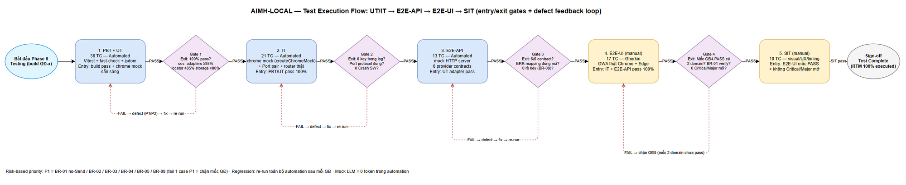
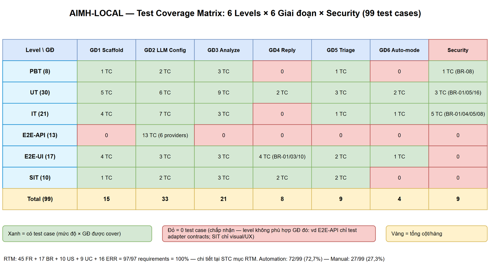

# Software Test Plan (STP)

## AIMailHelper — AIMH-LOCAL: Trợ lý AI cho Outlook Web (Browser Extension MV3)

> **Ghi chú nguồn (đọc trước):** STP v1 này do **QA agent tạo offline** cho placeholder **AIMH-LOCAL** — KHÔNG gọi Jira, KHÔNG xuất DOCX/XLSX, KHÔNG ingest KB (các công cụ đó không khả dụng trong phiên). Nguồn sự thật: **BRD.md v1** (10 user stories + AC), **FSD.md v1.2 BA-REVIEWED** (45 FR theo 6 GĐ, BR-01..BR-17, UC-01..09, ERR-01..16, NFR mục 8), **TDD.md v1.0** (testing strategy mục 12, NFR cách đo mục 10, chrome mock helper 12.2), **GLOSSARY.md**. Không bịa test case nào ngoài phạm vi BRD/FSD; mọi case đều truy vết được (RTM mục 3.5 / STC mục RTM).

---

## Document Information

| Field | Value |
|-------|-------|
| Jira Ticket | AIMH-LOCAL (placeholder offline — chưa có ticket Jira thật) |
| Title | AIMailHelper — Trợ lý AI cho Outlook Web (Browser Extension MV3) |
| Author | QA Agent |
| Version | 1.0 |
| Date | 2026-10-14 |
| Status | Draft — chờ SM review + BA review test cases (Phase 4 Step 4b/4b.5) |
| Related BRD | documents/AIMH-LOCAL/BRD.md (v1) |
| Related FSD | documents/AIMH-LOCAL/FSD.md (v1.2 — BA-REVIEWED) |
| Related TDD | documents/AIMH-LOCAL/TDD.md (v1.0) |
| Related STC | documents/AIMH-LOCAL/STC.md (v1.0) |

---

## Author Tracking

| Role | Name - Position | Responsibility |
|------|-----------------|----------------|
| Author | QA Agent – QA Engineer | Create STP + STC + test data + diagrams |
| Peer Reviewer | SM Agent (self-review) + BA Agent (business coverage review) | Review & sign-off |

---

## Revision History

| Version | Date | Author | Changes |
|---------|------|--------|---------|
| 1.0 | 2026-10-14 | QA Agent | Khởi tạo STP v1 từ BRD v1 + FSD v1.2 + TDD v1.0 — offline placeholder; 6 test levels; RTM 45 FR + 17 BR + 10 US + 9 UC + 16 ERR = 100%; 2 draw.io diagrams (test-coverage, test-execution-flow) |

---

## Sign-Off

| Name | Signature and date |
|------|--------------------|
| Product Owner | ☐ I agree and confirm the test plan in this STP |
| Tech Lead | ☐ I agree and confirm the test plan in this STP |

---

## 1. Introduction

### 1.1 Purpose

STP này định nghĩa **chiến lược kiểm thử** cho AIMailHelper — browser extension Manifest V3 (Chrome + Edge) chạy trên Outlook Web (OWA), gồm 4 nhóm năng lực: phân tích email, soạn draft trả lời (**KHÔNG tự bấm Send — BR-01**), triage hộp thư + Digest, auto-mode tùy chọn (**mặc định TẮT — BR-02**) với hàng chờ duyệt. Kế hoạch bám 100% FSD v1.2 (45 FR theo 6 giai đoạn GĐ1–GĐ6, 17 business rules, 9 use cases, 16 mã lỗi ERR) và TDD v1.0 (kiến trúc 3 execution context, 6 LLM adapters, self-healing locator 3 tầng, chrome.storage wrapper).

Đặc thù dự án quyết định chiến lược test:

1. **Greenfield + không backend**: toàn bộ logic chạy client-side trong 3 execution context (content script / service worker / extension pages). Không có REST API công khai — "API testing" ở đây là **contract test của 6 LLM adapters** qua mock HTTP server (E2E-API).
2. **DOM OWA do Microsoft sở hữu** và đổi bất cứ lúc nào — self-healing 3 tầng (T1 selectors → T2 semantic locator + cache → T3 vision opt-in) là đối tượng test nền tảng (BR-06, BR-12).
3. **An toàn là yêu cầu cao nhất**: extension không bao giờ tự bấm Send (BR-01); auto-mode và vision fallback mặc định TẮT (BR-02, BR-03); API key không bao giờ xuất hiện trong log (BR-08) — các case này được ưu tiên **P1** và test ở nhiều lớp độc lập.
4. **Chi phí LLM do người dùng chịu**: mọi test tự động dùng **mock LLM HTTP** (SSE fixtures) để assert cấu trúc request/response — **0 token thật** trong automation; token thật chỉ dùng ở E2E-UI/SIT thủ công trên OWA thật.

### 1.2 Test Objectives

- **O1 — Functional coverage 100%:** mọi FR (45), business rule (17), use case (9) và user story (10) của BRD/FSD có ít nhất 1 test case truy vết được (RTM coverage 100%).
- **O2 — Safety verification:** chứng minh bằng test đa lớp rằng KHÔNG tồn tại đường code tự kích hoạt nút Send (BR-01), auto-mode/vision mặc định TẮT (BR-02/03), key không lộ (BR-04/08).
- **O3 — Contract correctness:** 6 LLM adapters (OpenAI, Azure, Anthropic, Gemini, OpenAI-compatible, Local) gọi đúng endpoint/headers/body/SSE parsing/error mapping theo FSD 5.2.0–5.2.6.
- **O4 — Self-healing correctness:** T1 <1ms; T2 chỉ chạy khi T1 fail (BR-12); cache locator tự vô hiệu theo layoutHash (BR-06); cache triage theo message-id không gọi LLM lại (BR-09).
- **O5 — NFR verification:** đo được các chỉ số TDD mục 10: first token ~3s, triage 20 email < 60s, T2 cache hit < 10ms, T1 selectors < 1ms, bundle ≤ 1MB gzipped, stream dài > 2 phút không đứt.
- **O6 — Error handling đúng mã ERR-01..16** với retry/backoff policy đúng (429: Retry-After/1-2-4s max 3; 5xx: 2-4-8s; chỉ retry pre-first-chunk).
- **O7 — Compatibility:** hoạt động trên Chrome + Edge, cả 3 domain OWA (outlook.office.com, outlook.office365.com, outlook.live.com), reading-pane/popout/conversation view.

### 1.3 References

| Document | Location |
|----------|----------|
| BRD v1 (10 US + AC) | documents/AIMH-LOCAL/BRD.md |
| FSD v1.2 (45 FR, BR-01..17, UC-01..09, ERR-01..16, NFR) | documents/AIMH-LOCAL/FSD.md |
| TDD v1.0 (testing strategy §12, NFR cách đo §10, protocol §6, schema §7) | documents/AIMH-LOCAL/TDD.md |
| GLOSSARY (thuật ngữ bắt buộc) | documents/AIMH-LOCAL/GLOSSARY.md |
| STC (99 test cases chi tiết) | documents/AIMH-LOCAL/STC.md |
| Test data CSV (13 file) | documents/AIMH-LOCAL/testdata/ |
| PLAN.md (nguồn kỹ thuật đã chốt) | PLAN.md (workspace root) |

---

## 2. Test Strategy

### 2.1 Test Levels (6 levels — bắt buộc)

| Level | Scope | Automation | Tools |
|-------|-------|------------|-------|
| **PBT** | Correctness properties với input sinh ngẫu nhiên (fast-check): serializeEmailData, parse AnalysisResult fail-closed, redact key (BR-08), SSE tolerant parser, LRU 500, layoutHash bất biến theo cấu trúc, storage enum validation (BR-15) | ✅ Automated | Vitest + fast-check |
| **UT** | Unit test từng module theo TDD §12.3: 6 adapters (request shape/SSE/error mapping), registry, storage.ts (validate/area routing/migration/LRU), messaging (heartbeat/cancel/reconnect), owa-adapter (selectors, a11y-tree, layout-hash, locator-cache, reader, detector, actions), digest pipeline, auto-mode rule engine, i18n, **br01-audit source scan** | ✅ Automated | Vitest + jsdom |
| **IT** | Integration giữa các thành phần với **chrome mock thật hơn** (TDD §12.2): MessageRouter thật gắn vào createChromeMock, Port pair duplex fake (ordered/onDisconnect/trễ/gap seq), CONFIG_*/KEY_STORAGE_SET/TEST_CONNECTION/LIST_MODELS/QUEUE_*/LOCATOR_RESOLVE chạy end-to-end qua router, migration, permissions gate | ✅ Automated | Vitest + chrome mock (createChromeMock) |
| **E2E-API** | **Contract test của 6 LLM adapters** qua mock HTTP server (không backend REST trong dự án — đây là "API testing" tương đương): assert URL/headers/body/SSE stream/listModels/error mapping/testConnection cho đủ 6 provider | ✅ Automated | Vitest + fetch + mock HTTP server (undici MockAgent / node:http SSE fixture) |
| **E2E-UI** | Luồng end-to-end **thủ công trên OWA thật** (mốc bắt buộc sau GĐ4 trên cả outlook.office.com VÀ outlook.live.com — FR-GD4-08): load unpacked, popup/options, chat test, analyze streaming, reply chèn compose, triage, auto-mode — viết dạng **Gherkin** để tái lập được | ❌ Manual (Gherkin) | Browser Chrome/Edge trên OWA thật + checklist |
| **SIT** | Manual exploratory / visual / UX / timing trên OWA thật — **chỉ giữ những gì không tự động hóa được**: Shadow DOM không vỡ layout, đổi email giữa stream, EF-5 so khớp messageId, storage quota thật, heartbeat stream > 2 phút, virtualized list cuộn, Diagnose report | ❌ Manual | Browser + DevTools |

> **Lý do E2E-UI manual (không Playwright trên OWA):** OWA yêu cầu đăng nhập tài khoản thật + Microsoft chống automation trên domain mail; TDD §12.1 đã chốt "không E2E framework MVP — manual test trên OWA thật ở mốc GĐ4/GĐ5". Gherkin được dùng để chuẩn hóa kịch bản manual, sẵn sàng tự động hóa sau MVP nếu cần. Automation được maximize ở PBT/UT/IT/E2E-API (72/99 = 72,7%); SIT chỉ còn visual/UX/timing.


*[Edit in draw.io](diagrams/test-execution-flow.drawio)*

### 2.2 Test Types

| Type | Description | Applicable |
|------|-------------|------------|
| Functional Testing | Verify features theo UC-01..09 + FR-GD1..GD6 | Yes |
| Safety/Compliance Testing | BR-01 (no-Send), BR-02/03 (fail-closed), BR-04/05/08 (key/privacy), BR-15/16 (validation/CSP) | Yes — ưu tiên cao nhất |
| Security Testing | Prompt injection, XSS qua email content, key redaction, host permission allowlist, no remote code (phục vụ P6.3) | Yes |
| Regression Testing | Re-run toàn bộ bộ tự động (PBT/UT/IT/E2E-API) sau mỗi GĐ + source-scan BR-01 sau mỗi PR | Yes |
| Performance Testing | NFR TDD §10: T1 <1ms, T2 cache hit <10ms, snapshot ≤100ms/20K chars, first token ~3s, triage 20 email <60s, stream p95 <10ms, bundle ≤1MB | Yes (đo mục tiêu, không SLA) |
| Compatibility Testing | Chrome + Edge ≥114; 3 domain OWA; reading-pane/popout/conversation | Yes |
| Usability Testing | Song ngữ vi/en, thông báo lỗi dễ hiểu, privacy note | Yes (SIT) |

### 2.3 Test Approach

1. **Risk-based prioritization** — mức ưu tiên test theo rủi ro nghiệp vụ:

| Priority | Phạm vi | Lý do |
|----------|---------|-------|
| **P1 (cao nhất)** | BR-01 no-Send (UT-121, IT-607, E2E-UI-410/414), BR-02 auto-mode default OFF, BR-03 vision opt-in, BR-04/08 key storage + redaction, BR-05 host allowlist, BR-15 enum validation, BR-16 CSP | Rủi ro High/Low nhưng Impact High (gửi nhầm thư, lộ key) — BRD mục 5.1; fail 1 case P1 = chặn mốc GĐ |
| **P2** | 6 adapter contracts (E2E-API), Port streaming protocol, self-healing locator BR-06/BR-12, triage cache BR-09, error mapping ERR-01..16 | Nền tảng hoạt động hằng ngày |
| **P3** | i18n fallback, ModelPicker BR-17, NFR đo đạc, diagnose report | Chất lượng trải nghiệm |
| **P4** | Visual/cosmetic (SIT), hiDPI vision tọa độ | Nice-to-have |

2. **Automation-first, mock-token-free:** mọi layer tự động chạy với mock LLM (SSE fixture) — assert **cấu trúc** request/response, không assert nội dung AI; 0 token thật. E2E-UI/SIT trên OWA thật mới dùng provider thật (Ollama local 0-cost, hoặc cloud key dùng thử với giới hạn).
3. **Shift-left theo GĐ:** mỗi GĐ1..GĐ6 có bộ test tương ứng chạy ngay khi GĐ hoàn thành (Done criteria TDD §11); không dồn test cuối dự án.
4. **Multi-layer defense cho BR-01:** (a) static source scan (UT-121), (b) runtime spy khi approve-all (IT-607), (c) manual verify trên OWA (E2E-UI-410/414), (d) security review P3.7.
5. **Test data tái lập được:** toàn bộ fixture nằm trong `testdata/*.csv` (13 file) — email mẫu, mock SSE streams, cấu hình provider, rules auto-mode, chỉ số NFR.

### 2.4 Entry Criteria

| Level | Entry Criteria |
|-------|---------------|
| PBT/UT | Module code GĐ tương ứng hoàn thành; `npm run build` pass; chrome mock helper (TDD §12.2) sẵn sàng; fixtures từ `testdata/` nạp được |
| IT | PBT/UT của cùng module pass 100%; MessageRouter + handlers tồn tại; Port pair fake hoạt động |
| E2E-API | UT của adapter pass; mock HTTP server (SSE fixtures) dựng được cho 6 provider |
| E2E-UI | IT + E2E-API pass 100% cho GĐ tương ứng; build GĐ load được qua "Load unpacked"; tài khoản OWA test sẵn; (mốc GĐ4) cả 2 domain truy cập được |
| SIT | E2E-UI mốc tương ứng PASS; không còn defect Critical/Major mở của GĐ đó |

### 2.5 Exit Criteria

| Level | Exit Criteria |
|-------|---------------|
| PBT/UT | 100% case pass; coverage: adapters ≥ 85%, locator/cache ≥ 85%, storage/messaging ≥ 80% (TDD §12.1); br01-audit (UT-121) pass |
| IT | 100% case pass; 0 key trong mọi log/output (assert tự động); Port protocol đúng (seq/cancel/reconnect/heartbeat) |
| E2E-API | 13/13 contract case pass cho đủ 6 provider; error mapping → ERR đúng mã; KHÔNG key trong error message (BR-08) |
| E2E-UI | Mốc GĐ4: PASS trên CẢ outlook.office.com và outlook.live.com (FR-GD4-08); BR-01 verify không tự Send; 0 Critical/Major defect mở |
| SIT | Toàn bộ case visual/UX pass; không regression phát hiện; sign-off Test Complete |

### 2.6 E2E Automation Coverage (phân loại SIT → tự động hóa)

| Scenario Type | Classify As | Lý do |
|---------------|-------------|-------|
| Provider contract (headers/body/SSE/listModels/error) | **E2E-API** | Mock HTTP đủ, deterministic |
| Storage CRUD, enum validation, migration, LRU, area routing | **UT + IT** | chrome mock đủ thật (TDD §12.2) |
| Message router + Port streaming (chunk/done/error/cancel/reconnect/heartbeat) | **IT** | Port pair fake hỗ trợ ordered/disconnect/trễ |
| Rule engine auto-mode, queue approve/reject, triage batch/backoff | **UT + IT** | Logic thuần, mock observer/actions |
| Popup/Options render, load unpacked, chat test từ Options | **E2E-UI (manual)** | Cần browser thật + MV3 runtime |
| Streaming trên OWA thật, chèn compose box thật | **E2E-UI (manual)** | DOM OWA thật |
| Visual/UX: Shadow DOM layout, badge màu, Digest hiển thị | **SIT (manual)** | Cần mắt người |
| Timing: heartbeat > 2 phút, first token, SW kill giữa stream | **SIT (manual)** | Phụ thuộc MV3 runtime thật |
| Prompt injection / XSS render / key redaction | **IT + PBT** (tự động) | Không cần browser thật |

> Kết quả: chỉ còn 10/99 case SIT manual thuần (visual/UX/timing) — đạt mục tiêu "minimize manual SIT".

---

## 3. Test Scope

### 3.1 Features In Scope

| # | Feature / Story | Priority | FSD Reference | Test Type |
|---|-----------------|----------|---------------|-----------|
| 1 | GĐ1 Scaffold: manifest/permissions, popup, Options shell, storage.ts, messaging.ts, i18n, content inject 3 domain, selectors T1 | High | FR-GD1-01..08, US-01, US-05, BR-15 | PBT, UT, IT, E2E-UI |
| 2 | GĐ2 LLM Config: 6 adapters + registry, ProviderForm, ModelPicker, Test Connection, Port streaming, key storage sync/local, local preset | High | FR-GD2-01..10, US-02/03/04, BR-04, BR-08, BR-17 | PBT, UT, IT, E2E-API, E2E-UI |
| 3 | GĐ3 Đọc & Phân tích email: detector, reader, T2 self-healing, panel Shadow DOM, streaming 5 khía cạnh, badge màu | High | FR-GD3-01..07, US-06, BR-06, BR-12, BR-14 | UT, IT, E2E-UI, SIT |
| 4 | GĐ4 Soạn trả lời: tone/language, draft preview, chèn compose box KHÔNG Send, T3 vision opt-in, diagnose | High | FR-GD4-01..08, US-07, BR-01, BR-03, BR-10, BR-11 | UT, IT, E2E-UI, SIT |
| 5 | GĐ5 Triage: đọc list hiển thị, batch + throttle/backoff, badge, Digest, cache message-id, LRU 500, cap 50 | Medium | FR-GD5-01..06, US-08, BR-07, BR-09 | UT, IT, E2E-UI, SIT |
| 6 | GĐ6 Auto-mode: mặc định TẮT + confirm, MutationObserver, rule engine, hàng chờ Approve/Reject, QUEUE_MAX 200 | Medium | FR-GD6-01..06, US-09, BR-02, BR-13 | UT, IT, E2E-UI, SIT |
| 7 | Security (cross-cutting, phục vụ P6.3): prompt injection, XSS panel, key redaction, host allowlist, CSP no remote code, BR-01 audit | High | US-10, BR-01/04/05/08/16 | PBT, UT, IT, SIT |
| 8 | NFR verification (TDD §10): T1 <1ms, T2 cache hit <10ms, snapshot, first token ~3s, triage 20 <60s, stream p95, bundle, Test Connection ≤15s | Medium | FSD mục 8, TDD mục 10 | UT, IT, E2E-API, E2E-UI |
| 9 | Error handling ERR-01..16 + retry/backoff policy | High | FSD mục 9, TDD mục 9 | UT, IT, E2E-API, E2E-UI |

### 3.2 Features Out of Scope

| # | Feature | Reason |
|---|---------|--------|
| 1 | Microsoft Graph API / truy cập email server-side | Out of scope BRD 1.2 — extension chỉ đọc DOM OWA |
| 2 | Tự động bấm Send | BR-01 — KHÔNG tồn tại chức năng; chỉ test "không tồn tại" (negative audit) |
| 3 | Pro mode chrome.debugger + CDP | Hoãn sau MVP (Open Issue #7) — chỉ có interface stub |
| 4 | Firefox / Safari / Outlook desktop | Out of scope BRD 1.2 |
| 5 | Backend/server trung gian, telemetry | BR-05 — không tồn tại; audit "không có request tới host lạ" là in-scope |
| 6 | Chất lượng nội dung AI (độ hay của summary/draft) | Phụ thuộc model + prompt — chỉ test cấu trúc/schema, không judge nội dung |
| 7 | Load/stress testing quy mô lớn | Extension client-side single-user — không áp dụng |
| 8 | Deployment doanh nghiệp / admin policy | Out of scope BRD 1.2 |

### 3.3 Test Case Summary (theo 6 levels — chi tiết tại STC)

| Level | Count | Automated | Manual |
|-------|-------|-----------|--------|
| PBT | 8 | 8 | 0 |
| UT | 30 | 30 | 0 |
| IT | 21 | 21 | 0 |
| E2E-API | 13 | 13 | 0 |
| E2E-UI | 17 | 0 | 17 |
| SIT | 10 | 0 | 10 |
| **Total** | **99** | **72 (72,7%)** | **27 (27,3%)** |

### 3.4 RTM Summary — coverage theo User Story (BRD)

RTM đầy đủ (45 FR + 17 BR + 10 US + 9 UC + 16 ERR → test case IDs) tại **STC mục "Requirements Traceability Matrix"**. Tóm tắt theo US:

| US (BRD) | Nội dung | Test Cases chính | Coverage |
|----------|----------|------------------|----------|
| US-01 | Cài extension + popup + Options | TC-401, TC-402, TC-403, TC-101, TC-212 | ✅ 100% |
| US-02 | Cấu hình 6 LLM provider | TC-301..309, TC-404, TC-406, TC-107, TC-202 | ✅ 100% |
| US-03 | Test Connection + latency | TC-405, TC-311, TC-204, TC-617 | ✅ 100% |
| US-04 | Nơi lưu API key sync/local | TC-103, TC-203, TC-407 | ✅ 100% |
| US-05 | Chuyển ngôn ngữ UI vi/en | TC-106, TC-407, TC-008 | ✅ 100% |
| US-06 | Phân tích email 5 khía cạnh | TC-408, TC-409, TC-114, TC-115, TC-501..503, TC-002/003 | ✅ 100% |
| US-07 | Soạn draft + chèn Reply không Send | TC-410, TC-411, TC-116, TC-415, TC-504 | ✅ 100% |
| US-08 | Triage inbox + Digest | TC-413, TC-117, TC-118, TC-209, TC-509 | ✅ 100% |
| US-09 | Auto-mode hàng chờ duyệt | TC-414, TC-119, TC-120, TC-211 | ✅ 100% |
| US-10 | Privacy & an toàn (cross-cutting) | TC-604, TC-605, TC-606, TC-607, TC-121, TC-412 | ✅ 100% |

**Tổng RTM:** 45/45 FR · 17/17 BR · 10/10 US · 9/9 UC · 16/16 ERR = **100%** (0 requirement không có test case).

### 3.5 Test Coverage Matrix (6 levels × 6 GĐ × Security)


*[Edit in draw.io](diagrams/test-coverage.drawio)*

---

## 4. Test Environment

### 4.1 Environment Requirements

| Environment | URL / Nền | LLM Endpoint | Purpose |
|-------------|-----------|--------------|---------|
| AUT (automation) | Vitest + jsdom + chrome mock (createChromeMock — TDD §12.2) | Mock HTTP server với SSE fixtures — 0 token | PBT, UT, IT, E2E-API |
| SIT/E2E (thật) | Chrome/Edge "Load unpacked" trên OWA thật | Ollama local `http://localhost:11434` (0-cost, env `OLLAMA_ORIGINS=chrome-extension://*`) hoặc 1 cloud key dùng thử | E2E-UI, SIT |

### 4.2 Browser / Device Requirements

| Browser | Version | OS | Required |
|---------|---------|-----|----------|
| Chrome | ≥ 114 (MV3, storage.local 10MB) | Windows 10/11, macOS | Yes (bắt buộc) |
| Edge | ≥ 114 | Windows 10/11 | Yes (bắt buộc — AC US-01) |
| OWA Work/School | outlook.office.com + outlook.office365.com | — | Yes (mốc GĐ4) |
| OWA Cá nhân | outlook.live.com | — | Yes (mốc GĐ4) |
| Ollama | ≥ 0.3, model `llama3.2:latest` đã pull | cùng máy | Yes (E2E-UI provider local) |

### 4.3 Test Data Requirements

| Data Type | Description | Source | Preparation |
|-----------|-------------|--------|-------------|
| Provider configs (6) | Config hợp lệ + không hợp lệ từng provider (thiếu key, sai baseUrl, sai api-version, model rỗng) | testdata/provider-config-testdata.csv | Nạp qua Options hoặc fixtures |
| Mock SSE streams | Chuỗi SSE chuẩn từng provider (OpenAI `[DONE]`, Anthropic event/data, Gemini không `[DONE]`, vLLM tolerant) + error bodies (401/429/5xx/timeout) | testdata/llm-mock-responses-testdata.csv | Nạp vào mock HTTP server |
| Email fixtures | 10 email mẫu: thường, rỗng body, conversation, deadline, prompt-injection, XSS, sender khớp rule, 20+ item triage | testdata/email-fixture-testdata.csv + triage-testdata.csv | Mở thật trên OWA (E2E-UI) hoặc nạp DOM fixture (UT/IT) |
| Storage scenarios | Enum hợp lệ/không hợp lệ, keyStorage sync↔local, quota đầy, schemaVersion | testdata/storage-testdata.csv | Ghi qua devtools/migration test |
| Auto-mode data | Rules + email khớp/không khớp, queue 200 item | testdata/automode-testdata.csv | Nạp qua AutomationSettings |
| NFR measurement plan | Cách đo từng chỉ số TDD §10 | testdata/nfr-measurements-testdata.csv | DevTools/(console.time) |

### 4.4 External Dependencies

| System | Dependency | Mock/Stub Available |
|--------|-----------|---------------------|
| LLM cloud (OpenAI/Azure/Anthropic/Gemini/OpenRouter) | API key + CORS | Yes — mock HTTP server với SSE fixtures cho toàn bộ automation (0 token); thật chỉ dùng 1 lần smoke ở E2E-UI |
| Ollama local | env `OLLAMA_ORIGINS=chrome-extension://*` | Yes — chạy thật local (0-cost); thiếu env → test chính ERR-05 hướng dẫn |
| DOM OWA | 3 domain, có thể đổi layout | Yes — DOM fixture tự dựng + kịch bản "phá T1" bằng DevTools (E2E-UI-409) |
| chrome.storage / runtime Port | MV3 platform | Yes — createChromeMock (in-memory + Port pair duplex) |
| chrome.permissions | optional_host_permissions | Yes — mock contains/request trong IT |

---

## 5. Test Schedule

> Offline placeholder — lịch tính theo **tuần tương đối** kể từ khi GĐ tương ứng hoàn thành (không gắn ngày Jira thật).

| Phase | Start | End | Duration | Milestone |
|-------|-------|-----|----------|-----------|
| Test Planning (Phase 4) | T0 | T0 + 2 ngày | 2 ngày | STP + STC được SM review + BA APPROVED |
| Test Data Preparation | T0 | T0 + 1 ngày | 1 ngày (song song) | 13 file CSV + mock SSE fixtures sẵn sàng |
| GĐ1 Testing (UT/IT + E2E-UI smoke) | GĐ1 done | +1 ngày | 1 ngày | TC-101..106, TC-401..403 PASS |
| GĐ2 Testing (adapters + IT + E2E-API) | GĐ2 done | +3 ngày | 3 ngày | 13/13 E2E-API PASS; TC-04..06 PASS |
| GĐ3 Testing (locator + analyze) | GĐ3 done | +3 ngày | 3 ngày | TC-109..115, TC-408/409 PASS; NFR T1/T2 đo được |
| **Mốc kiểm thử thật GĐ4** (cả 2 domain) | GĐ4 done | +3 ngày | 3 ngày | TC-410..415 PASS cả outlook.office.com + outlook.live.com; BR-01 verify |
| GĐ5 Testing (triage) | GĐ5 done | +2 ngày | 2 ngày | TC-117/118, TC-413 PASS; triage 20 email < 60s |
| GĐ6 Testing (auto-mode) + Security review (P6.3) | GĐ6 done | +2 ngày | 2 ngày | TC-119..121, TC-414, TC-601..607 PASS |
| Defect Fix & Retest | liên tục | — | — | 0 Critical/Major mở |
| Test Complete sign-off | sau GĐ6 | +1 ngày | 1 ngày | TEST-REPORT hoàn tất; RTM 100% executed |

---

## 6. Resources & Responsibilities

| Role | Name | Responsibility |
|------|------|---------------|
| Test Lead | QA Agent | Test planning, STP/STC, RTM, báo cáo, quality gate |
| QA Engineer | QA Agent + SM (chạy manual E2E-UI/SIT) | Thiết kế + thực thi test case, defect reporting |
| BA | BA Agent | Review business coverage của STC (Step 4b.5), làm rõ AC |
| Developer | DEV Agent | Bug fix, unit test coverage, cung cấp build "Load unpacked" |
| DevOps | DevOps Agent | Môi trường build, mock HTTP server CI-ready |
| Security | security-agent (P6.3) | Review kết quả TC-601..607 + BR-01 audit |

**Tools:** Vitest 2.x + fast-check + jsdom (automation) · createChromeMock (TDD §12.2) · mock HTTP server (undici MockAgent/node:http) · Chrome/Edge DevTools (đo NFR, Diagnose) · draw.io CLI (diagram) · defect tracking: không Jira — ghi vào `TEST-REPORT-AIMH-LOCAL.csv` (offline).

---

## 7. Risk & Mitigation

| # | Risk | Impact | Likelihood | Mitigation |
|---|------|--------|------------|------------|
| 1 | MS đổi DOM OWA giữa chừng test → selector fixtures lỗi thời | High | High | DOM fixture tách khỏi test logic; kịch bản "phá T1" có chủ đích (TC-409); spike selector + message-id bắt buộc GĐ3/GĐ5 trên cả 2 domain (TDD §7.5, §15.2) |
| 2 | Mock HTTP không phản ánh đúng hành vi provider thật (SSE quirks) | High | Medium | SSE fixtures bám nguyên FSD 5.2.1–5.2.6; 1 lần smoke thật per provider ở E2E-UI (TC-404) để đối chiếu |
| 3 | Tốn token thật khi test trên OWA | Medium | Medium | Automation 0 token (mock); OWA thật dùng Ollama local ưu tiên; cloud key chỉ smoke ngắn |
| 4 | MV3 service worker bị kill giữa stream (idle ~30s) làm flaky test | High | Medium | Heartbeat 20s là đối tượng test riêng (TC-124, TC-508); fallback ERR-07 đã an toàn nghiệp vụ (Open Issue #9) |
| 5 | Anthropic listModels CORS chưa verify (Open Issue #2) | Low | Medium | BR-17 đã có phương án nhập tay; test cả 2 nhánh (TC-406) |
| 6 | Tài khoản OWA test bị giới hạn rate/2FA | Medium | Medium | 2 tài khoản (work + personal); Ollama local thay thế khi cloud chặn |
| 7 | Env OLLAMA_ORIGINS quên đặt → ERR-05 giả hạn chế | Low | High | Chính là case test ERR-05 (TC-404 bước phụ); checklist môi trường ghi rõ trong 4.2 |
| 8 | Timeline: test dồn cuối dự án | Medium | Medium | Shift-left: test mỗi GĐ ngay khi GĐ done (mục 5); automation re-run mỗi GĐ như regression |

---

## 8. Defect Management

### 8.1 Severity Levels

| Severity | Definition | Example (dự án này) |
|----------|-----------|---------------------|
| **Critical** | Vi phạm an toàn tuyệt đối, mất dữ liệu, lộ bí mật | Extension tự bấm Send (BR-01) · API key xuất hiện trong log/error (BR-08) · auto-mode tự hành động khi TẮT (BR-02) · vision gọi captureVisibleTab khi TẮT (BR-03) · email gửi tới host không phải provider cấu hình (BR-05) |
| Major | Tính năng chính không hoạt động, không có workaround | Adapter không stream được · T2 không phục hồi khi T1 gãy · triage không cache · chèn compose thất bại thường xuyên |
| Minor | Vấn đề có workaround, ảnh hưởng trải nghiệm | i18n fallback hiện raw key · badge màu sai sắc độ · message lỗi chưa dễ hiểu |
| Trivial | Cosmetic | Lệch spacing, typo trong privacy note |

### 8.2 Priority Levels

| Priority | Definition | SLA (Fix Time) |
|----------|-----------|----------------|
| P1 | Vi phạm BR-01/02/03/04/05/08 — an toàn/bảo mật | 4 giờ (chặn mốc GĐ) |
| P2 | Feature chính của GĐ hỏng, chưa qua Done criteria GĐ | 1 ngày làm việc |
| P3 | Minor defect | 3 ngày làm việc |
| P4 | Trivial, có thể hoãn | Bản sau |

### 8.3 Defect Lifecycle

```
New → Open → In Progress → Fixed → Ready for Retest → Verified → Closed
                                                   → Reopened → In Progress
```

Ghi nhận offline vào `TEST-REPORT-AIMH-LOCAL.csv` (cột Status/Actual_Result/Defect_ID); defect Critical/P1 phải được nêu trong báo cáo khi xong mỗi GĐ.

---

## 9. Test Metrics & Reporting

### 9.1 Metrics

| Metric | Formula | Target |
|--------|---------|--------|
| RTM Coverage | Requirements có ≥1 TC / Tổng requirements × 100% | 100% (97/97: 45 FR + 17 BR + 10 US + 9 UC + 16 ERR) |
| Test Execution Rate | Executed / Total × 100% | 100% |
| Pass Rate | Passed / Executed × 100% | ≥ 95% (Critical case: 100%) |
| Automation Rate | Automated / Total × 100% | ≥ 70% (hiện thiết kế 72,7%) |
| Defect Density | Defects / Test Cases | ≤ 0.1 |
| Critical Defect Count | Số Critical mở | 0 (đặc biệt BR-01/04/08) |
| Code Coverage | Vitest coverage adapters/locator/storage/messaging | adapters ≥85%, locator/cache ≥85%, storage/messaging ≥80% |
| NFR Attainment | Chỉ số TDD §10 đạt mục tiêu | 100% mục tiêu đo được (first token, triage 20<60s, T1<1ms, T2<10ms) |

### 9.2 Reporting Schedule

| Report | Frequency | Audience |
|--------|-----------|----------|
| Kết quả automation mỗi GĐ (log `npm test`) | Mỗi khi GĐ done | DEV + SM |
| Cập nhật `TEST-REPORT-AIMH-LOCAL.csv` | Sau mỗi buổi thực thi E2E-UI/SIT | SM |
| Defect summary Critical/Major | Ngay khi phát hiện | DEV + SM |
| Test Completion Report (TEST-REPORT.md) | Cuối Phase 6 | Tất cả stakeholders |

---

## 10. Appendix

### 10.1 Diagrams — trạng thái export (ghi THẬT)

| # | Diagram | File nguồn | PNG | Trạng thái export |
|---|---------|-----------|-----|-------------------|
| 1 | Test Coverage Matrix — 6 levels × 6 GĐ × Security (99 TC) | [test-coverage.drawio](diagrams/test-coverage.drawio) | [test-coverage.png](diagrams/test-coverage.png) | ✅ Thành công — draw.io CLI (`-x -f png -b 10 --width 2000`); vision self-check: PASS vòng 1 (grid thẳng hàng, legend rõ, không overlap) |
| 2 | Test Execution Flow — UT/IT → E2E-API → E2E-UI → SIT với 4 gate + feedback loop | [test-execution-flow.drawio](diagrams/test-execution-flow.drawio) | [test-execution-flow.png](diagrams/test-execution-flow.png) | ✅ Thành công — draw.io CLI; vision self-check: PASS vòng 1 (5 box + 4 diamond thẳng hàng, 4 feedback arrow không đè node) |

### 10.2 Diagram Index

| # | Diagram | Image | Source (editable) |
|---|---------|-------|-------------------|
| 1 | Test Coverage Matrix | [test-coverage.png](diagrams/test-coverage.png) | [test-coverage.drawio](diagrams/test-coverage.drawio) |
| 2 | Test Execution Flow | [test-execution-flow.png](diagrams/test-execution-flow.png) | [test-execution-flow.drawio](diagrams/test-execution-flow.drawio) |

### 10.3 Glossary (trích)

| Term | Definition |
|------|------------|
| PBT | Property-Based Testing — test bất biến với input sinh ngẫu nhiên (fast-check) |
| UT / IT | Unit Test / Integration Test (chrome mock — TDD §12.2) |
| E2E-API | Contract test của LLM adapters qua mock HTTP server (không có REST backend trong dự án) |
| E2E-UI / SIT | Test thủ công trên OWA thật: luồng end-to-end / exploratory-visual-UX |
| OWA Adapter | Tầng middleware đọc/thao tác DOM OWA (GLOSSARY) |
| Self-healing Locator | 3 tầng: selectors → semantic locator (a11y + cache) → vision fallback (GLOSSARY) |
| BR-xx / ERR-xx | Business rule (FSD 3.2) / mã lỗi user-facing (FSD 9.1) |

### 10.4 Assumptions

- AIMH-LOCAL là placeholder offline: không gắn Jira, không attach, không DOCX/XLSX export (không có công cụ export trong phiên).
- Mock LLM assertion chỉ xác minh **cấu trúc** (headers/body/SSE shape/schema) — chất lượng nội dung AI không thuộc phạm vi test.
- Manual E2E-UI/SIT do SM/QA thực thi trên OWA thật; Gherkin trong STC là kịch bản tái lập được.
- BA review test cases (Phase 4 Step 4b.5) sẽ được SM invoke sau khi STC hoàn tất; STP/STC chưa đánh dấu final cho tới khi BA verdict = APPROVED.

### 10.5 Test Data Index

| File | Phủ test case |
|------|---------------|
| testdata/pre-seeded-data.csv | Baseline providers + trạng thái ban đầu |
| testdata/provider-config-testdata.csv | TC-101/102/107/202/204/205/301..311/404/405/406/510 |
| testdata/llm-mock-responses-testdata.csv | TC-002/005/122/123/124/206..208/301..307/310..312 |
| testdata/storage-testdata.csv | TC-006/008/102..105/201..203/212/213/505 |
| testdata/email-fixture-testdata.csv | TC-001/003/108/114/408/410/501..504/601/603/613 |
| testdata/locator-testdata.csv | TC-007/109..113/115/210/409/610..612 |
| testdata/triage-testdata.csv | TC-006/117/118/209/413/509/614 |
| testdata/automode-testdata.csv | TC-119/120/211/414/607 |
| testdata/reply-testdata.csv | TC-116/125/410/411/412/504 |
| testdata/security-testdata.csv | TC-004/121/214/601..607 |
| testdata/nfr-measurements-testdata.csv | TC-508/610..617 |
| testdata/i18n-testdata.csv | TC-106/407 |
| testdata/ui-owa-testdata.csv | TC-401..415/501..510 |
