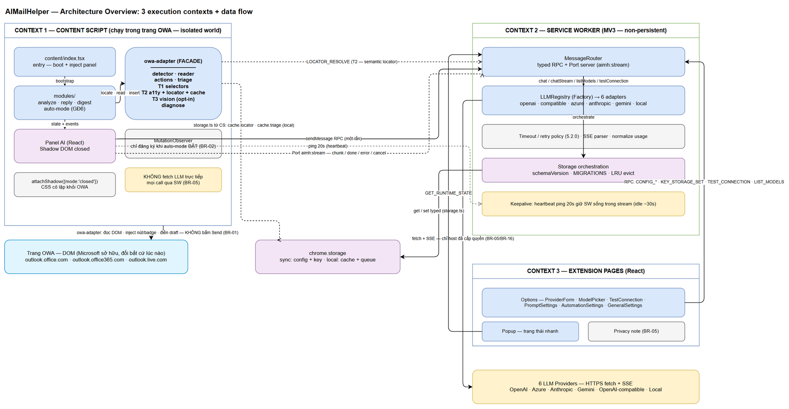
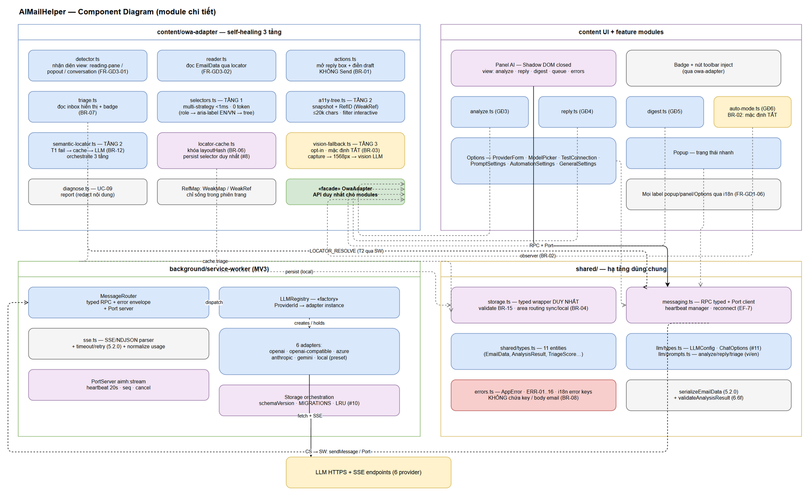
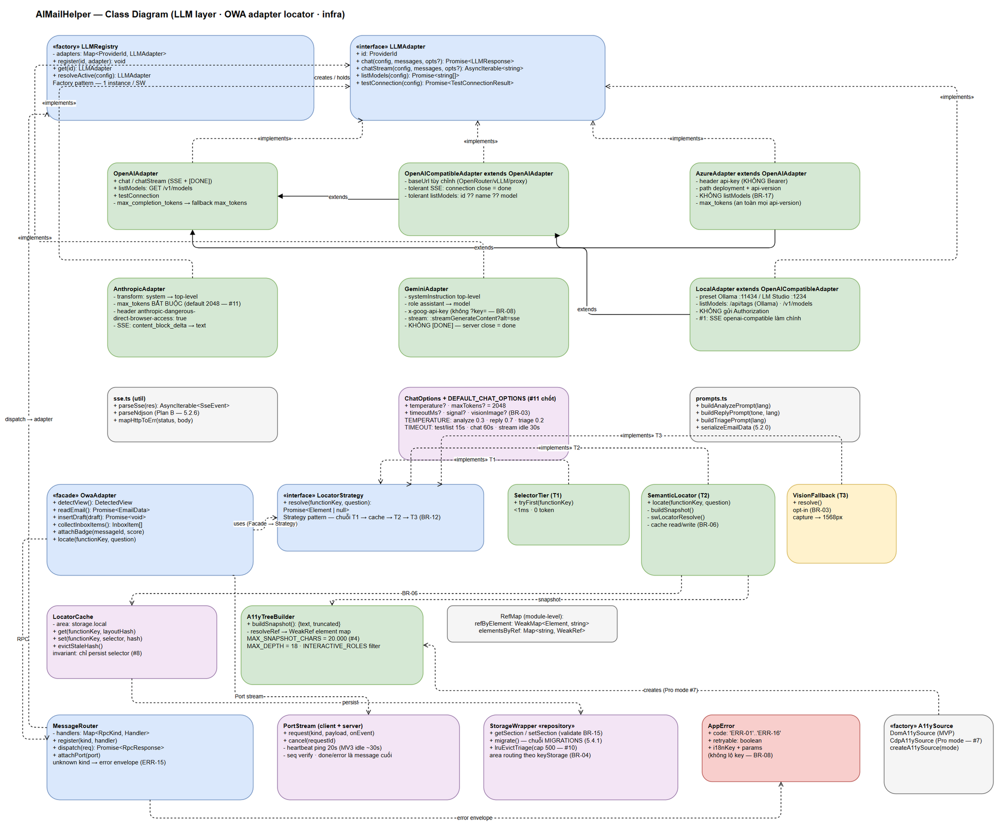
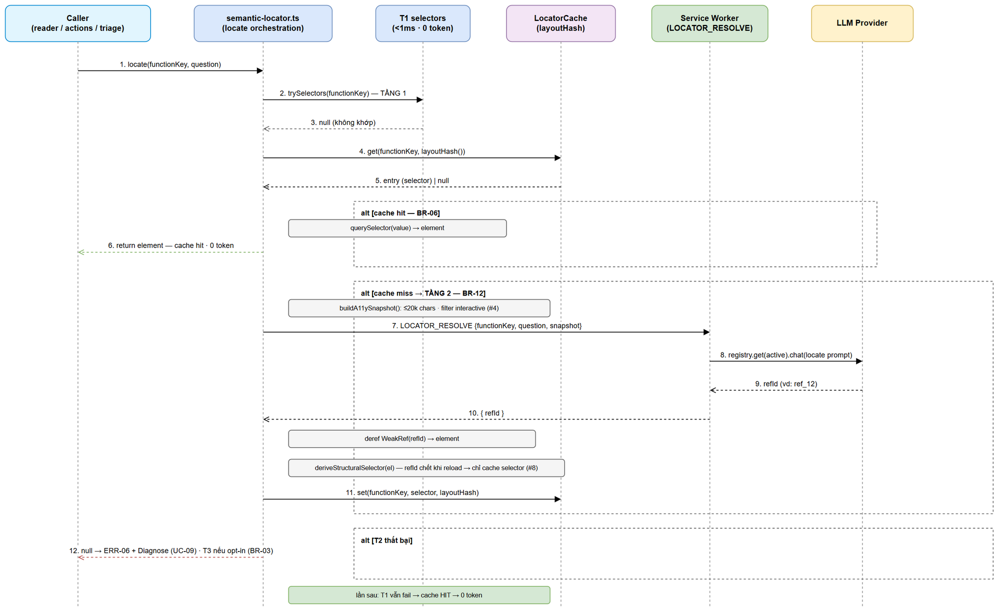

# Technical Design Document (TDD)

## AIMailHelper — AIMH-LOCAL: Trợ lý AI cho Outlook Web (Browser Extension MV3)

> **Ghi chú nguồn (đọc trước):** TDD v1 được **SA agent tạo offline** cho placeholder **AIMH-LOCAL** — KHÔNG gọi Jira, KHÔNG bịa ticket key/URL. Nguồn sự thật: **FSD.md v1.2 (BA-REVIEWED)** — input chính; **BRD.md v1** — business context; **GLOSSARY.md** — thuật ngữ bắt buộc; **REFERENCE-ANALYSIS.md** — pattern self-healing đã nghiên cứu; **PLAN.md** — tech stack + cấu trúc thư mục (mục 4) + LLM layer (mục 5) + OWA adapter 3 tầng (mục 6) — nguồn kỹ thuật đã chốt. **Dự án greenfield:** thư mục `src/` rỗng (kiểm tra 2026-10-14), toàn bộ thiết kế trong TDD này là **thiết kế mới từ đầu**. Tài liệu viết tiếng Việt, thuật ngữ kỹ thuật tiếng Anh, tuân thủ GLOSSARY (cột Avoid). Tài liệu tuân theo cấu trúc documents/templates/TDD-TEMPLATE.md, điều chỉnh cho domain browser extension (không có RDBMS — thay bằng chrome.storage design).

---

## Document Information

| Field | Value |
|-------|-------|
| Jira Ticket | AIMH-LOCAL (placeholder offline — chưa có ticket Jira thật) |
| Title | AIMailHelper — Trợ lý AI cho Outlook Web (Browser Extension MV3) |
| Author | SA Agent |
| Version | 1.0 |
| Date | 2026-10-14 |
| Status | Draft — chờ security review (P3.7) + feedback loop BA↔SA |
| Related BRD | documents/AIMH-LOCAL/BRD.md (v1) |
| Related FSD | documents/AIMH-LOCAL/FSD.md (v1.2 — BA-REVIEWED) |

---

## Author Tracking

| Role | Name - Position | Responsibility |
|------|-----------------|----------------|
| Author | SA Agent – Solution Architect | Create document |
| Peer Reviewer | security-agent (P3.7) / DEV agent | Review & implement |

---

## Revision History

| Version | Date | Author | Changes |
|---------|------|--------|---------|
| 1.0 | 2026-10-14 | SA Agent | Khởi tạo TDD v1 từ FSD v1.2 + BRD v1 + PLAN.md — offline placeholder; resolve Open Issues #1/#3/#5/#6/#7/#8/#10/#11; 4 drawio diagrams mới (architecture, component, class-diagram, sequence-semantic-locator); greenfield design |

---

## Sign-Off

| Name | Signature and date |
|------|--------------------|
| Product Owner | ☐ I agree and confirm the technical design in this TDD |
| Tech Lead | ☐ I agree and confirm the technical design in this TDD |

---
## 1. Introduction

> **Scope Boundary:** TDD này đặc tả **CÁCH triển khai (HOW)** các yêu cầu đã định nghĩa trong FSD v1.2 — không lặp lại yêu cầu chức năng, business rules, use cases hay UI specs (xem FSD). Tài liệu tập trung vào: lựa chọn công nghệ, kiến trúc, pattern triển khai, message protocol nội bộ, data design trên chrome.storage, bảo mật và checklist triển khai 6 giai đoạn.

### 1.1 Purpose

Thiết kế kỹ thuật chi tiết cho **AIMailHelper** — browser extension Manifest V3 (Chrome + Edge) chạy trên Outlook Web (OWA), gồm 4 nhóm năng lực: phân tích email, soạn draft trả lời (KHÔNG tự gửi), triage hộp thư + Digest, auto-mode tùy chọn (mặc định TẮT) với hàng chờ duyệt. TDD chuyển FSD thành: kiến trúc 3 execution context, component/class design khả triển khai ngay, message protocol typed, data schema chrome.storage có versioning/migration, chiến lược bảo mật (sẵn cho security review P3.7), error handling strategy và implementation checklist theo 6 GĐ.

### 1.2 Scope

**In scope (kỹ thuật):**

1. Kiến trúc 3 context: content script / service worker / extension pages (options + popup) — module boundaries bám PLAN.md mục 4.
2. **owa-adapter** — self-healing 3 tầng: selectors (T1) → semantic locator + locator-cache (T2) → vision fallback opt-in (T3); detector/reader/actions/triage; Shadow DOM isolation.
3. **LLM layer** — 6 provider adapters + registry (Factory) + streaming qua chrome.runtime Port (protocol khớp FSD 5.3.x).
4. **storage.ts** — typed wrapper chrome.storage + versioning/migration (FSD 5.4.1); **messaging.ts** — typed RPC + Port; **i18n** vi/en.
5. Message protocol nội bộ (RPC một-lần + Port streaming), data design (11 entities từ FSD mục 4 — chuẩn hóa cuối).
6. Security design (BR-01..BR-17), error handling (ERR-01..ERR-16), NFR confirm, testing strategy, implementation checklist 6 GĐ.

**Out of scope (kế thừa BRD/FSD):** Microsoft Graph API; tự bấm Send; Pro mode chrome.debugger + CDP (chỉ chốt interface stub — Open Issue #7); framework browser-agent ngoài; Firefox/Safari/Outlook desktop; backend trung gian; deployment doanh nghiệp.

**Greenfield note:** `src/` rỗng tại thời điểm viết — mọi quyết định đặt tên file/package trong TDD là **chuẩn hóa lần đầu**, DEV tạo theo đúng cây thư mục mục 4.1; không có codebase cũ cần tương thích.
### 1.3 Technology Stack

| Layer | Technology | Version | Ghi chú |
|-------|-----------|---------|---------|
| Language | TypeScript (strict mode) | 5.x | Toàn dự án; `strict: true`, `noUncheckedIndexedAccess` |
| UI Framework | React | 18.x | Options page, popup, panel AI (Shadow DOM) |
| Build | Vite + @crxjs/vite-plugin | Vite 5.x / CRXJS 2.x | `manifest.config.ts` khai báo MV3 |
| Platform | Chrome/Edge Manifest V3 | Chrome ≥ 114 | local storage quota 10MB từ Chrome 114 (FSD 5.4.1) |
| Runtime APIs | chrome.storage / runtime (Port, sendMessage) / tabs.captureVisibleTab / permissions / alarms (không dùng MVP) | — | Truy cập DUY NHẤT qua wrapper |
| LLM calls | fetch thuần + SSE parser tự viết | — | KHÔNG SDK (FR-GD2-10, BR-16) |
| i18n | Tự viết — JSON dictionary vi.json/en.json | — | Không library ngoài (PLAN.md mục 3) |
| Test | Vitest + jsdom | 2.x | Unit test adapters/locator/cache; chrome mock helper dùng chung |
| Database | **Không có** — chrome.storage.sync + local | — | Xem mục 6.3/7 |

**NEW DEPENDENCY:** không có dependency mới ngoài Vite/CRXJS/React/TypeScript/Vitest — đúng ràng buộc "LLM calls thuần fetch, bundle nhỏ" (PLAN.md mục 3).

### 1.4 Design Principles

1. **Structure beats pixels** (REFERENCE-ANALYSIS.md): a11y tree là nguồn sự thật cấu trúc; vision chỉ là fallback opt-in — hành động qua Ref ID, không qua tọa độ pixel.
2. **Một biên DOM duy nhất:** toàn bộ thao tác DOM OWA cô lập trong `owa-adapter/`; phần còn lại của app không biết gì về cấu trúc trang OWA (GLOSSARY: OWA Adapter).
3. **Fail-closed mặc định:** auto-mode TẮT (BR-02), vision TẮT (BR-03), không tồn tại code bấm Send (BR-01) — mọi nhánh "an toàn hơn" là nhánh mặc định.
4. **Một điểm kiểm soát:** mọi LLM call đi qua service worker; mọi storage access đi qua `storage.ts`; mọi fetch bị chặn theo host_permissions (BR-05, BR-16).
5. **Type-first:** message protocol, storage schema, config enums đều typed; validate runtime ở biên (BR-15) — sai giá trị bị từ chối, không âm thầm sửa.
6. **Chi phí token tối thiểu:** T1 <1ms 0 token; cache theo layoutHash (BR-06) / message-id (BR-09) — LLM chỉ gọi khi buộc phải gọi.
7. **Giới hạn kích thước:** file ≤ 200 dòng, function ≤ 20 dòng (code standards) — tách file theo trách nhiệm đơn nhất.

### 1.5 Constraints

- **MV3:** service worker non-persistent (idle ~30s); CSP không remote code — toàn bộ bundle cục bộ (BR-16); không `eval`, không script ngoài.
- **3 domain OWA duy nhất** (outlook.office.com, outlook.office365.com, outlook.live.com) — content script chỉ inject trên 3 domain này.
- **DOM OWA do Microsoft sở hữu** và đổi bất cứ lúc nào — kiến trúc phải chấp nhận thay đổi (self-healing là nền tảng, không phải tính năng phụ).
- **Chi phí token do người dùng chịu** — thiết kế tối ưu cache; snapshot a11y ≤ 20K chars (Open Issue #4 — đã RESOLVED).
- **Không persistent background, không native messaging, không debugger permission** ở MVP.
### 1.6 References & Traceability

| Document | Location |
|----------|----------|
| FSD v1.2 (input chính — BA-REVIEWED) | documents/AIMH-LOCAL/FSD.md |
| BRD v1 | documents/AIMH-LOCAL/BRD.md |
| GLOSSARY (10 thuật ngữ + Avoid) | documents/AIMH-LOCAL/GLOSSARY.md |
| REFERENCE-ANALYSIS (pattern self-healing) | documents/AIMH-LOCAL/REFERENCE-ANALYSIS.md |
| PLAN.md (mục 4 cấu trúc, mục 5 LLM, mục 6 OWA adapter, mục 7 giai đoạn) | PLAN.md (workspace root) |
| DESIGN-SYSTEM.md (chuẩn UI cho DEV) | documents/templates/DESIGN-SYSTEM.md |
| TDD Template | documents/templates/TDD-TEMPLATE.md |

**Traceability Use Case → TDD section:**

| UC (FSD) | FR chính | TDD section |
|----------|----------|-------------|
| UC-01 Analyze Email | FR-GD3-01..07 | §3.1, §3.7, §5.1, §6.2 |
| UC-02 Draft Reply | FR-GD4-01..08 | §3.1 (actions), §5.2, §8.5 |
| UC-03 Triage Inbox | FR-GD5-01..06 | §3.1 (triage), §5.4, §7.5 |
| UC-04 View Digest | FR-GD5-04..05 | §3.7 (digest), §7.4 |
| UC-05 Configure Provider | FR-GD2-01..05,07,10 | §3.2, §6.1, §8.3 |
| UC-06 Test Connection | FR-GD2-06 | §3.2, §6.1, §9.3 |
| UC-07 Approve/Reject | FR-GD6-01..06 | §3.7 (auto-mode), §5.5, §8.6 |
| UC-08 Switch Language | FR-GD1-06, FR-GD2-09 | §3.5, §7.2 (i18n) |
| UC-09 Diagnose Layout | FR-GD4-05..06 | §3.1 (diagnose), §9.5 |
| Cross-cutting | BR-01..BR-17 | §8 (Security), §9 (Error) |

---

## 2. Architecture Overview

### 2.1 Ba execution context

Extension MV3 chia thành **3 execution context** tách biệt hoàn toàn, giao tiếp duy nhất qua chrome.runtime messaging:

| # | Context | Vị trí | Vòng đời | Trách nhiệm | Giao tiếp |
|---|---------|--------|----------|-------------|-----------|
| 1 | **Content Script** | src/content/ — chạy trong trang OWA (isolated world) | Sống/cùng tab OWA; chết khi reload trang | Toàn bộ thao tác DOM OWA qua owa-adapter; panel AI Shadow DOM; MutationObserver auto-mode; đọc/ghi cache local | RPC sendMessage + Port `aimh:stream` → SW; KHÔNG fetch LLM trực tiếp (BR-05) |
| 2 | **Service Worker** | src/background/service-worker.ts | Non-persistent — bị kill sau ~30s idle; wake bởi message/event | MessageRouter; LLM registry + 6 adapters (fetch + SSE); storage orchestration + migration; timeout/retry policy | Nhận RPC/Port từ CS + extension pages; fetch → 6 LLM providers; get/set chrome.storage |
| 3 | **Extension Pages** | src/options/, src/popup/ — React apps riêng | Sống khi trang mở | Options: 6 section cấu hình; Popup: trạng thái nhanh | Chỉ nói chuyện với SW qua RPC (CONFIG_*, TEST_CONNECTION, LIST_MODELS, GET_RUNTIME_STATE) — không fetch trực tiếp |

**Lý do "mọi LLM call qua SW" (FSD 5.3.3 TA note):** (1) một điểm kiểm soát duy nhất cho BR-05 (chỉ host đã cấp quyền) và BR-08 (không log key); (2) trang Options không cần host permission riêng; (3) abort/cancel tập trung tại SW.


*[Edit in draw.io](diagrams/architecture.drawio)*

**Dòng dữ liệu tổng quát:** UI (panel/options/popup) → messaging.ts → MessageRouter (SW) → LLM adapter (fetch + SSE) → chunk forward ngược qua Port → panel render. Riêng dữ liệu đọc từ DOM: owa-adapter → EmailData → panel → SW (analyze/reply). Cache: SW ghi cache.triage; CS ghi cache.locator (cả hai qua storage.ts, khu local).
### 2.2 Module boundaries (theo PLAN.md mục 4)

| Khối | Vị trí | Trách nhiệm | GĐ |
|------|--------|-------------|-----|
| Service Worker | src/background/service-worker.ts | MessageRouter + gọi LLM + điều phối storage + Port server | GĐ1 (router), GĐ2 (LLM) |
| Content entry | src/content/index.tsx | Boot content script trên 3 domain OWA; mount panel; đăng ký listeners | GĐ1 |
| **OWA Adapter** | src/content/owa-adapter/ | Cô lập TOÀN BỘ thao tác DOM: detector, reader, actions, triage, selectors (T1), a11y-tree + semantic-locator + locator-cache (T2), vision-fallback (T3), diagnose | GĐ1 (T1) → GĐ3 (T2) → GĐ4 (T3) → GĐ5 (triage) |
| UI components | src/content/components/ | Panel AI (React trong Shadow DOM), nút hành động inject, badge | GĐ3 (analyze view), GĐ4 (reply view), GĐ5 (digest), GĐ6 (queue) |
| Feature modules | src/content/modules/ | analyze.ts (GĐ3), reply.ts (GĐ4), digest.ts (GĐ5), auto-mode.ts (GĐ6 — bổ sung so với PLAN, xem §3.7) | GĐ3–6 |
| Options | src/options/ | App + 6 components: ProviderForm, ModelPicker, TestConnection, PromptSettings, AutomationSettings, GeneralSettings | GĐ1 (shell), GĐ2 (forms) |
| Popup | src/popup/ | Provider đang dùng, bật/tắt extension, mở Options | GĐ1 |
| LLM layer | src/shared/llm/ | types.ts; adapters/ (6); registry.ts; prompts.ts (analyze/reply/triage × vi/en) | GĐ2 |
| Hạ tầng chung | src/shared/ | storage.ts (typed wrapper + migration), messaging.ts (RPC + Port), errors.ts (AppError + ERR-xx), i18n/ (vi.json, en.json), types.ts (11 entities) | GĐ1 |

**Quy tắc phụ thuộc (cứng, review bắt buộc):**

- `modules/` và `components/` → được gọi `owa-adapter` facade + `messaging.ts`; KHÔNG query `document` ngoài Shadow DOM của mình.
- `owa-adapter/` → KHÔNG import `components/`; chỉ xuất facade cho modules. Gọi SW qua `messaging.ts` (LOCATOR_RESOLVE).
- `shared/` → không import ngược vào content/background (dependency một chiều).
- Chỉ `background/` chứa `fetch` tới LLM; chỉ `owa-adapter/` chạm DOM OWA; chỉ `shared/storage.ts` chạm `chrome.storage`.

### 2.3 Shadow DOM isolation

- Panel AI mount vào 1 host `<div id="aimh-panel-host">` gắn vào `document.body` (hoặc container ổn định do detector chọn); bên trong tạo `shadow = host.attachShadow({ mode: "closed" })` — **closed nếu được** (FSD FR-GD3-05): tham chiếu `shadow` giữ trong closure của module Panel, không lộ ra global → OWA script không lấy được root để can thiệp.
- **CSS cô lập 2 chiều:** stylesheet của panel inject vào shadow root (constructed stylesheet `new CSSStyleSheet()` + `shadow.adoptedStyleSheets` — fallback `<style>` nếu Edge cũ); OWA không style được vào trong, panel không làm vỡ layout OWA. Host div set `position: fixed; z-index cao; all: initial` để tránh kế thừa style OWA.
- **Tradeoff của closed mode:** khó debug trên DevTools (phải bật trình gỡ shadow riêng) — chấp nhận; Diagnose mode (UC-09) bù lại bằng report a11y/DOM.
- **Điểm mù đã ghi nhận:** closed shadow DOM do chính extension tạo vẫn xem được từ trong closure; closed shadow DOM của OWA (nếu có) là điểm mù của content script — là lý do Pro mode CDP được thiết kế interface cắm sau (Open Issue #7, §4.2 A11ySource).
- React root tạo trong shadow: `createRoot(shadow)`; mọi label qua i18n (FR-GD1-06).

### 2.4 Message router pattern

- **RPC một-lần:** `chrome.runtime.sendMessage` + `chrome.runtime.onMessage` — envelope typed `RpcRequest / RpcResponse` (mục 6.1); SW đăng ký handler map `Record<RpcKind, Handler>` qua `MessageRouter.register()`; kind lạ → error envelope `{ code: "ERR-15" }` — không bao giờ throw xuyên biên.
- **Streaming:** `chrome.runtime.connect({ name: "aimh:stream" })` — 1 Port duy nhất mỗi content script; nhiều request song song phân biệt qua `requestId`; chi tiết protocol mục 6.2 (khớp FSD 5.3.1–5.3.3).
- **Wake SW tự nhiên:** mọi message đến SW reset đồng hồ idle; sendMessage giữ SW sống đến khi trả response (đủ cho RPC); stream dài dùng heartbeat 20s (mục 2.5).
### 2.5 MV3 constraints & service worker lifecycle

| Ràng buộc MV3 | Thiết kế đáp ứng |
|---------------|------------------|
| SW bị kill sau ~30s idle; không persistent background | **Heartbeat 20s:** khi còn >=1 request stream đang chờ, PortClient (CS) gửi `{type:"ping"}` mỗi 20s — mọi message qua Port reset idle timer (FSD 5.3.1). Khi không còn stream → ngừng ping để SW ngủ. Verify thực tế Chrome + Edge ở GĐ2 (Open Issue #9 — DEV/TA verify); fallback an toàn đã có: ERR-07 giữ phần đã nhận + nút thử lại. |
| sendMessage giữ SW sống đến khi response trả về | RPC CONFIG_*/TEST_CONNECTION/LIST_MODELS an toàn, không cần keepalive riêng. |
| Không tin setInterval/setTimeout trong SW | Không dùng timer trong SW cho business logic; timeout fetch dùng `AbortSignal.timeout()`; retry dùng `await sleep()` trong lúc request đang sống. Auto-mode KHÔNG đặt ở SW — MutationObserver nằm ở content script (sống cùng tab) → phát hiện email mới không phụ thuộc SW; SW được wake khi cần gọi LLM. |
| CSP không remote code (BR-16) | Bundle cục bộ 100% (Vite); không eval/new Function; không CDN; không innerHTML với chuỗi ngoài (React escape mặc định); icon bundle trong dist. |
| captureVisibleTab cần quyền | Chỉ gọi khi `config.vision.enabled === true` (BR-03) VÀ tab hiện tại thuộc 3 domain OWA (đã có host_permissions). |
| Port ngắt khi SW chết giữa stream | `port.onDisconnect`: request CHƯA có chunk → tự reconnect + gửi lại 1 lần (EF-7 UC-01); request ĐÃ có chunk → ERR-07, giữ phần đã nhận, KHÔNG tự gửi lại (tránh nhân đôi — FSD 5.3.1). |
| Thứ tự message | Port đảm bảo ordered — `seq` chỉ dùng để VERIFY (phát hiện bug forward), không dùng reorder (FSD 5.3.1). |

**Hệ quả kiến trúc với auto-mode (BR-02, fail-closed):** observer chỉ được đăng ký khi người dùng BẬT qua AutomationSettings (có xác nhận); tắt extension/auto-mode → hủy observer + hủy stream đang chạy; dữ liệu hàng chờ giữ nguyên (FR-GD6-06).

---

## 3. Component Design


*[Edit in draw.io](diagrams/component.drawio)*

### 3.1 owa-adapter — Facade 3 tầng (FR-GD3-03, BR-06, BR-12)

`owa-adapter` là **Facade** (`OwaAdapter`) bao quanh 10 module nội bộ; `modules/` và `components/` chỉ thấy facade. Thứ tự resolve canonical (chốt theo pseudocode FSD 6.6b — xem DISC-3):

**T1 selectors → LocatorCache → T2 semantic locator → T3 vision (opt-in) → fail + Diagnose.**

#### 3.1.1 Tầng 1 — selectors.ts (fast-path, hoàn thiện GĐ1)

- Multi-strategy selector chain cho từng `FunctionKey`; mỗi chain là mảng candidate thử tuần tự, trả element đầu tiên khớp; **dưới 1ms, 0 token** (NFR mục 10).
- Selector dùng attribute bền vững của OWA (role, aria-label cả EN/VN, data-*), KHÔNG dùng class hash ngắn (gãy ngay khi MS rebuild CSS).

| FunctionKey | Mục đích | Strategy chain (candidate) |
|-------------|----------|---------------------------|
| reading-pane | Vùng đọc email | [role=main] [aria-label*=Message i] → [data-conversation] → container cùng vai trò do structural probe |
| message-toolbar | Toolbar email (chỗ inject nút) | [role=toolbar] trong reading-pane → nhóm nút Reply/Reply all làm mốc tương đối |
| reply-button | Nút Reply (mở compose) | [aria-label*=Reply i]:not([aria-label*=all i]) → cả bản label VN ("Trả lời") |
| compose-box | Khung soạn thảo Reply | [role=textbox][aria-multiline=true] → [aria-label*=(Compose hoặc Reply) i] |
| inbox-list | Danh sách inbox (triage) | [role=list] chứa role=listitem con → container scroll chính |
| inbox-item | 1 dòng email | [role=listitem] (kể cả row rendering) |
| send-button | CHỈ để TRÁNH (không bao giờ bấm — BR-01) | [aria-label*=Send i] — dùng cho invariant check của diagnose, không có API action trỏ tới |

> **Invariant BR-01 ở mức design:** không tồn tại `FunctionKey`/API nào của actions.ts dẫn tới click nút Send; send-button chỉ xuất hiện trong selectors.ts để diagnose đối chiếu "có thấy nút Send không" — không có code path gọi `element.click()` trên nó. Kiểm chứng: unit test quét source (mục 12.3) + security review P3.7.

#### 3.1.2 Tầng 2 — a11y-tree.ts + semantic-locator.ts + locator-cache.ts (GĐ3)

- **a11y-tree.ts** (tham số chốt theo FSD 6.6a + Open Issue #4 RESOLVED): `MAX_SNAPSHOT_CHARS = 20_000`, `MAX_DEPTH = 18`, chỉ phát phần tử interactive + label có nghĩa; bộ `INTERACTIVE_ROLES` chốt: button, link, textbox, searchbox, combobox, listbox, option, checkbox, radio, switch, slider, tab, menuitem, menu, treeitem, listitem (thêm listitem phục vụ triage); label ưu tiên: aria-label (EN/VN) → aria-labelledby → text rút gọn 80 ký tự. Ref ID qua `WeakRef` map (refByElement: WeakMap, elementsByRef: Map) — KHÔNG giữ reference cứng, không chặn GC (GLOSSARY: Ref ID).
- **semantic-locator.ts** — orchestration chuẩn (khớp pseudocode 6.6b): T1 fail → đọc cache (chỉ khi layoutHash khớp — BR-06) → build snapshot → `LOCATOR_RESOLVE` qua SW (LLM trả refId) → deref WeakRef → **chuyển refId thành structural selector khi GHI cache** (Open Issue #8 — chốt tại §7.2) → trả element. T2 thất bại → T3 nếu opt-in, không thì ERR-06 + gợi ý Diagnose.
- **locator-cache.ts** — key `cache.locator.{functionKey}` trong storage.local; entry bắt buộc kèm `layoutHash`; đọc: hash khác → coi như không tồn tại (không thử resolve entry stale); sau khi T2 chạy lại thành công → xóa entry hash cũ, chỉ giữ hash hiện tại. `layoutHash()` theo 6.6c: hash signature 3 cấp (tag + role) của 4 vùng probe (toolbar/list/reading/compose) — KHÔNG hash nội dung email (đổi email không vô hiệu cache).
#### 3.1.3 Tầng 3 — vision-fallback.ts (opt-in, GĐ4)

- **Điều kiện chạy (BR-03, kiểm tra kép):** (1) T1 + T2 đã thất bại; (2) `config.vision.enabled === true` (mặc định false — BR-03). Cả hai điều kiện sai → KHÔNG bao giờ gọi `chrome.tabs.captureVisibleTab`.
- Pipeline: captureVisibleTab → nén mạnh về bề rộng ~1568px (tham khảo pxPerToken ≈ 28 của Claude in Chrome — REFERENCE-ANALYSIS.md) → canvas JPEG quality ~0.6 → gửi `visionImage` qua chat thường (ChatOptions.visionImage — FSD 5.1) với prompt yêu cầu trả về vị trí phần tử dạng (x%, y%) tương đối → map về pixel thật theo kích thước ảnh → `document.elementFromPoint` → dispatch event (click/focus). KHÔNG screenshot liên tục (bài học context 10x).
- Privacy: ảnh chụp chứa nội dung email → gửi CHỈ tới vision LLM người dùng cấu hình (BR-05); cảnh báo privacy hiển thị khi bật trong Options (FR-GD4-05); TẮT → không tạo ảnh nào.
- Tọa độ: ép tính theo CSS pixel của viewport (không nhân devicePixelRatio); ghi chú hạn chế hiDPI — nếu cần tuyệt đối chính xác mới cân nhắc CDP (Pro mode, ngoài MVP).

#### 3.1.4 detector.ts / reader.ts

- **detector.ts** (FR-GD3-01): nhận diện `detectedView`: "reading-pane" | "popout" | "conversation" bằng structural probe (không đoán theo text); trả thêm thông tin container phục vụ inject (vị trí toolbar, list). Không nhận diện được → trả unknown → luồng gọi bên quyết định lỗi (EF-3 UC-01).
- **reader.ts** (FR-GD3-02, BR-14): đọc EmailData qua locate(functionKey) — subject, sender, to/cc, bodyText (chuẩn hóa: bỏ tag, gộp whitespace, giữ xuống dòng đoạn), threadContext khi conversation (AF-1 UC-01); messageId theo strategy chain mục 7.5. **Gate BR-14:** bodyText rỗng → trả lỗi ERR-10 cho panel hiển thị, KHÔNG cho phép gọi LLM với payload rỗng (chặn ở reader, không phải ở adapter LLM).

#### 3.1.5 actions.ts (BR-01 — no-Send guarantee)

- API: `openReplyBox()` (nếu compose chưa mở — locate reply-button → dispatch click), `insertDraft(draft: string)`.
- Điền draft vào compose box theo cơ chế React-an toàn: lấy element qua locator → set value qua native setter (`Object.getOwnPropertyDescriptor(HTMLTextAreaElement/HTMLDivElement.prototype, "value")` hoặc contenteditable: focus + `document.execCommand("insertText")` fallback) → dispatch `input` event để OWA nhận state. KHÔNG dùng trực tiếp `element.value = ...` (React controlled component sẽ revert).
- **AF-5 UC-02:** compose đã có nội dung → hỏi xác nhận (thay thế/ghép/hủy) trước khi ghi — hỏi ở panel (React confirm), KHÔNG ghi đè im lặng.
- **BR-10:** draft rỗng → caller (reply.ts) vô hiệu nút chèn; actions.ts tự chặn thêm 1 lớp.
- **BR-01:** KHÔNG có hàm nào click nút Send; send-button không nằm trong bất kỳ API action (xem bảng 3.1.1). Sau khi chèn, luồng DỪNG — mọi bước tiếp theo là của người dùng trong OWA.

#### 3.1.6 triage.ts (GĐ5, BR-07)

- Đọc danh sách email ĐANG HIỂN THỊ: locate inbox-list → duyệt `inbox-item` hiện hữu trong DOM (virtualized list: chỉ item trong DOM — AF-5 UC-03); thu thập `{messageId, subject, sender, snippet}`.
- Item thiếu messageId sau strategy chain (mục 7.5) → bỏ qua + log (ERR-12, FR-GD5-06) — không gián đoạn batch.
- `attachBadge(messageId, score)`: inject badge màu (theo importanceLabel — DESIGN-SYSTEM badge palette) vào list item; badge lookup lại item theo messageId trong lần quét hiện tại (không cache DOM element qua phiên).
- Dừng an toàn: signal hủy từ digest.ts khi người dùng đổi folder (EF-2 UC-03) — check folder signature trước mỗi batch.

### 3.2 LLM layer (GĐ2 — FR-GD2-01..10)

- **registry.ts — Factory pattern:** `createLLMRegistry()` trả Map 6 adapter instance; `resolveActive(config)` lấy adapter theo `config.provider`. Registry tạo 1 lần trong SW; adapter stateless (config truyền vào từng call — UC-05 EF-6: request đang chạy dùng config snapshot lúc bắt đầu).
- **6 adapters** — contract chi tiết từng provider (endpoint, headers, body, SSE, listModels, error mapping, retry) **bám nguyên FSD 5.2.0–5.2.6** — TDD không lặp lại, chỉ chốt điểm kiến trúc:

| Adapter | Kế thừa | Điểm kiến trúc riêng |
|---------|---------|----------------------|
| OpenAIAdapter (openai.ts) | — (base) | SSE + [DONE]; `max_completion_tokens` → fallback `max_tokens`; stream_options.include_usage |
| OpenAICompatibleAdapter | extends OpenAIAdapter | baseUrl tùy chỉnh; tolerant SSE (connection close = done); tolerant listModels (id ?? name ?? model); KHÔNG gửi Authorization khi key rỗng |
| AzureAdapter | extends OpenAIAdapter | header api-key (KHÔNG Bearer); deployment trong path; KHÔNG listModels (BR-17); max_tokens |
| AnthropicAdapter | — | transform: system → top-level; messages đầu phải user; max_tokens BẮT BUỘC default 2048 (#11); header anthropic-dangerous-direct-browser-access: true; SSE event/content_block_delta |
| GeminiAdapter | — | systemInstruction top-level; role assistant → model; header x-goog-api-key (KHÔNG ?key= — BR-08); stream ?alt=sse KHÔNG [DONE] — server close = done; SAFETY → thông báo riêng (ERR-15) |
| LocalAdapter | extends OpenAICompatibleAdapter | preset Ollama :11434 / LM Studio :1234 (FR-GD2-07); listModels: /api/tags (Ollama) | /v1/models; KHÔNG gửi Authorization; **Open Issue #1 chốt: SSE openai-compatible làm chính** — native /api/chat NDJSON chỉ là Plan B giữ sẵn trong sse.ts (5.2.6) |

- **sse.ts (util dùng chung):** `parseSse(response): AsyncIterable<SseEvent>` — parser chuẩn hóa dùng chung bởi openai/compatible/azure/anthropic (Gemini cũng SSE, khác shape); tolerant mode cho compatible; `parseNdjson` cho Plan B; `mapHttpToErr(status, body, provider)` → AppError (mục 9).
- **ChatOptions defaults — Open Issue #11 CHỐT (§7.2):** maxTokens 2048; temperature per feature: analyze 0.3 / reply 0.7 / triage 0.2; timeout theo FSD 5.2.0 (testConnection 15s / listModels 15s / chat 60s / stream idle 30s). SW router set default theo kind; caller override được.
- **prompts.ts:** system prompt analyze/reply/triage bản vi + en (tách khỏi UI dictionary); `serializeEmailData(email)` đúng format 5.2.0 (thread chỉ khi conversation — AF-1 UC-01); prompt analyze yêu cầu JSON 1 khối để parse 6.6f.
### 3.3 Storage component — storage.ts (GĐ1)

- **Typed wrapper DUY NHẤT** truy cập chrome.storage (BR-15): mọi section có type + validator; `setSection` từ chối giá trị sai enum/shape (BR-15 — uiLanguage chỉ "vi"/"en", keyStorage chỉ "sync"/"local", providerActive chỉ ProviderId hợp lệ); dữ liệu hỏng từ ngoài (devtools) bị từ chối ở lần đọc validate (EF-3 UC-04).
- **Area routing (BR-04):** key API của provider nằm theo `config.general.keyStorage` — sync (mặc định) hoặc local; chuyển khu = ghi khu mới + XÓA khu cũ (KEY_STORAGE_SET — mục 6.1). Canonical location của keyStorage là `config.general` (xem DISC-1 — FSD v1.2 có nhân bản field trong LLMConfig, TDD chuẩn hóa bỏ khỏi LLMConfig).
- **Quota & ghi batch:** sync quota 102.400 bytes tổng / 8.192 bytes mỗi item / 512 items / 1.800 ghi mỗi giờ → CHỈ config nằm sync, ghi khi user thao tác (tần suất thấp — an toàn); local 10MB (Chrome ≥ 114) → cache + queue. Badge/triage cache ghi GỘP batch (1 lần cuối mỗi vòng quét) thay vì từng item (FSD 5.4.1 TA note).
- **Versioning/migration (FSD 5.4.1):** `storage.schemaVersion` ở CẢ sync và local; `SCHEMA_VERSION = 1`; chạy tại SW onInstalled/onStartup + khi Options mở; chuỗi `MIGRATIONS: Record<number, (data) => data>` mỗi bước pure + idempotent; downgrade (schema lớn hơn code) → KHÔNG đụng dữ liệu, log cảnh báo, chạy read-only config; migration fail → DỪNG giữ nguyên dữ liệu (KHÔNG BAO GIỜ xóa apiKey — BR-04), cảnh báo ở Options lần mở sau; migrator ĐƯỢC PHÉP drop cache.triage/cache.locator khi đổi cấu trúc (người dùng quét lại; locator tự học lại 1 lần — BR-06). Chi tiết schema mục 6.3.
- **LRU eviction (#10 chốt):** triage cache cap 500 entry — vượt → evict `analyzedAt` cũ nhất; locator cache chỉ giữ entry của layoutHash hiện tại (xóa phần còn lại khi hash đổi); cả hai chạy trong storage.ts sau khi ghi.

### 3.4 Messaging component — messaging.ts (GĐ1)

- `sendMessage<T>(kind, payload): Promise<T>` — bọc chrome.runtime.sendMessage, sinh `requestId`, parse RpcResponse envelope, ném AppError từ error envelope.
- `PortClient` (CS/popup/options): connect name `aimh:stream`; API `request(kind, payload, onEvent): StreamHandle` (hàm `cancel()`); heartbeat manager — ping 20s khi có stream active; xử lý onDisconnect theo 5.3.1 (reconnect 1 lần pre-first-chunk).
- `PortServer` (SW): nhận request → gọi adapter chatStream → forward từng delta (KHÔNG buffer toàn văn — NFR added latency p95 < 10ms); hủy qua AbortController gắn với `signal` của ChatOptions; sau done/error KHÔNG gửi thêm gì cho requestId đó.
- Reconnect: request chưa nhận chunk → gửi lại request nguyên văn; đã nhận → giữ, ERR-07. Cả hai phía bỏ qua message trễ sau cancel (5.3.1).

### 3.5 i18n component (GĐ1–2 — FR-GD1-06, FR-GD2-09, UC-08)

- `i18n/index.ts`: nạp vi.json/en.json (bundle tĩnh — không fetch runtime, đúng CSP); `t(key, params?)` — dictionary phẳng 3 cấp `screen.group.key`; placeholder `{name}`; fallback: thiếu key vi → en → vẫn thiếu → hiển thị raw key + console.warn (ERR-13, UI không vỡ); placeholder không khớp → render chuỗi gốc + warn.
- Reactive: nhỏ — pub/sub `onLanguageChange`; đổi uiLanguage → nạp lại dict → notify → popup/panel/Options re-render (UC-08 main flow). Đổi ngôn ngữ giữa lúc stream chạy: stream hiện tại giữ ngôn ngữ prompt LÚC BẮT ĐẦU (AF-2 UC-08).
- System prompts KHÔNG nằm trong UI dictionary — nằm ở prompts.ts (bản vi/en riêng — FSD mục 10).
- **Error messages qua i18n key:** Port error message mang error key (vd `errors.invalidKey`) + params — panel render theo uiLanguage (TA note FSD 5.3.2 — chốt ở đây).

### 3.6 UI components (GĐ1–6)

- **Panel AI (src/content/components/):** React root trong Shadow DOM closed; các view: AnalysisView (streaming 5 khía cạnh + badge màu theo importanceLabel — FR-GD3-06), ReplyComposer (tone/language/extraInstructions + preview + nút Chèn vào Reply — BR-10), DigestView (sort score giảm dần + reason — UC-04), QueueView (hàng chờ duyệt — UC-07), ErrorBanner (ERR code + Thử lại + Diagnose — mục 9). Render streaming gom rAF (≤1 render/frame — NFR).
- **Inject: nút "AI phân tích" trên toolbar email + badge list item** — thực hiện QUA owa-adapter (không phải components tự bấm DOM).
- **Options (src/options/):** 6 section theo FSD 3.4 màn 2 — ProviderForm (trường theo provider), ModelPicker (fetch khi hỗ trợ + ô nhập tay LUÔN khả dụng; Azure ẩn fetch — BR-17; Anthropic ẩn fetch nếu spike CORS GĐ2 fail), TestConnection ({ok, message, latencyMs}, disable khi đang gọi, chặn thiếu trường — ERR-11), PromptSettings (custom prompt, defaultTone, replyLanguage auto/vi/en — BR-11), AutomationSettings (auto-mode toggle OFF mặc định + cảnh báo xác nhận khi bật — BR-02; rules editor; batchSize/throttle), GeneralSettings (uiLanguage, keyStorage sync/local + privacy note — BR-04/05).
- **Popup (src/popup/):** providerActive, toggle extensionEnabled, mở Options (FR-GD1-02).

### 3.7 Feature modules (src/content/modules/)

- **analyze.ts (GĐ3):** orchestrate UC-01 — gọi OwaAdapter.readEmail() → gate BR-14 → PortClient.request("analyze") → render qua Panel; cancel khi đổi email (AF-4 UC-01); parse 6.6f khi done.
- **reply.ts (GĐ4):** orchestrate UC-02 — giữ ReplyDraft + so khớp email nguồn khi chèn (EF-5 UC-02: messageId panel state khác email đang mở → cảnh báo, KHÔNG chèn tự động); gọi actions.insertDraft sau khi user bấm; giữ preview cho copy tay khi chèn thất bại (EF-1).
- **digest.ts (GĐ5):** orchestrate UC-03/04 — batch pipeline (mục 5.4): lọc cache (BR-09) → TRIAGE_BATCH_REQUEST từng batch → progress event → cache TriageScore + badge; cap 50 item mỗi lần quét (#10) + nút "Quét tiếp" (EF-5 UC-03); join Digest với item đang hiển thị (AF-3 UC-04 — item mồ côi chờ LRU evict).
- **auto-mode.ts (GĐ6 — file BỔ SUNG so với PLAN.md mục 4, cần thiết cho FR-GD6):** MutationObserver đăng ký CHỈ khi enabled (BR-02) → email mới → pipeline analyze (6.1) → đối chiếu AutoModeRule (rule rỗng → KHÔNG draft — BR-13) → sinh draft → QueueItem pending vào `queue.autoDraft` (storage local). Approve (từng cái / all) → chèn qua actions.ts (uc-07) → status approved; Reject → removed; tắt auto-mode → giữ hàng chờ (FR-GD6-06). Chèn thất bại khi duyệt → item về pending (EF-2 UC-07).
---

## 4. Class/Module Design


*[Edit in draw.io](diagrams/class-diagram.drawio)*

### 4.1 Package structure (chuẩn hóa cuối — DEV tạo đúng cây này)

```
AIMailHelper/
├── manifest.config.ts              # MV3 config (CRXJS): permissions, host_permissions, optional_host_permissions, CSP
├── vite.config.ts
├── package.json / tsconfig.json    # TS strict
├── src/
│   ├── background/
│   │   ├── service-worker.ts       # entry SW: onInstalled/onStartup (migration), register handlers, attach port
│   │   ├── router.ts               # MessageRouter — handler map + error envelope
│   │   ├── handlers/               # config.handler.ts · connection.handler.ts · locator.handler.ts
│   │   │                           #   queue.handler.ts · state.handler.ts (mỗi file ≤ 200 dòng)
│   │   └── llm-runtime.ts          # resolve adapter + ChatOptions defaults per kind + abort registry
│   ├── content/
│   │   ├── index.tsx               # entry: boot panel, đăng ký listeners, expose facade
│   │   ├── owa-adapter/
│   │   │   ├── owa-adapter.ts      # «facade» OwaAdapter — API duy nhất
│   │   │   ├── detector.ts · reader.ts · actions.ts · triage.ts
│   │   │   ├── selectors.ts        # T1 — functionKey → candidate chains
│   │   │   ├── a11y-tree.ts        # T2 — walker + WeakRef map + A11ySource seam (#7)
│   │   │   ├── semantic-locator.ts # T2 — orchestration T1→cache→LLM→ref→selector
│   │   │   ├── locator-cache.ts    # cache theo layoutHash (BR-06)
│   │   │   ├── vision-fallback.ts  # T3 — opt-in (BR-03)
│   │   │   ├── layout-hash.ts      # signature 4 vùng probe (6.6c)
│   │   │   └── diagnose.ts         # UC-09 — report redact
│   │   ├── components/             # Panel AI (Shadow DOM), InjectedButton, Badge, ErrorBanner
│   │   │   ├── Panel/              # AnalysisView · ReplyComposer · DigestView · QueueView
│   │   │   └── shadow-root.ts      # attachShadow closed + styles
│   │   └── modules/                # analyze.ts · reply.ts · digest.ts · auto-mode.ts
│   ├── options/                    # App.tsx + components/ (6 section — FSD 3.4)
│   ├── popup/                      # Popup.tsx
│   └── shared/
│       ├── types.ts                # 11 entities (mục 7.2)
│       ├── errors.ts               # AppError + ERR-01..16 + i18n error keys
│       ├── storage.ts              # StorageWrapper — typed + validate + migrate + LRU
│       ├── messaging.ts            # RPC + PortClient/PortServer + heartbeat
│       ├── i18n/                   # index.ts · vi.json · en.json
│       └── llm/
│           ├── types.ts            # LLMConfig · ChatMessage · LLMResponse · ChatOptions · TestConnectionResult
│           ├── registry.ts         # «factory»
│           ├── prompts.ts          # analyze/reply/triage × vi/en + serializeEmailData
│           ├── sse.ts              # parseSse/parseNdjson/mapHttpToErr
│           └── adapters/           # openai.ts · openai-compatible.ts · azure.ts · anthropic.ts · gemini.ts · local.ts
└── tests/                          # vitest — mocks + unit tests (mục 12)
```

> So với PLAN.md mục 4: giữ nguyên 100% cây gốc; bổ sung phụ (không phá skeleton): background/handlers/* + llm-runtime.ts, owa-adapter/layout-hash.ts, components/shadow-root.ts, modules/auto-mode.ts, shared/errors.ts, tests/ — DEV ghi chú trong code comment "TDD §4.1" khi tạo file bổ sung.

### 4.2 Key interfaces (TypeScript — chuẩn hóa cuối)

```ts
// shared/llm/types.ts — khớp FSD 5.1 + ChatOptions (TA v1.1)
export type ProviderId = "openai" | "azure" | "anthropic" | "gemini" | "openai-compatible" | "local";

export interface LLMConfig {
  provider: ProviderId;
  apiKey?: string;                    // bắt buộc 4 provider cloud (BR-04) — KHÔNG chứa keyStorage (DISC-1)
  baseUrl?: string;                   // bắt buộc openai-compatible
  model: string;
  azure?: { endpoint: string; deployment: string; apiVersion: string };
  local?: { url: string; preset: "ollama" | "lmstudio" };
}

export interface ChatMessage { role: "system" | "user" | "assistant"; content: string; }

export interface LLMResponse {
  text: string;
  model: string;
  finishReason?: string;              // NORMALIZE: OpenAI finish_reason / Anthropic stop_reason (end_turn→stop) / Gemini finishReason (STOP→stop)
  usage?: { inputTokens: number; outputTokens: number };  // NORMALIZE (5.2.x)
}

export interface ChatOptions {
  temperature?: number;
  maxTokens?: number;                 // default 2048 — Anthropic bắt buộc (#11)
  timeoutMs?: number;                 // 15s test/list · 60s chat · idle 30s stream (5.2.0)
  signal?: AbortSignal;               // gắn Port cancel (5.3.1)
  visionImage?: { base64: string; mediaType: string };   // chỉ T3 (BR-03)
}

export const DEFAULT_MAX_TOKENS = 2048;
export const DEFAULT_TEMPERATURE = { analyze: 0.3, reply: 0.7, triage: 0.2 } as const;

export interface TestConnectionResult { ok: boolean; message: string; latencyMs: number; }

export interface LLMAdapter {
  id: ProviderId;
  chat(config: LLMConfig, messages: ChatMessage[], opts?: ChatOptions): Promise<LLMResponse>;
  chatStream(config: LLMConfig, messages: ChatMessage[], opts?: ChatOptions): AsyncIterable<string>;
  listModels(config: LLMConfig): Promise<string[]>;
  testConnection(config: LLMConfig): Promise<TestConnectionResult>;
}
```

```ts
// shared/errors.ts — error model thống nhất
export type ErrCode = "ERR-01" | ... | "ERR-16";   // mapping mục 9.6 / FSD 9.1

export class AppError extends Error {
  constructor(
    public readonly code: ErrCode,
    public readonly i18nKey: string,          // vd "errors.invalidKey" — render theo uiLanguage (BR-08: không chứa key)
    public readonly params?: Record<string, string>,
    public readonly retryable: boolean = false,
    public readonly httpStatus?: number,
  ) { super(i18nKey); }
}
```

```ts
// owa-adapter — locator strategy seam (Strategy pattern + Pro mode stub #7)
export type FunctionKey = "reading-pane" | "message-toolbar" | "reply-button"
  | "compose-box" | "inbox-list" | "inbox-item";

export interface LocatorStrategy {
  resolve(functionKey: FunctionKey, question: string): Promise<Element | null>;
}
// Impl: SelectorTier (T1) · SemanticLocator (T2) · VisionFallback (T3)
// SemanticLocator nhận injectable A11ySource:
export interface A11ySource {                     // «factory» createA11ySource(mode)
  buildSnapshot(root?: Element): { text: string; truncated: boolean };
}
// MVP: DomA11ySource (content script walk). Sau MVP: CdpA11ySource (chrome.debugger +
// Accessibility.getFullAXTree — xuyên closed shadow DOM) cắm qua cùng interface, KHÔNG đụng
// locator/cache/actions. Đây là toàn bộ "Pro mode interface stub" (Open Issue #7) — không thêm
// quyền debugger vào manifest MVP.
```
```ts
// shared/messaging.ts — RPC envelope (một-lần) + Port protocol (streaming) — khớp FSD 5.3.2–5.3.3
export type RpcKind = "CONFIG_GET" | "CONFIG_SET" | "KEY_STORAGE_SET" | "TEST_CONNECTION"
  | "LIST_MODELS" | "LOCATOR_RESOLVE" | "QUEUE_LIST" | "QUEUE_UPDATE" | "GET_RUNTIME_STATE";

export type RpcRequest  = { kind: RpcKind; requestId: string; payload: unknown };
export type RpcResponse<T> =
  | { requestId: string; ok: true; data: T }
  | { requestId: string; ok: false; error: { code: ErrCode; i18nKey: string; params?: Record<string, string> } };

// Port "aimh:stream" — CS → SW
export type PortRequest =
  | { type: "request"; requestId: string; kind: "analyze"; payload: { email: EmailData } }
  | { type: "request"; requestId: string; kind: "reply";
      payload: { email: EmailData; tone: ReplyDraft["tone"]; language: ReplyDraft["language"]; extraInstructions?: string } }
  | { type: "request"; requestId: string; kind: "triage-batch";
      payload: { items: { messageId: string; subject: string; sender: string; snippet: string }[] } }
  | { type: "request"; requestId: string; kind: "chat-test"; payload: { messages: ChatMessage[] } }
  | { type: "cancel"; requestId: string }
  | { type: "ping" };

// Port "aimh:stream" — SW → CS
export type PortEvent =
  | { type: "accepted"; requestId: string }
  | { type: "chunk"; requestId: string; seq: number; delta: string }
  | { type: "done"; requestId: string; finishReason?: string; usage?: { inputTokens: number; outputTokens: number } }
  | { type: "error"; requestId: string; code: ErrCode; i18nKey: string; params?: Record<string, string>;
      retryable: boolean; httpStatus?: number }
  | { type: "progress"; requestId: string; done: number; total: number; failed: number };
```

### 4.3 Design patterns chỉ định

| Pattern | Nơi dùng | Lý do |
|---------|----------|-------|
| **Adapter** | 6 LLM adapters chuẩn hóa 6 API khác nhau về 1 interface LLMAdapter | Thêm provider mới = thêm 1 file, không đụng SW/panel (FR-GD2-01) |
| **Factory** | LLMRegistry (create + map ProviderId → adapter); createA11ySource (mode "dom"/"cdp" — #7) | Một điểm tạo/resolve; adapter stateless |
| **Strategy** | LocatorStrategy: SelectorTier → SemanticLocator → VisionFallback; chuỗi chạy theo BR-12 | Thay thế/cấp bậc hóa cơ chế định vị; T3 bật/tắt không đổi code chạy |
| **Facade** | OwaAdapter gom 10 module DOM | modules/components không phụ thuộc cấu trúc trang OWA (GLOSSARY) |
| **Observer** | auto-mode MutationObserver (content script); i18n onLanguageChange (pub/sub) | Phản ứng thay đổi DOM/ngôn ngữ không polling |
| **Repository** | StorageWrapper = repository duy nhất trên chrome.storage | Validate + area routing + migration tập trung (BR-15, BR-04) |
| **Router + Registry** | MessageRouter handler map (RpcKind → Handler) | Thêm RPC kind mới không sửa dispatch; error envelope thống nhất |
| **Template Method (nhẹ)** | Base OpenAIAdapter + overridable hooks (buildUrl/buildHeaders/parseDelta) cho compatible/azure | Tránh copy SSE logic 3 lần |

### 4.4 Class responsibilities

| Class/Module | File | Trách nhiệm chính | Pattern |
|--------------|------|--------------------|---------|
| MessageRouter | background/router.ts | dispatch RpcRequest → handler; error envelope; attachPort | Router |
| LLMRuntime | background/llm-runtime.ts | resolveActive + ChatOptions defaults per kind + AbortController registry | Factory support |
| ConfigHandler | background/handlers/config.handler.ts | CONFIG_GET/SET, KEY_STORAGE_SET (di chuyển key giữa sync/local) | — |
| LocatorHandler | background/handlers/locator.handler.ts | LOCATOR_RESOLVE: build prompt → chat → trả refId (+usage) | — |
| OwaAdapter | owa-adapter/owa-adapter.ts | detectView / readEmail / insertDraft / collectInboxItems / attachBadge / locate | Facade |
| SemanticLocator | owa-adapter/semantic-locator.ts | chuỗi T1→cache→T2→T3; gọi LOCATOR_RESOLVE; ghi cache selector | Strategy |
| A11yTreeBuilder | owa-adapter/a11y-tree.ts | snapshot text + WeakRef map; A11ySource impl (Dom) | Strategy support |
| LocatorCache | owa-adapter/locator-cache.ts | get/set/evictStaleHash qua storage.ts | Repository client |
| StorageWrapper | shared/storage.ts | getSection/setSection/validate/migrate/lruEvict/areaRouting | Repository |
| PortClient/PortServer | shared/messaging.ts | stream request/cancel/heartbeat/reconnect | — |
| AppError | shared/errors.ts | code + i18nKey + retryable; chuyển từ mapHttpToErr | — |
| PanelView | content/components/Panel | render streaming (rAF), badge, queue views; nhận PortEvent | Observer |

### 4.5 Giới hạn kích thước & tổ chức

- **File ≤ 200 dòng / function ≤ 20 dòng:** adapter tách helper (buildRequest/parseSse) vào sse.ts; a11y walker tách layout-hash.ts; handler tách theo kind; React component > 200 dòng → tách subcomponent.
- models/types ở shared/; xử lý ở services (modules/ + handlers/); UI ở components/; pure util ở shared (sse.ts, serialize, validate) — đúng chuẩn models/components/services/utils.
---

## 5. Key Flows (Sequence)

### 5.1 Analyze Email (UC-01 — tham chiếu diagram FSD)


*[Edit in draw.io](diagrams/sequence-analyze-email.drawio)*

**SA review kết luận (đã rà lại):** sequence trong FSD **nhất quán với thiết kế TDD** — dòng: nút inject → detector/reader (qua locator T1/T2) → ANALYZE_REQUEST qua Port → registry.resolveActive → chatStream → chunk forward → panel render → parse 6.6f. Điểm TDD bổ sung rõ hơn FSD: (1) cancel AF-4 dùng Port {type:"cancel"} → SW AbortController; (2) EF-7 reconnect pre-first-chunk; (3) heartbeat ping 20s trong suốt stream; (4) parse AnalysisResult theo 6.6f — fail → EF-6 (raw + cảnh báo, không tự retry).

### 5.2 Reply Draft (UC-02 — tham chiếu diagram FSD)


*[Edit in draw.io](diagrams/sequence-reply-draft.drawio)*

**SA review kết luận:** nhất quán; các điểm TDD nhấn mạnh: (1) chèn CHỈ sau nút "Chèn vào Reply" (BR-10 — draft rỗng vô hiệu nút); (2) AF-5 compose có sẵn nội dung → confirm panel (replace/append/cancel) TRƯỚC khi actions.ts ghi; (3) EF-5 so khớp messageId panel-state ↔ email đang mở — lệch → cảnh báo, không chèn tự động; (4) sau chèn luồng DỪNG — người dùng tự Send (BR-01); chèn thất bại → giữ preview copy tay + Diagnose (EF-1).

### 5.3 Semantic locator — fallback chain (sequence MỚI của TDD)

Đây là trái tim của self-healing (FR-GD3-03, BR-06, BR-12) — FSD có state-locator diagram nhưng chưa có sequence chi tiết logic cache/write; TDD vẽ sequence chuẩn để DEV implement đúng thứ tự:


*[Edit in draw.io](diagrams/sequence-semantic-locator.drawio)*

| Bước | Hành động | Ghi chú |
|------|-----------|---------|
| 1 | locate(functionKey, question) | Caller: reader/actions/triage |
| 2–3 | T1 trySelectors → miss | <1ms, 0 token; T1 hit → trả NGAY, không chạm cache (BR-12) |
| 4–5 | cache.get(functionKey, layoutHash()) | Hash khác → coi như miss (BR-06) |
| 6 | [cache hit] querySelector(value) → return | 0 token; entry selector bền vững qua reload (#8) |
| 7 | buildA11ySnapshot | ≤20K chars, filter interactive (#4) |
| 8 | LOCATOR_RESOLVE {functionKey, question, snapshot} | Qua SW — mọi LLM call qua SW (BR-05) |
| 9–10 | SW → LLM (locate prompt) → refId | LLM trả ref_12 dạng; retry ERR-03/16 theo 5.2.0 |
| 11 | deref WeakRef → element | refId chỉ sống trong phiên trang |
| 12 | deriveStructuralSelector(el) | Không suy được → KHÔNG cache (tránh cache rác — #8) |
| 13 | cache.set(functionKey, selector, layoutHash) | Persist CHỈ selector — lần sau 0 token |
| 14 | [T2 fail] T3 nếu opt-in (BR-03) · không → ERR-06 + Diagnose (UC-09) | |

### 5.4 Triage batch (UC-03 — text flow, khớp pseudocode 6.6d)

1. digest.ts: collectInboxItems() (triage.ts) → lọc thiếu messageId (ERR-12) → lọc đã cache (BR-09) → áp cap 50 (#10).
2. Chia batch (batchSize mặc định 5 — config.automation); throttle ~1s giữa batch.
3. Mỗi batch: TRIAGE_BATCH_REQUEST (Port) → SW gọi 1 LLM call/batch (temperature 0.2, maxTokens 2048) → TriageScore[].
4. Thành công: cache ghi GỘP (storage.local) + badge attach + progress {done, total, failed}.
5. Lỗi retryable (ERR-03/16): backoff 1s→2s→4s... cap 10s, MAX_RETRY_BATCH 3 per batch; tôn trọng Retry-After nếu SW đính kèm; hết lượt → item "chưa chấm" (EF-3).
6. folderChanged() trước mỗi batch → dừng an toàn, giữ kết quả (EF-2).
7. Kết thúc: summary {done, failed, cachedSkipped} → Digest cập nhật (UC-04).

### 5.5 Auto-mode (UC-07 — text flow, fail-closed)

1. Người dùng BẬT qua AutomationSettings + xác nhận cảnh báo (BR-02; EF-3: không xác nhận → toggle không đổi).
2. auto-mode.ts đăng ký MutationObserver trên inbox-list container (qua owa-adapter); rule rỗng → chỉ analyze, không draft (BR-13).
3. Email mới: pipeline analyze (5.1) → khớp rule (sender/subject/minImportance) → sinh draft (kind "reply", KHÔNG chèn) → QueueItem {status:"pending"} vào queue.autoDraft (storage local).
4. Panel QueueView: Approve từng cái → actions.insertDraft → approved; Approve all → chèn lần lượt theo thứ tự, item lỗi về pending, cuối báo tổng kết (AF-5 UC-07); Reject → loại.
5. Tắt auto-mode: hủy observer + hủy stream đang chạy; hàng chờ giữ nguyên (FR-GD6-06). **Không tồn tại code tự Send trong mọi nhánh (BR-01).**

---

## 6. API Design — Internal (message protocol)

> Extension không có HTTP API công khai. "API" của hệ thống = (6.1) RPC message router một-lần; (6.2) Port streaming protocol; (6.3) storage schema + migration. Khớp FSD 5.3.2–5.3.3 (TA v1.1) — TDD chốt chi tiết DEV cần.

### 6.1 RPC message router (chrome.runtime.sendMessage)

**Envelope:** RpcRequest/RpcResponse (mục 4.2). Kind không tồn tại → `{ ok:false, error:{ code:"ERR-15", i18nKey:"errors.badRequest" } }`. Handler ném AppError → router chuyển thành error envelope (KHÔNG bao giờ crash SW, KHÔNG log key — BR-08).

| # | Kind | Caller | Payload (request) | Response data | Ghi chú / BR |
|---|------|--------|--------------------|---------------|--------------|
| 1 | CONFIG_GET | Options, Popup, Panel | {} | { general, prompts, automation, vision, activeProvider, providers: Record<ProviderId, { hasKey: boolean; keyStorage }> } | KHÔNG trả apiKey nguyên văn — chỉ hasKey (BR-08) |
| 2 | CONFIG_SET | Options | { section: "general"|"prompts"|"automation"|"vision"|"provider"; providerId?: ProviderId; value: unknown } | { ok: true } | Validate BR-15 ở storage.ts; sai → ok:false + ERR-15 |
| 3 | KEY_STORAGE_SET | Options | { keyStorage: "sync"|"local" } | { ok: true } | Chuyển key sang khu mới + XÓA khỏi khu cũ (BR-04); xin permission localhost nếu cần (§8.3) |
| 4 | TEST_CONNECTION | Options | { config: LLMConfig } | TestConnectionResult | Timeout 15s hard (5.2.0); sendMessage giữ SW sống |
| 5 | LIST_MODELS | Options | { config: LLMConfig } | { models: string[] } | Tolerant parse (5.2.5); fail → models rỗng + error — KHÔNG chặn lưu cấu hình (BR-17) |
| 6 | LOCATOR_RESOLVE | CS (semantic-locator) | { functionKey, question, snapshot } | { refId: string | null; usage? } | SW gọi LLM (kind "locate" — temperature 0, maxTokens 512); CS tự deref |
| 7 | QUEUE_LIST | Panel | {} | QueueItem[] | GĐ6 — chỉ item hiển thị |
| 8 | QUEUE_UPDATE | Panel | { id, status: "approved"|"rejected" } | { ok: true } | Approve → chèn qua actions (UC-07); Reject → loại |
| 9 | GET_RUNTIME_STATE | Popup | {} | { extensionEnabled, providerActive, autoModeEnabled } | FR-GD1-02 |

**JSON schema ví dụ — CONFIG_GET response:**

```json
{
  "requestId": "rpc_1728880000000_1",
  "ok": true,
  "data": {
    "general": { "uiLanguage": "vi", "keyStorage": "sync", "extensionEnabled": true },
    "prompts": { "customSystemPrompt": null, "defaultTone": "chinh-thuc", "replyLanguage": "auto" },
    "automation": { "enabled": false, "rules": [], "batchSize": 5, "throttleMs": 1000, "triageCap": 50 },
    "vision": { "enabled": false },
    "activeProvider": "openai",
    "providers": {
      "openai": { "hasKey": true, "keyStorage": "sync" },
      "azure": { "hasKey": false, "keyStorage": "sync" },
      "anthropic": { "hasKey": false, "keyStorage": "sync" },
      "gemini": { "hasKey": false, "keyStorage": "sync" },
      "openai-compatible": { "hasKey": false, "keyStorage": "sync" },
      "local": { "hasKey": false, "keyStorage": "sync" }
    }
  }
}
```

**JSON schema ví dụ — TEST_CONNECTION:**

```json
// request
{ "kind": "TEST_CONNECTION", "requestId": "rpc_1728880000001_2",
  "payload": { "config": { "provider": "openai", "apiKey": "sk-...", "model": "gpt-4o-mini", "keyStorage": "sync" } } }
// response — ok
{ "requestId": "rpc_1728880000001_2", "ok": true,
  "data": { "ok": true, "message": "OK (200)", "latencyMs": 830 } }
// response — sai key (ERR-02, không lộ key — BR-08)
{ "requestId": "rpc_1728880000001_2", "ok": false,
  "error": { "code": "ERR-02", "i18nKey": "errors.invalidKey" } }
```

**LOCATOR_RESOLVE ví dụ:**

```json
// request (từ CS)
{ "kind": "LOCATOR_RESOLVE", "requestId": "rpc_1728880000002_3",
  "payload": { "functionKey": "compose-box", "question": "tìm ô soạn thảo trả lời (compose body)",
               "snapshot": "toolbar "Reply" (ref_3)\ntextbox "Search" (ref_7)\n..." } }
// response
{ "requestId": "rpc_1728880000002_3", "ok": true,
  "data": { "refId": "ref_12", "usage": { "inputTokens": 950, "outputTokens": 3 } } }
```
### 6.2 Port streaming protocol (`aimh:stream` — khớp FSD 5.3.1–5.3.2)

**Schema đầy đủ** ở mục 4.2 (PortRequest/PortEvent). Quy tắc vận hành chốt:

1. `requestId`: `req_` + timestamp + counter — unique per stream; SW trả `accepted` trước chunk đầu.
2. `seq` monotonic từ 0 mỗi requestId; CS phát hiện gap (seq ≠ nextSeq) → ghi nhận gaps; done với gaps → cảnh báo nhẹ ERR-07-light, nội dung vẫn dùng (6.6e).
3. `done`/`error` là message CUỐI — sau đó SW không gửi gì nữa cho requestId; CS bỏ qua message trễ sau cancel.
4. `error` mang i18nKey + params (KHÔNG chuỗi hiển thị cứng) + retryable (true cho ERR-03/16 pre-first-chunk) + httpStatus nếu có; KHÔNG chứa key/body email (BR-08).
5. Cancel: CS gửi {type:"cancel"} → SW abort AbortController + ngắt fetch; SW sau cancel không gửi gì cho requestId đó.
6. Heartbeat: CS ping 20s khi có stream active; idle giữa 2 chunk > 30s → CS tự coi stream đứt (ERR-07), giữ phần đã nhận + cancel (timeout guardian 6.6e).
7. progress chỉ cho kind "triage-batch".

**Ví dụ chuỗi message (analyze):**

```text
CS→SW {type:"request", requestId:"req_1", kind:"analyze", payload:{email:{...}}}
SW→CS {type:"accepted", requestId:"req_1"}
SW→CS {type:"chunk", requestId:"req_1", seq:0, delta:"Xin chào"}
SW→CS {type:"chunk", requestId:"req_1", seq:1, delta:", tôi đã xem..."}
CS→SW {type:"ping"}                                   (mỗi 20s khi còn stream)
SW→CS {type:"done", requestId:"req_1", finishReason:"stop", usage:{inputTokens:1200, outputTokens:380}}
```

### 6.3 Storage schema & versioning/migration (FSD 5.4.1)

**Bảng key cuối (SA chuẩn hóa):**

| Key | Area | Kiểu | Ghi chú |
|-----|------|------|---------|
| storage.schemaVersion | sync + local | number | =1 hiện tại; migration 6.3.1 |
| config.general | sync | { uiLanguage: "vi"|"en"; keyStorage: "sync"|"local"; extensionEnabled: boolean } | BR-15; keyStorage canonical ở ĐÂY (DISC-1) |
| config.providers.{providerId} | sync hoặc local THEO config.general.keyStorage | LLMConfig | API key đi kèm; 6 provider giữ song song (AF-4 UC-05) |
| config.activeProvider | sync | ProviderId | — |
| config.prompts | sync | { customSystemPrompt?: string; defaultTone: "chinh-thuc"|"than-mat"|"ngan-gon"; replyLanguage: "auto"|"vi"|"en" } | BR-11 |
| config.automation | sync | { enabled: boolean (false); rules: AutoModeRule[]; batchSize: number (5); throttleMs: number (1000); triageCap: number (50) } | BR-02, BR-13, #10 |
| config.vision | sync | { enabled: boolean (false) } | BR-03 |
| cache.triage.{messageId} | local | TriageScore | BR-07, BR-09; LRU 500 (#10) |
| cache.locator.{functionKey} | local | LocatorCacheEntry | BR-06; chỉ giữ layoutHash hiện tại |
| queue.autoDraft | local | QueueItem[] | GĐ6; giữ khi tắt (FR-GD6-06) |

**6.3.1 Migration plan:**

| Order | Trigger | Hành động | Rollback |
|-------|---------|-----------|----------|
| 1 | onInstalled (lần đầu) | Ghi schemaVersion=1 + defaults (general/prompts/automation/vision/activeProvider) — KHÔNG tạo key rỗng cho provider | Load unpacked lại |
| 2 | onStartup / Options mở | Đọc schemaVersion: thiếu/=1 → không làm; <1 (không xảy ra v1) → chạy MIGRATIONS tuần tự; >1 → downgrade: read-only + cảnh báo | Migrator pure + idempotent — chạy lại an toàn |
| 3 | Migration step fail | DỪNG chuỗi, giữ dữ liệu cũ (không xóa apiKey — BR-04), log ERR, banner Options lần mở sau | Người dùng dọn cache / reset |

**6.3.2 Error policy storage:** quota vượt khi ghi cache → ERR-08: giữ dữ liệu cũ, KHÔNG mất key, gợi ý dọn cache (EF-4 UC-03); ghi config fail → giữ giá trị cũ, thông báo (EF-5 UC-05); deserialize fail cache → xóa entry hỏng + Digest trống gợi ý chạy lại (EF-3 UC-04 — migration được phép drop cache).

---

## 7. Data Design

> Nguồn: FSD mục 4 (11 entities — BA-REVIEWED v1.2) + 4 TA Notes. Trách nhiệm TDD: **chuẩn hóa kiểu cuối** (ủy quyền từ FSD mục 4) + resolve các Open Issues còn chờ SA. Không RDBMS — toàn bộ chrome.storage qua wrapper.

### 7.1 Tổng quan lưu trữ

Xem bảng key mục 6.3 + quota: sync 102.400 bytes tổng / 8KB per item / 512 items / 1.800 ghi mỗi giờ (chỉ config); local 10MB (Chrome ≥ 114) — cache triage BẮT BUỘC local (một inbox có thể hàng trăm TriageScore vượt sync). Data retention: cache giữ tới khi user dọn hoặc chạm quota/LRU; hàng chờ giữ khi tắt auto-mode.

### 7.2 Entities chuẩn hóa (TypeScript final)

```ts
// shared/types.ts
export type ProviderId = "openai" | "azure" | "anthropic" | "gemini" | "openai-compatible" | "local";

export interface EmailData {
  messageId: string;            // strategy chain mục 7.5; thiếu → triage bỏ qua (FR-GD5-06)
  subject: string;
  sender: { name: string; email: string };
  to: { name: string; email: string }[];
  cc: { name: string; email: string }[];
  bodyText: string;             // rỗng → chặn gọi LLM (BR-14) — gate ở reader
  threadContext?: { subject: string; from: string; excerpt: string }[];  // chỉ khi conversation (AF-1 UC-01)
  detectedView: "reading-pane" | "popout" | "conversation";
}

export interface AnalysisResult {
  summary: string;
  importanceScore: number;      // 0..100 — validate 6.6f
  importanceLabel: "cao" | "trung-binh" | "thap";   // suy từ score: >=70 cao, >=40 trung-binh, <40 thap
  intent: string;
  actions: string[];
  deadline: string | null;      // ISO date
  sentiment: string;
}

export interface ReplyDraft {
  draftContent: string;         // rỗng → vô hiệu nút chèn (BR-10)
  tone: "chinh-thuc" | "than-mat" | "ngan-gon";
  language: "auto" | "vi" | "en";   // ĐỘC LẬP uiLanguage (BR-11)
  extraInstructions?: string;
  createdAt: string;            // ISO datetime
}

export interface TriageScore {
  messageId: string;            // khóa cache BR-07/BR-09
  score: number;                // 0..100
  reason: string;               // hiển thị Digest (AC4 US-08)
  analyzedAt: string;           // ISO — freshness + LRU evict (#10)
}

export interface LocatorCacheEntry {
  functionKey: string;          // vd "compose-box", "reading-pane"
  strategy: "selector" | "refId";
  value: string;
  layoutHash: string;           // BR-06 — đổi → vô hiệu
  savedAt: string;
}
// INVARIANT (#8 chốt): entry PERSISTED (storage.local) phải có strategy="selector"
// (refId chết cùng JS context). strategy="refId" chỉ tồn tại trong session cache in-memory
// (SemanticLocator giữ tạm trong phiên trang); không bao giờ được ghi xuống storage.

export interface AutoModeRule {
  senderPattern?: string;       // khớp email sender (exact hoặc domain)
  subjectPattern?: string;      // substring match (case-insensitive)
  minImportance?: number;       // 0..100
}
// BR-13: rules rỗng / mọi rule rỗng → KHÔNG tự draft (chỉ analyze)

export interface QueueItem {
  id: string;                   // queue_ + timestamp
  messageId: string;            // email nguồn (join khi duyệt — UC-07 EF-4)
  draft: string;
  status: "pending" | "approved" | "rejected";
  createdAt: string;
}
export type PendingAutoDraft = QueueItem & { status: "pending" };  // alias TA note v1.1 — giữ QueueItem canonical
```
**Giải quyết các TA Notes của FSD mục 4 (chốt SA):**

| TA Note (FSD v1.2) | Quyết định TDD |
|---------------------|----------------|
| PendingAutoDraft = QueueItem pending | Giữ QueueItem canonical; alias type `PendingAutoDraft = QueueItem & { status: "pending" }` dùng ở panel view — không tạo entity riêng |
| refId cache không bền (Open Issue #8) | **CHỐT:** khi GHI cache, SemanticLocator luôn deriveStructuralSelector(el) (path tag+role+aria-label từ root); không suy được selector → KHÔNG cache. Persisted entry bắt buộc strategy="selector" (invariant §7.2); có unit test khẳng định không tồn tại entry refId trong storage |
| normalize usage/finishReason | Map tại adapter (mục 4.2 LLMResponse comment): OpenAI prompt_tokens/completion_tokens; Anthropic map thẳng, end_turn→stop; Gemini promptTokenCount/candidatesTokenCount, STOP→stop, SAFETY→ERR-15 |
| ChatOptions pointer (Open Issue #11) | **CHỐT:** maxTokens 2048; temperature analyze 0.3 / reply 0.7 / triage 0.2; locate 0 (deterministic); SW llm-runtime.ts set defaults per kind, caller override được |

### 7.3 Quan hệ thực thể (xác nhận FSD 4.3)

| Từ | Đến | Cardinality | Ghi chú |
|----|-----|-------------|---------|
| EmailData | AnalysisResult | 1:0..1 | Không cache kết quả analyze (chỉ cache triage) |
| EmailData | TriageScore | 1:0..1 | Khóa messageId; storage.local (BR-09) |
| EmailData | ReplyDraft | 1:0..N | Nhiều draft khi sinh lại khác tham số; cặp draft↔email do panel state nắm (EF-5 UC-02) |
| LLMConfig | LLMResponse / TestConnectionResult | 1:N | Config snapshot lúc bắt đầu request (UC-05 EF-6) |
| AutoModeRule | QueueItem | 1:N | Email khớp rule → 1 pending item |
| QueueItem | ReplyDraft(draft) | 1:1 | Draft nhúng trong item |
| LocatorCacheEntry | functionKey | N:1 | 1 chức năng 1 entry; vô hiệu theo layoutHash (BR-06) |

### 7.4 Caps & eviction (Open Issue #10 — CHỐT)

| Thông số | Giá trị chốt | Lý do |
|----------|--------------|-------|
| TRIAGE_SCAN_CAP | 50 item mỗi lần quét | ≈1 viewport inbox OWA; nút "Quét tiếp" (EF-5 UC-03); không mất kết quả đã có |
| TRIAGE_CACHE_LRU | 500 entry (~100KB) | An toàn trong local 10MB (5.4.1); evict analyzedAt cũ nhất |
| LOCATOR_CACHE | Chỉ giữ entry của layoutHash hiện tại; cap mềm 50 entry | Đổi layout → xóa toàn bộ hash cũ (BR-06) |
| QUEUE_MAX | 200 pending item | Chống phình vô hạn; vượt → dừng auto-draft + cảnh báo |

### 7.5 message-id extraction strategy (Open Issue #5 — CHỐT)

**Vấn đề:** OWA không đảm bảo 1 attribute ổn định chứa ExchangeId trên mọi view/domain (outlook.office.com vs outlook.live.com khác bản build). **Strategy chain** trong reader.ts/triage.ts (thử tuần tự, dừng ở chỗ có kết quả):

| # | Strategy | Cách làm | Độ bền |
|---|----------|----------|--------|
| S1 | Attribute probe | Đọc data-* trên list item: [data-itemid], [data-convid], [data-message-id] — lấy id item (ưu tiên) hoặc id conversation | Cao nếu attribute tồn tại ở bản build đó |
| S2 | URL/href regex | Quét href/deep-link trong item: regex /(AAMk[A-Za-z0-9+/=]{20,})/ (ExchangeId prefix "AAMk") — lấy group đầu | Cao — id xuất hiện trong link chi tiết |
| S3 | Synthetic content hash | Không có id: synthetic:{hash(subject|sender.email|sentAt-approx|preview-50)} (djb2/sha1 ngắn) — mark provenance="synthetic" | Trung bình — đổi nội dung row → id đổi → cache miss tự nhiên (an toàn, chỉ tốn thêm token) |

- **Fallback cứng:** không đủ dữ liệu cho cả 3 → bỏ qua item + log (ERR-12, FR-GD5-06) — không gián đoạn batch.
- **Spike bắt buộc GĐ5** (task trong checklist §11): verify S1/S2 attribute names thực tế trên CẢ outlook.office.com và outlook.live.com; điều chỉnh selectors.ts theo kết quả; synthetic chỉ là lưới an toàn.
- **Normalize:** trim id; item conversation dùng item-level id khi có, không thì conversation-level + subject làm phần mềm dịu.
- Provenance "synthetic" ghi kèm TriageScore (field mở rộng tùy chọn `provenance?: "native" | "synthetic"`) — quét lại sau có thể thay bằng id thật.

---

## 8. Security Design

> Chi tiết để security-agent review tiếp ở P3.7. Mapping đầy đủ BR-01..BR-17 của FSD mục 3.2 + FSD mục 7.

### 8.1 API key storage & redaction (BR-04, BR-08)

- Key lưu chrome.storage theo keyStorage: sync mặc định (tiện đa máy) / local ("chỉ lưu máy này"); chuyển khu = ghi khu mới + xóa khu cũ (KEY_STORAGE_SET) — KHÔNG tồn tại đồng thời 2 bản.
- **Không log key ở mọi tầng:** (1) CONFIG_GET trả hasKey; (2) AppError/Port error không bao giờ chứa key — message từ provider đi qua sanitize (strip chuỗi giống key: /sk-[A-Za-z0-9]{10,}/ → "[redacted]"); (3) logger chung `redactConfig()` trước mọi console.log có config; (4) diagnose report redact (UC-09 EF-3); (5) unit test assert không có key trong output mọi adapter khi mock trả error chứa key.
- Key KHÔNG bao giờ được gửi tới bất kỳ host nào ngoài endpoint provider tương ứng (chỉ nằm trong header auth của adapter).

### 8.2 MV3 CSP & remote code (BR-16)

- manifest: `content_security_policy` mặc định MV3 (script-src 'self'; object-src 'self'); không remote code; không eval/Function constructor; không WebSocket/iframe tới bên ngoài.
- Việc fetch tới LLM là DỮ LIỆU (không phải code) — hợp lệ CSP; response text render qua React (escaped) — KHÔNG dangerouslySetInnerHTML trừ chuỗi i18n nội bộ.
- Bundle cục bộ: icon/font/prompt trong dist; i18n JSON bundle tĩnh.

### 8.3 Host permissions least-privilege (BR-05/BR-16 — Open Issue #3 CHỐT)

| Nhóm | Khai báo manifest | Cơ chế |
|------|--------------------|--------|
| 3 domain OWA | host_permissions tĩnh: outlook.office.com/*, outlook.office365.com/*, outlook.live.com/* + content_scripts.matches tương ứng | Bắt buộc tĩnh cho content script |
| 4 LLM cloud | host_permissions tĩnh: api.openai.com/*, *.openai.azure.com/*, api.anthropic.com/*, generativelanguage.googleapis.com/* | Endpoint cố định, biết trước lúc build |
| Provider tùy chỉnh + local | optional_host_permissions: https://*/*, http://localhost/*, http://127.0.0.1/* | **Xin quyền LÚC LƯU CẤU HÌNH (UC-05):** khi user nhập baseUrl tùy chỉnh/local URL → Options gọi chrome.permissions.request({origins:[origin]}) ngay tại thao tác lưu (user gesture — bắt buộc từ trang Options, SW KHÔNG được gọi). **Verify lúc gọi:** SW check chrome.permissions.contains trước fetch → thiếu → ERR-14 + hướng dẫn cấp quyền (không fail im lặng — BR-05). Lý do chọn "lúc config" thay vì "lúc gọi đầu": UX rõ ràng (dialog ngay bối cảnh), tránh fail giữa stream |
| Ollama preset | optional http://localhost:11434/* | Xin khi bấm preset 1-click |

- fetch từ SW chỉ cho phép host đã cấp quyền; host lạ → chặn TRƯỚC khi fetch (permissions.contains) — không phụ thuộc browser chặn.
- Không xin permission rộng hơn nhu cầu (tabs.captureVisibleTab dùng host_permissions có sẵn; KHÔNG xin <all_urls); KHÔNG xin debugger/storage.sync ngoài cần — storage sync/local dùng "storage" permission duy nhất.

### 8.4 PII email data (BR-05, US-10)

- Nội dung email CHỈ gửi tới endpoint LLM người dùng tự cấu hình; KHÔNG có backend trung gian; KHÔNG telemetry/analytics; KHÔNG request tới host nào khác (audit: grep toàn bộ fetch).
- a11y snapshot (T2) chỉ chứa cấu trúc + label chức năng — KHÔNG chứa body email; prompt LLM chứa email theo serializeEmailData — chỉ đi tới provider active.
- Diagnose report: redact body, chỉ giữ structure/role/label chức năng + cảnh báo user rà trước khi gửi (UC-09 EF-3).
- Screenshot (T3): chỉ khi opt-in; cảnh báo privacy; xóa khỏi bộ nhớ ngay sau call (không persist ảnh).

### 8.5 No-Send guarantee (BR-01) — kiểm chứng 4 lớp

1. **Design:** không có FunctionKey/API action nào bấm Send (bảng 3.1.1); luồng kết thúc ở compose box / hàng chờ.
2. **Code:** actions.ts không chứa từ khóa click/dispatch trỏ send-button; grep CI-style test: unit test quét source asserting "không tồn tại chuỗi send.*click / click.*send trong src/".
3. **Test:** TC-08 (FSD mục 11) + manual test chèn draft → xác nhận không Send.
4. **Review:** security-agent P3.7 checklist mục riêng "BR-01 audit".
### 8.6 Auto-mode fail-closed (BR-02, BR-13)

- Config mặc định: config.automation.enabled = false tại migration lần đầu; KHÔNG có code path nào bật tự động.
- Bật: AutomationSettings toggle → dialog cảnh báo → confirm mới ghi; EF-3: hủy dialog → không đổi.
- Khi TẮT: MutationObserver KHÔNG đăng ký; không schedule; không fetch tự động nào (kể cả analyze nền).
- Rule rỗng → chỉ analyze, không draft (BR-13). Mọi draft tự sinh status pending — chờ duyệt; không nhánh nào bỏ qua hàng chờ.

### 8.7 Vision fallback opt-in (BR-03)

- config.vision.enabled mặc định false; bật kèm cảnh báo privacy (ảnh chụp gửi tới vision LLM).
- Điều kiện chạy kép (§3.1.3): T1+T2 fail VÀ enabled — kiểm tra tại vision-fallback.ts, không phụ thuộc caller.
- TẮT → không tồn tại call captureVisibleTab (verify bằng unit test mock chrome.tabs: assert zero call khi disabled).

### 8.8 Input validation (BR-15) & sanitize

| Biên | Validate |
|------|----------|
| storage.ts setSection | Enum cứng: uiLanguage ∈ {vi,en}; keyStorage ∈ {sync,local}; providerActive ∈ ProviderId; replyLanguage ∈ {auto,vi,en}; tone ∈ {chinh-thuc,than-mat,ngan-gon}; score ∈ 0..100; giá trị sai → từ chối + ERR-15 |
| LLMConfig | Per-provider bắt buộc (BRD Story 2 validation): key với 4 cloud; baseUrl hợp lệ (cho phép http://localhost) với compatible/local; model không rỗng; azure.apiVersion định dạng \d{4}-\d{2}-\d{2} |
| Port/RPC payload | Handler validate shape trước xử lý; kind lạ → ERR-15; payload EmailData bodyText rỗng → ERR-10 (BR-14) |
| ModelPicker input | Model không rỗng; Azure: deployment + endpoint + api-version (BR-17) |
| LLM output | validateAnalysisResult (6.6f): đủ 7 field, score 0..100 → fail → EF-6 hiển thị raw |
| Provider error message | sanitize: strip key-like chuỗi, strip nội dung dài > 500 ký tự → hiển thị an toàn |

### 8.9 Audit trail / logging (FSD 7.3)

| Event | Level | Fields | Đích |
|-------|-------|--------|------|
| Locator tier fallback | info | functionKey, tier (T1/cache/T2/T3), kết quả, thời gian | console (session) |
| LLM error | warn | code (ERR-xx), httpStatus, provider, kind — KHÔNG key, KHÔNG body | console |
| Diagnose report | — | cấu trúc DOM/a11y (≤ max_chars, redact) | Xuất thủ công khi user chạy (UC-09) |
| Auto-mode action | info | queueItem id, status change pending→approved/rejected | console + storage (truy vết) |
| Storage migration | warn/info | từ version → version, kết quả từng bước | console + banner Options nếu fail |

### 8.10 Checklist cho security-agent (P3.7)

1. BR-01: grep audit — không tồn tại code kích hoạt Send (mọi nhánh auto-mode/vision).
2. BR-04/08: key không nằm trong log/error/report; chuyển sync↔local xóa bản cũ; CONFIG_GET không trả key.
3. BR-05: mọi fetch chỉ tới host trong permissions; không backend; không telemetry.
4. BR-16: CSP manifest; không remote code; bundle analysis (không dependency lạ).
5. BR-03: captureVisibleTab chỉ khi opt-in + T1/T2 fail (unit test).
6. BR-02: fail-closed auto-mode; xác nhận bắt buộc.
7. BR-15: validation biên; fuzz nhẹ payload RPC/Port.
8. optional_host_permissions: request đúng origin đã nhập (không xin https://*/* khi chỉ cần 1 origin).

---

## 9. Error Handling

### 9.1 Error model & chiến lược từng tầng

- **shared/errors.ts:** AppError { code: ERR-xx; i18nKey; params; retryable; httpStatus } — mọi tầng ném/chuyển AppError; i18nKey để panel render theo uiLanguage (BR-08: không chứa key).
- **Adapter tier:** map HTTP/provider error → ERR (bảng 9.6) qua mapHttpToErr; retry policy 5.2.0 (chỉ pre-first-chunk); stream đứt → giữ phần đã nhận (KHÔNG tự retry — tránh nhân đôi).
- **Service worker tier:** MessageRouter catch AppError → error envelope; catch lạ → ERR-15 (generic, log stack console); SW chết giữa stream → Port onDisconnect logic (EF-7).
- **Content script tier:** panel nhận PortEvent error → ErrorBanner (i18nKey + nút Thử lại + gợi ý theo code: ERR-02 → mở form sửa key; ERR-06/09 → gợi ý Diagnose; ERR-05 → hướng dẫn OLLAMA_ORIGINS); storage lỗi → banner ERR-08/ERR-14.
- **Timeout matrix:** testConnection 15s · listModels 15s · chat 60s · stream idle giữa 2 chunk 30s (timeout guardian panel) — AbortSignal.timeout; timeout retry 1 lần chỉ khi chưa nhận chunk.

### 9.2 Retry/backoff policy (khớp FSD 5.2.0)

| Lỗi | Tự retry | Chiến lược |
|-----|----------|------------|
| 429 (ERR-03) | Có | Retry-After (giây) ưu tiên; không có → 1s→2s→4s; tối đa 3 |
| 5xx + Anthropic 529 + Gemini 503 (ERR-16) | Có | 2s→4s→8s; tối đa 3 |
| 401/403/404/400 (ERR-02/15) | KHÔNG | Retry vô ích — hiển thị lỗi cấu hình |
| Timeout | 1 lần | Chỉ khi chưa nhận chunk nào |
| Stream đứt giữa chừng | KHÔNG | Đã có chunk → giữ + nút Thử lại (user quyết) |

**Triage batch backoff (riêng — 6.6d):** per-batch retry 3 lần, backoff bắt đầu từ throttleMs (1s) nhân đôi cap 10s; tôn trọng Retry-After; item lỗi giữ "chưa chấm"; batch sau tiếp tục.

### 9.3 Degraded mode khi locator fail hoàn toàn (ERR-06)

- T1+T2 fail (+T3 tắt hoặc fail) → panel hiển thị ERR-06 + nút **Diagnose** (UC-09): diagnose.ts sinh báo cáo cấu trúc (redact) → user copy gửi bug report.
- Phân tích: nếu đọc được email bằng đường khác (user mở chế độ đọc) → gợi ý; KHÔNG tự thử lại vô hạn — mỗi luồng locate tối đa 1 lần T2 + 1 lần T3.
- Chèn draft thất bại (ERR-09): giữ draft trong preview + nút copy → user tự mở Reply thủ công; gợi ý Diagnose.

### 9.4 Ma trận ERR (đồng bộ FSD 9.1 — tham chiếu)

ERR-01 CORS · ERR-02 401/403 · ERR-03 429 · ERR-04 timeout · ERR-05 local/DNS · ERR-06 OWA DOM not found · ERR-07 stream đứt · ERR-08 storage quota · ERR-09 compose/chèn fail · ERR-10 email rỗng · ERR-11 thiếu trường config · ERR-12 thiếu message-id (log) · ERR-13 thiếu i18n key (fallback en) · ERR-14 thiếu host permission · ERR-15 request bị từ chối (400/404/413/model sai/content filter — KHÔNG retry) · ERR-16 provider quá tải (5xx/529/503 — backoff tự động). Chi tiết user message + expected behavior: FSD mục 9.1 (nguồn sự thật); TDD bổ sung mapping tầng (adapter→SW→panel) như 9.1/9.2.
---

## 10. Performance & NFR (Open Issue #6 — CHỐT)

FSD mục 8 đã định lượng; TDD **xác nhận các con số là mục tiêu v1** + bổ sung cách đo:

| Chỉ số | Mục tiêu chốt | Cách đo / Điểm verify |
|--------|---------------|------------------------|
| T1 selectors | < 1ms, 0 token | console.time quanh tryFirst; test jsdom với DOM mẫu |
| T2 cache hit | < 10ms | Đo get + querySelector; test unit |
| T2 lần đầu (miss) | snapshot build ≤ 100ms với DOM ~5.000 node; snapshot ≤ 20K chars (#4) | Đo buildSnapshot trong test DOM lớn; cap chars test |
| First token (analyze) | ~3s với provider cloud thông thường (mục tiêu, không SLA — phụ thuộc provider) | Devtools Network GĐ3; hiển thị streaming "trong vài giây" (BRD AC US-06) |
| Triage 20 email | < 60s với batchSize 5 + throttle 1s | Sanity: 4 batch × (~2–5s LLM + 1s throttle) ≈ 12–24s — dư địa lớn; đo GĐ5 |
| Test Connection | ≤ 15s hard timeout | AbortSignal.timeout test |
| Streaming nội bộ | SW forward ngay khi nhận (không buffer); added latency p95 < 10ms; render rAF ≤ 1/frame | Devtools GĐ2; log timestamp chunk |
| SW keepalive | Stream > 2 phút không đứt (heartbeat 20s vs idle ~30s) | Test stream dài GĐ2 trên Chrome + Edge (#9 — DEV/TA verify) |
| Retry | 429: Retry-After → 1→2→4s max 3; 5xx: 2→4→8s max 3; chỉ pre-first-chunk | Mock provider test (mở rộng TC-11) |
| Storage | sync: chỉ config (quota 102.400B/8KB/512 items/1.800 ghi mỗi giờ); local 10MB; triage LRU 500; locator chỉ hash hiện tại | Test LRU + đo kích thước entry |
| Bundle | ≤ 1MB gzipped toàn extension (không SDK LLM) | Build report GĐ2; vite-bundle-visualizer tùy chọn |
| A11y snapshot | ≤ 20K chars; build ≤ 100ms | Test GĐ3 |

---

## 11. Implementation Checklist (6 GĐ)

> Thứ tự: GĐ1 → GĐ6 (PLAN.md mục 7/8). **Dependency then chốt: GĐ2 phụ thuộc types GĐ1 (shared/llm/types.ts + shared/types.ts)** — GĐ1 phải hoàn thiện 2 file types TRƯỚC khi GĐ2 start adapters. Mỗi GĐ có mốc demo + tiêu chí hoàn thành (Done = toàn bộ checklist + test tương ứng pass).

### GĐ1 — Scaffold

**Files:** manifest.config.ts · vite.config.ts · package.json · tsconfig.json · src/background/service-worker.ts · background/router.ts · background/handlers/state.handler.ts · src/content/index.tsx · src/content/owa-adapter/owa-adapter.ts + selectors.ts (T1) · src/content/components/shadow-root.ts + Panel shell · src/options/App.tsx (shell) · src/popup/Popup.tsx · src/shared/{types.ts, errors.ts, storage.ts, messaging.ts, i18n/{index.ts, vi.json, en.json}} · src/shared/llm/types.ts · tests/ (chrome mock + test đầu tiên)

**Deliverable:** extension load qua "Load unpacked" (Chrome + Edge); popup/options render; content script inject 3 domain; RPC CONFIG_GET/SET + GET_RUNTIME_STATE chạy; i18n vi/en đổi được.

**Done criteria:** (1) load unpacked không lỗi console (TC-01); (2) config lưu/đọc đúng qua storage.ts, enum sai bị từ chối (BR-15); (3) T1 selectors trả element trên cả 3 domain (mốc đầu đo <1ms); (4) migration lần đầu ghi schemaVersion=1 + defaults; (5) file ≤200 dòng pass lint.

### GĐ2 — LLM Config (phụ thuộc types GĐ1)

**Files:** src/shared/llm/{registry.ts, prompts.ts, sse.ts} · llm/adapters/{openai, openai-compatible, azure, anthropic, gemini, local}.ts · background/handlers/{config.handler, connection.handler}.ts · background/llm-runtime.ts · Port client/server hoàn thiện (messaging.ts) + heartbeat · options/components/{ProviderForm, ModelPicker, TestConnection, GeneralSettings, PromptSettings}.tsx · manifest: host_permissions + optional_host_permissions (#3) · tests adapters (mock fetch SSE)

**Deliverable:** chat test streaming thành công từ Options cho đủ 6 provider (TC-02); Test Connection hiển thị {ok, message, latencyMs} (TC-03); key storage sync/local chuyển đúng (TC-04 — BR-04); ModelPicker fetch/nhập tay (BR-17).

**Done criteria:** (1) streaming qua Port chạy dài > 2 phút không đứt (heartbeat — verify #9); (2) error mapping ERR-01..05, 15, 16 đúng qua mock (401/429/5xx/timeout/CORS); (3) KHÔNG key trong bất kỳ log/error (test assert); (4) optional permission request chạy tại lưu config, ERR-14 khi thiếu (BR-05); (5) bundle ≤ 1MB gzipped.

### GĐ3 — Đọc & Phân tích email

**Files:** owa-adapter/{detector, reader, a11y-tree, semantic-locator, locator-cache, layout-hash}.ts · modules/analyze.ts · components/Panel/{AnalysisView, InjectedButton}.tsx · messaging: kind "analyze" + LOCATOR_RESOLVE · background/handlers/locator.handler.ts · tests locator/cache/walker

**Deliverable:** mở email → nút "AI phân tích" → streaming 5 khía cạnh + badge màu (TC-06); T1 gãy → T2 tự phục hồi + cache theo layoutHash, lần sau 0 token (TC-07 — BR-06/12); panel Shadow DOM không vỡ layout OWA.

**Done criteria:** (1) AnalysisResult đủ 5 khía cạnh, parse 6.6f; (2) email rỗng → ERR-10 không gọi LLM (BR-14); (3) cancel đổi email hoạt động (AF-4); (4) cache: entry persisted 100% strategy="selector" (#8 — test assert); (5) snapshot ≤ 20K chars; (6) không thao tác DOM ngoài owa-adapter (grep test).

### GĐ4 — Soạn trả lời AI + T3 + Diagnose (mốc kiểm thử OWA thật)

**Files:** owa-adapter/{actions, vision-fallback, diagnose}.ts · modules/reply.ts · components/Panel/ReplyComposer.tsx · Port kind "reply" · options: vision toggle + cảnh báo · tests actions/vision (mock)

**Deliverable:** sinh draft theo tone/language/extraInstructions → preview streaming → chèn vào compose box (KHÔNG tự Send — TC-08); draft rỗng vô hiệu nút (TC-09 — BR-10); T3 opt-in chạy đúng điều kiện kép (TC-13 — BR-03); Diagnose xuất report redact.

**Done criteria:** (1) mốc kiểm thử THỰC TẾ trên CẢ outlook.office.com và outlook.live.com — analyze + reply end-to-end (PLAN.md mục 8) trước khi vào GĐ5; (2) compose có sẵn nội dung → confirm AF-5; (3) chèn thất bại → preview copy tay (EF-1); (4) grep test BR-01 pass; (5) EF-5 so khớp messageId khi chèn.
### GĐ5 — Triage hộp thư

**Files:** owa-adapter/triage.ts · modules/digest.ts · components/Panel/DigestView.tsx + badge inject · Port kind "triage-batch" + progress · storage LRU triage (#10) · **SPIKE message-id S1/S2 trên cả 2 domain (mục 7.5)** · tests triage pipeline (mock 429/5xx)

**Deliverable:** quét inbox hiển thị → badge + Digest + cache message-id (TC-10 — BR-07/09); 429 → backoff + tiến độ (TC-11); cap 50 + "Quét tiếp"; đổi folder → dừng an toàn (EF-2).

**Done criteria:** (1) item thiếu message-id → bỏ qua + log, batch không gián đoạn (FR-GD5-06); (2) quét lại không gọi LLM cho id đã cache (BR-09 — test assert call count); (3) LRU evict đúng 500; (4) cache ghi gộp batch; (5) spike có kết luận ghi vào selectors.ts (attribute per domain).

### GĐ6 — Auto-mode (mặc định TẮT)

**Files:** modules/auto-mode.ts (MutationObserver + rule engine) · components/Panel/QueueView.tsx · RPC QUEUE_LIST/QUEUE_UPDATE · options/components/AutomationSettings.tsx (toggle + cảnh báo + rules editor + batchSize) · tests rule engine + queue

**Deliverable:** luồng auto-draft → hàng chờ → duyệt (từng cái/Approve all) → chèn (TC-12); Reject → loại; tắt → giữ hàng chờ; KHÔNG tự Send mọi nhánh (BR-01/02).

**Done criteria:** (1) cài mới → enabled=false (verify sau migration); (2) bật cần confirm (EF-3); (3) rule rỗng → chỉ analyze (BR-13); (4) chèn thất bại khi duyệt → item về pending (EF-2 UC-07); (5) QUEUE_MAX 200 bảo vệ; (6) security review BR-01/02 pass.

---

## 12. Testing Strategy

### 12.1 Framework & cấu trúc

- **Vitest 2.x** + jsdom (DOM-dependent tests); unit test là lớp chính (greenfield, không E2E framework MVP — manual test trên OWA thật ở mốc GĐ4/GĐ5).
- Cấu trúc: `tests/mocks/` (chrome mock helper dùng chung) · `tests/helpers/` (fixture DOM OWA mẫu, SSE fixture) · test đặt cạnh module: `src/shared/llm/adapters/openai.test.ts`... `src/content/owa-adapter/semantic-locator.test.ts`.
- Vitest config: environment "jsdom" mặc định, per-file `@vitest-environment node` cho adapter thuần; coverage các tầng: adapters ≥ 85%, locator/cache ≥ 85%, storage/messaging ≥ 80%.

### 12.2 chrome mock helper (tests/mocks/chrome.ts — dùng chung)

```ts
export function createChromeMock() {
  const storage = { sync: new Map(), local: new Map() };       // in-memory backing
  const listeners = { onMessage: [], onConnect: [], ... };
  return {
    storage: { sync: areaMock(storage.sync), local: areaMock(storage.local),
               onChanged: eventMock() },
    runtime: {
      sendMessage: async (msg) => dispatchToRouter(msg),        // nối vào MessageRouter thật → integration-lite
      connect: (name) => createPortPair(name),                  // duplex fake: client port <-> server port
      onInstalled / onStartup: eventMock(),
    },
    permissions: { contains: mock(async () => true), request: mock(async () => true) },
    tabs: { captureVisibleTab: mock(async () => "data:image/jpeg;base64,...") },
  };
}
// globalThis.chrome = createChromeMock() trong setup; từng test có thể override return value.
```

- Port pair fake hỗ trợ: ordered delivery, onDisconnect trigger thủ công (test EF-7), trễ/ Drop message (test seq gap), heartbeat assert.
- Router thật được gắn vào mock → unit test handler chạy integration-lite mà không cần Chrome.

### 12.3 Unit test matrix (bắt buộc)

| Nhóm | File test | Case chính |
|------|-----------|-----------|
| LLM adapters ×6 | adapters/*.test.ts | request shape đúng FSD 5.2.x (headers/body/transform Anthropic+Gemini); SSE parse từng provider ([DONE]/không [DONE]/NDJSON Plan B); error mapping 401/429/5xx/timeout/CORS → ERR đúng + retryable; KHÔNG key trong error message; usage/finishReason normalize |
| Registry | registry.test.ts | resolveActive per provider; config snapshot không đổi giữa call (EF-6 UC-05) |
| Locator T1 | selectors.test.ts | chain per functionKey trả element trên fixture DOM; <1ms (sanity) |
| A11y tree | a11y-tree.test.ts | snapshot ≤20K chars + truncated flag; filter interactive; RefId ổn định trong 1 walk; WeakRef không chặn GC |
| Semantic locator | semantic-locator.test.ts | T1 hit → không chạm cache/LLM; cache hit (hash khớp) → 0 LLM call; hash khác → miss; T2 → LOCATOR_RESOLVE → refId → element; **persisted entry luôn strategy="selector"** (#8); không suy được selector → không cache |
| Layout hash | layout-hash.test.ts | đổi email (nội dung) → hash KHÔNG đổi; đổi cấu trúc → hash ĐỔI (BR-06) |
| Storage | storage.test.ts | validate BR-15 (enum sai bị từ chối); area routing keyStorage (sync↔local, xóa bản cũ — BR-04); migration v1; LRU evict 500; quota fail giữ dữ liệu cũ (ERR-08) |
| Messaging | messaging.test.ts | Port ordered + seq verify; cancel ngừng message; onDisconnect pre/post-first-chunk; heartbeat 20s khi active; error envelope i18nKey |
| Triage pipeline | digest.test.ts | cache skip (BR-09 — assert LLM call count); backoff 429 (TC-11); cap 50; folder change dừng; thiếu message-id bỏ qua |
| Auto-mode | auto-mode.test.ts | mặc định TẮT; rule rỗng không draft (BR-13); pending→approve→chèn; reject; tắt giữ queue |
| **No-Send audit** | br01-audit.test.ts | quét source: KHÔNG tồn tại pattern click send-button; actions.ts API surface chỉ openReplyBox/insertDraft |
| i18n | i18n.test.ts | fallback en → raw key + warn (ERR-13); placeholder |

### 12.4 Manual test checklist trên OWA thật

**Mốc bắt buộc sau GĐ4 (cả outlook.office.com VÀ outlook.live.com — PLAN.md mục 8):**

1. Load unpacked; mở 1 email (reading pane) → Analyze → streaming 5 khía cạnh + badge đúng màu.
2. T1 gãy (dùng DevTools đổi attribute mô phỏng MS đổi UI) → T2 phục hồi; quét lại sau reload → cache hit 0 token (log tier).
3. Reply: chọn tone VI/EN → preview → Chèn vào Reply → draft nằm trong compose; edit + tự bấm Send của OWA; xác nhận extension không tự gửi.
4. Compose có sẵn nội dung → confirm replace/append (AF-5); chèn khi email đổi → cảnh báo EF-5.
5. Draft rỗng (mock stream rỗng) → nút chèn disabled (BR-10).
6. Vision: tắt mặc định — không có capture; bật + cảnh báo → T3 chạy khi T1+T2 bị phá.
7. Key storage sync → local: key rời sync (BR-04); sai key → ERR-02 không lộ key.
8. i18n vi/en toàn UI; thiếu key fallback en (ERR-13).

**Bổ sung GĐ5–6:**

9. Triage inbox 20+ email → badge + Digest + progress; quét lại → 0 LLM call cho cached (log).
10. 429 mock thật (provider rate limit) → backoff + item "chưa chấm"; đổi folder giữa chừng → dừng an toàn.
11. Cap 50 → thông báo + "Quét tiếp".
12. Auto-mode: bật + confirm → email mới khớp rule → pending → Approve → chèn; Approve all; Reject; tắt giữ queue; xác nhận KHÔNG tự Send.
---

## 13. Open Issues — Kết quả xử lý SA (TDD v1)

| # | Issue | Quyết định TDD | Mục |
|---|-------|----------------|-----|
| 1 | Ollama SSE vs native NDJSON | **CHỐT kỹ thuật:** SSE openai-compatible làm chính cho cả Ollama + LM Studio (tái dùng contract 5.2.5); NDJSON /api/chat chỉ là Plan B giữ trong sse.ts — không dùng MVP | §3.2 |
| 2 | Anthropic listModels CORS | Kế thừa BR-17 (BA decision): spike GĐ2 verify; fail → ẩn nút fetch, nhập tay; lỗi fetch không chặn lưu | §3.6 |
| 3 | optional_host_permissions timing | **CHỐT:** xin quyền LÚC LƯU CẤU HÌNH (chrome.permissions.request từ Options — user gesture); verify chrome.permissions.contains trước fetch → thiếu → ERR-14 + hướng dẫn (BR-05) | §8.3 |
| 4 | max_chars snapshot + filter | Kế thừa #4 RESOLVED: 20.000 chars; INTERACTIVE_ROLES chốt 16 roles + listitem | §3.1.2 |
| 5 | message-id từ DOM | **CHỐT strategy:** S1 attribute probe → S2 href regex (AAMk...) → S3 synthetic hash; spike GĐ5 verify cả 2 domain; thiếu → bỏ qua + log (FR-GD5-06) | §7.5 |
| 6 | NFR targets | **CHỐT:** confirm toàn bộ con số FSD mục 8 làm mục tiêu v1 + cách đo; triage 20 email trong 60s khả thi (sanity 12–24s) | §10 |
| 7 | Pro mode interface stub | **CHỐT:** A11ySource interface + createA11ySource(mode) seam — DomA11ySource MVP; CdpA11ySource cắm sau qua cùng interface; KHÔNG thêm quyền debugger MVP | §4.2 |
| 8 | Locator cache refId không bền | **CHỐT:** persist chỉ strategy="selector" (deriveStructuralSelector khi ghi); không suy được → không cache; invariant + unit test | §3.1.2, §7.2 |
| 9 | Heartbeat 20s verify | DEV/TA verify GĐ2 (stream dài 2 phút, Chrome + Edge); fallback ERR-07 giữ phần đã nhận — chấp nhận nghiệp vụ | §2.5, §10 |
| 10 | Cap triage + LRU | **CHỐT:** 50 item/lần quét + "Quét tiếp"; LRU 500 entry (~100KB); QUEUE_MAX 200 | §7.4 |
| 11 | ChatOptions defaults | **CHỐT:** maxTokens 2048; temperature analyze 0.3 / reply 0.7 / triage 0.2 (locate 0); timeout 15/15/60/30s | §4.2, §3.2 |

---

## 14. Diagrams — trạng thái export (ghi THẬT)

| # | Diagram | File nguồn | PNG | Trạng thái export |
|---|---------|-----------|-----|-------------------|
| 1 | Architecture — 3 execution contexts + data flow | [architecture.drawio](diagrams/architecture.drawio) | [architecture.png](diagrams/architecture.png) | ✅ Thành công — draw.io CLI (-x -f png -b 10 --width 2000); vision self-check: 2 vòng fix (label e13 đè box vàng → dời label; chạm mép box adapter → offset giữa) — PASS vòng 3 |
| 2 | Component — owa-adapter + LLM + shared + UI | [component.drawio](diagrams/component.drawio) | [component.png](diagrams/component.png) | ✅ Thành công — draw.io CLI; vision self-check: PASS vòng 1 |
| 3 | Class — LLMAdapter + 6 adapters + registry + OwaAdapter + locator tiers + LocatorCache + MessageRouter | [class-diagram.drawio](diagrams/class-diagram.drawio) | [class-diagram.png](diagrams/class-diagram.png) | ✅ Thành công — draw.io CLI; vision self-check: 2 vòng fix (raw ký tự nhỏ-hơn trong attribute — escape XML; generic type bị HTML swallow — double-escape) — PASS vòng 3 |
| 4 | Sequence — semantic locator fallback chain (T1 → cache → T2 → ref → cache write) | [sequence-semantic-locator.drawio](diagrams/sequence-semantic-locator.drawio) | [sequence-semantic-locator.png](diagrams/sequence-semantic-locator.png) | ✅ Thành công — draw.io CLI; vision self-check: PASS vòng 1 (12 message + 3 alt frame) |

> **Xác minh XML (hook drawio):** 4/4 file bắt đầu bằng `mxGraphModel`, không bọc `mxfile`, không XML comment, 0 edge self-closing (mọi edge có geometry con), escape & và < đầy đủ trong label, màu semantic 7-color palette. Diagrams của FSD (system-context, sequence-analyze-email, sequence-reply-draft, state-locator) giữ nguyên — tái sử dụng, không trùng tên file mới.

### Diagram Index (TDD)

| # | Diagram | Image | Source (editable) |
|---|---------|-------|-------------------|
| 1 | Architecture Overview | [architecture.png](diagrams/architecture.png) | [architecture.drawio](diagrams/architecture.drawio) |
| 2 | Component Diagram | [component.png](diagrams/component.png) | [component.drawio](diagrams/component.drawio) |
| 3 | Class Diagram | [class-diagram.png](diagrams/class-diagram.png) | [class-diagram.drawio](diagrams/class-diagram.drawio) |
| 4 | Sequence — Semantic Locator | [sequence-semantic-locator.png](diagrams/sequence-semantic-locator.png) | [sequence-semantic-locator.drawio](diagrams/sequence-semantic-locator.drawio) |
| 5 | Sequence — Analyze Email (từ FSD, tham chiếu) | [sequence-analyze-email.png](diagrams/sequence-analyze-email.png) | [sequence-analyze-email.drawio](diagrams/sequence-analyze-email.drawio) |
| 6 | Sequence — Reply Draft (từ FSD, tham chiếu) | [sequence-reply-draft.png](diagrams/sequence-reply-draft.png) | [sequence-reply-draft.drawio](diagrams/sequence-reply-draft.drawio) |

---

## 15. Appendix

### 15.1 Glossary

Dùng đúng 10 thuật ngữ theo documents/AIMH-LOCAL/GLOSSARY.md (OWA Adapter, Self-healing Locator, A11y Tree, Ref ID, LLM Provider/Adapter, Draft, Triage/Digest, Auto-mode, Analysis Result, Layout Hash); tránh các từ ở cột Avoid (OWA API, Graph client, auto-send, DOM dump...).

### 15.2 Assumptions & hạn chế

1. **Greenfield:** src/ rỗng — mọi cây thư mục/tên class là chuẩn hóa lần đầu; DEV tạo đúng §4.1.
2. **Không có DB thật để query** — extension không dùng RDBMS; schema chrome.storage thiết kế từ FSD 5.4.1 (hằng số quota Chrome là sự thật nền tảng).
3. **DOM OWA thực tế chưa được khảo sát** — selector chains (§3.1.1) và message-id strategy (§7.5) dựa trên pattern OWA phổ biến; **spike bắt buộc** ở GĐ3 (selector) và GĐ5 (message-id) trên cả 2 domain trước khi xem là ổn định.
4. **Heartbeat MV3 (Open Issue #9)** cần verify thực tế GĐ2; fallback ERR-07 đã an toàn về nghiệp vụ.
5. Anthropic listModels CORS (Open Issue #2) verify spike GĐ2; phương án nhập tay sẵn sàng (BR-17).
6. temperature của kind "locate" chốt 0 (deterministic) — bổ sung ngoài 3 giá trị FSD liệt kê, phục vụ T2 nhất quán.

### 15.3 Traceability ngược (FSD → TDD)

Mọi FR-GD1..GD6 (45 FR), BR-01..BR-17, UC-01..UC-09, ERR-01..ERR-16 của FSD v1.2 đều có đích thiết kế trong TDD: FR/UC → bảng traceability §1.6; BR → §8 (security) + §3 (component invariants); ERR → §9; data model → §7; API contract LLM → FSD 5.2.x (nguồn sự thật, TDD không lặp); Port/RPC → §6. Không có yêu cầu FSD nào bị bỏ sót; 8 Open Issues do SA chủ trì đã resolve (mục 13).